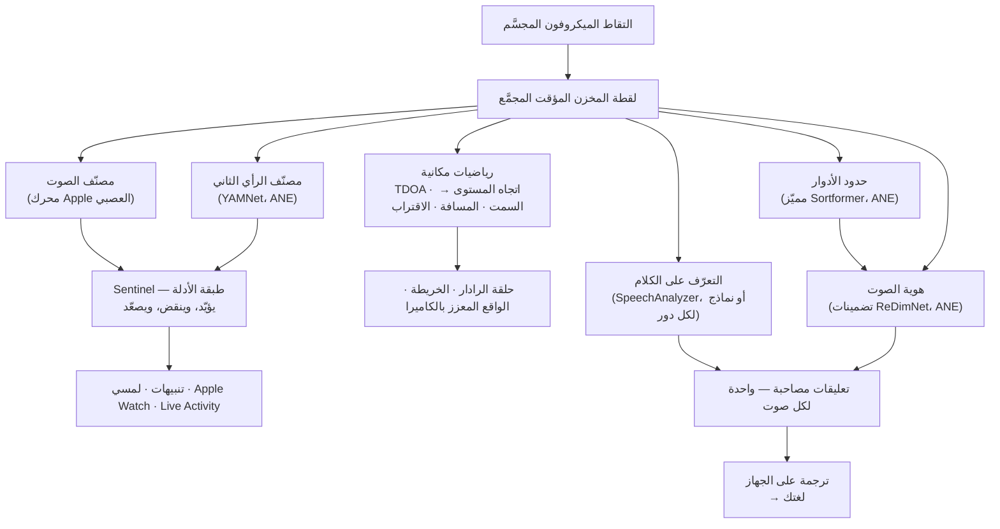
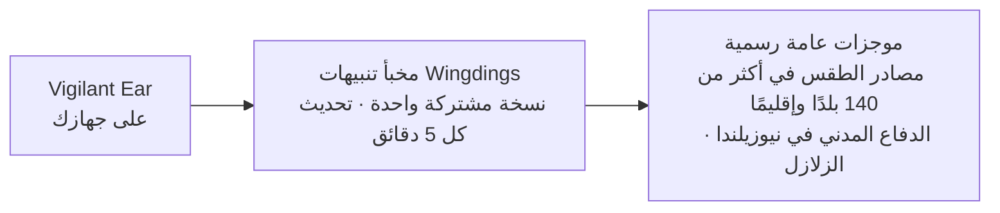

# Vigilant Ear 👂🛡️

📲 [تنزيل من App Store](https://apps.apple.com/app/id6761978703)

*ساري المفعول اعتبارًا من الإصدار 1.1.14 · أكتوبر 2026.*

## رادار صوتي لمن لا يستطيعون السمع.

تطبيق بُني خصيصًا لمجتمع الصم وضعاف السمع وCODA. معظم تطبيقات التعرّف على الصوت تخبرك *ما* هو الصوت. **أما Vigilant Ear فيخبرك أين هو، ومن يُصدره، وماذا يقولون** — فيحوّل iPhone إلى جهاز يصف الصوت من حولك لحظة وقوعه.

اتجاه صفارة إنذار ومسافتها. طَرقة خلفك. أشخاص المحادثة، يُرسمون أصواتًا مكتوبة منفصلة — كل واحد بتعليق مصاحب وموضع اتجاهي. وإذا تحدّث أحدهم بلغة لا تقرأها، أمكن أن تصلك كلماته **مترجمة إلى لغتك.** وتصل التنبيهات إلى **شاشة القفل وDynamic Island وApple Watch**، فتكفي نظرة.

كل ما يهم يعمل على الجهاز. لا يُسجَّل الصوت ولا يُرفع للتعرّف عليه. ولا شيء يتوقف على أن تسمع أذن بشرية شيئًا.

- 🧭 **الاتجاه، لا مجرد الكشف.** *ماذا، وأين، ومن،* و*ماذا قيل* — لا مجرد «أن صوتًا حدث».
- 📣 **نداء الاسم.** أدرج اسمك، أو اسم طفل، أو اسم شريك — «طلب Marie جاهز» ينبّه الهاتف والساعة، ويشير إلى الجهة.
- 🔒 **خصوصية بالتصميم.** يعمل التصنيف والتعليقات المصاحبة والترجمة على iPhone الخاص بك. التعليقات المصاحبة حيّة وعابرة؛ ولا تُحفظ أرشيفًا للنص.
- ⌚ **على معصمك وشاشة القفل.** رفيق الاتجاه على Apple Watch + Live Activity يُبقيان آخر تنبيه والجهة التي جاء منها على بعد نظرة واحدة.
- 🛰️ **هواتف أكثر، سمع واحد مشترك.** تربط شبكة Constellation أجهزة iPhone ذات Ultra-Wideband لتدمج ما يسمعه كل منها في صورة اتجاهية أدق.
- 👁️ **صُمم للصم / ضعاف السمع / CODA.** استجابات لمسية مميزة، ومرئيات عالية التباين، وإشارات لا تعتمد على اللون، وأهداف لمس كبيرة، و«تقليل الحركة» في كل أرجائه.

---

## لمن هو

- **مستخدمو الصم وضعاف السمع وCODA** الذين يريدون وعيًا ظرفيًا بالصوت — Home Watch (طَرقة، إنذار، رضيع، هاتف) وStreet Watch (صفارة إنذار، اقتراب) يمكنك تركهما يعملان والوثوق بهما.
- أي شخص يحتاج إلى **تعليقات مصاحبة مباشرة مع الاتجاه وفصل المتحدثين**، أو إلى **ترجمة على الجهاز** لمن يجلسون بالقرب.
- مستخدمو تسهيلات الاستخدام والبحث الصوتي المهتمون بتحديد موضع الصوت على الجهاز.

> Vigilant Ear أداة **مساعدة** لإمكانية الوصول، وليس جهاز سلامة حياة معتمدًا.

---

## ماذا يفعل

### 🧭 يرى الصوت — الاتجاه والمسافة
باستخدام ميكروفونَي iPhone، يقيس Vigilant Ear **زاوية الصوت وما إذا كان أمامك أم خلفك**، ويثبّت تلك القراءة في حدود درجة واحدة تقريبًا، ويضعها علامة حيّة على حلقة رادار يتجه أعلاها نحو ما تواجهه، وعلى الخريطة. ميكروفونان على خط واحد لا يستطيعان وحدهما التمييز بين اليسار واليمين. صوت على 50° يمينك وآخر على 50° يسارك يصلان بفارق زمني ضئيل واحد. يرسم التطبيق القراءة ومعها **علامة شبحية أبهت على الجانب الآخر**، وإدارة المعصم أو هاتف ثانٍ يحسم الأمر. وتُقدَّر المسافة من شدة الصوت وفق منحنى مُعايَر في الشارع، وتُعرض بوصفها التقدير الذي هي عليه، مع نطاق مرجَّح، بوحدات البلد الذي أنت فيه لا باللغة التي تقرأ بها التطبيق. على هاتف أميركي تُقرأ *≈ 50 ft*. وإذا تحركت، حافظت العلامات على مواضعها في العالم الحقيقي. هذا هو الجوهر: وعي مكاني بعالم لا تستطيع سماعه. (الأرقام أدناه.)

### 🚨 يتعرّف على الأصوات المهمة — وينبّهك
يتعرّف مصنّف على الجهاز على مئات الأصوات اليومية، ويراقب الفئات الحرجة — **صفارات الإنذار، والإنذارات — ومنها فئة مخصصة لإنذار السيارة — وأجراس الأبواب/الطرقات، وبكاء الرضيع، وشخص قريب، والطقس القاسي.** حين ينطلق أحدها، يصلك تنبيه واضح على الشاشة، و**إشعار فوري** اختياري، و**استجابة لمسية** مميزة — حتى والتطبيق في الخلفية أو الهاتف نائم. الفئات الحرجة جاهزة افتراضيًا، فتشغيل الإشعارات لا يعني «كل شيء متوقف». وإذا أوقفت كل فئات التنبيه، دخل المحرك في سبات كامل ما دام في الخلفية لتوفير البطارية. وتقابل طبقة **Sentinel** التنبيهات بأدلة مستقلة — الاتجاه، والحركة، والموجزات العامة — فما ينطلق يكون مؤيَّدًا، لا تخمينًا وحيدًا من المصنّف. ويعمل ذلك في الاتجاهين: لحظة على هيئة صفارة إنذار داخل أغنية تُحجَز، أما صفارة إنذار حقيقية تتكرر عبر موسيقاك فتخترق وتنبّه.

تأتي تحذيرات الطقس القاسي من **مصادر حكومية رسمية في أكثر من 140 بلدًا وإقليمًا**، ويُضاف المزيد باستمرار — مجانًا لجميع المستخدمين. وتُدرَج تنبيهات طوارئ الدفاع المدني أيضًا، ولها مفتاحها الخاص **تنبيهات الطوارئ**. وتُضيَّق الموجزات إلى ما يغطي مكانك. وحيث تتوفر، يقرأ التطبيق أيضًا **النشرات المسبقة** لوكالات الأرصاد الوطنية — الإشعارات باللغة العادية التي تُصدر قبل أيام من تيفون أو مطر غزير، لا التحذيرات التي لا تُصدر إلا بعد وصول الخطر — إضافة إلى نشرات الهطول المفاجئ والانهيارات الأرضية. وتُعرض الإشعارات المسبقة بهدوء، من دون الصوت والاهتزاز المحجوزين لتحذير حقيقي.

### 🌧️ رادار الطقس على الخريطة
يظهر المطر والثلج على الخريطة منذ لحظة فتح التطبيق — من الرادارات الوطنية للولايات المتحدة وكندا واليابان وإيطاليا وجزء كبير من أوروبا، ومن تقدير للمطر بالأقمار الاصطناعية عبر معظم بقية العالم. المس الخريطة فتُعاد الساعة الأخيرة ثلاث مرات، لترى إلى أين تتحرك العاصفة؛ ومقياس في الأسفل يقرأ من خفيف إلى كثيف. وإن لم تُرِده في جلسة، فاضغط زر الطقس لإيقافه. ويصل الرادار بالطريقة نفسها التي تصل بها التحذيرات — عبر خادمنا، فلا يتصل هاتفك أبدًا بخوادم حكومية. وتُظهر أسهم رمادية فاتحة أيضًا الاتجاه الذي تهب فيه الرياح، في أي مكان في العالم، من التوقّع العالمي لـ NOAA للساعة الحالية.

### 🛟 بمن تتصل — طوق النجاة
طوق نجاة بجانب بوصلة الخريطة يفتح قائمة قصيرة للبلد الذي تقف فيه:

- رقم الطوارئ، مع زرَي الاتصال والرسائل، وملاحظة عن النص في الوقت الفعلي حيث قد لا ينجح إرسال رسالة إلى رقم طوارئ
- وكالة الأرصاد الوطنية
- منظمة للصم، حيث تكون لإحداها صفحة مستقرة
- دعم Vigilant Ear

شارك Vigilant Ear من لوحة المساعدة (طوق النجاة): رمز يمكن لمن بجانبك مسحه للحصول على التطبيق، ورابط إلى App Store، وحسابنا على Instagram.

### ⌚ Apple Watch + Live Activity — بنظرة تعرف
- **رفيق Apple Watch** — يشير اتجاه التنبيه على معصمك، فتخبرك نظرة أين تنظر. واجهة Apple Watch أُعيد تصميمها بأيقونة أذن التطبيق، وتخطيط لوحة التهديد، والضغط مرتين لصرف التنبيه. ويمكن للتنبيهات أن تُظهر سهم الاتجاه حتى حين لا يكون تطبيق Apple Watch مفتوحًا.
- **نداء الاسم على Apple Watch.** عندما ينادي أحدٌ اسمك، تنقر ساعتك على معصمك ثلاث مرات وتعرض سهمًا نحو مصدر الصوت. وعندما لا يستطيع جهاز iPhone التمييز بين اليسار واليمين، تعرض مروحةٌ الجهتين معًا. تعمل الميزة وجهاز iPhone مقفل، ما دام تطبيق Vigilant Ear مفتوحًا على الساعة. يتطلب نداء الاسم تشغيل Speaker Mode.
- **اشعر بالإيقاع على Apple Watch.** عند تشغيل الموسيقى وفتح تطبيق Vigilant Ear على ساعتك، تنبض ضربات الطبل الجهير وطبل السنير على شكل حلقات، وتُميَّز الضربة الأولى من كل مازورة، وتنقر الساعة معصمك برفق عند كل ضربة أولى. انقر نقرًا مزدوجًا في أي مكان على شاشة الساعة لإيقاف النقر حتى تتوقف الموسيقى. التنبيهات تأتي أولًا دائمًا. وعندما يتعرّف Music ID على الأغنية، يظهر اسمها على ساعتك أيضًا.
- **Live Activity** — يبقى Vigilant Ear على **شاشة القفل**، وفي **Dynamic Island**، وفي **Watch Smart Stack**، فيكون آخر تنبيه وسمته على بعد نظرة واحدة دائمًا.
- **تنبيهات الشريك على معصمك** — حين يرفع هاتف شريك Constellation مرتبط تنبيهًا، يمكن أن يصل إلى Apple Watch أيضًا، ومعه الاتجاه. ويستهلك الرفيق قليلًا من بطارية Apple Watch على مدار اليوم.

### 💬 Speaker Mode — تعليقات مصاحبة مباشرة واتجاهية *(مجانًا)*
شغّل **Speaker Mode** فيفرّغ Vigilant Ear كلام من هم بقربك في **كتل تعليقات مصاحبة، واحدة لكل صوت.**

يُبقي فصل المتحدثين على الجهاز الأصوات متمايزة — *من* يقول *ماذا* — مع إشارة اتجاهية على الحلقة الداخلية. يُبرَز المتحدث المباشر؛ وينزلق النص الأقدم مبتعدًا كلما لزم مزيد من المساحة.

**كل متحدث بلغته.** على أجهزة iPhone ذات ذاكرة لا تقل عن 8 GB، يتيح تنزيل لمرة واحدة لنموذج التعليقات المصاحبة (نحو 1 GB — عبر Wi-Fi، أو عبر الشبكة الخلوية بعد السؤال) أن يضع التطبيق تعليقًا لكل دور باللغة المنطوقة فعلًا، فتصبح غرفة تنتقل بين الإنجليزية والإسبانية والفرنسية والعربية مفهومة. وفي اختباراتنا انخفضت أخطاء الكلمات في محادثة بأربع لغات من نحو 80% إلى 14%. ومنذ الإصدار 1.1.12 يرتكب نموذج كلام محسَّن أخطاء أقل بكثير في الضوضاء — في بار صاخب على iPhone 17، انتقلت التعليقات المصاحبة الألمانية من 45% من الكلمات خاطئة إلى 20% — ويستبدل النموذج القديم من تلقاء نفسه عبر Wi-Fi. ومن دون التنزيل — ولقراء الصينية واليابانية والكورية، حيث يقرأ متعرّف Apple قراءة أفضل — تستخدم التعليقات المصاحبة تعرّف Apple على الكلام على الجهاز كما من قبل.

شيئان لن تفعلهما معظم تطبيقات التعليقات المصاحبة.

**صدق في الثقة.** علامة جودة خفيفة لكل صف، وخطوط منقّطة تحت الكلمات المشكوك فيها، تخبرك متى تثق بسطر ومتى تعيد التحقق.

**تصحيح ذاتي.** فور استقرار الجملة، يعيد التطبيق قراءة الصوت بسياق كامل، ويمكنه أن يسترجع كلمة فاتت أو أُسيء سماعها خلال ثانيتين تقريبًا، ثم يتجمد النص.

**نداء الاسم** (الإعدادات، متوقف إلى أن تشغّله) يراقب تلك التعليقات المصاحبة بحثًا عن أسماء تدرجها — اسمك، أو اسم طفل، أو اسم شريك. حين يقول أحدهم «طلب Marie جاهز»، يصلك اهتزاز لمسي مميز وتنبيه على Apple Watch مع الاتجاه، لا فقاعة تعليق أخرى. وتبقى الكلمات ظاهرة في Speaker Mode بوصفها كلامًا؛ هذه هي اللمسة التي تعني أنهم كانوا يتحدثون *إليك*.

**يمكن إخفاء اللغة القوية** (الإعدادات → التعليقات المصاحبة). وإلا وصل السباب نصًا صريحًا بلا ما يلطّفه، ولا تكون للقارئ فرصة أن يصرف نظره أولًا؛ شغّل هذا فتُستبدل تلك الكلمات برموز، وتُقرأ الجملة من دون الكلمة. متعرّف الكلام في جهازك نفسه هو الذي يقرر ما يُحتسب — لا قائمة كلمات من عندنا — فيتبع اللغة الجاري تفريغها. وعلى حساب مُعلَن أنه دون 18 يبقى مُشغَّلًا دائمًا ويُظهر قفلًا. وينطبق على الكلام الذي يفرّغه *هذا* الجهاز؛ أما النص المرحَّل من هاتف مقترن فقد فُرّغ هناك ويصل نصًا مكتملًا.

**الكلمة التي شدّد عليها المتحدث تُعلَّم بالخط العريض.** تُقالان بالإنجليزية بصوت عالٍ، و"I didn't say THAT" و"I didn't say that" جملتان مختلفتان، والنص المتطابق يفقد الفرق كليًا. يراقب التطبيق الكلمة الواحدة التي رفع المتحدث طبقة صوته عندها ويجعلها بالخط العريض — كلمة واحدة على الأكثر في السطر، ولا شيء البتة حين لا يكون متيقنًا، لأن تعليم الكلمة الخطأ يزعم أن الشخص قال شيئًا لم يقله. وهو متوقف في الصينية واليابانية، حيث تخبرك الطبقة *أي كلمة هي* لا مدى شدة دفعها.

التعليقات المصاحبة مجانية؛ والترجمة التلقائية هي طبقة Power Pack+ الاختيارية. ويمكن أيضًا **نطق التعليقات المصاحبة بصوت عالٍ إلى جهاز Bluetooth، بما في ذلك سماعة أذن طبية** — مجانًا، في الإعدادات. **نغمات الاتجاه** (مجانًا أيضًا، في الإعدادات → التعليقات المصاحبة) تضيف إشارة صوتية اختيارية في الأذن التي تختارها، تدل على موضع المتحدث — مفيدة مع سماعة أذن طبية أو مع سمع من جانب واحد، ومتاحة لأي شخص.

### 🌐 ترجمة تلقائية — لغتك، مباشرة *(Power Pack+)*
مع تشغيل Speaker Mode، حين يتحدث شخص قريب لغة أخرى، يستطيع Vigilant Ear اكتشافها وعرض تعليقه المصاحب **بلغتك**، مع إظهار لغة المصدر على كتلته. والسلسلة — سماع → فصل المتحدثين → تفريغ → ترجمة → عرض — تعمل **على الجهاز**؛ ولحظة الشبكة الوحيدة هي تنزيل حزمة لغة لمرة واحدة من Apple، وحين يكون ذلك التنزيل هو ما تنتظره يقول التطبيق ذلك بدل أن يتركك أمام نص غير مترجم. لا يلزم أن تعرف اللغة الأخرى أو تختارها أولًا. وتُترجم الجملة المكتملة فور انتهائها، من دون انتظار أن يتوقف المتحدث، وتصل الترجمات في جزء من الوقت.

هذا أقرب ما هو متاح إلى **المترجم الشامل في الخيال العلمي** — جهاز يفهم ببساطة. يكتشف Vigilant Ear اللغة من تلقاء نفسه، ويتابع كل متحدث في الغرفة، ويضع لهم جميعًا تعليقات مصاحبة بلغتك — بلا سمّاعات أذن، وبلا إعداد، وعلى جهازك.

### 🎵 الوعي بالموسيقى والبث *(Power Pack+)*
يتعرّف **ShazamKit** على الموسيقى التي تُشغَّل من حولك، ويكتشف تغيّر الأغنية تلقائيًا فيبقى عنوانها محدَّثًا.

### 🎛️ Acoustic Scope — انظر إلى الصوت كما ينظر المهندس
عرض احترافي مباشر للصوت من حولك: الطيف، ومخطط الطيف، ونطاقات RTA بعرض ⅓ أوكتاف، والكروما، والجزئيات التوافقية — **مجانًا للجميع**. **Partials يقرأ الموسيقى:** تُسمّى كل نغمة بنوتتها، وإلى جانبها سلسلتها التوافقية، وتُسمّى الأصوات الأعلى مثل أجهزة إنذار الدخان بطبقتها الحقيقية، ويمكنك تعيين نوتة مستهدفة تُرسم خطًا تغنّي بموازاته أو تضبط الآلة عليه. وترك مخطط الطيف مفتوحًا لا يكلّف شيئًا يُذكر، مهما طالت مشاهدتك. أما أدوات التقاط الأصوات لتدريب حزم الصوت المخصصة الخاصة بك فهي جزء من Power Pack+.

### 📦 حزم الصوت المخصصة — علّمه عالمك *(Power Pack+)*
يمكنك أن تعلّم Vigilant Ear الأصوات التي تهمّك — طيورًا محلية، أو رنين باب مبنى، أو همهمة مولّد غير طبيعية، أو نوع طائرة لحظة إقلاعها. تتراص هذه الحزم المضافة فوق الكشف المدمج، فلا تزاحم الأصوات الجديدة صفارات الإنذار والإنذارات أبدًا. ودليل خطوة بخطوة مدمج في التطبيق.

### 🛰️ Constellation — أجهزة iPhone كثيرة، سمع واحد مشترك *(Power Pack+)*
مع جهازي iPhone أو أكثر يدعمان Ultra-Wideband (معظمها منذ iPhone 11)، تقرن شبكة **Constellation** بينها حتى يستشعر كل منها موضع الآخر، وتدمج ما يسمعه كل جهاز في صورة واحدة أدق لمصدر الصوت — مصفوفة استماع موزَّعة سلبية. وتُدمج التعليقات المصاحبة أيضًا: يفرّغ كل هاتف ما يسمعه ميكروفونه، وتُحاذى الكلمات بين الهواتف، فيُسهم الأقرب إلى المتحدث بما سمعه — والكلمات التي لم يلتقطها إلا هاتف واحد تُحفظ ولا تُفقَد.

تتصل الهواتف **بعضها ببعض مباشرة** — بلا موجّه، وبلا شبكة Wi-Fi مشتركة، وبلا إنترنت؛ يكفي أن يكون Wi-Fi في وضع التشغيل. وتستخدم رابط الندّ للندّ نفسه الذي يستخدمه AirDrop، ولا ينضم إلا الهواتف ذات العتاد المناسب. والرابط بين الهواتف مشفَّر دائمًا؛ والهواتف التي تعمل بـ Vigilant Ear 1.1.6 أو أقدم تحتاج إلى تحديث التطبيق لتشارك في الشبكة.

**رسائل الشريك** — أرسل نصًا سريعًا إلى هاتف شريك في الشبكة؛ يصل إلى موجز تعليقه المصاحب ويمكن أن يصل مترجمًا إلى لغته، على الجهاز. والمراسلة واعية بالسن: مبنية على نطاق العمر المُعلَن من Apple، ويبقى التراسل بين بالغ وقاصر متوقفًا ما لم يسمِّ كل منهما الآخر عمدًا. التنبيهات والتعليقات المصاحبة لا تُقيَّد أبدًا — القيد على التراسل بين شخص وشخص فقط.

### 🔗 Remote Link — الوصول إلى من ليس معك *(Power Pack+ للبدء)*
ما تفعله المكالمة الهاتفية عادةً، لكن بالفيديو والنص بدلًا منها. ترسل رمز دعوة؛ وينضم الشخص الآخر من داخل Vigilant Ear **من دون أن يملك Power Pack+**. وبخلاف Constellation لا يُشترط التقارب — ويمكن لكما أن تكونا في أي مكان.

**لا يُستخدم أي صوت في أي مرحلة.** فيديو ونص فقط، فلا شيء في الرابط يعتمد على السمع عند أي من الطرفين — وهو يمنحك طريقة للتخاطب بالإشارة مع شخص عبر التطبيق. والتطبيق نفسه لا يفهم لغة الإشارة؛ إنه ينقل الفيديو، وأنتما تتوليان الباقي. ويكون الاتصال مباشرًا بين الهاتفين حيثما تسمح الشبكة بذلك، ويُظهر لك التطبيق بوضوح أهو **مباشر** أم **مرحَّل**، فتعرف دائمًا إن كان الفيديو يمر عبر مُرحِّل.

**التعليقات المصاحبة تنتقل أيضًا.** ما يفرّغه كل هاتف يظهر على الآخر، مترجمًا إلى لغة القارئ حين يلزم. ويمكن لأي منكما إيقاف الرابط مؤقتًا — الفيديو والتعليقات المصاحبة — ثم استئنافه، وإنهاء الاتصال من الشاشة الرئيسية.

### 📷 الواقع المعزز بالكاميرا — «انظر الصوت»
افتح الواقع المعزز بالكاميرا من مروحة الإجراءات، وثبّت الأصوات المكتشفة عند سمتها الحقيقي في عرض الكاميرا المباشر. تتجمع العلامات حسب المتحدث أو حسب فئة الصوت والاتجاه حتى يبقى العرض مقروءًا، وتتلاشى ما دام الصوت هادئًا.

### 🗺️ الخرائط والطرق وتوقّع المسار
تُسقَط سمتات الصوت على إحداثيات GPS حقيقية على الخريطة. ويمكن **مطابقة أصوات المركبات مع الشوارع القريبة** وتوقّع مساراتها، فتُقرأ شاحنة عابرة على أنها تتحرك *على طول الطريق* لا عبر المباني. (جرّب عرض شاحنة الإطفاء في Feature Playground.)

### 🪄 Feature Playground — أثبته من دون آذان
**Feature Playground** متاح للجميع: عيّنات تنبيهات Home وStreet (طَرقة، إنذار، رضيع، صفارة إنذار، طقس)، وعروض لهواتف متعددة وللمحادثة. ولهذه العروض علامة مائية واضحة حتى لا يتظاهر التمرين بأنه حدث مباشر. وإغلاق اللوحة يزيل العروض إزالة نظيفة (لا تزوير GPS عالق، ولا أعلام متبقية).

### ♿ تسهيلات الاستخدام أولًا
صُمم للصم / ضعاف السمع / CODA ولذوي عمى الألوان:

- إشارات **مستقلة عن اللون**
- أهداف لمس **≥44 pt**
- احترام **تقليل الحركة**
- **تخطيطات من اليمين إلى اليسار** لقرّاء العربية
- تنبيهات متعددة الوسائط (لمسي + مرئي + Apple Watch)
- شاشة تحقق عند بدء التشغيل تُظهر حالة الإذن بأخضر / رمادي / أحمر واضح، وبالبرتقالي المحروق لـ«غير مسموح»، بما في ذلك منح الإشعارات الذي يعمل مفتاح التنبيه الرئيسي

---

## المجاني وPower Pack+

جوهر السلامة **مجاني، وإلى الأبد**:

- **Home Watch وStreet Watch** — تنبيهات صوت محلية (إنذارات، وصفارات إنذار، وطرقات/أجراس أبواب، ورضيع، وشخص قريب) مع التوصيل على الشاشة، واللمسي، والإشعار الفوري الاختياري.
- **تعليقات مصاحبة مباشرة** — Speaker Mode، على الجهاز، واتجاهية حيث يسمح العتاد، مع علامات ثقة صادقة، وتصحيح ذاتي خلال نحو ثانيتين، وإخراج منطوق اختياري إلى جهاز Bluetooth (بما في ذلك سماعة أذن طبية)، ونغمات الاتجاه.
- **نداء الاسم** — أسماء اختيارية تكتبها (اسمك، والأطفال، والشريك). المطابقة تنبيه على Apple Watch/الهاتف مع السمت، لا تعليق مصاحب ثانٍ.
- **Standing Watch** — حالة الغرفة نفسها، يعمل دائمًا بلا شيء تضبطه: مصباح سماوي ثابت ما دامت الغرفة محافظة على نمطها، وكهرماني حين يتغير شيء — صوت جديد، أو هدوء مفاجئ، أو شيء يقترب. وحين يبدأ التطبيق، يخبرك كم من الوقت لم يكن يستمع فيه إلى التنبيهات.
- **تنبيهات الطقس القاسي** — تحذيرات رسمية لمنطقتك من مصادر حكومية في أكثر من 140 بلدًا وإقليمًا، ويُضاف المزيد باستمرار.
- **رادار الطقس** — المطر والثلج على الخريطة، مع إعادة الساعة الأخيرة، والاتجاه الذي تهب فيه الرياح.
- **طوق النجاة** — بمن تتصل في البلد الذي أنت فيه.
- **تنبيهات الزلازل (في أنحاء العالم)** — تشعر باهتزاز وترى على خريطتك المنطقة التي شعرت به حين يُبلَّغ عن زلزال قريب. تأكيد من موجز الزلازل الرسمي — لا إنذار مبكر: إذا شعرت بهزة، فهذا يخبرك ماذا كانت. يُفحص الموجز كل خمس دقائق، وفي الخلفية أيضًا، ويمكن لاستشعار الهدير العميق (تحت الصوتي) على الجهاز أن يجهّز فحصًا إضافيًا لحظة تحرّك الأرض.
- **Feature Playground** — تنبيهات للتمرين ومعاينات للميزات، مع علامة مائية PREVIEW واضحة.
- **رفيق Apple Watch وLive Activity** — اتجاه يُدرَك بنظرة، وآخر تنبيه.
- **Acoustic Scope** — تصوير مباشر للصوت بمستوى احترافي، مجانًا للجميع. (أدوات الالتقاط للتدريب هي Power Pack+.)
- **مصفوفة الأبحاث** *(مُشغَّلة إلى أن توقفها)* — ما دامت مُشغَّلة، يُشارَك الوقت، وموقع تقريبي (نحو 1 كم)، ومعدل تكرار الأحداث الشبيهة بالزلزال — بلا صوت، وبلا معرّف — للمساعدة في رسم خرائط الزلازل وغيرها من الأحداث منخفضة التردد. سؤال على الخريطة يُطرح مرة واحدة. وتنتظر التقارير إلى أن يكون ذلك السؤال قد عُرض على الشاشة.

**Power Pack+** فتح لمرة واحدة (**ليس اشتراكًا**) مع **تجربة مجانية لـ 90 يومًا**. ويضيف القدرات الخارقة:

- **ترجمة تلقائية** — ترجمة على الجهاز للكلام القريب إلى لغتك.
- **Constellation** — سمع مشترك بين عدة أجهزة iPhone عبر Ultra-Wideband، مع رسائل الشريك.
- **Music ID** — التعرّف على الأغاني بـ ShazamKit.
- **حزم الصوت المخصصة** — مصنّفات إضافية تدرّبها لأصواتك أنت.
- **Remote Link** — مكالمات فيديو ونص خاصة مع من ليس معك، بلا صوت في أي مرحلة. بدء واحدة يحتاج إلى Power Pack+؛ والشخص الذي تدعوه ينضم مجانًا.

مجانيًا كان أو Power Pack+، **يبقى صوتك على الجهاز للتعرّف عليه** — فالدرجة لا تغيّر إلا الميزات المفتوحة، ولا تغيّر أبدًا الوجهة التي يُرسل إليها الصوت الخام للتحليل.

---

## كيف يعمل (تحت الغطاء)

Vigilant Ear مسار **محلي أولًا، وعلى الجهاز**، مبني في طبقات: التقاط مرة واحدة، ثم يقرأ متخصصون مستقلون الصوت نفسه ويراجع كل منهم عمل الآخر. يُلتقط الصوت الخام بالتقاط عالي الأولوية، ويُنسخ إلى **قائمة حرّة لمخازن مؤقتة مجمَّعة** (بلا إرهاق تخصيص على مسار الزمن الحقيقي)، ويُوزَّع من دون إيقاف واجهة المستخدم:

لا يُوثَق بنموذج واحد وحده. تقع طبقة **Sentinel** بين الكشف والتنبيه: تؤيّد المحركات المستقلة بعضها أو تنقضه إطارًا بإطار — وحين تتراكم أدلة متكررة من الواقع ضد نقض (صفارة إنذار حقيقية تعول عبر موسيقاك)، تنتصر الأدلة وينطلق التنبيه.

وللتعليقات المصاحبة فرصة ثانية خاصة بها. تُعاد قراءة كل جملة أُنجزت بهدوء من حلقة صوت قصيرة في الذاكرة، بسياق كامل — وتصل التصحيحات خلال نحو ثانيتين، ثم يتجمد النص نهائيًا:

- **الرياضيات المكانية** — تحويلات فورييه السريعة (FFT)، وفرق زمن الوصول الموزون بالتماسك (TDOA — تُفضَّل نطاقات التردد التي يتفق عليها الميكروفونان، ثم يُحوَّل تأخر الوصول الضئيل إلى سمت)، وتتبع الاقتراب من اتجاه المستوى على مهام في الخلفية. ويُقرأ زوج الميكروفونين في اتجاه ثابت، فيعمل الاتجاه بالطريقة نفسها سواء أمسكت الهاتف قائمًا أو على جانبه.
- **الكلام** — `SpeechAnalyzer` / `SpeechTranscriber` في iOS 26 للتفريغ؛ وإطار **الترجمة** من Apple للترجمة على الجهاز. ومع تنزيل التعليقات المصاحبة الاختياري، يُقطَع كل دور بكاشف نشاط صوتي، وتُختار لغته بنموذج للغة المنطوقة، ويُفرَّغ بنماذج مفتوحة للتعرّف على الكلام — واحد للغات الأوروبية، وواحد لسائرها — كلها على الجهاز. وهوية الصوت قائمة على الأدلة: لا يُؤكَّد الصوت شخصًا حقيقيًا إلا من نوافذ صوت مستقلة، والمطابقة غير المتيقنة تُعرض غير منسوبة بدل تخمين الاسم الخطأ.
- **نموذجان لسؤالين** — تمييز الأصوات يحتاج إلى *متى تغيّر المتحدث* و*من ذلك المتحدث*، وليسا المسألة نفسها. يعلّم مميّز **Sortformer** التدفقي حدود الأدوار؛ وتضمينات **ReDimNet** تقرر صوت من داخل كل دور. والقطع على الحد أهم مما يبدو: نافذة تمتد على شخصين تحتوي كليهما، ولا يستطيع أي نموذج تضمين أن يتراجع عن ذلك بعدئذ. وتحت الاثنين أرضية نشاط صوتي — إذا سكت المميّز في غرفة صعبة بدل أن يخمن، ظلت الأدوار تُقطَع، فيهبط أداء التطبيق بدل أن يمزج متحدثين في واحد.
- **حقيقة الموسيقى** — يملك كاشف **بصمة الأغنية** بالكرومَا قرار «هل تُشغَّل موسيقى فعلًا؟»، لأن المصنّفات العامة تشتهر بتسمية الغرف الصامتة وصفارات الإنذار «موسيقى». ولا يعمل Shazam إلا بعد أن توافق البصمة على أن شيئًا موسيقيًا موجود حقًا.
- **التزامن** — عزل Swift 6 يُبقي التقاط الميكروفون، والرياضيات الصوتية، وحلقة رسم واجهة المستخدم منفصلة بوضوح.
- **الكفاءة** — خفض معدل العينات، والتصنيف المتكيّف مع الحمل، واستخدام الشبكة المشروط بالأدلة، تُبقي الاستماع الدائم خفيفًا بما يكفي لتركه يعمل.

وتسلك تنبيهات الطقس والزلازل المسار المعاكس للصوت — لا يخرج أبدًا أي شيء عن صوتك، لكن *بيانات* التنبيه تدخل. يمر **كل** موجز رسمي — وصور الرادار والرياح — عبر مخبأ مُرحِّل صغير نشغّله، فيخدم جلب واحد للبيانات العامة كل مستخدم، ولا يتصل هاتفك أبدًا بخوادم حكومية:

---

## ما يستطيع هاتفك سماعه — بالقياس

في iPhone ميكروفونان تفصل بينهما نحو ست بوصات (15 سم)، وبارومتر، وساعة دقيقة جدًا. وهذا يكفي ليخبرك من أي جهة جاء الصوت، وكم يبعد تقريبًا، وهل يقترب منك، وهل فُتح باب للتو. إليك دقة كل من ذلك، وكيف تحققنا منه، ولماذا يهم إن كنت لا تستطيع سماع الصوت بنفسك. قِيس جدول الاتجاه على iPhone 17 في سبتمبر 2026. والفحص المكتبي نفسه على iPhone 16 Pro Max لم يُنتج زاوية متصلة — تلك الصورة تجذب الصوت نحو الأمام أو نحو الجانب — فصفوف الدرجات هي لجهاز 17 وحده. وتبقى المسافة تقديرًا بطبيعتها — ونقول ذلك على الشاشة. والمسافات المقيسة بالشريط في هذا القسم بالأقدام، وحدات ذلك الشريط.

**الاتجاه — في حدود درجتين.** يصل الصوت إلى الميكروفون العلوي قبل السفلي، أو بعده، ومن ذلك الفارق يستخرج التطبيق كم يبعد الصوت عن محور الهاتف وهل هو أمام أم خلف. وقناتا الهاتف ليستا ميكروفونين عاديين بل صورة مجسَّمة معالجة، وتضيف تلك الصورة نمطًا ثابتًا من عندها كلما كانت الغرفة صاخبة. يتعلّم التطبيق ذلك النمط من الهدوء بعد الإطلاق. وبعد نحو دقيقة من غرفة هادئة يُزيل النمط قبل قراءة الاتجاه؛ وحتى ذلك الحين تجري القراءة من دون ذلك التصحيح.

| ما قسناه | النتيجة |
|---|---|
| الخطأ الوسيط عبر 96 غرفة محاكاة، من مكتب هادئ إلى غرفة صلبة الجدران عند 5 dB SNR | 1.0° |
| iPhone 17 على مكتب، وضوضاء الغرفة تعمل، ومكبّر الصوت على 30° عن المحور | قرأ 61.7° من المستوى الجانبي مقابل 60° متوقعة، بتذبذب 1.6° |
| نفسه، ومكبّر الصوت مباشرة عن جانب الهاتف | قرأ 4.5° مقابل 0° متوقعة، بتذبذب 2.2° |
| نفسه، ومكبّر الصوت على 60° عن المحور | الوسيط 35.7° مقابل 30° متوقعة؛ انقسمت الجولة، مع تجمّع ثانٍ عند تأخر الاتجاه المستقيم إلى الأمام، والأرجح انعكاس عن منصة الاختبار |
| نفسه، ومكبّر الصوت أمام الهاتف مباشرة | كل قراءة عند أقصى تأخر، كما ينبغي |
| قراءات وقعت على نمط الصورة نفسه بدل الصوت | لا شيء، عند أي زاوية |

*لماذا يهم:* إن كنت لا تستطيع سماع صفارة إنذار، فإن «خلفك، مائلًا إلى جانب» يخبرك أين تنظر. والقراءة التي تثبت لا تستحق الثقة إلا بعد مقابلتها بشريط قياس، وهذه قوبلت به مرتين. أما الفحص الأول فجعل النتيجة تبدو أفضل مما كانت.

**المسافة — تُعرض بوصفها التقدير الذي هي عليه.** ميكروفون واحد لا يقيس المسافة، بل شدة الصوت فقط، وقد تبدو شاحنة صاخبة بعيدة كسيارة هادئة قريبة. يقدّر التطبيق المسافة من شدة الصوت بمنحنى مُلاءَم على شارع حقيقي، ثم يقولها كما يقولها شخص حذر. على هاتف أميركي يكون ذلك *نحو 50 ft، والأرجح بين 25 و100.*

| ما قسناه | النتيجة |
|---|---|
| كشوف سيارات حقيقية أُعيد تشغيلها عبر المعايرة | 1,131 |
| الوقوع داخل طريق الـ 100-foot الذي كانت عليه فعلًا | 73% |
| سيارات المسار البعيد | قُدِّرت 78 و87 ft حيث قال الشريط 73 و85 ft |

قِيس الطريق (تقاطع مدينة) مسارًا بمسار؛ وحين يخطئ المنحنى فإنه يخطئ نحو الجانب الأقرب. والمعايرة مقفلة باختبار آلي فلا يمكن أن تنحرف في صمت. أما الإنذارات داخل مكانك، مثل كاشف الدخان، فلا تُعطى رقم مسافة أصلًا — فهي معك في الغرفة بالفعل.

**الحركة — قادم نحوك.** للسيارات وصفارات الإنذار، ازدياد الشدة يعني عادةً الاقتراب. يراقب التطبيق سرعة ارتفاع مستوى الصوت على مدى بضع ثوانٍ: صعود متواصل بنحو 1.5 dB في الثانية (زيادة واضحة ومطّردة في الشدة) يعني الاقتراب، والهبوط المقابل يعني الابتعاد، والصوت الذي يكفّ عن التغيّر يكفّ عن أن يُسمّى أيًّا منهما بعد نحو أربع ثوانٍ. ولحظة صاخبة واحدة — نقرة بوق، أو صفقة باب — لا تستطيع إطلاق ذلك. مبني على الفيزياء وتسعة اختبارات آلية؛ ومرور مُسجَّل في الشارع هو التأكيد الميداني التالي.

**هواء الغرفة — للباب بصمة.** يستطيع البارومتر أن يلاحظ فتح باب على بعد نحو أربع عشرة قدمًا (4.3 م): ينخفض الضغط بينما يتأرجح الباب، ثم يرتد بينما يُغلق. وعلى مدى أربع عشرة ساعة من الهدوء وخمسة عشر حدث باب، صنع كل باب ذلك الشكل ذا الجزأين، ولم يصنعه شيء آخر في البيت.

| الحدث | معدل الضغط | الشكل |
|---|---|---|
| الباب الأمامي، فُتح وأُغلق، ×10 | 0.6–1.8 Pa/s | انخفاض، ثم ارتداد، بفاصل ~5 ث |
| الباب الأمامي، صُفق، ×5 | 1.1–2.5 Pa/s | الزوج نفسه، بقمة أعلى |
| تعاقب التكييف ليلًا، ×8 | 0.11–0.46 Pa/s | صعود بطيء على مدى دقائق، متطابق على الهاتفين |
| غرفة هادئة | ~0.02 Pa/s | لا شيء |
| نشاط بشري، مرور مشيًا | — | يلاحظه مستشعر الحركة ويتجاهله الهاتف |

باب لا يُحكم سدّ الغرفة كان غير مرئي — باب شبكي، في هذا الاختبار — تمامًا كما ينبغي. واليوم يمكن أن يظهر تغيّر الضغط على الخريطة هديرًا عميقًا؛ وتنبيه باب مخصص لليل هادئ مَقيس ومصمَّم، وليس هو الافتراض اليومي بعد.

**Constellation — هاتفان يحسمان الجانب.** يرسم كل هاتف على الشبكة خطًا نحو الصوت من موضعه، ولا تتقاطع الخطوط بوضوح إلا على جانب واحد. وحين تفعل، تختفي العلامة الشبحية ويستطيع التطبيق أن يقول يسارًا أو يمينًا من جديد. في المحاكاة، هاتفان **تفصل بينهما 40 مترًا** يضعان صفارة إنذار على بعد 50 مترًا في حدود نحو 2 متر.

**كيف يُصدَّق أي شيء هنا.** مرّ كل رقم بالبوابات الثلاث نفسها، بالترتيب: غرفة محاكاة جوابها معروف سلفًا؛ ثم اختبارات آلية صغيرة تعيد إنشاء الحالة بعينها التي قد تخدع التطبيق وتُشغَّل عند كل تغيير؛ ثم الهواتف الحقيقية على مكتب حقيقي بمسافات قِيست باليد. لا يُحتسب شيء دقيقًا حتى يجتاز الثالثة. ولمن لا يستطيع سماع الصوت، كلمة التطبيق هي الكلمة الوحيدة — فينبغي أن تُكتسب كما يكتسبها المختبر.

ملاحظات أعمق للمهندسين: [الفيزياء](https://vigilantear.com/en/physics/) — TDOA، والمسافة، والحركة، وConstellation، والكشف البارومتري، مع وسم كل رقم بـ MEASURED / BENCHED / MODELLED.

---

## الخصوصية

- **على الجهاز، دائمًا للمسار الأساسي.** يعمل التصنيف والرياضيات المكانية والتفريغ وفصل المتحدثين والترجمة على iPhone الخاص بك. لا يُسجَّل الصوت الخام ولا يُرفع للتعرّف عليه.
- **التعليقات المصاحبة عابرة.** تبقى التعليقات المصاحبة المباشرة في الذاكرة طوال الجلسة؛ وسجلات التنقيح المُصدَّرة لا تتضمن نص التعليقات المصاحبة.
- **لا حزم SDK للإعلان ولا للتحليلات السلوكية.** يقتصر استخدام الشبكة المحدود على الخرائط، وموجزات الطقس العامة، وصور الرادار والرياح، وقائمة المساعدة، وتنزيل نموذج التعليقات المصاحبة الاختياري، وبصمات Shazam الاختيارية، وسياق الطريق، وتقارير مصفوفة الأبحاث ما دامت تلك الميزة مُشغَّلة، ومشتريات App Store — انظر التفاصيل في سياسة الخصوصية.

التفاصيل الكاملة: [الخصوصية](/ar/privacy/) · [الشروط](/ar/terms/) · [الدعم](/ar/support/)

---

## العتاد والمنصات

- **iPhone (التجربة الكاملة).** يعمل بالوضع العمودي أو الأفقي — أمسكه كما تشاء. الميكروفونات المجسَّمة مطلوبة لتحديد الاتجاه. يُوصى بـ **iPhone 13 أو أحدث**؛ وتعليقات كل متحدث بلغته تحتاج إلى **ذاكرة بسعة 8 GB** (iPhone 15 Pro وما بعده).
- **Apple Watch.** تنبيهات الرفيق مع سهم الاتجاه؛ ويعمل مع Live Activity / Smart Stack.
- **iPad (أصلي).** تخطيط متكيّف: على الشاشة الكبيرة تحصل التعليقات المصاحبة المباشرة على لوحة شفافة بجانب الخريطة تنطوي حين لا يتحدث أحد. ميكروفونات أحادية القناة → تعليقات مصاحبة من دون اتجاه كامل.
- **Constellation** يحتاج إلى **Ultra-Wideband** — iPhone 11 أو أحدث، باستثناء طرازات SE و«e». وهو **لا** يحتاج إلى شبكة Wi-Fi: مع تشغيل Wi-Fi تكتشف الهواتف بعضها مباشرة، فيعمل Constellation بلا موجّه وبلا إنترنت ما دامت الهواتف قريبة بعضها من بعض.
- **Android (حين يتوفر).** إصدار منفصل بالرادار الأساسي والتنبيهات والتعليقات المصاحبة والطقس؛ وشبكة Constellation على iOS أولًا.

---

## التوطين

مُوطَّن بالكامل — الواجهة والتنبيهات والتعليقات المصاحبة — إلى **الإنجليزية، والإسبانية، والبرتغالية (البرازيل)، والفرنسية، والألمانية، والإيطالية، والتركية، والعربية، واليابانية، والصينية المبسطة، والصينية التقليدية، والكورية، والروسية، والهندية، والرومانية، والبولندية** (16 لغة). يتبع لغة النظام أو اختيارًا يدويًا في التطبيق. تعمل التعليقات المصاحبة الرومانية على الجهاز؛ وليس لدى Apple Translate رومانية، فتُظهر ترجمة تلقائية الأصل لتلك اللغة.

---

## الحالة وإخلاء المسؤولية

Vigilant Ear **وسيلة تجريبية لإمكانية الوصول الصوتي**، وليس مرفق سلامة حياة معتمدًا. تتفاوت دقة تحديد موضع الصوت مع المحيط، والطقس، والرياح، وعتاد الميكروفون. **حافظ دائمًا على وعيك المعتاد بما حولك** — لا تعتمده مصدرًا وحيدًا لمعلومات السلامة.

بعض القدرات (علامات الواقع المعزز بالكاميرا، وترقية استحقاق Critical Alerts حين تمنحه Apple، والتأليف المتقدم للأصوات في حزم متعددة) لا تزال تتطور؛ أما المراقبة المجانية عبر Home Watch وStreet Watch والتعليقات المصاحبة المباشرة فهي المنتج الذي يمكنك الوثوق به من اليوم الأول.

**المصادر والتراخيص:** [api.vigilantear.com/sources](https://api.vigilantear.com/sources)

---

**التواصل:** [vigilantear@wingdingssocial.com](mailto:vigilantear@wingdingssocial.com)

صُنع بـ ❤️ لمجتمع الصم وضعاف السمع وللبحث الصوتي.

    
  <strong>© 2026 Wingdings, Inc.</strong> 
  جميع الحقوق محفوظة. 
  براءات اختراع متعددة قيد التسجيل

