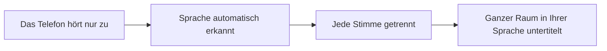
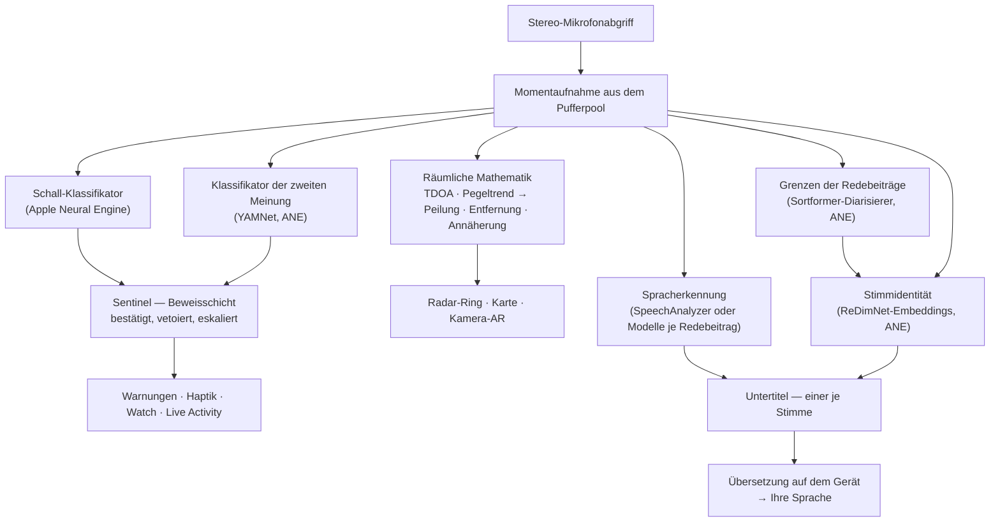
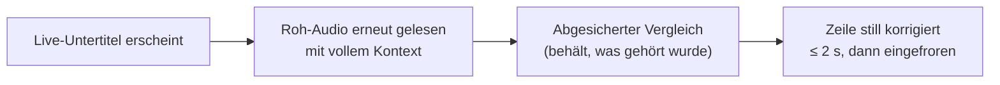
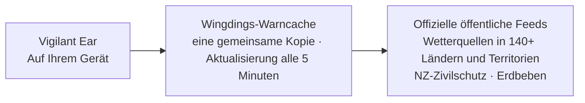

# Vigilant Ear 👂🛡️

*Gültig ab Version 1.1.13 · Oktober 2026.*

## Ein akustisches Radar für Menschen, die nicht hören können.

Eine App, eigens gebaut für die Gemeinschaft der Gehörlosen, der Schwerhörigen und der CODA. Die meisten Apps zur Geräuscherkennung sagen Ihnen, *was* ein Geräusch ist. **Vigilant Ear sagt Ihnen, wo es ist, wer es erzeugt und was gesagt wird** — und macht aus einem iPhone ein Gerät, das den Schall um Sie herum beschreibt, während er geschieht.

Richtung und Entfernung einer Sirene. Ein Klopfen hinter Ihnen. Die Menschen in einem Gespräch, dargestellt als getrennte, transkribierte Stimmen — jede untertitelt und nach der Richtung gesetzt. Spricht jemand eine Sprache, die Sie nicht lesen, können ihre Worte **in Ihre Sprache übersetzt** ankommen. Warnungen erreichen Ihren **Sperrbildschirm, die Dynamic Island und die Apple Watch**, sodass ein Blick genügt.

Alles, worauf es ankommt, läuft auf dem Gerät. Audio wird für die Erkennung weder aufgezeichnet noch hochgeladen. Nichts setzt voraus, dass ein menschliches Ohr irgendetwas hört.

- 🧭 **Richtung, nicht nur Erkennung.** *Was, wo, wer* und *was gesagt wurde* — nicht bloß „ein Geräusch ist passiert“.
- 📣 **Name gerufen.** Tragen Sie Ihren Namen ein, den eines Kindes oder den einer Partnerin oder eines Partners — „Bestellung für Marie ist fertig“ alarmiert das Telefon und die Uhr und zeigt die Richtung.
- 🔒 **Privat von Grund auf.** Klassifizierung, Untertitelung und Übersetzung laufen auf Ihrem iPhone. Untertitel sind live und flüchtig; sie werden nicht als Transkriptarchiv gespeichert.
- ⌚ **Am Handgelenk und auf dem Sperrbildschirm.** Der Richtungsbegleiter der Apple Watch und die Live Activity halten die letzte Warnung und die Richtung, aus der sie kam, nur einen Blick entfernt.
- 🛰️ **Mehr Telefone, ein gemeinsames Gehör.** Unser Constellation-Mesh verbindet iPhones mit Ultra-Wideband und fügt zusammen, was jedes hört, zu einem schärferen Richtungsbild.
- 👁️ **Gemacht für Gehörlose / Schwerhörige / CODA.** Unterschiedliche Haptik, kontrastreiche Darstellung, farbunabhängige Hinweise, große Tippflächen und durchgängig die Einstellung Bewegung reduzieren.

---

## Für wen es ist

- **Gehörlose, Schwerhörige und CODA**, die situatives Bewusstsein für Schall wollen — Home Watch (Klopfen, Alarm, Baby, Telefon) und Street Watch (Sirene, Annäherung), die Sie eingeschaltet lassen und denen Sie vertrauen können.
- Alle, die **Live-Untertitel mit Richtung und getrennten Sprechenden** brauchen oder eine **Übersetzung auf dem Gerät** von Menschen, die in der Nähe sitzen.
- Menschen aus der Barrierefreiheit und der Akustikforschung, die sich für die Schallortung auf dem Gerät interessieren.

> Vigilant Ear ist eine **Hilfe** zur Barrierefreiheit, kein zertifiziertes Gerät für die Lebenssicherheit.

---

## Was es tut

### 🧭 Es sieht den Schall — Richtung und Entfernung
Mit den beiden Mikrofonen des iPhone misst Vigilant Ear den **Winkel eines Geräuschs und ob es vor oder hinter Ihnen liegt**, hält diese Messung bis auf etwa ein Grad stabil und setzt sie als Live-Markierung auf einen Radar-Ring mit der Blickrichtung nach oben und auf die Karte. Zwei Mikrofone auf einer Linie können links und rechts von allein nicht unterscheiden. Ein Geräusch 50° zu Ihrer Rechten und eines 50° zu Ihrer Linken kommen mit demselben winzigen Zeitabstand an. Die App zeichnet die Messung plus ein **schwächeres Geisterziel auf der anderen Seite**, und eine Drehung des Handgelenks oder ein zweites Telefon entscheidet es. Die Entfernung wird aus der Lautstärke anhand einer auf der Straße kalibrierten Kurve geschätzt und als das gezeigt, was sie ist, mit einem wahrscheinlichen Bereich, in den Einheiten des Landes, in dem Sie sind, und nicht der Sprache, in der Sie die App lesen. Auf einem US-Telefon steht dort *≈ 50 ft*. Bewegen Sie sich, und die Markierungen behalten ihren Ort in der wirklichen Welt. Das ist der Kern: räumliches Bewusstsein für eine Welt, die Sie nicht hören können. (Zahlen unten.)

### 🚨 Es erkennt wichtige Geräusche — und warnt Sie
Ein Klassifikator auf dem Gerät erkennt Hunderte alltäglicher Geräusche und beobachtet die kritischen Kategorien — **Sirenen, Alarme — einschließlich einer eigenen Klasse für Autoalarme —, Türklingeln/Klopfen, Babyweinen, eine Person in der Nähe und Unwetter.** Wenn eine davon auslöst, erhalten Sie eine klare Warnung auf dem Bildschirm, eine optionale **Push-Mitteilung** und eine eigene **Haptik** — auch wenn die App im Hintergrund ist oder das Telefon schläft. Kritische Kategorien stehen von Anfang an bereit, sodass das Einschalten der Mitteilungen nicht „alles aus“ bedeutet. Schalten Sie alle Warnkategorien aus, geht die Engine im Hintergrund vollständig in den Ruhezustand, um Akku zu sparen. Eine Schicht **Sentinel** prüft Warnungen gegen unabhängige Belege — Richtung, Bewegung und öffentliche Feeds —, sodass das, was auslöst, belegt ist und nicht eine einzelne Vermutung des Klassifikators. Es wirkt in beide Richtungen: Ein Moment in einem Lied, der wie eine Sirene geformt ist, wird zurückgehalten, aber eine echte Sirene, die sich durch Ihre Musik hindurch wiederholt, bricht durch und warnt.

Unwetterwarnungen kommen aus **offiziellen staatlichen Quellen in mehr als 140 Ländern und Territorien**, und oft kommen weitere hinzu — kostenlos für alle. Auch Notfallmeldungen des Zivilschutzes sind dabei, mit einem eigenen Schalter **Notfallwarnungen**. Die Feeds werden auf diejenigen eingegrenzt, die dort gelten, wo Sie sind. Wo es sie gibt, liest die App auch die **Vorabbulletins** der nationalen Wetterdienste — die Hinweise in einfacher Sprache, die Tage vor einem Taifun oder starkem Regen herausgegeben werden, nicht nur die Warnungen, die erst erscheinen, wenn die Gefahr da ist — sowie die Bulletins zu plötzlichem Starkregen und zu Erdrutschen. Vorabhinweise werden still angezeigt, ohne den Ton und die Vibration, die einer echten Warnung vorbehalten sind.

### 🌧️ Wetterradar auf der Karte
Regen und Schnee stehen auf der Karte, sobald die App sich öffnet — aus den nationalen Radaren der Vereinigten Staaten, Kanadas, Japans, Italiens und eines großen Teils Europas sowie aus einer satellitengestützten Regenschätzung über den größten Teil der übrigen Welt. Berühren Sie die Karte, spielt die letzte Stunde dreimal ab, sodass Sie sehen, wohin ein Sturm zieht; eine Skala unten reicht von Leicht bis Dicht. Wenn Sie es für eine Sitzung nicht möchten, tippen Sie auf die Wetter-Schaltfläche, um es auszuschalten. Das Radar kommt auf demselben Weg wie die Warnungen — über unseren eigenen Server, sodass Ihr Telefon niemals staatliche Server kontaktiert. Hellgraue Pfeile zeigen außerdem, wohin der Wind weht, überall auf der Welt, aus der globalen Vorhersage der NOAA für die aktuelle Stunde.

### 🛟 Wen anrufen — der Rettungsring
Ein Rettungsring neben dem Kompass der Karte öffnet eine kurze Liste für das Land, in dem Sie gerade stehen:

- die Notrufnummer, mit Schaltflächen für Anruf und Text, und ein Hinweis auf Echtzeittext, wo eine Textnachricht an eine Notrufnummer möglicherweise nicht funktioniert
- der nationale Wetterdienst
- eine Organisation Gehörloser, sofern eine davon eine stabile Seite hat
- der Support von Vigilant Ear

Teile Vigilant Ear über das Hilfe-Fenster (den Rettungsring): ein Code, den jemand neben dir scannen kann, um die App zu laden, ein Link zum App Store und unser Instagram.

### ⌚ Apple Watch + Live Activity — hinsehen und wissen
- **Begleiter der Apple Watch** — die Richtung einer Warnung zeigt auf Ihr Handgelenk, sodass ein Blick sagt, wohin Sie sehen sollen. Neu gestaltete Oberfläche der Watch mit dem Ohr-Symbol der App, dem Layout des Bedrohungs-HUD und Doppeltipp, um eine Warnung zu verwerfen. Warnungen können den Richtungspfeil auch zeigen, wenn die App auf der Watch nicht offen ist.
- **Name gerufen auf der Apple Watch.** Ruft jemand deinen Namen, tippt dir die Uhr dreimal aufs Handgelenk und zeigt mit einem Pfeil zur Stimme. Kann das iPhone links und rechts nicht unterscheiden, zeigt ein Fächer beide Seiten. Das funktioniert bei gesperrtem iPhone, solange die Vigilant Ear App auf der Uhr geöffnet ist. Name gerufen braucht den eingeschalteten Speaker Mode.
- **Live Activity** — Vigilant Ear bleibt auf Ihrem **Sperrbildschirm**, in der **Dynamic Island** und im **Watch Smart Stack**, sodass die letzte Warnung und ihre Peilung immer nur einen Blick entfernt sind.
- **Partnerwarnungen am Handgelenk** — wenn das Telefon eines verbundenen Constellation-Partners eine Warnung auslöst, kann sie auch Ihre Watch erreichen, die Richtung eingeschlossen. Der Begleiter verbraucht über einen Tag wenig vom Akku der Watch.

### 💬 Speaker Mode — Live-Untertitel mit Richtung *(kostenlos)*
Schalten Sie **Speaker Mode** ein, und Vigilant Ear schreibt Menschen, die in Ihrer Nähe sprechen, in **Untertitelblöcke, einen je Stimme.** Die Diarisierung auf dem Gerät hält die Stimmen auseinander — *wer* *was* sagt — mit einem Richtungshinweis auf dem inneren Ring. Die gerade sprechende Person wird hervorgehoben; älterer Text rollt weg, sobald Platz gebraucht wird.

**Jede sprechende Person in der eigenen Sprache.** Auf iPhones mit mindestens 8 GB Speicher lässt ein einmaliger Download des Untertitelmodells (etwa 1 GB — über Wi-Fi, oder im Mobilfunk, nachdem gefragt wurde) die App jeden Redebeitrag in der tatsächlich gesprochenen Sprache untertiteln, sodass ein Raum verständlich bleibt, der zwischen Englisch, Spanisch, Französisch und Arabisch wechselt. In unseren Tests sanken die Wortfehler in einem Gespräch mit vier Sprachen von etwa 80% auf 14%. Seit Version 1.1.12 macht ein verbessertes Sprachmodell im Lärm weit weniger Fehler — in einer lauten Bar auf einem iPhone 17 gingen deutsche Untertitel von 45% falscher Wörter auf 20% zurück — und ersetzt das alte von allein über Wi-Fi. Ohne den Download — und für Leserinnen und Leser des Chinesischen, Japanischen und Koreanischen, wo Apples Erkenner besser liest — nutzen die Untertitel wie bisher Apples Spracherkennung auf dem Gerät.

Zwei Dinge, die die meisten Untertitel-Apps nicht tun.

**Ehrlichkeit über die Konfidenz.** Eine dezente Qualitätsmarke je Zeile und gepunktete Unterstreichungen unter zweifelhaften Wörtern sagen Ihnen, wann Sie einer Zeile vertrauen und wann Sie gegenprüfen sollen.

**Selbstkorrektur.** Gleich nachdem ein Satz steht, liest die App das Audio mit dem vollen Kontext erneut und kann ein verpasstes oder falsch verstandenes Wort innerhalb weniger Sekunden wiederherstellen; danach friert der Text ein.

**Name gerufen** (Einstellungen, aus, bis Sie es einschalten) achtet in diesen Untertiteln auf Namen, die Sie eintragen — Ihren, den eines Kindes, den einer Partnerin oder eines Partners. Wenn jemand „Bestellung für Marie ist fertig“ sagt, erhalten Sie eine eigene Haptik und eine Warnung auf der Watch mit Richtung, nicht eine weitere Untertitelblase. Die Wörter erscheinen in Speaker Mode weiterhin als Sprache; dies ist der Hinweis, dass *zu Ihnen* gesprochen wurde.

**Derbe Sprache kann verdeckt werden** (Einstellungen → Untertitel). Flüche kommen sonst als Klartext an, ohne etwas, das sie abmildert, und wer liest, kann nicht zuerst wegsehen; schalten Sie dies ein, und diese Wörter werden durch Symbole ersetzt, sodass der Satz ohne das Wort lesbar bleibt. Der eigene Spracherkenner Ihres Geräts entscheidet, was zählt — nicht eine Wortliste von uns —, sodass es der Sprache folgt, die gerade transkribiert wird. Bei einem Konto, das als unter 18 angegeben ist, ist es immer an und zeigt ein Schloss. Es gilt für Sprache, die *dieses* Gerät transkribiert; Text, der von einem gekoppelten Telefon weitergegeben wird, wurde dort transkribiert und kommt als fertiger Text an.

**Das Wort, auf das eine Stimme Gewicht gelegt hat, wird fett gesetzt.** Auf Englisch laut gesagt sind "I didn't say THAT" und "I didn't say that" zwei verschiedene Sätze, und ein gleiches Transkript verliert den Unterschied ganz. Die App achtet auf das eine Wort, bei dem die Stimme die Tonhöhe angehoben hat, und setzt es fett — höchstens eines je Zeile, und gar nichts, wenn sie nicht sicher ist, denn das falsche Wort zu markieren würde behaupten, die Person habe etwas gesagt, das sie nicht gesagt hat. Ausgeschaltet bei Chinesisch und Japanisch, wo die Tonhöhe Ihnen sagt, *welches Wort es ist*, und nicht, wie stark darauf gedrückt wurde.

Untertitel sind kostenlos; die automatische Übersetzung ist die optionale Schicht von Power Pack+. Untertitel können auch **laut an ein Bluetooth-Gerät ausgegeben werden, auch an ein Hörgerät** — kostenlos, in den Einstellungen. **Richtungstöne** (ebenfalls kostenlos, unter Einstellungen → Untertitel) setzen einen optionalen Hörhinweis in das Ohr, das Sie wählen, und zeigen so, wo eine sprechende Person ist — nützlich mit einem Hörgerät oder bei einseitigem Hören, und für alle verfügbar.

### 🌐 Auto-Übersetzen — Ihre Sprache, live *(Power Pack+)*
Bei eingeschaltetem Speaker Mode kann Vigilant Ear, wenn eine Person in der Nähe eine andere Sprache spricht, diese erkennen und deren Untertitel **in Ihrer Sprache** wiedergeben, mit der Ausgangssprache auf deren Block. Die Kette — hören → Sprechende trennen → transkribieren → übersetzen → anzeigen — läuft **auf dem Gerät**; der einzige Moment im Netz ist ein einmaliger Download eines Sprachpakets von Apple, und wenn Sie gerade auf diesen Download warten, sagt die App das, statt Sie vor unübersetztem Text sitzen zu lassen. Sie müssen die andere Sprache nicht vorher kennen oder wählen. Ein fertiger Satz wird übersetzt, sobald er endet, ohne zu warten, bis die Person aufhört zu sprechen, und die Übersetzungen kommen in einem Bruchteil der Zeit an.

Das kommt dem **Universalübersetzer der Science-Fiction** am nächsten — einem Gerät, das einfach versteht. Vigilant Ear erkennt die Sprache von selbst, folgt jeder sprechenden Person im Raum und untertitelt sie alle in Ihrer Sprache — keine Ohrhörer, kein Einrichten, auf Ihrem Gerät.

### 🎵 Musik und Sendungen im Blick *(Power Pack+)*
**ShazamKit** erkennt Musik, die um Sie herum spielt, und erkennt Liedwechsel automatisch, sodass der Titel aktuell bleibt.

### 🎛️ Acoustic Scope — den Schall sehen wie ein Ingenieur
Eine professionelle Live-Ansicht des Schalls um Sie herum: Spektrum, Spektrogramm, ⅓-Oktav-RTA-Bänder, Chroma und harmonische Teiltöne — **kostenlos für alle**. **Partials liest Musik:** Jeder Ton wird mit seiner Note benannt, daneben seine Obertonreihe, höhere Klänge wie Rauchmelder werden in ihrer wahren Tonhöhe benannt, und Sie können eine Zielnote setzen, die als Linie zum Mitsingen oder Stimmen gezeichnet wird. Das Spektrogramm offen zu lassen kostet nahezu nichts, egal wie lange Sie zusehen. Die Werkzeuge, die Geräusche aufnehmen, um Eigene Soundpakete zu trainieren, gehören zu Power Pack+.

### 📦 Eigene Soundpakete — bringen Sie ihm Ihre Welt bei *(Power Pack+)*
Sie können Vigilant Ear die Geräusche beibringen, auf die es Ihnen ankommt — örtliche Vögel, die Türglocke eines Gebäudes, das ungewöhnliche Brummen eines Generators oder ein Flugzeugtyp beim Start. Diese Zusatzpakete legen sich über die eingebaute Erkennung, sodass neue Geräusche Sirenen und Alarme nie verdrängen. Eine Schritt-für-Schritt-Anleitung steckt in der App.

### 🛰️ Constellation — viele iPhones, ein gemeinsames Gehör *(Power Pack+)*
Mit zwei oder mehr iPhones mit Ultra-Wideband (die meisten seit dem iPhone 11) paart das **Constellation**-Mesh sie, sodass sie die Position des jeweils anderen erfassen und das, was jedes hört, zu einem einzigen, genaueren Bild davon verschmelzen, woher ein Geräusch kommt — ein verteiltes, passives Hör-Array. Auch die Untertitel werden verschmolzen: Jedes Telefon transkribiert, was sein eigenes Mikrofon hört, und die Wörter werden über die Telefone abgeglichen, sodass das Telefon, das einer sprechenden Person am nächsten ist, beisteuert, was es gehört hat — Wörter, die nur ein Telefon erfasst hat, bleiben erhalten und gehen nicht verloren.

Die Telefone verbinden sich **direkt miteinander** — kein Router, kein gemeinsames Wi-Fi-Netz und kein Internet; Wi-Fi muss nur eingeschaltet sein. Die Telefone nutzen dieselbe Peer-to-Peer-Verbindung, die AirDrop nutzt, und nur Telefone mit der passenden Hardware können beitreten. Die Verbindung zwischen den Telefonen ist immer verschlüsselt; Telefone mit Vigilant Ear 1.1.6 oder älter müssen die App aktualisieren, um am Mesh teilzunehmen.

**Partnernachrichten** — senden Sie einen kurzen Text an das Telefon eines Mesh-Partners; er landet im Untertitel-Feed dort und kann auf dem Gerät in die Sprache der anderen Person übersetzt ankommen. Das Schreiben berücksichtigt das Alter: Es baut auf Apples Declared Age Range auf, und Text zwischen einer erwachsenen und einer minderjährigen Person bleibt aus, sofern nicht beide die jeweils andere Person bewusst benannt haben. Warnungen und Untertitel sind nie gesperrt — nur das Schreiben von Person zu Person.

### 🔗 Remote Link — jemanden erreichen, der nicht bei Ihnen ist *(Power Pack+ zum Starten)*
Was ein Anruf normalerweise leistet, geschieht hier stattdessen mit Video und Text. Sie senden einen Einladungscode; die andere Person tritt aus Vigilant Ear bei, **ohne Power Pack+ zu besitzen**. Anders als bei Constellation gibt es keine Pflicht zur Nähe — Sie beide können überall sein.

**An keinem Punkt wird Audio verwendet.** Nur Video und Text, sodass nichts an der Verbindung davon abhängt, dass an einem der Enden gehört wird — und sie gibt Ihnen einen Weg, sich mit jemandem über die App in Gebärdensprache zu verständigen. Die App selbst versteht keine Gebärdensprache; sie überträgt das Video, und den Rest machen Sie beide. Die Verbindung läuft direkt zwischen den beiden Telefonen, wo das Netz es zulässt, und die App zeigt Ihnen klar, ob sie **Direkt** oder **Relayed** ist, sodass Sie immer wissen, ob Ihr Video durch ein Relay läuft.

**Auch die Untertitel reisen mit.** Was jedes Telefon transkribiert, erscheint auf dem anderen, übersetzt in die Sprache der lesenden Person, wenn es nötig ist. Jede der beiden Personen kann die Verbindung anhalten — Video und Untertitel — und sie fortsetzen und vom Hauptbildschirm auflegen.

### 📷 Kamera-AR — „den Schall sehen“
Öffnen Sie die Kamera-AR aus dem Aktionsfächer und heften Sie erkannte Geräusche an ihrer tatsächlichen Peilung in die Live-Ansicht der Kamera. Markierungen gruppieren sich nach sprechender Person oder nach Geräuschkategorie und Richtung, sodass die Ansicht lesbar bleibt, und sie verblassen, solange ein Geräusch leise bleibt.

### 🗺️ Karten, Straßen und Pfadvorhersage
Schallpeilungen werden auf echte GPS-Koordinaten auf der Karte projiziert. Fahrzeuggeräusche können **an nahe Straßen eingerastet** werden, und ihre Wege werden vorhergesagt, sodass ein vorbeifahrender Lastwagen als Bewegung *entlang der Straße* gelesen wird und nicht durch Gebäude. (Probieren Sie die Feuerwehrwagen-Demo im Feature Playground.)

### 🪄 Feature Playground — es ohne Ohren beweisen
**Feature Playground** ist für alle öffentlich: Beispielwarnungen für Home Watch und Street Watch (Klopfen, Alarm, Baby, Sirene, Wetter), Demos mit mehreren Telefonen und mit Gesprächen. Diese tragen ein klares Wasserzeichen, sodass Übung nie vorgibt, ein Live-Ereignis zu sein. Das Schließen der Fläche räumt die Demos sauber ab (kein hängengebliebenes GPS-Spoof, keine übrig gebliebenen Flags).

### ♿ Barrierefreiheit zuerst
Gebaut für Gehörlose / Schwerhörige / CODA und farbenblinde Menschen:

- **farbunabhängige** Hinweise
- Tippflächen von **≥44 pt**
- Beachtung von **Bewegung reduzieren**
- **Rechts-nach-links-Layouts** für Leserinnen und Leser des Arabischen
- multimodale Warnungen (Haptik + visuell + Watch)
- ein Prüfbildschirm beim Start, der den Stand der Berechtigungen in klarem Grün / Grau / Rot zeigt und in gebranntem Orange für „nicht erlaubt“, einschließlich der Mitteilungserlaubnis, die als Hauptschalter der Warnungen wirkt

---

## Kostenlos und Power Pack+

Der Kern der Sicherheit ist **kostenlos, für immer**:

- **Home Watch und Street Watch** — örtliche Geräuschwarnungen (Alarme, Sirenen, Klopfen/Türklingeln, Baby, Person in der Nähe) auf dem Bildschirm, mit Haptik und optionaler Push-Zustellung.
- **Live-Untertitel** — Speaker Mode, auf dem Gerät, mit Richtung, wo die Hardware es hergibt, mit ehrlichen Konfidenzmarken, Selbstkorrektur in ~2 Sekunden, optionaler Sprachausgabe an ein Bluetooth-Gerät (auch ein Hörgerät) und Richtungstönen.
- **Name gerufen** — optionale Namen, die Sie eintippen (Ihren, die von Kindern, den einer Partnerin oder eines Partners). Ein Treffer ist eine Warnung auf Watch und Telefon mit Peilung, kein zweiter Untertitel.
- **Standing Watch** — der eigene Zustand des Raums, immer an, ohne dass etwas einzustellen ist: eine stetige cyanfarbene Lampe, solange der Raum sein Muster hält, bernsteinfarben, wenn sich etwas ändert — eine neue Stimme, plötzliche Stille oder etwas, das sich nähert. Beim Start sagt Ihnen die App, wie lange sie nicht auf Warnungen gehört hat.
- **Unwetterwarnungen** — offizielle Warnungen für Ihre Region aus staatlichen Quellen in mehr als 140 Ländern und Territorien, und oft kommen weitere hinzu.
- **Wetterradar** — Regen und Schnee auf der Karte, mit der letzten Stunde in der Wiederholung, und wohin der Wind weht.
- **Der Rettungsring** — wen Sie in dem Land anrufen, in dem Sie sind.
- **Erdbebenwarnungen (weltweit)** — spüren Sie eine Vibration und sehen Sie auf Ihrer Karte das Gebiet, das es gespürt hat, wenn in der Nähe ein Beben gemeldet wird. Eine Bestätigung aus dem offiziellen Erdbeben-Feed — keine Frühwarnung: Wenn Sie ein Beben gespürt haben, sagt Ihnen das, was es war. Der Feed wird alle fünf Minuten geprüft, auch im Hintergrund, und die Erfassung von **Tiefem Grollen** (Infraschall) auf dem Gerät kann eine zusätzliche Prüfung scharfschalten, sobald sich der Boden bewegt.
- **Feature Playground** — Warnungen üben und Funktionsvorschauen mit einem klaren Wasserzeichen PREVIEW.
- **Begleiter der Apple Watch und Live Activity** — Richtung und letzte Warnung auf einen Blick.
- **Acoustic Scope** — Live-Darstellung des Schalls in Profi-Qualität, kostenlos für alle. (Die Aufnahmewerkzeuge zum Trainieren gehören zu Power Pack+.)
- **Forschungs-Array** *(an, bis Sie es ausschalten)* — solange es an ist, werden die Zeit, ein grober Ort (etwa 1 km) und die Häufigkeit bebenartiger Ereignisse geteilt — kein Audio, keine Kennung —, um Erdbeben und andere niederfrequente Ereignisse zu kartieren. Eine Frage auf der Karte wird einmal gestellt. Meldungen warten, bis diese Frage auf dem Bildschirm gewesen ist.

**Power Pack+** ist eine einmalige Freischaltung (**kein Abo**) mit einer **kostenlosen Testphase von 90 Tagen**. Es bringt die Superkräfte dazu:

- **Auto-Übersetzen** — Übersetzung von Sprache in der Nähe in Ihre Sprache, auf dem Gerät.
- **Constellation** — gemeinsames Hören mehrerer iPhones über Ultra-Wideband, mit Partnernachrichten.
- **Music ID** — Liederkennung über ShazamKit.
- **Eigene Soundpakete** — Zusatz-Klassifikatoren, die Sie für Ihre eigenen Geräusche trainieren.
- **Remote Link** — private Video- und Textgespräche mit jemandem, der nicht bei Ihnen ist, ganz ohne Audio an irgendeinem Punkt. Zum Starten braucht es Power Pack+; die Person, die Sie einladen, tritt kostenlos bei.

Ob kostenlos oder mit Power Pack+: **Ihr Audio bleibt für die Erkennung auf dem Gerät** — die Stufe ändert nur, welche Funktionen freigeschaltet sind, nie, wohin Roh-Audio zur Analyse gesendet wird.

---

## Wie es funktioniert (unter der Haube)

Vigilant Ear ist eine **lokal zuerst, auf dem Gerät** aufgebaute Pipeline in Schichten: einmal aufnehmen, dann unabhängige Spezialisten denselben Schall lesen und einander die Arbeit prüfen lassen. Roh-Audio wird an einem Abgriff mit hoher Priorität erfasst, in eine **Pufferpool-Freiliste** kopiert (ohne dauerndes Allozieren auf dem Echtzeitpfad) und aufgefächert, ohne die Oberfläche aufzuhalten:

Keinem einzelnen Modell wird allein vertraut. Die Schicht **Sentinel** sitzt zwischen Erkennung und Warnung: Unabhängige Engines bestätigen einander oder legen Frame für Frame ein Veto ein — und wenn sich wiederholte Belege aus der Wirklichkeit gegen ein Veto häufen (eine echte Sirene, die durch Ihre Musik heult), gewinnen die Belege, und die Warnung löst aus.

Untertitel bekommen eine eigene zweite Chance. Jeder fertige Satz wird still aus einem kurzen Audio-Ringpuffer im Speicher mit vollem Kontext erneut gelesen — Korrekturen landen innerhalb von etwa zwei Sekunden, danach ist der Text endgültig eingefroren:

- **Räumliche Mathematik** — FFTs, kohärenzgewichtete Laufzeitdifferenz (TDOA — die Frequenzbänder bevorzugen, in denen beide Mikrofone übereinstimmen, und dann die winzige Ankunftsverzögerung in eine Peilung umrechnen) sowie die Verfolgung der Annäherung über den Pegeltrend, auf Hintergrundaufgaben. Das Mikrofonpaar wird in einer festen Ausrichtung gelesen, sodass die Richtung gleich funktioniert, ob Sie das Telefon aufrecht oder quer halten.
- **Sprache** — iOS 26 `SpeechAnalyzer` / `SpeechTranscriber` für die Transkription; Apples Framework **Translation** für die Übersetzung auf dem Gerät. Mit dem optionalen Untertitel-Download schneidet ein Detektor für Sprachaktivität jeden Redebeitrag, ein Modell für gesprochene Sprache wählt dessen Sprache, und offene Spracherkennungsmodelle transkribieren ihn — eines für europäische Sprachen, eines für die übrigen —, alles auf dem Gerät. Die Stimmidentität beruht auf Belegen: Eine Stimme wird nur aus unabhängigen Schallfenstern als echte Person bestätigt, und eine unsichere Zuordnung erscheint ohne Zuschreibung, statt den falschen Namen zu raten.
- **Zwei Modelle für zwei Fragen** — Stimmen zu trennen braucht *wann die sprechende Person gewechselt hat* und *wer diese Person ist*, und das ist nicht dieselbe Aufgabe. Ein streamender Diarisierer **Sortformer** markiert die Grenzen der Redebeiträge; Embeddings von **ReDimNet** entscheiden, wessen Stimme in jedem sitzt. Am Übergang zu schneiden wiegt schwerer, als es klingt: Ein Fenster, das über zwei Personen reicht, enthält beide, und kein Embedding-Modell kann das danach rückgängig machen. Unter beiden liegt ein Boden der Sprachaktivität — wenn der Diarisierer in einem schwierigen Raum verstummt, statt zu raten, werden die Redebeiträge trotzdem geschnitten, sodass die App sich zurücknimmt, statt zwei Sprechende zu einer Stimme zu vermischen.
- **Wahrheit über Musik** — ein Chroma-**Detektor der Liedsignatur** besitzt die Entscheidung „spielt wirklich Musik?“, weil allgemeine Klassifikatoren bekanntermaßen stille Räume und Sirenen „Musik“ nennen. Shazam läuft erst, wenn die Signatur zustimmt, dass wirklich etwas Musikalisches da ist.
- **Nebenläufigkeit** — die Isolation von Swift 6 hält den Mikrofonabgriff, die akustische Mathematik und die Render-Schleife der Oberfläche sauber getrennt.
- **Effizienz** — Unterabtastung, lastangepasste Klassifikation und an Belege gebundene Netznutzung halten das Dauerzuhören leicht genug, um es anzulassen.

Wetter- und Erdbebenwarnungen gehen den umgekehrten Weg zum Audio — nichts von Ihrem Schall geht je nach draußen, aber Warn-*Daten* kommen herein. **Jeder** offizielle Feed — und die Bilder von Radar und Wind — läuft durch einen kleinen Relay-Cache, den wir betreiben, sodass ein einziger Abruf der öffentlichen Daten allen dient und Ihr Telefon niemals staatliche Server kontaktiert:

---

## Was Ihr Telefon hören kann — gemessen

Ihr iPhone hat zwei Mikrofone im Abstand von etwa sechs Zoll (15 cm), ein Barometer und eine sehr gute Uhr. Das genügt, um Ihnen zu sagen, aus welcher Richtung ein Geräusch kam, ungefähr wie weit es weg ist, ob es auf Sie zukommt und ob gerade eine Tür aufgegangen ist. Hier steht, wie genau jedes davon ist, wie wir es geprüft haben und warum das zählt, wenn Sie den Schall selbst nicht hören können. Die Richtungstabelle wurde im September 2026 auf einem iPhone 17 gemessen. Dieselbe Prüfung auf dem Tisch mit einem iPhone 16 Pro Max ergab keinen durchgehenden Winkel — dieses Bild schnappt ein Geräusch nach vorn oder zur Seite —, sodass die Zeilen in Grad allein die des 17 sind. Die Entfernung bleibt von Natur aus eine Schätzung — das sagen wir auf dem Bildschirm. Die in diesem Abschnitt abgemessenen Entfernungen sind in Fuß, den Einheiten dieses Maßbands.

**Richtung — bis auf ein paar Grad.** Ein Geräusch erreicht das obere Mikrofon vor dem unteren, oder danach, und aus diesem Abstand errechnet die App, wie weit das Geräusch von der Achse des Telefons abliegt und ob es vorn oder hinten ist. Die beiden Kanäle des Telefons sind keine schlichten Mikrofone, sondern ein verarbeitetes Stereobild, und dieses Bild legt ein eigenes festes Muster darüber, sobald ein Raum laut ist. Die App lernt dieses Muster aus der Ruhe nach dem Start. Nach etwa einer Minute in einem ruhigen Raum nimmt sie das Muster heraus, bevor sie die Richtung liest; bis dahin läuft die Messung ohne diese Korrektur.

| Was wir gemessen haben | Ergebnis |
|---|---|
| Medianfehler über 96 simulierte Räume, vom ruhigen Büro bis zum Raum mit harten Wänden bei 5 dB SNR | 1.0° |
| iPhone 17 auf einem Tisch, Raumgeräusch an, Lautsprecher 30° von der Achse | las 61.7° von der Seitenebene bei erwarteten 60°, Schwankung 1.6° |
| Dasselbe, Lautsprecher genau von der Seite des Telefons | las 4.5° bei erwarteten 0°, Schwankung 2.2° |
| Dasselbe, Lautsprecher 60° von der Achse | Median 35.7° bei erwarteten 30°; der Durchlauf spaltete sich, mit einem zweiten Cluster bei der Verzögerung für geradeaus, höchstwahrscheinlich eine Reflexion am Messaufbau |
| Dasselbe, Lautsprecher geradeaus | jede Messung bei der maximalen Verzögerung, wie es sein soll |
| Messungen, die auf dem eigenen Muster des Bildes landeten statt auf dem Schall | keine, bei keinem Winkel |

*Warum es zählt:* Wenn Sie eine Sirene nicht hören können, sagt Ihnen „hinter Ihnen, etwas zur Seite“, wohin Sie sehen sollen. Eine Messung, die still steht, verdient Vertrauen erst, wenn sie gegen ein Maßband geprüft wurde, und diese wurde zweimal geprüft. Die erste Prüfung ließ das Ergebnis besser aussehen, als es war.

**Entfernung — gezeigt als die Schätzung, die sie ist.** Ein Mikrofon kann keine Entfernung messen, nur die Lautstärke, und ein lauter Lastwagen weit weg kann klingen wie ein leises Auto ganz nah. Die App schätzt die Entfernung aus der Lautstärke anhand einer Kurve, die auf einer echten Straße angepasst wurde, und sagt es so, wie es ein vorsichtiger Mensch täte. Auf einem US-Telefon ist das *etwa 50 ft, wahrscheinlich zwischen 25 und 100.*

| Was wir gemessen haben | Ergebnis |
|---|---|
| Echte Auto-Erkennungen, durch die Kalibrierung erneut abgespielt | 1131 |
| Landung innerhalb der 100-foot-Straße, auf der die Autos tatsächlich waren | 73% |
| Autos der fernen Spur | geschätzt 78 und 87 ft, wo das Maßband 73 und 85 ft sagte |

Die Straße (eine Kreuzung in der Stadt) wurde Spur für Spur gemessen; wenn die Kurve irrt, irrt sie zur nahen Seite. Die Kalibrierung ist durch einen automatisierten Test festgehalten, sodass sie nicht unbemerkt driften kann. Alarme in Ihrem eigenen Raum, etwa ein Rauchmelder, bekommen überhaupt keine Entfernungsangabe — sie sind schon mit Ihnen im Raum.

**Bewegung — kommt auf Sie zu.** Bei Autos und Sirenen heißt lauter werden meist näher kommen. Die App beobachtet, wie schnell der Pegel eines Geräuschs über einige Sekunden steigt: ein anhaltender Anstieg von etwa 1.5 dB je Sekunde (eine klare, stetige Zunahme der Lautstärke) bedeutet Annäherung, ein entsprechendes Fallen bedeutet Weggehen, und ein Geräusch, das aufhört sich zu ändern, wird nach etwa vier Sekunden keines von beiden mehr genannt. Ein einzelner lauter Moment — ein kurzes Hupen, ein Türknall — kann es nicht auslösen. Aufgebaut auf Physik und neun automatisierten Tests; eine aufgezeichnete Vorbeifahrt auf der Straße ist die nächste Bestätigung im Feld.

**Die Luft im Raum — eine Tür hat eine Signatur.** Das Barometer kann bemerken, dass etwa vierzehn Fuß (4.3 m) entfernt eine Tür aufgeht: Der Druck sinkt, während die Tür schwingt, und federt zurück, wenn sie zufällt. Über vierzehn Stunden Ruhe und fünfzehn Türereignisse machte jede Tür diese zweiteilige Form, und nichts anderes im Haus tat das.

| Ereignis | Druckrate | Form |
|---|---|---|
| Haustür, geöffnet und geschlossen, ×10 | 0.6–1.8 Pa/s | Absinken, dann Rückfedern, ~5 s auseinander |
| Haustür, zugeschlagen, ×5 | 1.1–2.5 Pa/s | dasselbe Paar, höher |
| Klimaanlage, die über Nacht taktet, ×8 | 0.11–0.46 Pa/s | langsame Rampe über Minuten, auf beiden Telefonen identisch |
| Ein ruhiger Raum | ~0.02 Pa/s | nichts |
| Menschliche Aktivität, Vorbeigehen | — | der Bewegungssensor bemerkt es, und das Telefon ignoriert es |

Eine Tür, die den Raum nicht abdichtet, war unsichtbar — eine Fliegengittertür, in diesem Test — genau so, wie es sein soll. Heute kann eine Druckänderung als **Tiefes Grollen** auf der Karte erscheinen; eine eigene Türwarnung für die ruhige Nacht ist gemessen und entworfen und ist noch nicht der alltägliche Standard.

**Constellation — zwei Telefone klären die Seite.** Jedes Telefon im Mesh zeichnet von dort, wo es steht, eine Linie zum Geräusch, und die Linien kreuzen sich nur auf einer Seite sauber. Wenn sie das tun, verschwindet das Geisterziel, und die App kann wieder links oder rechts sagen. In der Simulation verorten zwei Telefone **40 Meter auseinander** eine Sirene 50 Meter entfernt auf etwa 2 Meter genau.

**Wie hier irgendetwas Glauben findet.** Jede Zahl ging in derselben Reihenfolge durch dieselben drei Tore: ein simulierter Raum, dessen Antwort vorher bekannt ist; kleine automatisierte Tests, die genau den Fall nachstellen, der die App täuschen würde, und bei jeder Änderung laufen; dann die echten Telefone auf einem echten Tisch, mit Entfernungen, die von Hand gemessen wurden. Nichts gilt als genau, bevor es das dritte übersteht. Für jemanden, der den Schall nicht hören kann, ist das Wort der App das einzige Wort — es sollte so verdient werden, wie ein Labor es verdient.

Tiefere Notizen für Ingenieurinnen und Ingenieure: [Physik](https://vigilantear.com/en/physics/) — TDOA, Entfernung, Bewegung, Constellation und barometrische Erkennung, und jede Zahl ist gekennzeichnet mit MEASURED / BENCHED / MODELLED.

---

## Datenschutz

- **Auf dem Gerät, immer für die Kernpipeline.** Klassifikation, räumliche Mathematik, Transkription, Diarisierung und Übersetzung laufen auf Ihrem iPhone. Roh-Audio wird für die Erkennung weder aufgezeichnet noch hochgeladen.
- **Untertitel sind flüchtig.** Live-Untertitel bleiben für die Sitzung im Speicher; exportierte Debug-Protokolle enthalten keinen Untertiteltext.
- **Keine Werbung und keine SDKs für Verhaltensanalyse.** Begrenzte Netznutzung gibt es nur für Karten, öffentliche Wetter-Feeds, Radar- und Windbilder, die Hilfeliste, den optionalen Download des Untertitelmodells, optionale Shazam-Fingerabdrücke, Straßenkontext, Meldungen des Forschungs-Arrays, solange diese Funktion an ist, und Käufe im App Store — die Einzelheiten stehen in unserer Datenschutzerklärung.

Vollständige Einzelheiten: [Datenschutz](/de/privacy/) · [Nutzungsbedingungen](/de/terms/) · [Support](/de/support/)

---

## Hardware und Plattformen

- **iPhone (volles Erlebnis).** Funktioniert im Hoch- und im Querformat — halten Sie es, wie Sie mögen. Stereomikrofone sind für die Richtungsfindung nötig. Empfohlen **iPhone 13 oder neuer**; Untertitel in der Sprache jeder sprechenden Person brauchen **8 GB Speicher** (iPhone 15 Pro und später).
- **Apple Watch.** Begleitwarnungen mit Richtungspfeil; funktioniert mit Live Activity / Smart Stack.
- **iPad (nativ).** Adaptives Layout: Auf dem großen Bildschirm bekommen Live-Untertitel eine durchsichtige Fläche neben der Karte, die sich weglegt, wenn niemand spricht. Einkanalige Mikrofone → Untertitel ohne volle Richtung.
- **Constellation** braucht **Ultra-Wideband** — iPhone 11 oder später, ohne die Modelle SE und „e“. Es braucht **kein** Wi-Fi-Netz: Bei eingeschaltetem Wi-Fi finden die Telefone einander direkt, sodass Constellation ohne Router und ohne Internet funktioniert, solange die Telefone nahe beieinander sind.
- **Android (wenn verfügbar).** Eigener Build mit dem Kernradar, Warnungen, Untertiteln und Wetter; das Mesh von Constellation ist zuerst für iOS.

---

## Lokalisierung

Vollständig lokalisiert — Oberfläche, Warnungen und Untertitel — in **Englisch, Spanisch, Portugiesisch (Brasilien), Französisch, Deutsch, Italienisch, Türkisch, Arabisch, Japanisch, Vereinfachtes Chinesisch, Traditionelles Chinesisch, Koreanisch, Russisch, Hindi, Rumänisch und Polnisch** (16 Sprachen). Die App folgt der Sprache des Systems oder einer manuellen Wahl in der App. Rumänische Untertitel funktionieren auf dem Gerät; Apple Translate hat kein Rumänisch, daher zeigt Auto-Übersetzen für diese Sprache das Original.

---

## Status und Haftungsausschluss

Vigilant Ear ist eine **experimentelle Hilfe für akustische Barrierefreiheit**, kein zertifiziertes System der Lebenssicherheit. Die Auflösung der Ortung schwankt mit der Umgebung, dem Wetter, dem Wind und der Mikrofon-Hardware. **Behalten Sie immer Ihre gewohnte Aufmerksamkeit für die Umgebung** — verlassen Sie sich nicht darauf als Ihre einzige Quelle für Informationen zur Sicherheit.

Einige Fähigkeiten (Markierungen der Kamera-AR, das Upgrade der Berechtigung für kritische Hinweise, sobald Apple sie erteilt, das fortgeschrittene Erstellen mehrerer Soundpakete) entwickeln sich weiter; die kostenlosen Home Watch und Street Watch und die Live-Untertitel sind das Produkt, dem Sie vom ersten Tag an vertrauen können.

**Quellen und Lizenzen:** [api.vigilantear.com/sources](https://api.vigilantear.com/sources)

---

**Kontakt:** [vigilantear@wingdingssocial.com](mailto:vigilantear@wingdingssocial.com)

Mit ❤️ gemacht für die Gemeinschaft der Gehörlosen und Schwerhörigen und für die Akustikforschung.

    
  <strong>© 2026 Wingdings, Inc.</strong> 
  Alle Rechte vorbehalten. 
  Mehrere Patente angemeldet

