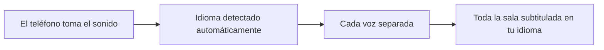
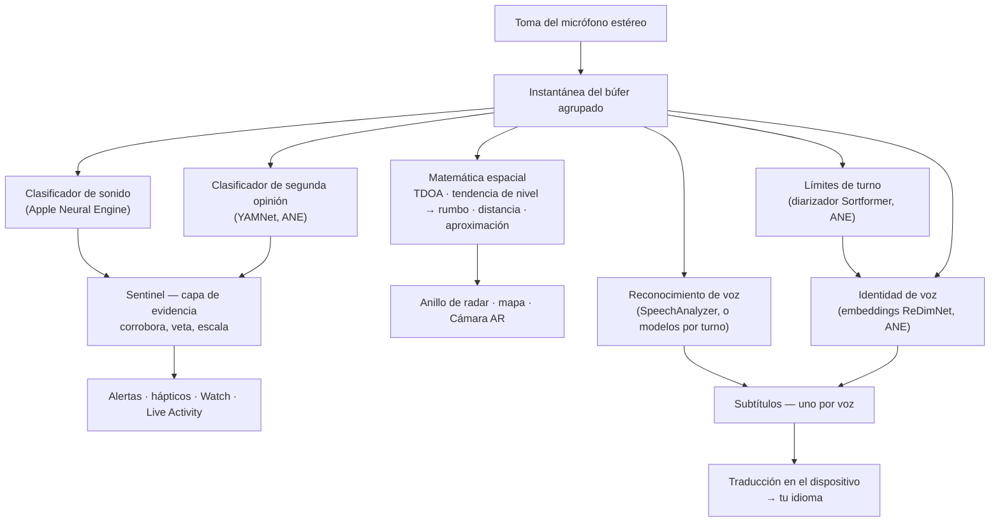
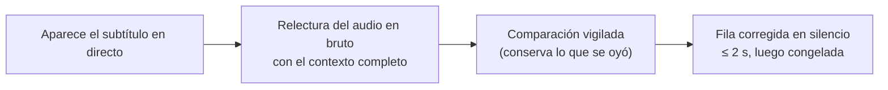
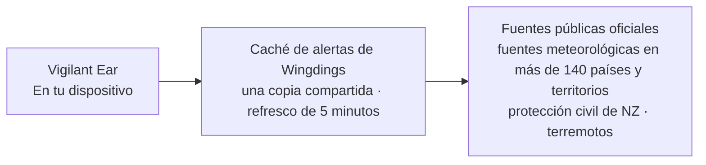

# Vigilant Ear 👂🛡️

*Vigente desde la versión 1.1.14 · octubre de 2026.*

## Un radar acústico para las personas que no pueden oír.

Una app hecha específicamente para la comunidad Sorda, con hipoacusia y CODA. La mayoría de las apps de reconocimiento de sonido te dicen *qué* es un sonido. **Vigilant Ear te dice dónde está, quién lo produce y qué está diciendo**: convierte un iPhone en un dispositivo que describe el sonido a tu alrededor según ocurre.

La dirección y la distancia de una sirena. Un golpe a tu espalda. Las personas de una conversación, dibujadas como voces transcritas por separado: cada una con subtítulos y situada en su dirección. Si alguien habla un idioma que no lees, sus palabras pueden llegarte **traducidas al tuyo.** Las alertas llegan a tu **pantalla de bloqueo, al Dynamic Island y al Apple Watch**, así que basta una mirada.

Todo lo que importa se ejecuta en el dispositivo. El audio no se graba ni se sube para el reconocimiento. Nada depende de que un oído humano oiga nada.

- 🧭 **Dirección, no solo detección.** *Qué, dónde, quién* y *qué se dijo*: no meramente «ha sonado algo».
- 📣 **Nombre llamado.** Anota tu nombre, el de un niño o el de tu pareja: «pedido para Marie, listo» alerta el teléfono y el reloj, y señala hacia dónde.
- 🔒 **Privado por diseño.** La clasificación, los subtítulos y la traducción se ejecutan en tu iPhone. Los subtítulos son en directo y efímeros; no se guardan como archivo de transcripción.
- ⌚ **En la muñeca y en la pantalla de bloqueo.** El compañero de dirección del Apple Watch y Live Activity mantienen la última alerta, y de dónde vino, a una sola mirada.
- 🛰️ **Más teléfonos, una escucha compartida.** Nuestra malla Constellation enlaza iPhones con Ultra-Wideband para fusionar lo que oye cada uno en una imagen direccional más nítida.
- 👁️ **Hecho para personas Sordas, con hipoacusia y CODA.** Hápticos distintos, visuales de alto contraste, señales independientes del color, zonas de toque grandes y Reducir movimiento en todo momento.

---

## Para quién es

- **Personas Sordas, con hipoacusia y CODA** que quieren conciencia situacional del sonido: Home Watch (golpe, alarma, bebé, teléfono) y Street Watch (sirena, aproximación), que puedes dejar encendidos y de los que te puedes fiar.
- Quien necesite **subtítulos en directo con dirección y separación de hablantes**, o **traducción en el dispositivo** de las personas sentadas cerca.
- Quien trabaje en accesibilidad o en investigación acústica y se interese por la localización del sonido en el dispositivo.

> Vigilant Ear es una **ayuda** de accesibilidad, no un dispositivo certificado de seguridad vital.

---

## Qué hace

### 🧭 Ve el sonido — dirección y distancia
Con los dos micrófonos del iPhone, Vigilant Ear mide el **ángulo de un sonido y si está delante de ti o detrás**, mantiene esa lectura firme con un error de cerca de un grado y la sitúa como un marcador en directo sobre un anillo de radar con el rumbo hacia arriba y sobre el mapa. Dos micrófonos en una misma línea no distinguen por sí solos la izquierda de la derecha. Un sonido a 50° a tu derecha y otro a 50° a tu izquierda llegan con la misma diferencia de tiempo, minúscula. La app dibuja la lectura más un **fantasma más tenue al otro lado**, y un giro de muñeca o un segundo teléfono lo resuelve. La distancia se estima por el volumen, frente a una curva calibrada en la calle, y se muestra como la estimación que es, con un intervalo probable, en las unidades del país en el que estás y no en las del idioma en el que lees la app. En un teléfono de EE. UU. se lee *≈ 50 ft*. Si te mueves, los marcadores conservan su posición en el mundo real. Esto es el núcleo: conciencia espacial de un mundo que no puedes oír. (Las cifras, más abajo.)

### 🚨 Reconoce los sonidos importantes — y te avisa
Un clasificador en el dispositivo identifica cientos de sonidos cotidianos y vigila las categorías críticas: **sirenas, alarmas —incluida una clase específica de alarma de coche—, timbres y golpes, llanto de bebé, una persona cerca y tiempo severo.** Cuando una se dispara, recibes una alerta clara en pantalla, una **notificación push** opcional y un **háptico** distinto, incluso con la app en segundo plano o el teléfono en reposo. Las categorías críticas vienen listas por defecto, de modo que activar las notificaciones no significa «todo apagado». Si apagas todas las categorías de alerta, el motor hiberna por completo mientras está en segundo plano, para ahorrar batería. Una capa **Sentinel** contrasta las alertas con pruebas independientes —dirección, movimiento y fuentes públicas—, así que lo que se dispara está corroborado y no es la conjetura aislada de un clasificador. Funciona en los dos sentidos: un momento con forma de sirena dentro de una canción se retiene, pero una sirena real que se repite a través de tu música se abre paso y alerta.

Los avisos de tiempo severo proceden de **fuentes oficiales de los gobiernos de más de 140 países y territorios**, y se añaden más a menudo: gratis para todo el mundo. También entran las alertas de emergencia de protección civil, con su propio interruptor de **Alertas de emergencia**. Las fuentes se reducen a las que cubren donde estás. Donde existen, la app también lee los **boletines anticipados** de las agencias meteorológicas nacionales: los avisos en lenguaje claro que se publican días antes de un tifón o de una lluvia intensa, no solo las advertencias que salen cuando el peligro ya ha llegado, más los boletines de chaparrón repentino y de deslizamiento de tierra. Los avisos anticipados se muestran en silencio, sin el sonido ni la vibración reservados a una advertencia real.

### 🌧️ Radar meteorológico en el mapa
La lluvia y la nieve aparecen en el mapa desde el momento en que se abre la app: de los radares nacionales de Estados Unidos, Canadá, Japón, Italia y gran parte de Europa, y de una estimación de lluvia por satélite en la mayor parte del resto del mundo. Toca el mapa y la última hora se reproduce tres veces, para que veas hacia dónde se mueve una tormenta; una escala abajo va de Ligera a Densa. Si no la quieres en una sesión, toca el botón del tiempo para apagarla. El radar llega igual que los avisos: por nuestro propio servidor, de modo que tu teléfono nunca contacta con servidores gubernamentales. Unas flechas de gris claro muestran también hacia dónde sopla el viento, en cualquier lugar del mundo, a partir de la previsión global de la NOAA para la hora en curso.

### 🛟 A quién llamar — el aro salvavidas
Un aro salvavidas junto a la brújula del mapa abre una lista breve del país en el que estás:

- el número de emergencias, con botones de llamada y de texto, y una nota sobre el texto en tiempo real (Real-Time Text) allí donde escribir a un número de emergencias puede no funcionar
- la agencia meteorológica nacional
- una organización de personas Sordas, cuando tiene una página estable
- el soporte de Vigilant Ear

Comparte Vigilant Ear desde el panel de ayuda (el salvavidas): un código que alguien a tu lado puede escanear para descargar la app, un enlace a la App Store y nuestro Instagram.

### ⌚ Apple Watch + Live Activity — mirar y saber
- **Compañero de Apple Watch**: la dirección de una alerta señala en la muñeca, así que una mirada te dice hacia dónde mirar. Interfaz del Watch rediseñada, con el icono de la oreja de la app, disposición de HUD de amenaza y doble toque para descartar una alerta. Las alertas pueden seguir mostrando la flecha de dirección aunque la app del Watch no esté abierta.
- **Nombre llamado en el Apple Watch.** Cuando alguien dice tu nombre, el reloj te da tres toques y muestra una flecha hacia la voz. Cuando el iPhone no distingue la izquierda de la derecha, un abanico muestra ambos lados. Funciona con el iPhone bloqueado mientras la app Vigilant Ear esté abierta en el reloj. Nombre llamado necesita el Speaker Mode activado.
- **Siente el ritmo en el Apple Watch.** Con música sonando y la app Vigilant Ear abierta en el reloj, el bombo y la caja laten como anillos, el tiempo 1 de cada compás queda marcado y la muñeca recibe un toque suave en cada tiempo 1. Toca dos veces en cualquier parte de la pantalla del reloj para desactivar el toque hasta que pare la música. Las alertas siempre van primero. Cuando Music ID reconoce la canción, su título también aparece en el reloj.
- **Live Activity**: Vigilant Ear permanece en tu **pantalla de bloqueo**, en el **Dynamic Island** y en el **Smart Stack** del Watch, de modo que la última alerta y su rumbo están siempre a una mirada.
- **Alertas del compañero en la muñeca**: cuando el teléfono de un compañero de Constellation enlazado emite una alerta, también puede llegar a tu Watch, con la dirección. El compañero gasta poca batería del Watch a lo largo del día.

### 💬 Speaker Mode — subtítulos en directo y con dirección *(gratis)*
Activa **Speaker Mode** y Vigilant Ear transcribe a quienes hablan cerca de ti en **bloques de subtítulos, uno por voz.** La diarización de hablantes en el dispositivo mantiene las voces separadas —*quién* dice *qué*—, con una señal de dirección en el anillo interior. Quien habla en ese momento queda resaltado; el texto más antiguo se desplaza cuando hace falta sitio.

**Cada hablante en su propio idioma.** En los iPhone con al menos 8 GB de memoria, una descarga única del modelo de subtítulos (cerca de 1 GB: por Wi-Fi, o por datos móviles después de preguntarte) permite a la app subtitular cada turno en el idioma que de verdad se habla, de modo que se entiende una sala que alterna entre inglés, español, francés y árabe. En nuestras pruebas, los errores de palabra en una conversación de cuatro idiomas bajaron de cerca del 80% al 14%. Desde la versión 1.1.12, un modelo de voz mejorado se equivoca mucho menos con ruido —en un bar ruidoso, en un iPhone 17, los subtítulos en alemán pasaron del 45% de palabras mal al 20%— y sustituye solo al anterior por Wi-Fi. Sin la descarga —y para quien lee chino, japonés y coreano, donde el reconocedor de Apple lee mejor— los subtítulos usan el reconocimiento de voz en el dispositivo de Apple, como antes.

Dos cosas que la mayoría de las apps de subtítulos no hacen.

**Honestidad sobre la confianza.** Una marca de calidad discreta en cada fila, y subrayados de puntos bajo las palabras dudosas, te dicen cuándo fiarte de una línea y cuándo comprobarla de nuevo.

**Autocorrección.** Justo después de que cae una frase, la app vuelve a leer el audio con el contexto completo y puede recuperar una palabra perdida o mal oída en un par de segundos; después el texto se congela.

**Nombre llamado** (Preferencias, apagado hasta que lo actives) vigila esos subtítulos en busca de los nombres que anotas: el tuyo, el de un niño, el de tu pareja. Cuando alguien dice «pedido para Marie, listo», recibes un háptico distinto y una alerta en el Watch con dirección, no otra burbuja de subtítulos. Las palabras siguen saliendo en Speaker Mode como habla; este es el toque de que hablaban *contigo*.

**El lenguaje fuerte se puede enmascarar** (Preferencias → Subtítulos). Si no, los tacos llegan como texto plano, sin nada que los suavice, y quien lee no tiene ocasión de apartar la vista antes; actívalo y esas palabras se sustituyen por símbolos, de modo que la frase se sigue leyendo sin la palabra. El propio reconocedor de voz de tu dispositivo decide qué cuenta —no una lista de palabras nuestra—, así que sigue el idioma que se transcribe. En una cuenta declarada como menor de 18 está siempre activo y muestra un candado. Se aplica al habla que transcribe *este* dispositivo; el texto retransmitido desde un teléfono emparejado se transcribió allí y llega como texto ya cerrado.

**La palabra en la que se apoyó quien habla se marca en negrita.** Dichas en voz alta en inglés, "I didn't say THAT" y "I didn't say that" son dos frases distintas, y una transcripción idéntica pierde la diferencia por completo. La app busca la única palabra en la que la voz subió de tono y la pone en negrita: como mucho una por línea, y ninguna cuando no está segura, porque marcar la palabra equivocada afirmaría que la persona dijo algo que no dijo. Desactivado en chino y en japonés, donde el tono indica *qué palabra es* y no con qué fuerza se empujó.

Los subtítulos son gratis; la Traducción automática es la capa opcional de Power Pack+. Los subtítulos también se pueden **decir en voz alta por un dispositivo Bluetooth, incluido un audífono**: gratis, en Preferencias. Los **Tonos de dirección** (también gratis, en Preferencias → Subtítulos) añaden una señal de audio opcional en el oído que elijas, que indica dónde está quien habla: útil con un audífono o con audición de un solo lado, y al alcance de cualquiera.

### 🌐 Traducción automática — tu idioma, en directo *(Power Pack+)*
Con Speaker Mode activado, cuando alguien cerca habla otro idioma, Vigilant Ear puede detectarlo y poner sus subtítulos **en tu idioma**, con el idioma de origen en su bloque. La cadena —oír → separar hablantes → transcribir → traducir → mostrar— se ejecuta **en el dispositivo**; el único momento de red es una descarga única del paquete de idioma de Apple, y cuando lo que esperas es esa descarga, la app lo dice en lugar de dejarte delante de texto sin traducir. No tienes que conocer ni elegir antes el otro idioma. Una frase terminada se traduce en cuanto acaba, sin esperar a que quien habla se detenga, y las traducciones llegan en una fracción del tiempo.

Es lo más parecido que hay al **traductor universal de la ciencia ficción**: un dispositivo que simplemente entiende. Vigilant Ear detecta el idioma por sí solo, sigue a cada persona que habla en la sala y subtitula a todas en tu idioma: sin auriculares, sin configuración, en tu dispositivo.

### 🎵 Música y conciencia de emisiones *(Power Pack+)*
**ShazamKit** identifica la música que suena a tu alrededor y detecta automáticamente los cambios de canción, de modo que el título se mantiene al día.

### 🎛️ Acoustic Scope — ver el sonido como un ingeniero
Una vista profesional en directo del sonido a tu alrededor: espectro, espectrograma, bandas RTA de ⅓ de octava, croma y parciales armónicos. **Gratis para todo el mundo.** **Partials lee la música:** cada tono se nombra por su nota, con la serie armónica al lado; los sonidos más agudos, como las alarmas de humo, se nombran en su tono real, y puedes fijar una nota objetivo que se dibuja como una línea para cantar o afinar contra ella. Dejar abierto el espectrograma no cuesta casi nada, por mucho que mires. Las herramientas que capturan sonidos para entrenar tus propios Paquetes de Sonido Personalizados forman parte de Power Pack+.

### 📦 Paquetes de Sonido Personalizados — enséñale tu mundo *(Power Pack+)*
Puedes enseñar a Vigilant Ear los sonidos que te importan: aves de la zona, el timbre de la puerta de un edificio, el zumbido anómalo de un generador o un tipo de avión al despegar. Estos paquetes añadidos se apilan sobre la detección integrada, de modo que los sonidos nuevos nunca desplazan a las sirenas ni a las alarmas. La app lleva una guía paso a paso.

### 🛰️ Constellation — muchos iPhone, una escucha compartida *(Power Pack+)*
Con dos o más iPhone con Ultra-Wideband (la mayoría desde el iPhone 11), la malla **Constellation** los empareja para que noten la posición de los otros y fusionen lo que oye cada uno en una sola imagen más precisa de dónde viene un sonido: una red de escucha distribuida y pasiva. Los subtítulos también se fusionan: cada teléfono transcribe lo que oye su propio micrófono, y las palabras se alinean entre teléfonos para que el más cercano a quien habla aporte lo que oyó. Las palabras que solo captó un teléfono se conservan, no se pierden.

Los teléfonos se conectan **directamente entre sí**: sin router, sin red Wi-Fi compartida y sin internet; basta con que el Wi-Fi esté encendido. Usan el mismo enlace entre pares que AirDrop, y solo entran los teléfonos con el hardware adecuado. El enlace entre los teléfonos va siempre cifrado; los que llevan Vigilant Ear 1.1.6 o anterior tienen que actualizar la app para participar en la malla.

**Mensajes al compañero**: envía un texto breve al teléfono de un compañero de la malla; cae en su flujo de subtítulos y puede llegar traducido a su idioma, en el dispositivo. La mensajería tiene en cuenta la edad: se apoya en el intervalo de edad declarado de Apple (Declared Age Range), y los mensajes entre una persona adulta y un menor siguen apagados salvo que las dos se hayan nombrado a propósito. Las alertas y los subtítulos nunca se restringen; solo se restringen los mensajes de persona a persona.

### 🔗 Remote Link — llegar a quien no está contigo *(Power Pack+ para empezar)*
Lo que normalmente haría una llamada, hecho con vídeo y texto. Envías un código de invitación; la otra persona entra desde Vigilant Ear **sin tener Power Pack+**. A diferencia de Constellation no hace falta estar cerca: tú y la otra persona podéis estar en cualquier lugar.

**No se usa audio en ningún momento.** Solo vídeo y texto, así que nada del enlace depende de oír en ninguno de los dos extremos, y te da una forma de signar con alguien a través de la app. La propia app no entiende la lengua de signos; lleva el vídeo y el resto lo hacéis vosotros. La conexión es directa entre los dos teléfonos siempre que la red lo permite, y la app te muestra con claridad si es **Direct** o **Relayed**, para que sepas siempre si tu vídeo pasa por un relé.

**Los subtítulos también viajan.** Lo que transcribe cada teléfono aparece en el otro, traducido al idioma de quien lee cuando hace falta. Cualquiera de los dos puede pausar el enlace —vídeo y subtítulos—, reanudarlo y colgar desde la pantalla principal.

### 📷 Cámara AR — «ver el sonido»
Abre Cámara AR desde el Abanico de acciones y fija los sonidos detectados en su rumbo real, dentro de la vista en directo de la cámara. Los marcadores se agrupan por hablante o por categoría de sonido y dirección, para que la vista se siga leyendo, y se desvanecen mientras un sonido permanece en silencio.

### 🗺️ Mapas, calles y predicción de la trayectoria
Los rumbos del sonido se proyectan en coordenadas GPS reales sobre el mapa. Los sonidos de vehículos se pueden **ajustar a las calles cercanas** y se puede predecir su trayectoria, de modo que un camión que pasa se lee como si avanzara *por la carretera* y no a través de los edificios. (Prueba la demostración del camión de bomberos en Feature Playground.)

### 🪄 Feature Playground — compruébalo sin oír
**Feature Playground** es público para todo el mundo: alertas de muestra de Home y Street (golpe, alarma, bebé, sirena, tiempo) y demostraciones de varios teléfonos y de conversación. Llevan una marca de agua clara, para que el ensayo nunca se haga pasar por un suceso en directo. Al cerrar el panel, las demostraciones se desmontan limpiamente (sin un GPS suplantado que se quede fijo, sin indicadores residuales).

### ♿ La accesibilidad, primero
Hecho para personas Sordas, con hipoacusia, CODA y con daltonismo:

- señales **independientes del color**
- zonas de toque de **≥44 pt**
- respeto de **Reducir movimiento**
- **diseños de derecha a izquierda** para quien lee árabe
- alertas multimodales (háptico + visual + Watch)
- una pantalla de verificación al arrancar que muestra el estado de los permisos en verde, gris y rojo claros, y en naranja tostado para «no permitido», incluido el permiso de notificaciones que actúa como interruptor maestro de las alertas

---

## Gratis y Power Pack+

El núcleo de seguridad es **gratis, para siempre**:

- **Home Watch y Street Watch**: alertas de sonido local (alarmas, sirenas, golpes y timbres, bebé, persona cerca), en pantalla, con háptico y con push opcional.
- **Subtítulos en directo**: Speaker Mode, en el dispositivo, con dirección cuando el hardware lo permite, con marcas honestas de confianza, autocorrección de unos 2 segundos, salida hablada opcional hacia un dispositivo Bluetooth (incluido un audífono) y Tonos de dirección.
- **Nombre llamado**: nombres opcionales que escribes (el tuyo, los de los niños, el de tu pareja). Una coincidencia es una alerta en el Watch o en el teléfono, con rumbo, no un segundo subtítulo.
- **Standing Watch**: el estado propio de la sala, siempre activo y sin nada que configurar. Una lámpara cian fija mientras la sala mantiene su patrón; ámbar cuando algo cambia: una voz nueva, un silencio repentino o algo que se acerca. Cuando la app arranca, te dice cuánto tiempo estuvo sin escuchar alertas.
- **Alertas de tiempo severo**: avisos oficiales para tu región, de fuentes gubernamentales de más de 140 países y territorios, y se añaden más a menudo.
- **Radar meteorológico**: lluvia y nieve en el mapa, con la última hora en repetición, y hacia dónde sopla el viento.
- **El aro salvavidas**: a quién llamar en el país en el que estás.
- **Alertas de terremoto (en todo el mundo)**: notas una vibración y ves en el mapa la zona que lo sintió cuando se informa de un seísmo cercano. Es una confirmación de la fuente oficial de terremotos, no un aviso temprano: si sentiste el temblor, esto te dice qué fue. La fuente se comprueba cada cinco minutos, también en segundo plano, y la detección en el dispositivo de Retumbos profundos (infrasonido) puede armar una comprobación extra en el instante en que se mueve el suelo.
- **Feature Playground**: alertas de práctica y vistas previas de funciones, con una marca de agua PREVIEW clara.
- **Compañero de Apple Watch y Live Activity**: dirección y última alerta, de un vistazo.
- **Acoustic Scope**: visualización de sonido en directo, de nivel profesional, gratis para todo el mundo. (Las herramientas de captura para entrenar son de Power Pack+.)
- **Red de investigación** *(activa hasta que la apagues)*: mientras está activa se comparten la hora, una ubicación aproximada (cerca de 1 km) y la frecuencia de los sucesos parecidos a un seísmo —sin audio y sin identificador— para ayudar a cartografiar terremotos y otros sucesos de baja frecuencia. En el mapa sale una pregunta, una sola vez. Los informes esperan hasta que esa pregunta haya estado en pantalla.

**Power Pack+** es un desbloqueo de pago único (**no una suscripción**), con una **prueba gratuita de 90 días**. Añade los superpoderes:

- **Traducción automática**: traducción en el dispositivo del habla cercana a tu idioma.
- **Constellation**: escucha compartida entre varios iPhone por Ultra-Wideband, con mensajes al compañero.
- **Music ID**: reconocimiento de canciones con ShazamKit.
- **Paquetes de Sonido Personalizados**: clasificadores añadidos que entrenas para tus propios sonidos.
- **Remote Link**: llamadas privadas de vídeo y texto con quien no está contigo, sin audio en ningún momento. Para iniciar una hace falta Power Pack+; la persona a la que invitas entra gratis.

Gratis o con Power Pack+, **tu audio se queda en el dispositivo para el reconocimiento**: el nivel solo cambia qué funciones se desbloquean, nunca adónde se envía el audio en bruto para analizarlo.

---

## Cómo funciona (por dentro)

Vigilant Ear es una cadena **primero local, en el dispositivo**, montada por capas: se captura una vez y después especialistas independientes leen el mismo sonido y contrastan el trabajo de los demás. El audio en bruto se captura en una toma de alta prioridad, se copia en una **lista libre de búferes agrupados** (sin ráfagas de asignación en la ruta de tiempo real) y se reparte sin frenar la interfaz:

No se fía de ningún modelo por sí solo. La capa **Sentinel** está entre la detección y la alerta: motores independientes se corroboran o se vetan trama a trama, y cuando las pruebas repetidas del mundo real se acumulan contra un veto (una sirena real que aúlla a través de tu música), ganan las pruebas y la alerta se dispara.

Los subtítulos tienen su propia segunda oportunidad. Cada frase ya cerrada se vuelve a leer en silencio desde un anillo corto de audio en memoria, con el contexto completo: las correcciones llegan en unos dos segundos y después el texto se congela del todo:

- **Matemática espacial**: FFT, diferencia de tiempo de llegada ponderada por la coherencia (TDOA: se favorecen las bandas de frecuencia en las que coinciden los dos micrófonos y después ese retraso mínimo de llegada se convierte en un rumbo) y seguimiento de la aproximación por la tendencia del nivel, en tareas de segundo plano. El par de micrófonos se lee con una orientación fija, de modo que la dirección funciona igual sostengas el teléfono en vertical o de lado.
- **Habla**: `SpeechAnalyzer` / `SpeechTranscriber` de iOS 26 para la transcripción; el framework **Translation** de Apple para la traducción en el dispositivo. Con la descarga opcional de subtítulos, un detector de actividad de voz corta cada turno, un modelo de lengua hablada elige el idioma y lo transcriben modelos abiertos de reconocimiento del habla —uno para las lenguas europeas y otro para el resto—, todo en el dispositivo. La identidad de voz se basa en pruebas: una voz solo se confirma como persona real a partir de ventanas de sonido independientes, y una coincidencia incierta se muestra sin atribuir, en lugar de adivinar el nombre que no es.
- **Dos modelos para dos preguntas**: separar las voces exige saber *cuándo cambió quien habla* y *quién es*, y no son el mismo problema. Un diarizador en flujo **Sortformer** marca los límites de turno; los embeddings de **ReDimNet** deciden de quién es la voz dentro de cada uno. Cortar en el límite importa más de lo que parece: una ventana a caballo entre dos personas contiene a las dos, y ningún modelo de embeddings puede deshacer eso después. Debajo de ambos hay un suelo de actividad de voz: si el diarizador calla en una sala difícil en lugar de adivinar, los turnos se siguen cortando, así que la app se degrada en vez de fundir a dos hablantes en uno.
- **La verdad de la música**: un **detector de firma de canción** por croma decide «¿hay música sonando de verdad?», porque los clasificadores generales tienen fama de llamar «música» a las salas en silencio y a las sirenas. Shazam solo se ejecuta cuando la firma conviene en que hay algo realmente musical.
- **Concurrencia**: el aislamiento de Swift 6 mantiene separados la toma del micrófono, la matemática acústica y el bucle de dibujo de la interfaz.
- **Eficiencia**: el submuestreo, la clasificación que se adapta a la carga y el uso de red condicionado a las pruebas mantienen la escucha continua lo bastante ligera como para dejarla encendida.

Las alertas de tiempo y de terremoto siguen el camino contrario al del audio: de tu sonido no sale nada, pero los *datos* de alerta sí entran. **Todas** las fuentes oficiales —y las imágenes del radar y del viento— pasan por una pequeña caché de retransmisión que operamos, de modo que una sola obtención de los datos públicos sirve a todo el mundo, y tu teléfono nunca contacta con servidores gubernamentales:

---

## Lo que tu teléfono puede oír — medido

Tu iPhone tiene dos micrófonos separados unas seis pulgadas (15 cm), un barómetro y un reloj muy bueno. Con eso basta para decirte de qué dirección vino un sonido, aproximadamente a qué distancia, si viene hacia ti y si acaba de abrirse una puerta. Aquí está lo precisa que es cada una de esas cosas, cómo lo comprobamos y por qué importa si no puedes oír el sonido. La tabla de dirección se midió en un iPhone 17 en septiembre de 2026. La misma prueba de escritorio en un iPhone 16 Pro Max no dio un ángulo continuo —esa imagen encaja el sonido hacia delante o hacia el lado—, así que las filas en grados son solo las del 17. La distancia sigue siendo una estimación por naturaleza: lo decimos en pantalla. Las distancias medidas con cinta en esta sección están en pies, las unidades de esa cinta.

**Dirección: a un par de grados.** Un sonido llega al micrófono de arriba antes que al de abajo, o después, y con ese hueco la app calcula cuánto se aparta del eje del teléfono y si está delante o detrás. Los dos canales del teléfono no son micrófonos lisos, sino una imagen estéreo procesada, y esa imagen añade un patrón fijo propio siempre que la sala es ruidosa. La app aprende ese patrón a partir del silencio de después del arranque. Tras cerca de un minuto de una sala en silencio, quita el patrón antes de leer la dirección; hasta entonces la lectura va sin esa corrección.

| Qué medimos | Resultado |
|---|---|
| Mediana del error en 96 salas simuladas, de una oficina en silencio a una sala de paredes duras a 5 dB SNR | 1.0° |
| iPhone 17 en un escritorio, con ruido de sala, altavoz a 30° del eje | leyó 61.7° desde el plano lateral frente a 60° esperados, oscilación de 1.6° |
| Igual, altavoz justo en el lateral del teléfono | leyó 4.5° frente a 0° esperados, oscilación de 2.2° |
| Igual, altavoz a 60° del eje | mediana de 35.7° frente a 30° esperados; la pasada se partió, con un segundo agrupamiento en el retardo de justo delante, muy probablemente un reflejo del montaje |
| Igual, altavoz justo delante | todas las lecturas en el retardo máximo, como debe ser |
| Lecturas que caen en el patrón propio de la imagen y no en el sonido | ninguna, en ningún ángulo |

*Por qué importa:* si no puedes oír una sirena, «detrás de ti, hacia un lado» te dice hacia dónde mirar. Una lectura que se queda quieta solo merece confianza cuando se ha comprobado con una cinta métrica, y esta se comprobó dos veces. La primera comprobación hizo que el resultado pareciera mejor de lo que era.

**Distancia: se muestra como la estimación que es.** Un micrófono no mide la distancia, solo el volumen, y un camión ruidoso y lejano puede sonar como un coche silencioso y cercano. La app estima la distancia por el volumen, con una curva ajustada en una calle real, y después lo dice como lo diría alguien cuidadoso. En un teléfono de EE. UU. eso es *about 50 ft, likely between 25 and 100.*

| Qué medimos | Resultado |
|---|---|
| Detecciones reales de coches reproducidas con la calibración | 1,131 |
| Que caen dentro de la carretera de 100-foot por la que realmente iban | 73% |
| Coches del carril lejano | se estimaron 78 and 87 ft donde la cinta decía 73 and 85 ft |

La carretera (un cruce de ciudad) se midió carril a carril; cuando la curva se equivoca, se equivoca por el lado cercano. La calibración queda fijada por una prueba automática, para que no pueda desviarse en silencio. Las alarmas de tu propio espacio, como un detector de humo, no llevan ninguna cifra de distancia: ya están en la sala contigo.

**Movimiento: viene hacia ti.** En coches y sirenas, subir de volumen suele querer decir acercarse. La app mira a qué ritmo sube el nivel de un sonido durante unos segundos: una subida sostenida de cerca de 1.5 dB por segundo (un aumento claro y constante del volumen) significa que se aproxima, una bajada equivalente significa que se aleja, y un sonido que deja de cambiar deja de llamarse de una forma o de la otra al cabo de unos cuatro segundos. Un solo momento fuerte —un toque de claxon, un portazo— no puede dispararlo. Se basa en la física y en nueve pruebas automáticas; un paso grabado por la calle es la próxima confirmación de campo.

**El aire de la sala: una puerta tiene firma.** El barómetro puede notar una puerta que se abre a unos catorce pies (4.3 m): la presión baja cuando la puerta gira y rebota al cerrarse. En catorce horas de silencio y quince sucesos de puerta, todas las puertas hicieron esa forma de dos partes, y nada más en la casa lo hizo.

| Suceso | Ritmo de presión | Forma |
|---|---|---|
| Puerta principal, abierta y cerrada, ×10 | 0.6–1.8 Pa/s | bajada y después rebote, separadas ~5 s |
| Puerta principal, de un portazo, ×5 | 1.1–2.5 Pa/s | el mismo par, más alto |
| El aire acondicionado en ciclo por la noche, ×8 | 0.11–0.46 Pa/s | rampa lenta de minutos, idéntica en los dos teléfonos |
| Una sala en silencio | ~0.02 Pa/s | nada |
| Actividad humana, alguien que pasa andando | — | el sensor de movimiento lo nota y el teléfono lo ignora |

Una puerta que no sella la sala fue invisible —una puerta mosquitera, en esta prueba—, exactamente como debe ser. Hoy un cambio de presión puede verse como Retumbos profundos en el mapa; una alerta propia de puerta en una noche tranquila está medida y diseñada, y todavía no es lo habitual cada día.

**Constellation: dos teléfonos resuelven el lado.** Cada teléfono de la malla traza una línea hacia el sonido desde donde está, y las líneas solo se cruzan limpias en un lado. Cuando lo hacen, el fantasma desaparece y la app puede decir otra vez izquierda o derecha. En simulación, dos teléfonos **separados 40 metros** sitúan una sirena que está a 50 metros con un margen de unos 2 metros.

**Cómo se llega a creer lo de aquí.** Cada cifra pasó por las mismas tres puertas, por este orden: una sala simulada con la respuesta sabida de antemano; pruebas automáticas pequeñas que recrean el caso exacto que engañaría a la app y se ejecutan en cada cambio; después, los teléfonos de verdad en un escritorio de verdad, con las distancias medidas a mano. Nada cuenta como preciso hasta que supera la tercera. Para quien no puede oír el sonido, la palabra de la app es la única: tiene que ganársela como se la gana un laboratorio.

Notas más a fondo para ingenieros: [Física](https://vigilantear.com/en/physics/) — TDOA, distancia, movimiento, Constellation y detección barométrica, con cada cifra etiquetada MEASURED / BENCHED / MODELLED.

---

## Privacidad

- **En el dispositivo, siempre, en la cadena central.** La clasificación, la matemática espacial, la transcripción, la diarización y la traducción se ejecutan en tu iPhone. El audio en bruto no se graba ni se sube para el reconocimiento.
- **Los subtítulos son efímeros.** Los subtítulos en directo se quedan en memoria durante la sesión; los registros de depuración que exportas no incluyen el texto de los subtítulos.
- **Sin SDK de publicidad ni de analítica de comportamiento.** El uso limitado de la red es solo para los mapas, las fuentes meteorológicas públicas, las imágenes del radar y del viento, la lista de ayuda, la descarga opcional del modelo de subtítulos, las huellas opcionales de Shazam, el contexto de las calles, los informes de la Red de investigación mientras esa función está activa y las compras del App Store. El detalle está en nuestra política de privacidad.

Detalles completos: [Privacidad](/es/privacy/) · [Términos](/es/terms/) · [Soporte](/es/support/)

---

## Hardware y plataformas

- **iPhone (experiencia completa).** Funciona en vertical o en horizontal: sosténlo como quieras. Hacen falta micrófonos estéreo para hallar la dirección. Se recomienda **iPhone 13 o posterior**; los subtítulos en el idioma de cada hablante necesitan **8 GB de memoria** (iPhone 15 Pro y posteriores).
- **Apple Watch.** Alertas del compañero con flecha de dirección; funciona con Live Activity / Smart Stack.
- **iPad (nativo).** Disposición adaptativa: en la pantalla grande, los subtítulos en directo tienen un panel translúcido junto al mapa, que se recoge cuando nadie habla. Micrófonos de un solo canal → subtítulos sin la dirección completa.
- **Constellation** necesita **Ultra-Wideband**: iPhone 11 o posterior, salvo los modelos SE y «e». **No** necesita una red Wi-Fi: con el Wi-Fi encendido, los teléfonos se descubren directamente, así que Constellation funciona sin router y sin internet mientras los teléfonos estén cerca.
- **Android (cuando esté disponible).** Compilación aparte, con el radar central, las alertas, los subtítulos y el tiempo; la malla Constellation es primero de iOS.

---

## Localización

Localizado por completo —interfaz, alertas y subtítulos— en **inglés, español, portugués (Brasil), francés, alemán, italiano, turco, árabe, japonés, chino simplificado, chino tradicional, coreano, ruso, hindi, rumano y polaco** (16 idiomas). Sigue el idioma del sistema o una elección manual en la app. Los subtítulos en rumano funcionan en el dispositivo; Apple Translate no tiene rumano, así que Traducción automática muestra el original en ese idioma.

---

## Estado y aviso

Vigilant Ear es una **ayuda experimental de accesibilidad acústica**, no un sistema certificado de seguridad vital. La resolución de la localización del sonido varía con el entorno, el tiempo, el viento y el hardware de los micrófonos. **Mantén siempre tu conciencia habitual del entorno**: no confíes en ella como única fuente de información sobre tu seguridad.

Algunas capacidades (los marcadores de cámara AR, la ampliación del permiso de Critical Alerts cuando Apple la concede y la autoría avanzada de sonido en varios paquetes) siguen evolucionando; la vigilancia gratuita de Home Watch / Street Watch y los subtítulos en directo son el producto del que puedes fiarte desde el primer día.

**Fuentes y licencias:** [api.vigilantear.com/sources](https://api.vigilantear.com/sources)

---

**Contacto:** [vigilantear@wingdingssocial.com](mailto:vigilantear@wingdingssocial.com)

Hecho con ❤️ para la comunidad Sorda y con hipoacusia, y para la investigación acústica.

    
  <strong>© 2026 Wingdings, Inc.</strong> 
  Todos los derechos reservados. 
  Varias patentes en trámite

