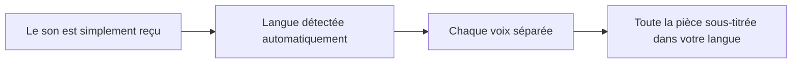
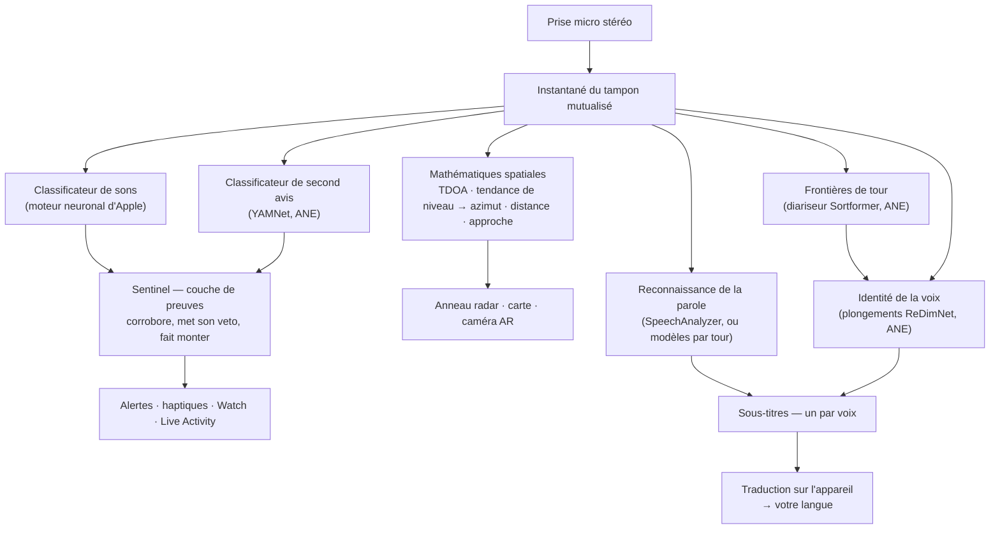
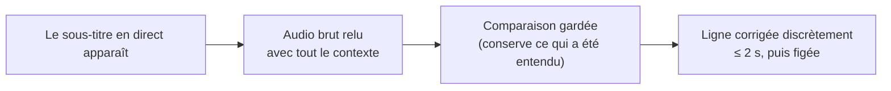
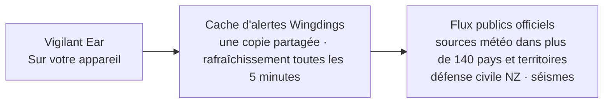

# Vigilant Ear 👂🛡️

*En vigueur à compter de la version 1.1.13 · octobre 2026.*

## Un radar acoustique pour les personnes qui n'entendent pas.

Une application conçue spécialement pour la communauté Sourde, malentendante et CODA. La plupart des applications de reconnaissance sonore vous disent *ce qu'est* un son. **Vigilant Ear vous dit où il est, qui le produit et ce qui se dit** — il fait d'un iPhone un appareil qui décrit le son autour de vous au moment où il se produit.

La direction et la distance d'une sirène. Un coup frappé derrière vous. Les personnes d'une conversation, dessinées comme des voix transcrites distinctes — chacune sous-titrée et placée en direction. Si quelqu'un parle une langue que vous ne lisez pas, ses mots peuvent arriver **traduits dans la vôtre.** Les alertes atteignent votre **écran verrouillé, le Dynamic Island et l'Apple Watch**, de sorte qu'un coup d'œil suffit.

Tout ce qui compte s'exécute sur l'appareil. L'audio n'est ni enregistré ni envoyé pour la reconnaissance. Rien ne dépend d'une oreille humaine qui entendrait quoi que ce soit.

- 🧭 **La direction, pas seulement la détection.** *Quoi, où, qui,* et *ce qui a été dit* — pas seulement « un son s'est produit ».
- 📣 **Nom appelé.** Inscrivez votre nom, celui d'un enfant ou d'un partenaire — « la commande de Marie est prête » alerte le téléphone et la montre, et indique de quel côté.
- 🔒 **Privé par conception.** La classification, le sous-titrage et la traduction s'exécutent sur votre iPhone. Les sous-titres sont en direct et éphémères ; ils ne sont pas enregistrés comme une archive de transcription.
- ⌚ **Au poignet et sur l'écran verrouillé.** Le compagnon de direction Apple Watch et Live Activity gardent la dernière alerte, et le côté d'où elle vient, à un coup d'œil.
- 🛰️ **Plusieurs téléphones, une ouïe partagée.** Notre maillage Constellation relie des iPhone Ultra-Wideband pour fondre ce que chacun entend en une image directionnelle plus nette.
- 👁️ **Conçu pour les Sourds, les malentendants et les CODA.** Retours haptiques distincts, visuels à fort contraste, repères indépendants de la couleur, grandes cibles tactiles, et Réduire les animations partout.

---

## À qui cela s'adresse

- **Les personnes Sourdes, malentendantes et CODA** qui veulent une conscience situationnelle du son — Home Watch (coup, alarme, bébé, téléphone) et Street Watch (sirène, approche), que vous pouvez laisser actifs et auxquels vous pouvez vous fier.
- Toute personne qui a besoin de **sous-titres en direct avec la direction et la séparation des locuteurs**, ou d'une **traduction sur l'appareil** des personnes assises à proximité.
- Les personnes venues de l'accessibilité ou de la recherche acoustique que la localisation sonore sur l'appareil intéresse.

> Vigilant Ear est une **aide** à l'accessibilité, pas un dispositif certifié de sécurité des personnes.

---

## Ce qu'il fait

### 🧭 Il voit le son — direction et distance
Avec les deux microphones de l'iPhone, Vigilant Ear mesure **l'angle d'un son et s'il est devant vous ou derrière vous**, tient cette lecture stable à environ un degré près, et la place comme marqueur en direct sur un anneau radar cap en haut et sur la carte. Deux microphones sur une même ligne ne peuvent pas, à eux seuls, distinguer la gauche de la droite. Un son à 50° sur votre droite et un son à 50° sur votre gauche arrivent avec le même infime écart de temps. L'application dessine la lecture plus un **fantôme plus faible de l'autre côté**, et un tour de poignet ou un second téléphone tranche. La distance est estimée d'après l'intensité, selon une courbe étalonnée dans la rue, et montrée comme l'estimation qu'elle est, avec une fourchette probable, dans les unités du pays où vous êtes plutôt que dans celles de la langue dans laquelle vous lisez l'application. Sur un téléphone des États-Unis, cela s'affiche *≈ 50 ft*. Bougez, et les marqueurs gardent leur position dans le monde réel. C'est le cœur : la conscience spatiale d'un monde que vous n'entendez pas. (Les chiffres sont plus bas.)

### 🚨 Il reconnaît les sons importants — et vous prévient
Un classificateur sur l'appareil identifie des centaines de sons du quotidien et surveille les catégories critiques — **sirènes, alarmes — y compris une classe dédiée à l'alarme de voiture — sonnettes et coups frappés, pleurs de bébé, une personne à proximité, et temps violent.** Lorsque l'une se déclenche, vous recevez une alerte claire à l'écran, une **notification push** facultative et un **retour haptique** distinct — même lorsque l'application est en arrière-plan ou que le téléphone est en veille. Les catégories critiques sont prêtes par défaut, de sorte qu'activer les notifications ne veut pas dire « tout est éteint ». Désactivez toutes les catégories d'alerte et le moteur hiberne complètement tant qu'il est en arrière-plan, pour économiser la batterie. Une couche **Sentinel** recoupe les alertes avec des preuves indépendantes — direction, mouvement et flux publics — afin que ce qui se déclenche soit corroboré, et non une supposition isolée du classificateur. Cela fonctionne dans les deux sens : un passage en forme de sirène à l'intérieur d'une chanson est retenu, mais une vraie sirène qui se répète à travers votre musique passe et alerte.

Les avertissements de temps violent viennent de **sources gouvernementales officielles dans plus de 140 pays et territoires**, et d'autres s'ajoutent souvent — gratuit pour tous les utilisateurs. Les alertes d'urgence de la protection civile sont incluses elles aussi, avec leur propre interrupteur **Alertes d'urgence**. Les flux sont limités à ceux qui couvrent l'endroit où vous vous trouvez. Là où ils existent, l'application lit aussi les **bulletins anticipés** des agences météorologiques nationales — les avis en langage clair publiés plusieurs jours avant un typhon ou de fortes pluies, et pas seulement les avertissements émis une fois le danger arrivé — ainsi que les bulletins d'averses soudaines et de glissements de terrain. Les avis anticipés s'affichent discrètement, sans le son ni la vibration réservés à un véritable avertissement.

### 🌧️ Radar météo sur la carte
La pluie et la neige s'affichent sur la carte dès l'ouverture de l'application — à partir des radars nationaux des États-Unis, du Canada, du Japon, de l'Italie et d'une grande partie de l'Europe, et d'une estimation satellitaire de la pluie sur la majeure partie du reste du monde. Touchez la carte et la dernière heure est rejouée trois fois, afin que vous voyiez dans quel sens une tempête se déplace ; une échelle en bas se lit de Faible à Dense. Si vous n'en voulez pas pour une session, touchez le bouton météo pour le couper. Le radar arrive de la même manière que les avertissements — par notre propre serveur, de sorte que votre téléphone ne contacte jamais de serveurs gouvernementaux. Des flèches gris clair montrent aussi dans quel sens souffle le vent, partout dans le monde, d'après la prévision globale de la NOAA pour l'heure en cours.

### 🛟 Qui appeler — la bouée de sauvetage
Une bouée de sauvetage à côté de la boussole de la carte ouvre une courte liste pour le pays où vous vous trouvez :

- le numéro d'urgence, avec des boutons d'appel et de texte, et une note sur le texte en temps réel là où envoyer un texte à un numéro d'urgence peut ne pas fonctionner
- l'agence météorologique nationale
- une organisation Sourde, là où l'une dispose d'une page stable
- l'assistance Vigilant Ear

Partagez Vigilant Ear depuis le panneau d'aide (la bouée) : un code que la personne à côté de vous peut scanner pour obtenir l'app, un lien vers l'App Store et notre Instagram.

### ⌚ Apple Watch + Live Activity — regarder et savoir
- **Compagnon Apple Watch** — la direction d'une alerte s'indique sur votre poignet, de sorte qu'un coup d'œil vous dit où regarder. Interface de la Watch repensée, avec l'icône d'oreille de l'application, une disposition en HUD de menace, et un double toucher pour écarter une alerte. Les alertes peuvent encore montrer la flèche de direction lorsque l'application de la Watch n'est pas ouverte.
- **Nom appelé sur l'Apple Watch.** Quand quelqu'un dit votre nom, votre montre vous tapote trois fois et affiche une flèche vers la voix. Quand l'iPhone ne distingue pas la gauche de la droite, un éventail montre les deux côtés. Cela fonctionne iPhone verrouillé, tant que l'app Vigilant Ear est ouverte sur la montre. Nom appelé nécessite que le Speaker Mode soit activé.
- **Live Activity** — Vigilant Ear reste sur votre **écran verrouillé**, dans le **Dynamic Island** et dans le **Smart Stack** de la Watch, de sorte que la dernière alerte et son azimut sont toujours à un coup d'œil.
- **Alertes du partenaire au poignet** — lorsqu'un téléphone partenaire Constellation lié déclenche une alerte, elle peut aussi atteindre votre Watch, direction comprise. Le compagnon consomme peu de la batterie de la Watch sur une journée.

### 💬 Speaker Mode — sous-titres en direct et directionnels *(gratuit)*
Activez **Speaker Mode** et Vigilant Ear transcrit les personnes qui parlent près de vous en **blocs de sous-titres, un par voix.** La diarisation des locuteurs sur l'appareil garde les voix distinctes — *qui* dit *quoi* — avec un repère directionnel sur l'anneau intérieur. Le locuteur en direct est mis en évidence ; le texte plus ancien défile à mesure qu'il faut de la place.

**Chaque locuteur dans sa propre langue.** Sur les iPhone qui ont au moins 8 Go de mémoire, un téléchargement unique du modèle de sous-titrage (environ 1 Go — en Wi-Fi, ou en cellulaire après vous avoir demandé) permet à l'application de sous-titrer chaque tour dans la langue réellement parlée, de sorte qu'une pièce qui passe de l'anglais à l'espagnol, au français et à l'arabe reste compréhensible. Dans nos tests, les erreurs de mots dans une conversation à quatre langues sont tombées d'environ 80 % à 14 %. Depuis la version 1.1.12, un modèle de parole amélioré fait bien moins d'erreurs dans le bruit — dans un bar bruyant, sur un iPhone 17, les sous-titres en allemand sont passés de 45 % de mots faux à 20 % — et remplace l'ancien de lui-même en Wi-Fi. Sans le téléchargement — et pour les lecteurs du chinois, du japonais et du coréen, là où le reconnaisseur d'Apple reconnaît mieux — les sous-titres utilisent comme auparavant la reconnaissance vocale sur l'appareil d'Apple.

Deux choses que la plupart des applications de sous-titres ne font pas.

**Honnêteté sur la confiance.** Une marque de qualité discrète sur chaque ligne, et des soulignements en pointillés sous les mots douteux, vous disent quand faire confiance à une ligne et quand revérifier.

**Correction d'elle-même.** Juste après qu'une phrase s'est posée, l'application relit l'audio avec tout le contexte et peut rétablir un mot manqué ou mal entendu en quelques secondes, puis le texte se fige.

**Nom appelé** (Réglages, désactivé jusqu'à ce que vous l'activiez) surveille ces sous-titres pour les noms que vous inscrivez — le vôtre, celui d'un enfant, celui d'un partenaire. Lorsque quelqu'un dit « la commande de Marie est prête », vous recevez un retour haptique distinct et une alerte sur la Watch avec la direction, et non une autre bulle de sous-titre. Les mots apparaissent toujours dans Speaker Mode comme de la parole ; c'est le signe qu'on s'adressait *à vous*.

**Le langage grossier peut être masqué** (Réglages → Sous-titres). Sinon, les jurons arrivent en texte brut, sans rien pour les adoucir, et la personne qui lit n'a aucune chance de détourner le regard d'abord ; activez ceci et ces mots sont remplacés par des symboles, de sorte que la phrase se lit encore sans le mot. C'est le reconnaisseur de parole de votre propre appareil qui décide de ce qui compte — pas une liste de mots à nous — et il suit donc la langue en cours de transcription. Sur un compte déclaré comme ayant moins de 18 ans, c'est toujours activé, et un cadenas s'affiche. Cela vaut pour la parole que *cet* appareil transcrit ; le texte relayé depuis un téléphone apparié a été transcrit là-bas et arrive en texte achevé.

**Le mot sur lequel un locuteur a appuyé est marqué en gras.** À voix haute, en anglais, "I didn't say THAT" et "I didn't say that" sont deux phrases différentes, et une transcription identique perd entièrement la différence. L'application guette le seul mot que la voix d'un locuteur a relevé en hauteur et le met en gras — un au plus par ligne, et rien du tout lorsqu'elle n'est pas sûre, parce que marquer le mauvais mot affirmerait que la personne a dit quelque chose qu'elle n'a pas dit. Désactivé en chinois et en japonais, où la hauteur vous dit *de quel mot il s'agit* plutôt que la force avec laquelle il a été poussé.

Les sous-titres sont gratuits ; la traduction automatique est la couche facultative Power Pack+. Les sous-titres peuvent aussi être **dits à voix haute vers un appareil Bluetooth, y compris une aide auditive** — gratuit, dans Réglages. Les **Tonalités de direction** (gratuites aussi, dans Réglages → Sous-titres) ajoutent un repère audio facultatif dans l'oreille que vous choisissez, qui signale où se trouve un locuteur — utile avec une aide auditive ou une audition unilatérale, et offert à tout le monde.

### 🌐 Traduction automatique — votre langue, en direct *(Power Pack+)*
Avec Speaker Mode activé, lorsqu'une personne à proximité parle une autre langue, Vigilant Ear peut la détecter et rendre ses sous-titres **dans votre langue**, la langue source figurant sur son bloc. La chaîne — entendre → séparer les locuteurs → transcrire → traduire → afficher — s'exécute **sur l'appareil** ; le seul moment de réseau est un téléchargement unique du paquet de langues auprès d'Apple, et lorsque c'est ce téléchargement que vous attendez, l'application le dit plutôt que de vous laisser devant un texte non traduit. Vous n'avez pas à connaître ni à choisir l'autre langue d'abord. Une phrase achevée est traduite dès qu'elle se termine, sans attendre que le locuteur s'arrête, et les traductions arrivent en une fraction du temps.

C'est ce qui se rapproche le plus du **traducteur universel de la science-fiction** — un appareil qui comprend, tout simplement. Vigilant Ear détecte la langue de lui-même, suit chaque locuteur dans la pièce et les sous-titre tous dans votre langue — sans écouteurs, sans configuration, sur votre appareil.

### 🎵 Musique et conscience des diffusions *(Power Pack+)*
**ShazamKit** identifie la musique qui joue autour de vous et détecte automatiquement les changements de morceau, afin que le titre reste à jour.

### 🎛️ Acoustic Scope — voir le son comme un ingénieur
Une vue professionnelle en direct du son autour de vous : spectre, spectrogramme, bandes RTA en ⅓ d'octave, chroma et partiels harmoniques — **gratuit pour tout le monde**. **Partials lit la musique :** chaque ton est nommé par sa note, avec sa série harmonique à côté ; les sons plus aigus, comme les alarmes de fumée, sont nommés à leur hauteur réelle, et vous pouvez fixer une note cible qui se dessine comme une ligne pour chanter ou vous accorder en face. Laisser le Spectrogramme ouvert ne coûte presque rien, aussi longtemps que vous le regardez. Les outils qui capturent des sons pour entraîner vos propres packs de sons personnalisés font partie de Power Pack+.

### 📦 Packs de sons personnalisés — enseignez-lui votre monde *(Power Pack+)*
Vous pouvez apprendre à Vigilant Ear les sons qui comptent pour vous — des oiseaux du coin, le carillon de porte d'un bâtiment, le bourdonnement anormal d'un générateur, ou un type d'avion au décollage. Ces packs complémentaires se superposent à la détection intégrée, de sorte que les nouveaux sons n'évincent jamais les sirènes et les alarmes. Un guide pas à pas est intégré à l'application.

### 🛰️ Constellation — plusieurs iPhone, une ouïe partagée *(Power Pack+)*
Avec deux iPhone ou plus équipés de l'Ultra-Wideband (la plupart depuis l'iPhone 11), le maillage **Constellation** les apparie afin qu'ils perçoivent la position les uns des autres et fondent ce que chacun entend en une image unique et plus précise de l'origine d'un son — un réseau d'écoute passif et distribué. Les sous-titres sont fusionnés eux aussi : chaque téléphone transcrit ce que son propre microphone entend, et les mots sont alignés d'un téléphone à l'autre afin que celui qui est le plus près d'un locuteur apporte ce qu'il a entendu — les mots qu'un seul téléphone a saisis sont gardés plutôt que perdus.

Les téléphones se connectent **directement les uns aux autres** — pas de routeur, pas de réseau Wi-Fi partagé et pas d'internet ; il suffit que le Wi-Fi soit activé. Ils utilisent le même lien de pair à pair qu'AirDrop, et seuls les téléphones qui ont le bon matériel peuvent rejoindre. Le lien entre les téléphones est toujours chiffré ; les téléphones qui exécutent Vigilant Ear 1.1.6 ou une version plus ancienne doivent mettre l'application à jour pour participer au maillage.

**Messages au partenaire** — envoyez un court texte au téléphone d'un partenaire du maillage ; il arrive dans son fil de sous-titres et peut parvenir traduit dans sa langue, sur l'appareil. La messagerie tient compte de l'âge : fondée sur la tranche d'âge déclarée d'Apple, l'échange de textes entre un adulte et un mineur reste désactivé, sauf si les deux personnes se sont délibérément nommées l'une l'autre. Les alertes et les sous-titres ne sont jamais soumis à une condition — seul l'échange de textes de personne à personne l'est.

### 🔗 Remote Link — joindre quelqu'un qui n'est pas avec vous *(Power Pack+ pour commencer)*
Ce qu'un appel téléphonique ferait d'ordinaire, fait ici en vidéo et en texte. Vous envoyez un code d'invitation ; l'autre personne rejoint depuis Vigilant Ear **sans posséder Power Pack+**. Contrairement à Constellation, aucune proximité n'est exigée — vous deux pouvez être n'importe où.

**Aucun audio n'est utilisé à aucun moment.** Vidéo et texte seulement, de sorte que rien dans le lien ne dépend de l'audition à l'une ou l'autre extrémité — et cela vous donne un moyen de communiquer en langue des signes avec quelqu'un par l'application. L'application elle-même ne comprend pas la langue des signes ; elle porte la vidéo, et vous deux faites le reste. La connexion est directe entre les deux téléphones partout où le réseau le permet, et l'application vous montre clairement si elle est **Direct** ou **Relayed**, afin que vous sachiez toujours si votre vidéo passe par un relais.

**Les sous-titres voyagent aussi.** Ce que chaque téléphone transcrit apparaît sur l'autre, traduit dans la langue de qui lit lorsque c'est nécessaire. L'un ou l'autre d'entre vous peut mettre le lien en pause — vidéo et sous-titres — puis le reprendre, et raccrocher depuis l'écran principal.

### 📷 Caméra AR — « voir le son »
Ouvrez la caméra AR depuis l'Éventail d'actions et épinglez les sons détectés à leur azimut réel dans la vue caméra en direct. Les marqueurs se regroupent par locuteur ou par catégorie de son et par direction, afin que la vue reste lisible, et ils s'estompent lorsqu'un son reste faible.

### 🗺️ Cartes, routes et prédiction de trajectoire
Les azimuts des sons se projettent sur de vraies coordonnées GPS sur la carte. Les sons de véhicules peuvent être **accrochés aux rues proches** et leurs trajectoires prédites, de sorte qu'un camion qui passe se lit comme avançant *le long de la route* plutôt qu'à travers les bâtiments. (Essayez la démo du camion de pompiers dans le Feature Playground.)

### 🪄 Feature Playground — le prouver sans entendre
**Feature Playground** est public, pour tout le monde : alertes d'exemple Home et Street (coup, alarme, bébé, sirène, météo), démos à plusieurs téléphones et démos de conversation. Elles portent un filigrane bien visible, afin que l'exercice ne se fasse jamais passer pour un événement en direct. Fermer le panneau démonte les démos proprement (pas de position GPS simulée coincée, pas de drapeaux résiduels).

### ♿ L'accessibilité d'abord
Conçu pour les personnes Sourdes, malentendantes, CODA et daltoniennes :

- repères **indépendants de la couleur**
- cibles tactiles de **≥44 pt**
- respect de **Réduire les animations**
- **mises en page de droite à gauche** pour les lecteurs de l'arabe
- alertes multimodales (haptique + visuel + Watch)
- un écran de vérification au démarrage qui montre l'état des autorisations en vert / gris / rouge bien distincts, et en orange brûlé pour « non autorisé », y compris l'autorisation de notification qui sert d'interrupteur principal des alertes

---

## Gratuit et Power Pack+

Le cœur de la sécurité est **gratuit, pour toujours** :

- **Home Watch et Street Watch** — alertes sonores locales (alarmes, sirènes, coups et sonnettes, bébé, personne à proximité), à l'écran, en haptique, et en notification push facultative.
- **Sous-titres en direct** — Speaker Mode, sur l'appareil, directionnels lorsque le matériel le permet, avec des marques de confiance honnêtes, une correction d'elle-même d'environ 2 secondes, une sortie parlée facultative vers un appareil Bluetooth (y compris une aide auditive), et les Tonalités de direction.
- **Nom appelé** — noms facultatifs que vous saisissez (le vôtre, des enfants, un partenaire). Une correspondance est une alerte sur la Watch ou le téléphone, avec l'azimut, et non un second sous-titre.
- **Standing Watch** — l'état de la pièce elle-même, toujours actif, sans rien à configurer : une lampe cyan stable tant que la pièce garde son motif, ambre lorsqu'un changement survient — une nouvelle voix, un silence soudain, ou quelque chose qui s'approche. Au démarrage de l'application, elle vous dit depuis combien de temps elle n'écoutait pas les alertes.
- **Alertes de temps violent** — avertissements officiels pour votre région, issus de sources gouvernementales dans plus de 140 pays et territoires, et d'autres s'ajoutent souvent.
- **Radar météo** — pluie et neige sur la carte, avec la dernière heure en relecture, et le sens dans lequel souffle le vent.
- **La bouée de sauvetage** — qui appeler dans le pays où vous vous trouvez.
- **Alertes de séisme (monde entier)** — une vibration vous prévient, et vous voyez sur votre carte la zone qui l'a ressentie lorsqu'un séisme est signalé à proximité. Une confirmation issue du flux officiel des séismes — pas une alerte précoce : si vous avez senti le sol trembler, ceci vous dit ce que c'était. Le flux est vérifié toutes les cinq minutes, en arrière-plan aussi, et la détection sur l'appareil des Grondements profonds (infrasons) peut armer une vérification supplémentaire dès que le sol bouge.
- **Feature Playground** — alertes d'exercice et aperçus de fonctions, avec un filigrane PREVIEW bien visible.
- **Compagnon Apple Watch et Live Activity** — direction et dernière alerte, d'un coup d'œil.
- **Acoustic Scope** — visualisation sonore en direct de niveau professionnel, gratuite pour tout le monde. (Les outils de capture pour l'entraînement sont Power Pack+.)
- **Réseau de recherche** *(activé jusqu'à ce que vous le désactiviez)* — tant qu'il est activé, l'heure, une localisation approximative (environ 1 km) et la fréquence des événements de type séisme sont partagées — pas d'audio, pas d'identifiant — pour aider à cartographier les séismes et d'autres événements de basse fréquence. Une question sur la carte est posée une fois. Les rapports attendent que cette question ait été à l'écran.

**Power Pack+** est un déverrouillage unique (**pas un abonnement**) avec un **essai gratuit de 90 jours**. Il ajoute les superpouvoirs :

- **Traduction automatique** — traduction sur l'appareil de la parole proche, dans votre langue.
- **Constellation** — ouïe partagée entre plusieurs iPhone en Ultra-Wideband, avec les messages au partenaire.
- **Music ID** — reconnaissance de morceaux par ShazamKit.
- **Packs de sons personnalisés** — classificateurs complémentaires que vous entraînez pour vos propres sons.
- **Remote Link** — appels privés en vidéo et en texte avec quelqu'un qui n'est pas avec vous, sans aucun audio à aucun moment. Pour en commencer un, il faut Power Pack+ ; la personne que vous invitez rejoint gratuitement.

Gratuit ou Power Pack+, **votre audio reste sur l'appareil pour la reconnaissance** — le palier ne change que les fonctions déverrouillées, jamais l'endroit où l'audio brut est envoyé pour analyse.

---

## Comment cela fonctionne (sous le capot)

Vigilant Ear est un pipeline **d'abord local, sur l'appareil**, bâti en couches : capturer une fois, puis laisser des spécialistes indépendants lire le même son et vérifier le travail les uns des autres. L'audio brut est capturé sur une prise à haute priorité, copié dans une **liste libre de tampons mutualisés** (pas de rafale d'allocations sur le chemin temps réel), puis distribué sans bloquer l'interface :

Aucun modèle n'est cru seul. La couche **Sentinel** se tient entre la détection et l'alerte : des moteurs indépendants se corroborent ou opposent leur veto l'un à l'autre, trame par trame — et lorsque des preuves répétées du monde réel s'accumulent contre un veto (une vraie sirène qui hurle à travers votre musique), la preuve l'emporte et l'alerte part.

Les sous-titres ont leur propre seconde chance. Chaque phrase finalisée est relue discrètement depuis un court anneau audio en mémoire, avec tout le contexte — les corrections arrivent en environ deux secondes, puis le texte se fige pour de bon :

- **Mathématiques spatiales** — des FFT, la différence de temps d'arrivée pondérée par la cohérence (TDOA — privilégier les bandes de fréquences sur lesquelles les deux microphones s'accordent, puis transformer le minuscule retard d'arrivée en azimut), et le suivi d'approche par la tendance du niveau, sur des tâches d'arrière-plan. La paire de microphones est lue dans une orientation fixe, afin que la direction fonctionne de la même façon, que vous teniez le téléphone à la verticale ou sur le côté.
- **Parole** — `SpeechAnalyzer` / `SpeechTranscriber` d'iOS 26 pour la transcription ; le framework **Translation** d'Apple pour la traduction sur l'appareil. Avec le téléchargement facultatif des sous-titres, chaque tour est découpé par un détecteur d'activité vocale, sa langue est choisie par un modèle de langue parlée, et il est transcrit par des modèles ouverts de reconnaissance de la parole — un pour les langues européennes, un pour le reste — le tout sur l'appareil. L'identité de la voix repose sur des preuves : une voix n'est confirmée comme une vraie personne qu'à partir de fenêtres de son indépendantes, et une correspondance incertaine s'affiche sans attribution plutôt que de deviner le mauvais nom.
- **Deux modèles pour deux questions** — distinguer les voix demande *quand le locuteur a changé* et *qui est ce locuteur*, et ce n'est pas le même problème. Un diariseur en flux **Sortformer** marque les frontières de tour ; les plongements **ReDimNet** décident quelle voix se trouve dans chacun. Couper sur la frontière compte plus qu'il n'y paraît : une fenêtre qui chevauche deux personnes contient les deux, et aucun modèle de plongement ne peut défaire cela ensuite. Sous les deux se trouve un plancher d'activité vocale — si le diariseur se tait dans une pièce difficile plutôt que de deviner, les tours sont quand même découpés, si bien que l'application se dégrade au lieu de fondre deux locuteurs en un seul.
- **Vérité musicale** — un **détecteur de signature de morceau** par chroma détient la décision « de la musique joue-t-elle vraiment ? », parce que les classificateurs généraux appellent notoirement les pièces silencieuses et les sirènes « musique ». Shazam ne s'exécute qu'une fois que la signature convient que quelque chose de musical est vraiment là.
- **Concurrence** — l'isolation de Swift 6 garde nettement séparés la prise du microphone, le calcul acoustique et la boucle de rendu de l'interface.
- **Efficacité** — le sous-échantillonnage, une classification qui s'adapte à la charge, et un usage du réseau conditionné par les preuves gardent l'écoute permanente assez légère pour la laisser activée.

Les alertes météo et de séisme prennent le chemin inverse de l'audio — rien de votre son ne sort jamais, mais des *données* d'alerte entrent. **Chaque** flux officiel — ainsi que les images de radar et de vent — passe par un petit cache relais que nous exploitons, afin qu'une seule récupération des données publiques serve tous les utilisateurs, et que votre téléphone ne contacte jamais de serveurs gouvernementaux :

---

## Ce que votre téléphone peut entendre — mesuré

Votre iPhone a deux microphones écartés d'environ six pouces (15 cm), un baromètre et une très bonne horloge. Cela suffit à vous dire de quel côté un son est venu, à peu près à quelle distance, s'il vient vers vous, et si une porte vient de s'ouvrir. Voici la précision de chacun de ces points, comment nous l'avons vérifié, et pourquoi cela compte si vous n'entendez pas le son vous-même. Le tableau de direction a été mesuré sur un iPhone 17 en septembre 2026. La même vérification sur un bureau, avec un iPhone 16 Pro Max, n'a pas donné d'angle continu — cette image cale un son vers l'avant ou sur le côté — si bien que les lignes en degrés sont celles du 17 seul. La distance reste par nature une estimation — nous le disons à l'écran. Les distances prises au ruban dans cette section sont en pieds, les unités de ce ruban.

**Direction — à quelques degrés près.** Un son atteint le microphone du haut avant celui du bas, ou après, et de cet écart l'application déduit de combien le son s'écarte de l'axe du téléphone, et s'il est devant ou derrière. Les deux canaux du téléphone ne sont pas de simples microphones, mais une image stéréo traitée, et cette image ajoute un motif fixe qui lui est propre chaque fois qu'une pièce est bruyante. L'application apprend ce motif à partir du calme après le lancement. Après environ une minute de pièce calme, elle retire le motif avant de lire la direction ; jusque-là, la lecture se fait sans cette correction.

| Ce que nous avons mesuré | Résultat |
|---|---|
| Erreur médiane sur 96 pièces simulées, du bureau calme à la pièce aux murs durs à 5 dB de RSB | 1,0° |
| iPhone 17 sur un bureau, bruit de la pièce activé, haut-parleur à 30° de l'axe | lecture de 61,7° depuis le plan latéral, contre 60° attendus, oscillation de 1,6° |
| Même cas, haut-parleur pile sur le côté du téléphone | lecture de 4,5° contre 0° attendu, oscillation de 2,2° |
| Même cas, haut-parleur à 60° de l'axe | médiane de 35,7° contre 30° attendus ; la série s'est scindée, avec un second groupe au retard du plein devant, très probablement une réflexion sur le banc d'essai |
| Même cas, haut-parleur droit devant | chaque lecture au retard maximal, comme il se doit |
| Lectures tombées sur le motif propre de l'image plutôt que sur le son | aucune, à aucun angle |

*Pourquoi cela compte :* si vous n'entendez pas une sirène, « derrière vous, déporté sur un côté » vous dit où regarder. Une lecture qui reste stable ne mérite d'être crue qu'une fois vérifiée au mètre ruban, et celle-ci l'a été deux fois. La première vérification faisait paraître le résultat meilleur qu'il n'était.

**Distance — montrée comme l'estimation qu'elle est.** Un seul microphone ne peut pas mesurer la distance, seulement l'intensité, et un camion bruyant au loin peut sonner comme une voiture discrète tout près. L'application estime la distance d'après l'intensité, avec une courbe ajustée dans une vraie rue, puis le dit comme le ferait une personne prudente. Sur un téléphone des États-Unis, c'est *environ 50 ft, vraisemblablement entre 25 et 100.*

| Ce que nous avons mesuré | Résultat |
|---|---|
| Détections réelles de voitures rejouées dans l'étalonnage | 1 131 |
| Arrivée à l'intérieur de la route de 100-foot sur laquelle elles se trouvaient vraiment | 73 % |
| Voitures de la voie lointaine | estimation de 78 et 87 ft, là où le ruban indiquait 73 et 85 ft |

La route (un carrefour en ville) a été mesurée voie par voie ; lorsque la courbe se trompe, elle se trompe du côté proche. L'étalonnage est verrouillé par un test automatisé, afin qu'il ne puisse pas dériver en silence. Les alarmes dans votre propre espace, comme un détecteur de fumée, n'ont aucun chiffre de distance — elles sont déjà dans la pièce avec vous.

**Mouvement — qui vient vers vous.** Pour les voitures et les sirènes, devenir plus fort signifie en général se rapprocher. L'application observe à quelle vitesse le niveau d'un son monte sur quelques secondes : une montée soutenue d'environ 1,5 dB par seconde (une augmentation claire et régulière de l'intensité) signifie qu'il approche, une baisse équivalente signifie qu'il s'éloigne, et un son qui cesse de changer cesse d'être appelé l'un ou l'autre après environ quatre secondes. Un seul moment fort — un coup de klaxon, une porte qui claque — ne peut pas le déclencher. Construit sur la physique et neuf tests automatisés ; un passage de rue enregistré est la prochaine confirmation sur le terrain.

**L'air de la pièce — une porte a une signature.** Le baromètre peut remarquer une porte qui s'ouvre à environ quatorze pieds (4,3 m) : la pression baisse lorsque la porte pivote, puis rebondit lorsqu'elle se ferme. Sur quatorze heures de calme et quinze événements de porte, chaque porte a produit cette forme en deux temps, et rien d'autre dans la maison ne l'a fait.

| Événement | Taux de pression | Forme |
|---|---|---|
| Porte d'entrée, ouverte puis fermée, ×10 | 0,6–1,8 Pa/s | creux, puis rebond, écart d'environ 5 s |
| Porte d'entrée, claquée, ×5 | 1,1–2,5 Pa/s | même paire, plus haute |
| Climatisation en cycles pendant la nuit, ×8 | 0,11–0,46 Pa/s | rampe lente sur des minutes, identique sur les deux téléphones |
| Une pièce calme | ~0,02 Pa/s | rien |
| Activité humaine, passage à pied | — | le capteur de mouvement le remarque et le téléphone l'ignore |

Une porte qui n'isole pas la pièce était invisible — une porte moustiquaire, dans ce test — exactement comme il se doit. Aujourd'hui, un changement de pression peut s'afficher comme des Grondements profonds sur la carte ; une alerte de porte dédiée aux nuits calmes est mesurée et conçue, et n'est pas encore le réglage du quotidien.

**Constellation — deux téléphones tranchent le côté.** Chaque téléphone du maillage trace une ligne vers le son depuis l'endroit où il se trouve, et les lignes ne se croisent nettement que d'un seul côté. Lorsqu'elles le font, le fantôme disparaît et l'application peut à nouveau dire gauche ou droite. En simulation, deux téléphones **écartés de 40 mètres** placent une sirène à 50 mètres à environ 2 mètres près.

**Comment on en vient à croire quoi que ce soit ici.** Chaque chiffre est passé par les mêmes trois portes, dans l'ordre : une pièce simulée dont la réponse est connue d'avance ; de petits tests automatisés qui recréent le cas exact qui tromperait l'application et qui s'exécutent à chaque changement ; puis les vrais téléphones sur un vrai bureau, avec des distances mesurées à la main. Rien ne compte comme exact tant que cela n'a pas survécu à la troisième. Pour quelqu'un qui n'entend pas le son, la parole de l'application est la seule parole — elle doit être gagnée comme un laboratoire la gagne.

Notes plus approfondies pour les ingénieurs : [Physique](https://vigilantear.com/en/physics/) — TDOA, distance, mouvement, Constellation et détection barométrique, chaque chiffre étant étiqueté MEASURED / BENCHED / MODELLED.

---

## Confidentialité

- **Sur l'appareil, toujours pour le pipeline central.** La classification, les mathématiques spatiales, la transcription, la diarisation et la traduction s'exécutent sur votre iPhone. L'audio brut n'est ni enregistré ni envoyé pour la reconnaissance.
- **Les sous-titres sont éphémères.** Les sous-titres en direct restent en mémoire pour la session ; les journaux de débogage exportés n'incluent pas le texte des sous-titres.
- **Aucun SDK de publicité ni d'analytique comportementale.** L'usage limité du réseau ne sert qu'aux cartes, aux flux météo publics, aux images de radar et de vent, à la liste d'aide, au téléchargement facultatif du modèle de sous-titrage, aux empreintes Shazam facultatives, au contexte routier, aux rapports du Réseau de recherche tant que cette fonction est activée, et aux achats sur l'App Store — le détail est dans notre politique de confidentialité.

Détails complets : [Confidentialité](/fr/privacy/) · [Conditions](/fr/terms/) · [Assistance](/fr/support/)

---

## Matériel et plateformes

- **iPhone (expérience complète).** Fonctionne en portrait ou en paysage — tenez-le comme vous voulez. Des microphones stéréo sont requis pour trouver la direction. **iPhone 13 ou plus récent** recommandé ; les sous-titres dans la langue de chaque locuteur exigent **8 Go de mémoire** (iPhone 15 Pro et suivants).
- **Apple Watch.** Alertes du compagnon avec flèche de direction ; fonctionne avec Live Activity / Smart Stack.
- **iPad (natif).** Mise en page adaptative : sur le grand écran, les sous-titres en direct ont un panneau transparent à côté de la carte, qui se range lorsque personne ne parle. Micros à un seul canal → sous-titres sans direction complète.
- **Constellation** exige l'**Ultra-Wideband** — iPhone 11 ou plus récent, à l'exclusion des modèles SE et « e ». Elle n'a **pas** besoin d'un réseau Wi-Fi : avec le Wi-Fi activé, les téléphones se découvrent directement, de sorte que Constellation fonctionne sans routeur et sans internet tant que les téléphones sont proches les uns des autres.
- **Android (lorsqu'il est disponible).** Version distincte avec le radar central, les alertes, les sous-titres et la météo ; le maillage Constellation est d'abord sur iOS.

---

## Localisation

Entièrement localisé — interface, alertes et sous-titres — en **anglais, espagnol, portugais (Brésil), français, allemand, italien, turc, arabe, japonais, chinois simplifié, chinois traditionnel, coréen, russe, hindi et roumain** (15 langues). Suit la langue du système ou un choix manuel dans l'application. Les sous-titres en roumain fonctionnent sur l'appareil ; Apple Translate n'a pas le roumain, donc la Traduction automatique affiche l'original pour cette langue.

---

## État et avertissement

Vigilant Ear est une **aide expérimentale à l'accessibilité acoustique**, pas un dispositif certifié de sécurité des personnes. La résolution de la localisation du son varie selon l'environnement, la météo, le vent et le matériel des microphones. **Conservez toujours votre conscience habituelle de l'environnement** — ne vous y fiez pas comme seule source d'information pour votre sécurité.

Certaines capacités (marqueurs de caméra AR, mise à niveau de l'autorisation Alertes critiques lorsqu'Apple l'accorde, création avancée de sons en plusieurs packs) continuent d'évoluer ; la veille gratuite Home / Street et les sous-titres en direct sont le produit auquel vous pouvez faire confiance dès le premier jour.

**Sources et licences :** [api.vigilantear.com/sources](https://api.vigilantear.com/sources)

---

**Contact :** [vigilantear@wingdingssocial.com](mailto:vigilantear@wingdingssocial.com)

Fait avec ❤️ pour la communauté Sourde et malentendante et la recherche acoustique.

    
  <strong>© 2026 Wingdings, Inc.</strong> 
  Tous droits réservés. 
  Plusieurs brevets en instance

