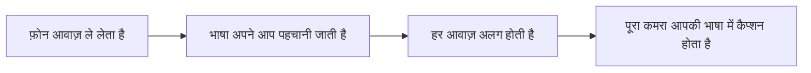
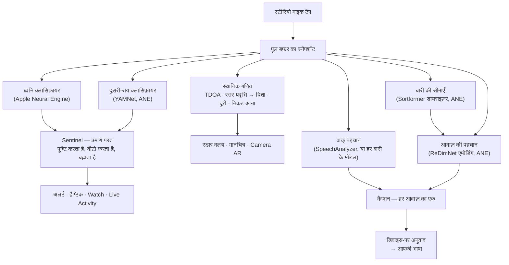
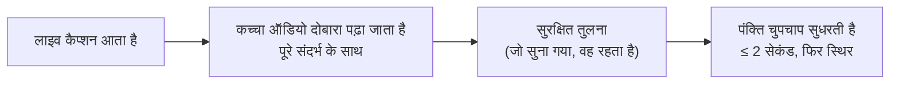
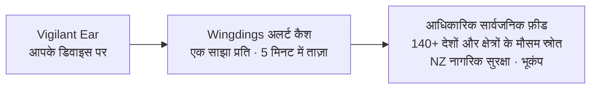

# Vigilant Ear 👂🛡️

*संस्करण 1.1.13 से प्रभावी · अक्टूबर 2026।*

## जो सुन नहीं पाते, उनके लिए एक ध्वनिक रडार।

बधिर, कम सुनने वाले और CODA समुदाय के लिए ख़ास तौर पर बना ऐप। ज़्यादातर ध्वनि-पहचान ऐप बताते हैं कि आवाज़ *क्या* है। **Vigilant Ear बताता है कि वह कहाँ है, कौन कर रहा है, और वे क्या कह रहे हैं** — iPhone को एक ऐसे उपकरण में बदलता है जो आपके आस-पास की ध्वनि का ब्यौरा उसी समय देता है जब वह हो रही हो।

सायरन की दिशा और दूरी। आपके पीछे एक खटखटाहट। बातचीत के लोग, अलग-अलग लिप्यंतरित आवाज़ों की तरह खींचे गए — हर एक पर कैप्शन, और दिशा में रखा हुआ। अगर कोई ऐसी भाषा बोल रहा हो जिसे आप पढ़ नहीं पाते, उनके शब्द **आपकी भाषा में अनूदित होकर** आ सकते हैं। अलर्ट आपकी **लॉक स्क्रीन, Dynamic Island और Apple Watch** तक पहुँचते हैं, ताकि एक नज़र काफ़ी हो।

जो मायने रखता है, वह सब डिवाइस पर चलता है। पहचान के लिए ऑडियो न रिकॉर्ड होता है, न अपलोड। कुछ भी इस पर निर्भर नहीं कि कोई इंसानी कान कुछ सुने।

- 🧭 **दिशा, सिर्फ़ पहचान नहीं।** *क्या, कहाँ, कौन,* और *क्या कहा गया* — सिर्फ़ यह नहीं कि “कोई आवाज़ हुई।”
- 📣 **नाम पुकारा गया।** अपना नाम, किसी बच्चे का, या किसी साथी का लिखें — “Marie का ऑर्डर तैयार” फ़ोन और Watch को सचेत करता है, और बताता है किस ओर।
- 🔒 **डिज़ाइन से निजी।** वर्गीकरण, कैप्शन और अनुवाद आपके iPhone पर चलते हैं। कैप्शन लाइव और क्षणिक हैं; वे प्रतिलेख के संग्रह के रूप में सहेजे नहीं जाते।
- ⌚ **आपकी कलाई और लॉक स्क्रीन पर।** Apple Watch का दिशा-साथी + Live Activity आख़िरी अलर्ट और यह कि वह किस ओर से आया, एक नज़र की दूरी पर रखते हैं।
- 🛰️ **अधिक फ़ोन, एक साझा सुनना।** हमारा Constellation मेश Ultra-Wideband वाले iPhone को जोड़ता है, ताकि हर एक जो सुने उसे एक तीक्ष्ण दिशात्मक तस्वीर में मिलाया जा सके।
- 👁️ **बधिर / कम सुनने वाले / CODA के लिए बना।** अलग-अलग हैप्टिक, उच्च-कंट्रास्ट दृश्य, रंग-स्वतंत्र संकेत, बड़े टैप लक्ष्य, और पूरे ऐप में मोशन कम करें।

---

## यह किसके लिए है

- **बधिर, कम सुनने वाले और CODA उपयोगकर्ता** जो ध्वनि की परिस्थितिजन्य जागरूकता चाहते हैं — Home Watch (खटखटाहट, अलार्म, शिशु, फ़ोन) और Street Watch (सायरन, निकट आना), जिन्हें आप चालू छोड़ सकते हैं और जिन पर भरोसा कर सकते हैं।
- कोई भी जिसे **दिशा और वक्ता-पृथक्करण वाले लाइव कैप्शन** चाहिए, या पास बैठे लोगों का **डिवाइस-पर अनुवाद**।
- सुलभता और ध्वनिक-शोध के उपयोगकर्ता, जिन्हें डिवाइस-पर ध्वनि स्थानीयकरण में रुचि हो।

> Vigilant Ear एक सुलभता **सहायता** है, प्रमाणित जीवन-सुरक्षा उपकरण नहीं।

---

## यह क्या करता है

### 🧭 यह ध्वनि देखता है — दिशा और दूरी

iPhone के दो माइक्रोफ़ोन से Vigilant Ear **ध्वनि का कोण और यह कि वह आपके आगे है या पीछे** मापता है, उस रीडिंग को लगभग एक डिग्री तक स्थिर रखता है, और उसे एक लाइव चिह्न के रूप में ऐसे रडार वलय और मानचित्र पर रखता है जिसका ऊपर वाला किनारा आपकी दिशा में हो। एक सीध में दो माइक्रोफ़ोन अपने बल पर बाएँ को दाएँ से नहीं बता सकते। आपके दाएँ 50° की ध्वनि और आपके बाएँ 50° की ध्वनि एक ही छोटे समय-अंतर के साथ पहुँचती हैं। ऐप रीडिंग के साथ **दूसरी ओर एक हल्का आभासी चिह्न** भी खींचता है, और कलाई का एक घुमाव या दूसरा फ़ोन उसे तय कर देता है। दूरी तीव्रता से अनुमानित होती है, सड़क पर अंशांकित वक्र के मुक़ाबले, और उसी अनुमान के रूप में दिखाई जाती है, संभावित सीमा के साथ, उस देश की इकाइयों में जिसमें आप हैं — उस भाषा की नहीं जिसमें आप ऐप पढ़ रहे हैं। अमेरिकी फ़ोन पर वह *≈ 50 ft* पढ़ता है। आप हिलें, तो चिह्न अपनी वास्तविक-दुनिया की जगह पर टिके रहते हैं। यही मूल है: एक ऐसी दुनिया की स्थानिक जागरूकता जिसे आप सुन नहीं पाते। (आँकड़े नीचे।)

### 🚨 यह ज़रूरी ध्वनियाँ पहचानता है — और आपको चेताता है

एक डिवाइस-पर क्लासिफ़ायर सैकड़ों रोज़मर्रा की ध्वनियाँ पहचानता है और महत्वपूर्ण श्रेणियों पर नज़र रखता है — **सायरन, अलार्म — कार-अलार्म की एक समर्पित श्रेणी सहित — डोरबेल/खटखटाहट, शिशु का रोना, पास का कोई व्यक्ति, और गंभीर मौसम।** जब इनमें से कोई चले, आपको स्क्रीन पर एक स्पष्ट अलर्ट, वैकल्पिक **पुश सूचना**, और एक अलग **हैप्टिक** मिलता है — तब भी जब ऐप बैकग्राउंड में हो या फ़ोन सोया हो। महत्वपूर्ण श्रेणियाँ डिफ़ॉल्ट रूप से तैयार रहती हैं, ताकि सूचनाएँ चालू करने का मतलब “सब कुछ बंद” न हो। सभी अलर्ट श्रेणियाँ बंद कर दें, तो इंजन बैकग्राउंड में पूरी तरह सुप्त हो जाता है, ताकि बैटरी बचे। एक **Sentinel** परत अलर्ट को स्वतंत्र प्रमाण से जाँचती है — दिशा, गति और सार्वजनिक फ़ीड — ताकि जो चले वह पुष्ट हो, अकेले क्लासिफ़ायर का अनुमान नहीं। यह दोनों ओर काम करता है: गीत के अंदर सायरन-जैसा क्षण रोक दिया जाता है, पर आपके संगीत के बीच दोहराता असली सायरन आर-पार निकलकर अलर्ट करता है।

गंभीर-मौसम की चेतावनियाँ **140 से अधिक देशों और क्षेत्रों के आधिकारिक सरकारी स्रोतों** से आती हैं, और अक्सर और जुड़ती रहती हैं — सभी उपयोगकर्ताओं के लिए मुफ़्त। नागरिक-सुरक्षा के आपातकालीन अलर्ट भी शामिल हैं, अपने **आपातकालीन अलर्ट** टॉगल के साथ। फ़ीड उन तक सिकोड़ दी जाती हैं जो वहाँ लागू होती हैं जहाँ आप हैं। जहाँ उपलब्ध हो, ऐप राष्ट्रीय मौसम एजेंसियों के **अग्रिम बुलेटिन** भी पढ़ता है — टाइफ़ून या भारी बारिश से कई दिन पहले जारी सादे-भाषा के नोटिस, न कि केवल वे चेतावनियाँ जो ख़तरा पहुँचने के बाद जारी होती हैं — साथ ही अचानक मूसलाधार बारिश और भूस्खलन के बुलेटिन। अग्रिम नोटिस शांति से दिखाए जाते हैं, बिना उस ध्वनि और कंपन के जो असली चेतावनी के लिए रखे गए हैं।

### 🌧️ मानचित्र पर मौसम रडार

ऐप खुलते ही मानचित्र पर बारिश और बर्फ़ दिखती है — संयुक्त राज्य, कनाडा, जापान, इटली और यूरोप के बड़े हिस्से के राष्ट्रीय रडार से, और दुनिया के बाक़ी अधिकांश हिस्से में उपग्रह से बारिश का अनुमान। मानचित्र छुएँ, और पिछला घंटा तीन बार चलता है, ताकि आप देख सकें तूफ़ान किस ओर बढ़ रहा है; नीचे एक पैमाना हल्का से घना तक पढ़ता है। अगर आप इस सत्र के लिए इसे न चाहें, तो मौसम बटन पर टैप करके इसे बंद कर दें। रडार उसी रास्ते आता है जिस रास्ते चेतावनियाँ आती हैं — हमारे अपने सर्वर से, इसलिए आपका फ़ोन कभी सरकारी सर्वर से संपर्क नहीं करता। हल्के स्लेटी तीर यह भी दिखाते हैं कि हवा किस ओर बह रही है, दुनिया में कहीं भी, वर्तमान घंटे के लिए NOAA के वैश्विक पूर्वानुमान से।

### 🛟 किसे कॉल करें — जीवन-रक्षक चक्र

मानचित्र के कम्पास के बगल एक जीवन-रक्षक चक्र उस देश की एक छोटी सूची खोलता है जिसमें आप खड़े हैं:

- आपातकालीन नंबर, कॉल और संदेश के बटन के साथ, और Real-Time Text पर एक नोट जहाँ आपातकालीन नंबर पर संदेश काम न कर सकता हो
- राष्ट्रीय मौसम एजेंसी
- एक बधिर संगठन, जहाँ किसी का स्थिर पृष्ठ हो
- Vigilant Ear सहायता

मदद पैनल (लाइफ़ रिंग) से Vigilant Ear शेयर करें: एक कोड जिसे आपके पास बैठा कोई व्यक्ति ऐप पाने के लिए स्कैन कर सकता है, App Store का लिंक, और हमारा Instagram।

### ⌚ Apple Watch + Live Activity — एक नज़र, और पता

- **Apple Watch साथी** — अलर्ट की दिशा आपकी कलाई पर इंगित होती है, ताकि एक नज़र बता दे कि कहाँ देखें। नया Watch इंटरफ़ेस, ऐप के कान वाले आइकन के साथ, ख़तरे वाला HUD लेआउट, और अलर्ट ख़ारिज करने के लिए डबल-टैप। Watch ऐप खुला न हो, तब भी अलर्ट दिशा का तीर दिखा सकते हैं।
- **Apple Watch पर नाम पुकारा गया।** जब कोई आपका नाम लेता है, तो आपकी घड़ी तीन बार थपकी देती है और आवाज़ की ओर एक तीर दिखाती है। जब फ़ोन बाएँ और दाएँ में फ़र्क़ नहीं कर पाता, तो एक पंखा दोनों तरफ़ दिखाता है। यह आपके iPhone के लॉक रहते हुए भी काम करता है, जब तक घड़ी पर Vigilant Ear ऐप खुला है। नाम पुकारा गया के लिए Speaker Mode चालू होना ज़रूरी है।
- **Live Activity** — Vigilant Ear आपकी **लॉक स्क्रीन** पर, **Dynamic Island** में, और **Watch Smart Stack** में रहता है, ताकि आख़िरी अलर्ट और उसकी दिशा हमेशा एक नज़र दूर हों।
- **कलाई पर साथी अलर्ट** — जब किसी जुड़े Constellation साथी का फ़ोन अलर्ट उठाए, वह आपकी Watch तक भी पहुँच सकता है, दिशा सहित। साथी पूरे दिन में Watch की बैटरी का बहुत कम हिस्सा इस्तेमाल करता है।

### 💬 Speaker Mode — लाइव, दिशात्मक कैप्शन *(मुफ़्त)*

**Speaker Mode** चालू करें, और Vigilant Ear आपके पास बोल रहे लोगों को **कैप्शन ब्लॉकों में लिखता है, हर आवाज़ का एक।** डिवाइस-पर वक्ता-डायराइज़ेशन आवाज़ों को अलग रखता है — *कौन* *क्या* कह रहा है — भीतरी वलय पर एक दिशात्मक संकेत के साथ। लाइव वक्ता हाइलाइट होता है; जगह चाहिए तो पुराना पाठ स्क्रॉल होकर हट जाता है।

**हर वक्ता अपनी भाषा में।** कम से कम 8 GB मेमोरी वाले iPhone पर कैप्शन-मॉडल का एक बार का डाउनलोड (लगभग 1 GB — Wi-Fi पर, या पूछने के बाद सेल्युलर पर) ऐप को हर बारी उस भाषा में कैप्शन करने देता है जो वास्तव में बोली जा रही हो, ताकि अंग्रेज़ी, स्पेनिश, फ़्रेंच और अरबी के बीच बदलता कमरा समझ में आए। हमारे परीक्षणों में चार-भाषा की बातचीत में शब्द-त्रुटियाँ लगभग 80% से 14% पर आ गईं। संस्करण 1.1.12 से एक बेहतर वाक् मॉडल शोर में बहुत कम ग़लतियाँ करता है — iPhone 17 पर एक शोरगुल वाले बार में जर्मन कैप्शन में ग़लत शब्दों का हिस्सा 45% से 20% हुआ — और Wi-Fi पर पुराने मॉडल को अपने आप बदल देता है। डाउनलोड के बिना — और चीनी, जापानी तथा कोरियाई के पाठकों के लिए, जहाँ Apple का पहचानक बेहतर पढ़ता है — कैप्शन पहले की तरह Apple की डिवाइस-पर वाक् पहचान का उपयोग करते हैं।

दो काम जो ज़्यादातर कैप्शन ऐप नहीं करेंगे।

**विश्वास के बारे में ईमानदारी।** हर पंक्ति पर एक सूक्ष्म गुणवत्ता-चिह्न, और संदिग्ध शब्दों के नीचे बिंदीदार रेखाएँ, बताती हैं कि पंक्ति पर कब भरोसा करें और कब दोबारा जाँचें।

**स्व-सुधार।** वाक्य आते ही ऐप पूरे संदर्भ के साथ ऑडियो दोबारा पढ़ता है, और कुछ सेकंड के भीतर छूटा या ग़लत सुना गया शब्द वापस ला सकता है; फिर पाठ स्थिर हो जाता है।

**नाम पुकारा गया** (सेटिंग्स, जब तक आप इसे चालू न करें तब तक बंद) उन कैप्शन में आपके लिखे नाम देखता है — आपका, किसी बच्चे का, किसी साथी का। जब कोई कहे “Marie का ऑर्डर तैयार”, आपको एक अलग हैप्टिक और दिशा के साथ Watch अलर्ट मिलता है, एक और कैप्शन बुलबुला नहीं। शब्द Speaker Mode में बोली के रूप में फिर भी दिखते हैं; यह वह टैप है कि वे *आपसे* बात कर रहे थे।

**कड़ी भाषा ढकी जा सकती है** (सेटिंग्स → कैप्शन)। वरना गाली सादे पाठ के रूप में आती है, उसे नरम करने को कुछ नहीं होता, और पढ़ने वाले को पहले नज़र हटाने का मौक़ा नहीं मिलता; इसे चालू करें, तो वे शब्द चिह्नों से बदल दिए जाते हैं, ताकि वाक्य उस शब्द के बिना भी पढ़ा जा सके। क्या गिना जाए, यह आपके डिवाइस का अपना वाक् पहचानक तय करता है — हमारी कोई शब्द-सूची नहीं — इसलिए यह उस भाषा का पालन करता है जिसका लिप्यंतरण हो रहा है। 18 वर्ष से कम घोषित खाते पर यह हमेशा चालू रहता है और एक ताला दिखाता है। यह उस बोली पर लागू होता है जिसे *यह* डिवाइस लिप्यंतरित करता है; जोड़े गए फ़ोन से आया पाठ वहाँ लिप्यंतरित हुआ था और तैयार पाठ के रूप में पहुँचता है।

**जिस शब्द पर वक्ता ने ज़ोर दिया, वह मोटे अक्षरों में चिह्नित होता है।** अंग्रेज़ी में ज़ोर से कहा जाए, तो "I didn't say THAT" और "I didn't say that" दो अलग वाक्य हैं, और एक समान प्रतिलेख वह अंतर पूरी तरह खो देता है। ऐप उस एक शब्द को देखता है जिसकी पिच वक्ता की आवाज़ ने उठाई, और उसे मोटा करता है — एक पंक्ति में अधिक से अधिक एक, और जब उसे यक़ीन न हो तो कुछ भी नहीं, क्योंकि ग़लत शब्द चिह्नित करने का अर्थ होगा कि व्यक्ति ने कुछ ऐसा कहा जो उसने कहा ही नहीं। चीनी और जापानी में यह बंद है, जहाँ पिच बताती है *यह कौन-सा शब्द है*, न कि उसे कितनी ज़ोर से धकेला गया।

कैप्शन मुफ़्त हैं; स्वचालित अनुवाद वैकल्पिक Power Pack+ परत है। कैप्शन **Bluetooth डिवाइस पर ज़ोर से भी बोले जा सकते हैं, श्रवण यंत्र सहित** — मुफ़्त, सेटिंग्स में। **दिशा टोन** (ये भी मुफ़्त, सेटिंग्स → कैप्शन में) आपके चुने हुए कान में एक वैकल्पिक श्रव्य संकेत जोड़ते हैं, जो बताता है वक्ता कहाँ है — श्रवण यंत्र या एक तरफ़ से सुनने के साथ उपयोगी, और किसी के भी लिए उपलब्ध।

### 🌐 स्वतः-अनुवाद — आपकी भाषा, लाइव *(Power Pack+)*

Speaker Mode चालू हो, तो जब पास का कोई व्यक्ति दूसरी भाषा बोले, Vigilant Ear उसे पहचान सकता है और उनके कैप्शन **आपकी भाषा में** दिखा सकता है, स्रोत भाषा उनके ब्लॉक पर लिखी रहती है। शृंखला — सुनना → वक्ताओं को अलग करना → लिप्यंतरण → अनुवाद → दिखाना — **डिवाइस पर** चलती है; नेटवर्क का एकमात्र क्षण Apple से भाषा-पैक का एक बार का डाउनलोड है, और जब आप उसी डाउनलोड का इंतज़ार कर रहे हों तो ऐप ऐसा कह देता है, बजाय इसके कि आपको अननुवादित पाठ देखते छोड़ दे। आपको दूसरी भाषा पहले से जाननी या चुननी नहीं होती। पूरा वाक्य समाप्त होते ही अनुवाद हो जाता है, वक्ता के रुकने का इंतज़ार किए बिना, और अनुवाद समय के एक छोटे अंश में पहुँचते हैं।

यह **विज्ञान-कथा के सार्वभौमिक अनुवादक** के सबसे क़रीब उपलब्ध चीज़ है — एक ऐसा उपकरण जो बस समझ लेता है। Vigilant Ear भाषा अपने आप पहचानता है, कमरे के हर वक्ता का अनुसरण करता है, और उन सब के कैप्शन आपकी भाषा में करता है — न ईयरबड, न सेटअप, आपके डिवाइस पर।

### 🎵 संगीत और प्रसारण की जागरूकता *(Power Pack+)*

**ShazamKit** आपके आस-पास बज रहे संगीत को पहचानता है और गीत बदलने को अपने आप पकड़ता है, ताकि शीर्षक वर्तमान बना रहे।

### 🎛️ Acoustic Scope — ध्वनि को इंजीनियर की तरह देखें

आपके आस-पास की ध्वनि का एक पेशेवर लाइव दृश्य: स्पेक्ट्रम, स्पेक्ट्रोग्राम, ⅓-ऑक्टेव RTA बैंड, क्रोमा, और हार्मोनिक पार्शियल — **हर किसी के लिए मुफ़्त**। **Partials संगीत पढ़ता है:** हर सुर अपने स्वर के नाम से पुकारा जाता है, उसके पास उसकी हार्मोनिक शृंखला होती है, धुआँ-अलार्म जैसी ऊँची ध्वनियों का नाम उनकी असली पिच पर पड़ता है, और आप एक लक्ष्य स्वर सेट कर सकते हैं जो गाने या सुर मिलाने के लिए एक रेखा बनकर खिंचता है। Spectrogram खुला छोड़ने पर लगभग कुछ भी खर्च नहीं होता, चाहे आप कितनी देर देखें। अपनी कस्टम साउंड पैक के प्रशिक्षण के लिए ध्वनियाँ कैप्चर करने वाले उपकरण Power Pack+ का हिस्सा हैं।

### 📦 कस्टम साउंड पैक — इसे अपनी दुनिया सिखाएँ *(Power Pack+)*

आप Vigilant Ear को वे ध्वनियाँ सिखा सकते हैं जो आपके लिए मायने रखती हैं — स्थानीय पक्षी, किसी इमारत की दरवाज़ा-घंटी, जनरेटर की असामान्य गुनगुनाहट, या उड़ान भरते किसी विमान का प्रकार। ये ऐड-ऑन पैक बिल्ट-इन पहचान के ऊपर जुड़ते हैं, इसलिए नई ध्वनियाँ सायरन और अलार्म की जगह कभी नहीं लेतीं। क़दम-दर-क़दम मार्गदर्शिका ऐप में बनी हुई है।

### 🛰️ Constellation — कई iPhone, एक साझा सुनना *(Power Pack+)*

दो या अधिक Ultra-Wideband-सक्षम iPhone (iPhone 11 के बाद के ज़्यादातर) के साथ **Constellation** मेश उन्हें जोड़ता है, ताकि वे एक-दूसरे की स्थिति भाँप सकें और हर एक जो सुनता है उसे मिलाकर एक ही, अधिक सटीक तस्वीर बना सकें कि ध्वनि कहाँ से आ रही है — एक वितरित, निष्क्रिय श्रवण सरणी। कैप्शन भी मिलते हैं: हर फ़ोन वही लिप्यंतरित करता है जो उसका अपना माइक्रोफ़ोन सुनता है, और शब्द फ़ोनों के बीच संरेखित होते हैं, ताकि वक्ता के सबसे पास वाला फ़ोन जो सुना वह जोड़े — जो शब्द केवल एक फ़ोन ने पकड़े, वे खोने के बजाय रह जाते हैं।

फ़ोन **एक-दूसरे से सीधे** जुड़ते हैं — न राउटर, न साझा Wi-Fi नेटवर्क, और न इंटरनेट; Wi-Fi को बस चालू होना है। वे वही पीयर-टू-पीयर कड़ी इस्तेमाल करते हैं जो AirDrop इस्तेमाल करता है, और केवल सही हार्डवेयर वाले फ़ोन जुड़ सकते हैं। फ़ोनों के बीच की कड़ी हमेशा एन्क्रिप्टेड रहती है; Vigilant Ear 1.1.6 या उससे पुराना चला रहे फ़ोनों को मेश में शामिल होने के लिए ऐप अपडेट करना होगा।

**साथी संदेश** — मेश साथी के फ़ोन पर एक छोटा पाठ भेजें; वह उनके कैप्शन फ़ीड में पहुँचता है, और डिवाइस पर उनकी भाषा में अनूदित होकर आ सकता है। संदेश आयु-जागरूक हैं: Apple की Declared Age Range पर बने। वयस्क और नाबालिग के बीच पाठ तब तक बंद रहता है जब तक दोनों लोगों ने जान-बूझकर एक-दूसरे को नामित न किया हो। अलर्ट और कैप्शन कभी रोके नहीं जाते — केवल व्यक्ति-से-व्यक्ति पाठ।

### 🔗 Remote Link — किसी ऐसे तक पहुँचें जो साथ नहीं है *(शुरू करने के लिए Power Pack+)*

जो काम एक फ़ोन कॉल आमतौर पर करता है, वह वीडियो और पाठ से। आप एक निमंत्रण कोड भेजते हैं; दूसरा व्यक्ति Vigilant Ear के अंदर से जुड़ता है, **Power Pack+ का मालिक हुए बिना**। Constellation के उलट यहाँ निकटता की कोई शर्त नहीं — आप दोनों कहीं भी हो सकते हैं।

**किसी भी बिंदु पर ऑडियो का उपयोग नहीं होता।** केवल वीडियो और पाठ, इसलिए कड़ी की कोई बात दोनों तरफ़ सुनने पर निर्भर नहीं — और यह आपको ऐप के ज़रिए किसी के साथ सांकेतिक भाषा करने का रास्ता देता है। ऐप स्वयं सांकेतिक भाषा नहीं समझता; वह वीडियो ले जाता है, और बाक़ी आप दोनों करते हैं। कनेक्शन दो फ़ोनों के बीच सीधा होता है जहाँ नेटवर्क इसकी अनुमति दे, और ऐप साफ़ दिखाता है कि वह **Direct** है या **Relayed**, ताकि आप हमेशा जानें कि आपका वीडियो किसी रिले से गुज़र रहा है या नहीं।

**कैप्शन भी साथ चलते हैं।** हर फ़ोन जो लिप्यंतरित करता है, वह दूसरे पर दिखता है, ज़रूरत पड़ने पर पाठक की भाषा में अनूदित। आप दोनों में से कोई भी कड़ी रोक सकता है — वीडियो और कैप्शन — और उसे फिर चला सकता है, और मुख्य स्क्रीन से काट सकता है।

### 📷 Camera AR — “ध्वनि देखें”

ऐक्शन फ़ैन से Camera AR खोलें, और पहचानी ध्वनियों को लाइव कैमरा दृश्य में उनकी असली दिशा पर पिन करें। चिह्न वक्ता के अनुसार, या ध्वनि की श्रेणी और दिशा के अनुसार, गुच्छों में आते हैं, ताकि दृश्य पढ़ा जा सके, और ध्वनि शांत बनी रहने पर वे फीके पड़ जाते हैं।

### 🗺️ मानचित्र, सड़कें और पथ का पूर्वानुमान

ध्वनि की दिशाएँ मानचित्र पर वास्तविक GPS निर्देशांकों पर प्रक्षेपित होती हैं। वाहन की ध्वनियाँ **पास की सड़कों पर स्नैप** हो सकती हैं, और उनके पथ का पूर्वानुमान होता है, ताकि गुज़रता ट्रक इमारतों के आर-पार नहीं, *सड़क के साथ-साथ* चलता पढ़े। (Feature Playground में दमकल-ट्रक का डेमो आज़माएँ।)

### 🪄 Feature Playground — बिना सुने सिद्ध करें

**Feature Playground** सबके लिए सार्वजनिक है: Home और Street के नमूना अलर्ट (खटखटाहट, अलार्म, शिशु, सायरन, मौसम), बहु-फ़ोन और बातचीत के डेमो। इन पर साफ़ वॉटरमार्क होता है, ताकि अभ्यास कभी लाइव घटना का रूप न धरे। पैनल बंद करते ही डेमो साफ़ हट जाते हैं (कोई अटका GPS स्पूफ़ नहीं, कोई बचा फ़्लैग नहीं)।

### ♿ सुलभता पहले

बधिर / कम सुनने वाले / CODA और वर्णांध उपयोगकर्ताओं के लिए बना:

- **रंग-स्वतंत्र** संकेत
- **≥44 pt** टैप लक्ष्य
- **मोशन कम करें** का सम्मान
- अरबी पाठकों के लिए **दाएँ-से-बाएँ लेआउट**
- बहु-माध्यम अलर्ट (हैप्टिक + दृश्य + Watch)
- एक आरंभ-सत्यापन स्क्रीन, जो अनुमति की स्थिति साफ़ हरे / स्लेटी / लाल में दिखाती है, और “अनुमति नहीं” के लिए जले नारंगी में — जिसमें वह सूचना-अनुमति भी है जो मास्टर अलर्ट स्विच का काम करती है

---

## मुफ़्त और Power Pack+

सुरक्षा का मूल **हमेशा के लिए मुफ़्त** है:

- **Home Watch और Street Watch** — स्थानीय ध्वनि अलर्ट (अलार्म, सायरन, खटखटाहट/डोरबेल, शिशु, पास का व्यक्ति), स्क्रीन पर, हैप्टिक के साथ, और वैकल्पिक पुश वितरण के साथ।
- **लाइव कैप्शन** — Speaker Mode, डिवाइस पर, जहाँ हार्डवेयर दे वहाँ दिशात्मक, ईमानदार विश्वास-चिह्नों के साथ, ~2-सेकंड का स्व-सुधार, Bluetooth डिवाइस (श्रवण यंत्र सहित) पर वैकल्पिक बोला गया आउटपुट, और दिशा टोन।
- **नाम पुकारा गया** — वैकल्पिक नाम जो आप टाइप करते हैं (आपका, बच्चों के, साथी का)। मेल एक Watch/फ़ोन अलर्ट है, दिशा के साथ, दूसरा कैप्शन नहीं।
- **Standing Watch** — कमरे की अपनी दशा, हमेशा चालू, सेट करने को कुछ नहीं: स्थिर सियान लैंप जब तक कमरा अपना पैटर्न थामे रहे, ऐम्बर जब कुछ बदले — एक नई आवाज़, अचानक शांति, या कुछ क़रीब आता हुआ। ऐप शुरू होते ही वह बताता है कि वह अलर्ट के लिए कितनी देर नहीं सुन रहा था।
- **गंभीर-मौसम अलर्ट** — आपके क्षेत्र की आधिकारिक चेतावनियाँ, 140 से अधिक देशों और क्षेत्रों के सरकारी स्रोतों से, और अक्सर और जुड़ती रहती हैं।
- **मौसम रडार** — मानचित्र पर बारिश और बर्फ़, पिछले घंटे की पुनरावृत्ति के साथ, और यह कि हवा किस ओर बह रही है।
- **जीवन-रक्षक चक्र** — जिस देश में आप हैं, वहाँ किसे कॉल करें।
- **भूकंप अलर्ट (दुनिया भर)** — पास भूकंप की रिपोर्ट हो, तो एक बज़ महसूस करें और मानचित्र पर वह क्षेत्र देखें जिसने उसे महसूस किया। आधिकारिक भूकंप फ़ीड से एक पुष्टि — पूर्व-चेतावनी नहीं: अगर आपको झटका महसूस हुआ, यह बताता है वह क्या था। फ़ीड हर पाँच मिनट जाँची जाती है, बैकग्राउंड में भी, और डिवाइस-पर गहरी गड़गड़ाहट (इन्फ़्रासाउंड) का संवेदन ज़मीन हिलते ही एक अतिरिक्त जाँच तैयार कर सकता है।
- **Feature Playground** — स्पष्ट PREVIEW वॉटरमार्क के साथ अभ्यास अलर्ट और सुविधाओं के पूर्वावलोकन।
- **Apple Watch साथी और Live Activity** — एक नज़र में दिशा और आख़िरी अलर्ट।
- **Acoustic Scope** — प्रो-स्तर का लाइव ध्वनि-दृश्य, हर किसी के लिए मुफ़्त। (प्रशिक्षण के लिए कैप्चर करने वाले उपकरण Power Pack+ हैं।)
- **शोध सरणी** *(जब तक आप इसे बंद न करें, चालू)* — जब यह चालू हो, समय, एक मोटा स्थान (लगभग 1 किमी) और भूकंप-जैसी घटनाओं की आवृत्ति साझा होती है — कोई ऑडियो नहीं, कोई पहचानकर्ता नहीं — भूकंपों और अन्य निम्न-आवृत्ति घटनाओं का नक़्शा बनाने में मदद के लिए। मानचित्र पर एक प्रश्न एक बार पूछता है। रिपोर्ट तब तक रुकती हैं जब तक वह प्रश्न स्क्रीन पर न आ चुका हो।

**Power Pack+** एक बार का अनलॉक है (**सदस्यता नहीं**), **90-दिन के मुफ़्त परीक्षण** के साथ। यह महाशक्तियाँ जोड़ता है:

- **स्वतः-अनुवाद** — पास की बोली का आपकी भाषा में डिवाइस-पर अनुवाद।
- **Constellation** — Ultra-Wideband पर कई iPhone का साझा श्रवण, साथी संदेशों सहित।
- **Music ID** — ShazamKit से गीत पहचान।
- **कस्टम साउंड पैक** — ऐड-ऑन क्लासिफ़ायर, जिन्हें आप अपनी ध्वनियों के लिए प्रशिक्षित करते हैं।
- **Remote Link** — किसी ऐसे व्यक्ति के साथ निजी वीडियो और पाठ कॉल जो आपके साथ नहीं है, किसी भी बिंदु पर बिना ऑडियो के। शुरू करने के लिए Power Pack+ चाहिए; जिसे आप आमंत्रित करते हैं, वह मुफ़्त जुड़ता है।

मुफ़्त हो या Power Pack+, **पहचान के लिए आपका ऑडियो डिवाइस पर ही रहता है** — स्तर केवल यह बदलता है कि कौन-सी सुविधाएँ अनलॉक हैं, यह कभी नहीं कि विश्लेषण के लिए कच्चा ऑडियो कहाँ भेजा जाता है।

---

## यह कैसे काम करता है (अंदर से)

Vigilant Ear एक **स्थानीय-प्रथम, डिवाइस-पर** पाइपलाइन है, परतों में बनी: एक बार कैप्चर करें, फिर स्वतंत्र विशेषज्ञ उसी ध्वनि को पढ़ें और एक-दूसरे के काम की जाँच करें। कच्चा ऑडियो एक उच्च-प्राथमिकता वाले टैप पर कैप्चर होता है, एक **पूल बफ़र फ़्री-लिस्ट** में कॉपी होता है (रीयलटाइम पथ पर बार-बार आवंटन नहीं), और UI को रोके बिना बाँट दिया जाता है:

किसी एक मॉडल पर अकेले भरोसा नहीं होता। **Sentinel** परत पहचान और अलर्ट के बीच बैठती है: स्वतंत्र इंजन फ़्रेम-दर-फ़्रेम एक-दूसरे की पुष्टि या वीटो करते हैं — और जब बार-बार का वास्तविक प्रमाण किसी वीटो के ख़िलाफ़ जमा हो जाता है (आपके संगीत के बीच चीखता असली सायरन), प्रमाण जीतता है और अलर्ट चलता है।

कैप्शन को अपना दूसरा मौक़ा मिलता है। हर अंतिम वाक्य चुपचाप एक छोटी इन-मेमोरी ऑडियो रिंग से, पूरे संदर्भ के साथ, दोबारा पढ़ा जाता है — सुधार लगभग दो सेकंड में आ जाते हैं, फिर पाठ हमेशा के लिए स्थिर हो जाता है:

- **स्थानिक गणित** — FFT, सुसंगति-भारित आगमन-समय अंतर (TDOA — उन आवृत्ति बैंड को तरजीह दें जिन पर दोनों माइक्रोफ़ोन सहमत हों, फिर छोटी पहुँच-देरी को दिशा में बदलें), और बैकग्राउंड कार्यों पर स्तर-प्रवृत्ति से निकट आने की ट्रैकिंग। माइक्रोफ़ोन जोड़ा एक निश्चित ओरिएंटेशन में पढ़ा जाता है, ताकि दिशा एक जैसी काम करे, चाहे आप फ़ोन सीधा पकड़ें या आड़ा।
- **वाक्** — प्रतिलेखन के लिए iOS 26 `SpeechAnalyzer` / `SpeechTranscriber`; डिवाइस-पर अनुवाद के लिए Apple का **Translation** फ़्रेमवर्क। वैकल्पिक कैप्शन डाउनलोड के साथ हर बारी एक वाक्-गतिविधि संसूचक से काटी जाती है, उसकी भाषा एक बोली-भाषा मॉडल चुनता है, और उसे ओपन वाक्-पहचान मॉडल लिप्यंतरित करते हैं — यूरोपीय भाषाओं के लिए एक, बाक़ी के लिए एक — सब डिवाइस पर। आवाज़ की पहचान प्रमाण पर टिकी है: किसी आवाज़ को असली व्यक्ति तभी माना जाता है जब ध्वनि की स्वतंत्र खिड़कियाँ ऐसा कहें, और अनिश्चित मेल ग़लत नाम का अनुमान लगाने के बजाय अनारोपित दिखता है।
- **दो प्रश्नों के लिए दो मॉडल** — आवाज़ों को अलग बताने के लिए यह चाहिए कि *वक्ता कब बदला* और *वह वक्ता कौन है*, और ये एक ही समस्या नहीं। एक **Sortformer** स्ट्रीमिंग डायराइज़र बारी की सीमाएँ चिह्नित करता है; **ReDimNet** एम्बेडिंग तय करती हैं कि हर एक के अंदर किसकी आवाज़ है। सीमा पर काटना उतना मामूली नहीं जितना लगता है: जो खिड़की दो लोगों पर सवार हो, उसमें दोनों होते हैं, और बाद में कोई एम्बेडिंग मॉडल उसे पूर्ववत नहीं कर सकता। दोनों के नीचे एक वाक्-गतिविधि का फ़र्श है — अगर डायराइज़र कठिन कमरे में अनुमान लगाने के बजाय शांत हो जाए, तब भी बारियाँ कटती हैं, इसलिए ऐप दो वक्ताओं को एक में मिलाने के बजाय कम होकर चलता है।
- **संगीत का सच** — एक क्रोमा **गीत-हस्ताक्षर संसूचक** इस फ़ैसले का मालिक है कि “क्या सच में संगीत बज रहा है?”, क्योंकि सामान्य क्लासिफ़ायर शांत कमरों और सायरन को “संगीत” कहने के लिए कुख्यात हैं। Shazam तभी चलता है जब हस्ताक्षर माने कि सच में कुछ संगीतमय मौजूद है।
- **समवर्तीता** — Swift 6 का आइसोलेशन माइक्रोफ़ोन टैप, ध्वनिक गणित और UI रेंडर लूप को साफ़-साफ़ अलग रखता है।
- **दक्षता** — डाउनसैंपलिंग, लोड-अनुकूली वर्गीकरण, और प्रमाण-गेटेड नेटवर्क उपयोग हमेशा-सुनने को इतना हल्का रखते हैं कि उसे चालू छोड़ा जा सके।

मौसम और भूकंप के अलर्ट ऑडियो से उलटा रास्ता लेते हैं — आपकी ध्वनि के बारे में कुछ भी कभी बाहर नहीं जाता, पर अलर्ट का *डेटा* अंदर आता है। **हर** आधिकारिक फ़ीड — और रडार तथा हवा की छवियाँ — एक छोटे रिले कैश से होकर जाती हैं जिसे हम चलाते हैं, ताकि सार्वजनिक डेटा की एक फ़ेच हर उपयोगकर्ता के काम आए, और आपका फ़ोन कभी सरकारी सर्वर से संपर्क न करे:

---

## आपका फ़ोन क्या सुन सकता है — मापा हुआ

आपके iPhone में लगभग छह इंच (15 cm) की दूरी पर दो माइक्रोफ़ोन हैं, एक बैरोमीटर, और एक बहुत अच्छी घड़ी। इतना काफ़ी है यह बताने को कि ध्वनि किस ओर से आई, मोटे तौर पर कितनी दूर से, क्या वह आपकी ओर आ रही है, और क्या कोई दरवाज़ा अभी खुला। यहाँ है कि इनमें से हर एक कितना सटीक है, हमने कैसे जाँचा, और यह क्यों मायने रखता है अगर आप स्वयं वह ध्वनि नहीं सुन पाते। दिशा की तालिका सितंबर 2026 में एक iPhone 17 पर मापी गई। iPhone 16 Pro Max पर वही मेज़-जाँच निरंतर कोण नहीं दे पाई — वह छवि ध्वनि को झटके से आगे या बगल की ओर बैठा देती है — इसलिए डिग्री की पंक्तियाँ अकेले 17 की हैं। दूरी स्वभाव से अनुमान ही रहती है — हम स्क्रीन पर ऐसा कहते हैं। इस खंड में टेप से मापी दूरियाँ फ़ुट में हैं, उसी टेप की इकाइयाँ।

**दिशा — एक-दो डिग्री तक।** ध्वनि ऊपर वाले माइक्रोफ़ोन तक नीचे वाले से पहले पहुँचती है, या बाद में, और उस अंतर से ऐप निकालता है कि ध्वनि फ़ोन की धुरी से कितनी हटी है और वह आगे है या पीछे। फ़ोन के दो चैनल सादे माइक्रोफ़ोन नहीं, बल्कि एक संसाधित स्टीरियो छवि हैं, और कमरे के शोरगुल होने पर वह छवि अपना एक स्थिर पैटर्न जोड़ देती है। ऐप वह पैटर्न लॉन्च के बाद की शांति से सीखता है। शांत कमरे के लगभग एक मिनट बाद वह दिशा पढ़ने से पहले उस पैटर्न को निकाल देता है; तब तक रीडिंग उस सुधार के बिना चलती है।

| हमने क्या मापा | परिणाम |
|---|---|
| 96 अनुकरण किए कमरों में माध्यिका त्रुटि, शांत दफ़्तर से लेकर 5 dB SNR पर कठोर दीवारों वाले कमरे तक | 1.0° |
| मेज़ पर iPhone 17, कमरे का शोर चालू, वक्ता धुरी से 30° हटा | पार्श्व तल से 61.7° पढ़ा, अपेक्षित 60° के मुक़ाबले, डगमगाहट 1.6° |
| वही, वक्ता सीधे फ़ोन के पार्श्व में | 4.5° पढ़ा, अपेक्षित 0° के मुक़ाबले, डगमगाहट 2.2° |
| वही, वक्ता धुरी से 60° हटा | माध्यिका 35.7°, अपेक्षित 30° के मुक़ाबले; रन बँट गया, सीधे-आगे की देरी पर एक दूसरा गुच्छ, सबसे अधिक संभावना परीक्षण-रिग से परावर्तन की |
| वही, वक्ता सीधे आगे | हर रीडिंग अधिकतम देरी पर, जैसा होना चाहिए |
| ऐसी रीडिंग जो ध्वनि के बजाय छवि के अपने पैटर्न पर गिरीं | कोई नहीं, किसी भी कोण पर |

*यह क्यों मायने रखता है:* अगर आप सायरन नहीं सुन पाते, तो “आपके पीछे, एक ओर हटकर” बताता है कि कहाँ देखें। जो रीडिंग स्थिर रहे, उस पर भरोसा तभी करना चाहिए जब उसे टेप से जाँचा गया हो, और इसे दो बार जाँचा गया। पहली जाँच ने परिणाम को जितना था उससे बेहतर दिखा दिया।

**दूरी — उसी अनुमान के रूप में दिखाई जाती है, जो वह है।** एक माइक्रोफ़ोन दूरी नहीं माप सकता, केवल तीव्रता, और दूर का तेज़ ट्रक पास की शांत कार जैसा सुनाई दे सकता है। ऐप तीव्रता से दूरी का अनुमान लगाता है, एक ऐसे वक्र से जो वास्तविक सड़क पर फिट किया गया, फिर उसे वैसे कहता है जैसे कोई सावधान व्यक्ति कहे। अमेरिकी फ़ोन पर वह है *लगभग 50 ft, संभावित रूप से 25 और 100 के बीच।*

| हमने क्या मापा | परिणाम |
|---|---|
| अंशांकन से दोबारा चलाई गई वास्तविक कार-पहचानें | 1,131 |
| उस 100-foot सड़क के भीतर आना जिस पर वे वास्तव में थीं | 73% |
| दूर वाली लेन की कारें | अनुमान 78 और 87 ft, जहाँ टेप ने 73 और 85 ft कहा |

सड़क (एक शहर का चौराहा) लेन-दर-लेन मापी गई; जब वक्र चूकता है, वह नज़दीक वाली ओर चूकता है। अंशांकन एक स्वचालित परीक्षण से लॉक है, ताकि वह चुपचाप खिसक न सके। आपके अपने स्थान के अंदर के अलार्म, जैसे धुआँ संसूचक, को दूरी का कोई आँकड़ा नहीं मिलता — वे पहले से आपके साथ कमरे में हैं।

**गति — आपकी ओर आना।** कारों और सायरन के लिए, तेज़ होते जाना आमतौर पर क़रीब आने का मतलब है। ऐप कुछ सेकंड तक देखता है कि ध्वनि का स्तर कितनी तेज़ी से बढ़ता है: लगभग 1.5 dB प्रति सेकंड की निरंतर चढ़ाई (तीव्रता में स्पष्ट, स्थिर वृद्धि) का मतलब निकट आना है, मेल खाती गिरावट का मतलब दूर जाना है, और जो ध्वनि बदलना बंद कर दे उसे लगभग चार सेकंड बाद न निकट आना कहा जाता है, न दूर जाना। एक अकेला तेज़ क्षण — हॉर्न की एक ठोकर, दरवाज़ा पटकना — इसे चालू नहीं कर सकता। भौतिकी और नौ स्वचालित परीक्षणों पर बना; रिकॉर्ड किया गया सड़क से गुज़रना अगली फ़ील्ड पुष्टि है।

**कमरे की हवा — दरवाज़े का एक हस्ताक्षर होता है।** बैरोमीटर लगभग चौदह फ़ुट (4.3 m) दूर दरवाज़ा खुलना नोटिस कर सकता है: दरवाज़ा घूमते ही दाब गिरता है, फिर बंद होते ही वापस उछलता है। चौदह घंटे की शांति और पंद्रह दरवाज़ा-घटनाओं में हर दरवाज़े ने वह दो-हिस्से का आकार बनाया, और घर की किसी और चीज़ ने नहीं।

| घटना | दाब दर | आकार |
|---|---|---|
| सामने का दरवाज़ा, खुला और बंद, ×10 | 0.6–1.8 Pa/s | गिरावट, फिर उछाल, ~5 सेकंड के अंतर पर |
| सामने का दरवाज़ा, पटका गया, ×5 | 1.1–2.5 Pa/s | वही जोड़ा, अधिक ऊँचा |
| रात भर एयर कंडीशनिंग का चक्र, ×8 | 0.11–0.46 Pa/s | मिनटों में धीमी ढलान, दोनों फ़ोनों पर एक जैसी |
| एक शांत कमरा | ~0.02 Pa/s | कुछ नहीं |
| मानवीय गतिविधि, पास से गुज़रना | — | गति संवेदक नोटिस करता है और फ़ोन उसे अनदेखा कर देता है |

जो दरवाज़ा कमरे को सील नहीं करता, वह अदृश्य रहा — इस परीक्षण में एक जालीदार बाहरी दरवाज़ा — ठीक जैसा होना चाहिए। आज दाब का बदलाव मानचित्र पर गहरी गड़गड़ाहट के रूप में दिख सकता है; एक समर्पित शांत-रात दरवाज़ा अलर्ट मापा जा चुका है और डिज़ाइन किया जा चुका है, और अभी रोज़मर्रा का डिफ़ॉल्ट नहीं है।

**Constellation — दो फ़ोन पक्ष तय करते हैं।** मेश पर हर फ़ोन जहाँ बैठा है वहाँ से ध्वनि की ओर एक रेखा खींचता है, और रेखाएँ केवल एक ओर साफ़-साफ़ क्रॉस करती हैं। जब ऐसा होता है, हल्का आभासी चिह्न गायब हो जाता है और ऐप फिर से बाएँ या दाएँ कह सकता है। अनुकरण में, **40 मीटर** दूर दो फ़ोन 50 मीटर दूर एक सायरन को लगभग 2 मीटर के भीतर रखते हैं।

**यहाँ किसी बात पर विश्वास कैसे होता है।** हर संख्या उन्हीं तीन फाटकों से गुज़री, क्रम से: एक अनुकरण किया कमरा जिसका उत्तर पहले से पता हो; छोटे स्वचालित परीक्षण जो ठीक उस मामले को दोहराते हैं जो ऐप को धोखा दे, और हर बदलाव पर चलते हैं; फिर असली फ़ोन, असली मेज़ पर, दूरियाँ हाथ से मापी हुई। तीसरे से निकलने तक कुछ भी सटीक नहीं गिना जाता। जो व्यक्ति ध्वनि नहीं सुन पाता, उसके लिए ऐप का शब्द ही एकमात्र शब्द है — इसे वैसे कमाया जाना चाहिए जैसे एक प्रयोगशाला कमाती है।

इंजीनियरों के लिए गहरे नोट: [भौतिकी](https://vigilantear.com/en/physics/) — TDOA, दूरी, गति, Constellation, और बैरोमेट्रिक पहचान, हर आँकड़े पर टैग MEASURED / BENCHED / MODELLED।

---

## गोपनीयता

- **मूल पाइपलाइन के लिए हमेशा डिवाइस पर।** वर्गीकरण, स्थानिक गणित, प्रतिलेखन, डायराइज़ेशन और अनुवाद आपके iPhone पर चलते हैं। कच्चा ऑडियो पहचान के लिए न रिकॉर्ड होता है, न अपलोड।
- **कैप्शन क्षणिक हैं।** लाइव कैप्शन सत्र भर मेमोरी में रहते हैं; निर्यात किए गए डिबग लॉग में कैप्शन का पाठ नहीं होता।
- **कोई विज्ञापन या व्यवहार-विश्लेषण SDK नहीं।** सीमित नेटवर्क उपयोग केवल मानचित्रों, सार्वजनिक मौसम फ़ीड, रडार और हवा की छवियों, सहायता सूची, वैकल्पिक कैप्शन-मॉडल डाउनलोड, वैकल्पिक Shazam फ़िंगरप्रिंट, सड़क संदर्भ, उस सुविधा के चालू रहने पर शोध सरणी की रिपोर्ट, और App Store ख़रीदारी के लिए है — विवरण हमारी गोपनीयता नीति में देखें।

पूर्ण विवरण: [गोपनीयता](/hi/privacy/) · [नियम](/hi/terms/) · [सहायता](/hi/support/)

---

## हार्डवेयर और प्लेटफ़ॉर्म

- **iPhone (पूरा अनुभव)।** पोर्ट्रेट या लैंडस्केप में काम करता है — जैसे चाहें पकड़ें। दिशा निकालने के लिए स्टीरियो माइक्रोफ़ोन ज़रूरी हैं। सुझाव है **iPhone 13 या उससे नया**; हर वक्ता की भाषा में कैप्शन के लिए **8 GB मेमोरी** चाहिए (iPhone 15 Pro और बाद के)।
- **Apple Watch।** दिशा के तीर के साथ साथी अलर्ट; Live Activity / Smart Stack के साथ काम करता है।
- **iPad (नेटिव)।** अनुकूल लेआउट: बड़ी स्क्रीन पर लाइव कैप्शन को मानचित्र के बगल एक पारदर्शी पैनल मिलता है, जो तब सिमट जाता है जब कोई न बोल रहा हो। एकल-चैनल माइक → पूरी दिशा के बिना कैप्शन।
- **Constellation** को **Ultra-Wideband** चाहिए — iPhone 11 या बाद का, SE और “e” मॉडल को छोड़कर। इसे Wi-Fi नेटवर्क की **ज़रूरत नहीं**: Wi-Fi चालू होने पर फ़ोन एक-दूसरे को सीधे ढूँढ लेते हैं, इसलिए Constellation बिना राउटर और बिना इंटरनेट के काम करता है, जब तक फ़ोन एक-दूसरे के पास हों।
- **Android (जब उपलब्ध हो)।** अलग बिल्ड, जिसमें मुख्य रडार, अलर्ट, कैप्शन और मौसम हैं; Constellation मेश iOS-प्रथम है।

---

## स्थानीयकरण

पूरी तरह स्थानीयकृत — इंटरफ़ेस, अलर्ट और कैप्शन — **अंग्रेज़ी, स्पेनिश, पुर्तगाली (ब्राज़ील), फ़्रेंच, जर्मन, इतालवी, तुर्की, अरबी, जापानी, सरलीकृत चीनी, पारंपरिक चीनी, कोरियाई, रूसी, हिन्दी, रोमानियाई और पोलिश** में (16 भाषाएँ)। सिस्टम लोकेल का अनुसरण करता है, या ऐप में हाथ से किया गया चुनाव। रोमानियाई कैप्शन डिवाइस पर काम करते हैं; Apple Translate में रोमानियाई नहीं है, इसलिए उस भाषा के लिए स्वतः-अनुवाद मूल दिखाता है।

---

## स्थिति और अस्वीकरण

Vigilant Ear एक **प्रयोगात्मक ध्वनिक-सुलभता सहायता** है, प्रमाणित जीवन-सुरक्षा उपयोगिता नहीं। ध्वनि कहाँ है, इसका विभेदन आस-पास के वातावरण, मौसम, हवा और माइक्रोफ़ोन के हार्डवेयर के साथ बदलता है। **अपनी सामान्य पर्यावरणीय जागरूकता हमेशा बनाए रखें** — सुरक्षा की जानकारी के एकमात्र स्रोत के रूप में इस पर निर्भर न रहें।

कुछ क्षमताएँ (कैमरा AR चिह्न, Apple के देने पर Critical Alerts एंटाइटलमेंट का अपग्रेड, उन्नत बहु-पैक ध्वनि-लेखन) विकसित होती रहती हैं; मुफ़्त Home / Street Watch और लाइव कैप्शन वह उत्पाद हैं जिस पर आप पहले दिन से भरोसा कर सकते हैं।

**स्रोत और लाइसेंस:** [api.vigilantear.com/sources](https://api.vigilantear.com/sources)

---

**संपर्क:** [vigilantear@wingdingssocial.com](mailto:vigilantear@wingdingssocial.com)

बधिर और कम सुनने वाले समुदाय तथा ध्वनिक शोध के लिए ❤️ से बनाया गया।

    
  <strong>© 2026 Wingdings, Inc.</strong> 
  सर्वाधिकार सुरक्षित। 
  अनेक पेटेंट लंबित

