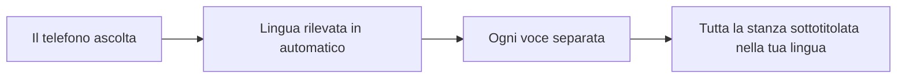
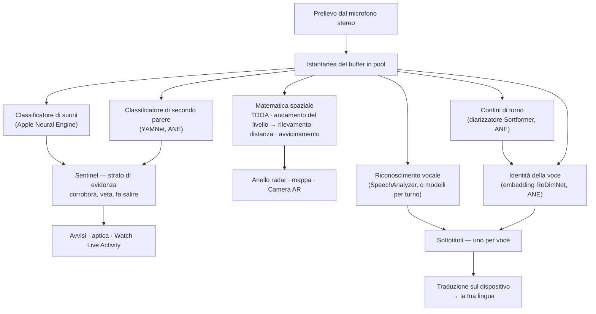
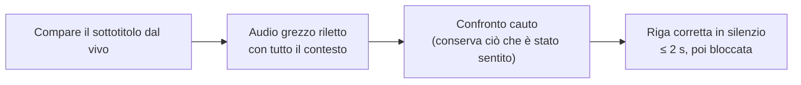
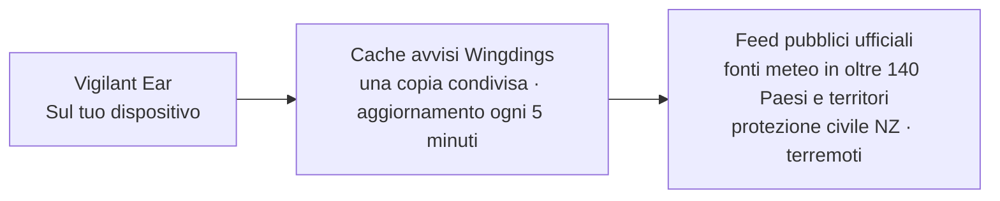

# Vigilant Ear 👂🛡️

*In vigore dalla versione 1.1.13 · ottobre 2026.*

## Un radar acustico per chi non può sentire.

Un'app costruita in modo specifico per la comunità Sorda, ipoudente e CODA. La maggior parte delle app di riconoscimento dei suoni ti dice *che cos'* è un suono. **Vigilant Ear ti dice dov'è, chi lo produce e che cosa sta dicendo** — e trasforma un iPhone in un dispositivo che descrive il suono intorno a te mentre accade.

La direzione e la distanza di una sirena. Una bussata alle tue spalle. Le persone di una conversazione, disegnate come voci trascritte distinte — ognuna sottotitolata e collocata nella sua direzione. Se qualcuno parla una lingua che non leggi, le sue parole possono arrivarti **tradotte nella tua.** Gli avvisi raggiungono la tua **schermata di blocco, la Dynamic Island e l'Apple Watch**, così basta un'occhiata.

Tutto ciò che conta gira sul dispositivo. L'audio non viene registrato né caricato per il riconoscimento. Niente dipende dal fatto che un orecchio umano senta qualcosa.

- 🧭 **Direzione, non solo rilevamento.** *Che cosa, dove, chi* e *che cosa è stato detto* — non soltanto «è successo un suono».
- 📣 **Nome chiamato.** Metti in elenco il tuo nome, un bambino o un partner — «ordine per Marie pronto» avvisa il telefono e l'orologio, e indica da che parte.
- 🔒 **Riservato per progettazione.** Classificazione, sottotitoli e traduzione girano sul tuo iPhone. I sottotitoli sono dal vivo ed effimeri; non vengono salvati come archivio di trascrizione.
- ⌚ **Al polso e sulla schermata di blocco.** Il companion di direzione per Apple Watch + Live Activity tengono l'ultimo avviso, e la direzione da cui è arrivato, a un'occhiata di distanza.
- 🛰️ **Più telefoni, un orecchio condiviso.** La nostra mesh Constellation collega gli iPhone Ultra-Wideband per fondere ciò che ciascuno sente in un quadro direzionale più nitido.
- 👁️ **Pensata per persone Sorde / ipoudenti / CODA.** Aptici distinti, immagini ad alto contrasto, indizi indipendenti dal colore, ampie aree di tocco e Riduci movimento ovunque.

---

## Per chi è

- **Persone Sorde, ipoudenti e CODA** che vogliono la consapevolezza situazionale del suono — Home Watch (bussata, allarme, bambino, telefono) e Street Watch (sirena, avvicinamento) che puoi lasciare accesi e di cui ti puoi fidare.
- Chiunque abbia bisogno di **sottotitoli dal vivo con direzione e separazione dei parlanti**, o della **traduzione sul dispositivo** delle persone sedute lì vicino.
- Chi si occupa di accessibilità e di ricerca acustica e si interessa alla localizzazione del suono sul dispositivo.

> Vigilant Ear è un **aiuto** all'accessibilità, non un dispositivo certificato di sicurezza della vita.

---

## Che cosa fa

### 🧭 Vede il suono — direzione e distanza
Con i due microfoni dell'iPhone, Vigilant Ear misura **l'angolo di un suono e se ti sta davanti o dietro**, tiene quella lettura stabile entro circa un grado e la piazza come indicatore dal vivo su un anello radar con la prua in alto e sulla mappa. Due microfoni su una sola linea, da soli, non distinguono la sinistra dalla destra. Un suono a 50° alla tua destra e uno a 50° alla tua sinistra arrivano con lo stesso minuscolo scarto di tempo. L'app disegna la lettura più un'**eco fantasma più tenue dall'altra parte**, e un giro del polso o un secondo telefono la risolve. La distanza si stima dall'intensità, su una curva calibrata in strada, e si mostra per la stima che è, con un intervallo probabile, nelle unità del Paese in cui ti trovi e non della lingua in cui leggi l'app. Su un telefono degli Stati Uniti si legge *≈ 50 ft*. Se ti sposti, gli indicatori tengono la posizione che hanno nel mondo reale. Questo è il nucleo: la consapevolezza spaziale di un mondo che non puoi sentire. (I numeri sono sotto.)

### 🚨 Riconosce i suoni importanti — e ti avvisa
Un classificatore sul dispositivo identifica centinaia di suoni di tutti i giorni e sorveglia le categorie critiche — **sirene, allarmi — compresa una classe dedicata all'allarme dell'auto — campanelli/bussate, pianto di bambino, una persona vicina e maltempo grave.** Quando uno scatta, ricevi un avviso chiaro sullo schermo, una **notifica push** facoltativa e un **feedback aptico** distinto — anche con l'app in background o il telefono in standby. Le categorie critiche sono pronte fin dall'inizio, così attivare le notifiche non significa «tutto spento». Se spegni tutte le categorie di avviso, il motore va del tutto in ibernazione mentre è in background, per risparmiare batteria. Uno strato **Sentinel** ricontrolla gli avvisi contro evidenze indipendenti — direzione, movimento e feed pubblici — così ciò che scatta è corroborato, non l'ipotesi isolata di un classificatore. Funziona nei due sensi: un momento a forma di sirena dentro una canzone viene trattenuto, ma una sirena vera che si ripete attraverso la tua musica irrompe e avvisa.

Gli avvisi di maltempo grave arrivano da **fonti governative ufficiali in più di 140 Paesi e territori**, e altre se ne aggiungono spesso — gratis per tutti. Sono incluse anche le allerte di emergenza della protezione civile, con il loro interruttore **Allerte di emergenza**. I feed si restringono a quelli che coprono il posto in cui ti trovi. Dove è disponibile, l'app legge anche i **bollettini anticipati** delle agenzie meteorologiche nazionali — gli avvisi in linguaggio chiaro emessi giorni prima di un tifone o di una pioggia forte, non solo gli avvisi emessi quando il pericolo è già arrivato — più i bollettini di nubifragio improvviso e di frana. Gli avvisi anticipati si mostrano in modo discreto, senza il suono e la vibrazione riservati a un avviso vero.

### 🌧️ Il radar meteo sulla mappa
Pioggia e neve compaiono sulla mappa dal momento in cui l'app si apre — dai radar nazionali di Stati Uniti, Canada, Giappone, Italia e di buona parte dell'Europa, e da una stima satellitare della pioggia su quasi tutto il resto del mondo. Tocca la mappa e l'ultima ora si riproduce tre volte, così vedi da che parte si muove un temporale; una scala in basso va da Leggero a Denso. Se per una sessione non lo vuoi, tocca il pulsante del meteo per spegnerlo. Il radar arriva nello stesso modo degli avvisi — attraverso un nostro server, così il tuo telefono non contatta mai server governativi. Frecce grigio chiaro mostrano anche da che parte soffia il vento, in qualsiasi punto del mondo, dalla previsione globale della NOAA per l'ora in corso.

### 🛟 Chi chiamare — il salvagente
Un salvagente accanto alla bussola della mappa apre un breve elenco per il Paese in cui ti trovi:

- il numero di emergenza, con pulsanti per chiamare e per scrivere, e una nota sul testo in tempo reale (Real-Time Text) dove un messaggio a un numero di emergenza potrebbe non funzionare
- l'agenzia meteorologica nazionale
- un'organizzazione della comunità Sorda, dove ne esiste una con una pagina stabile
- il supporto di Vigilant Ear

Condividi Vigilant Ear dal pannello di aiuto (il salvagente): un codice che chi ti sta accanto può scansionare per scaricare l'app, un link all'App Store e il nostro Instagram.

### ⌚ Apple Watch + Live Activity — un'occhiata e sai
- **Companion per Apple Watch** — la direzione di un avviso punta sul polso, così un'occhiata ti dice dove guardare. Interfaccia del Watch ridisegnata, con l'icona dell'orecchio dell'app, il layout HUD delle minacce e il doppio tocco per chiudere un avviso. Gli avvisi possono comunque mostrare la freccia di direzione quando l'app del Watch non è aperta.
- **Nome chiamato su Apple Watch.** Quando qualcuno dice il tuo nome, l'orologio ti dà tre tocchi e mostra una freccia verso la voce. Quando l'iPhone non distingue la sinistra dalla destra, un ventaglio mostra entrambi i lati. Funziona con l'iPhone bloccato mentre l'app Vigilant Ear è aperta sull'orologio. Nome chiamato richiede lo Speaker Mode attivo.
- **Live Activity** — Vigilant Ear resta sulla **schermata di blocco**, nella **Dynamic Island** e nello **Smart Stack** del Watch, così l'ultimo avviso e il suo rilevamento sono sempre a un'occhiata di distanza.
- **Avvisi del partner al polso** — quando il telefono di un partner Constellation collegato emette un avviso, può arrivare anche sul tuo Watch, direzione inclusa. Il companion consuma poco della batteria del Watch nell'arco di una giornata.

### 💬 Speaker Mode — sottotitoli dal vivo e direzionali *(gratis)*
Attiva **Speaker Mode** e Vigilant Ear trascrive le persone che parlano vicino a te in **blocchi di sottotitoli, uno per voce.** La diarizzazione dei parlanti sul dispositivo tiene distinte le voci — *chi* sta dicendo *che cosa* — con un indizio di direzione sull'anello interno. Chi parla in quel momento è in evidenza; il testo più vecchio scorre via quando serve spazio.

**Ogni parlante nella propria lingua.** Sugli iPhone con almeno 8 GB di memoria, un download una tantum del modello di sottotitolazione (circa 1 GB — via Wi-Fi, oppure in cellulare dopo averti chiesto) fa sì che l'app sottotitoli ogni turno nella lingua davvero parlata, così una stanza che passa tra inglese, spagnolo, francese e arabo resta comprensibile. Nelle nostre prove, gli errori sulle parole in una conversazione in quattro lingue sono scesi da circa l'80% al 14%. Dalla versione 1.1.12 un modello vocale migliorato sbaglia molto di meno nel rumore — in un bar rumoroso su un iPhone 17, i sottotitoli in tedesco sono passati dal 45% di parole sbagliate al 20% — e sostituisce da solo quello precedente via Wi-Fi. Senza il download — e per chi legge cinese, giapponese e coreano, dove il riconoscitore di Apple legge meglio — i sottotitoli usano, come prima, il riconoscimento vocale sul dispositivo di Apple.

Due cose che la maggior parte delle app di sottotitoli non fa.

**Onestà sull'affidabilità.** Un segno di qualità discreto su ogni riga, e sottolineature punteggiate sotto le parole dubbie, ti dicono quando fidarti di una riga e quando ricontrollare.

**Autocorrezione.** Subito dopo che una frase arriva, l'app rilegge l'audio con tutto il contesto e può ripristinare una parola persa o sentita male entro un paio di secondi, poi il testo si blocca.

**Nome chiamato** (Impostazioni, spento finché non lo attivi) sorveglia quei sottotitoli in cerca dei nomi che elenchi — il tuo, quello di un bambino, di un partner. Quando qualcuno dice «ordine per Marie pronto», ricevi un feedback aptico distinto e un avviso sul Watch con la direzione, non un'altra bolla di sottotitoli. Le parole compaiono comunque in Speaker Mode come parlato; questo è il tocco del fatto che stavano parlando *a te*.

**Il linguaggio forte si può mascherare** (Impostazioni → Sottotitoli). Altrimenti le parolacce arrivano come testo normale, senza niente che le addolcisca, e chi legge non ha modo di distogliere lo sguardo prima; attivalo e quelle parole vengono sostituite da simboli, così la frase si legge comunque, senza la parola. Decide che cosa conta il riconoscitore vocale del tuo dispositivo — non un nostro elenco di parole — quindi segue la lingua che si sta trascrivendo. Su un account dichiarato sotto i 18 anni è sempre attivo e mostra un lucchetto. Vale per il parlato che trascrive *questo* dispositivo; il testo inoltrato da un telefono accoppiato è stato trascritto lì e arriva come testo già finito.

**La parola su cui chi parla ha calcato è segnata in grassetto.** Dette ad alta voce in inglese, "I didn't say THAT" e "I didn't say that" sono due frasi diverse, e una trascrizione identica perde del tutto la differenza. L'app cerca l'unica parola che la voce ha alzato di tono e la mette in grassetto — al massimo una per riga, e proprio niente quando non è sicura, perché segnare la parola sbagliata farebbe credere che la persona abbia detto qualcosa che non ha detto. È spento in cinese e in giapponese, dove l'altezza del tono ti dice *quale parola è* e non quanto è stata calcata.

I sottotitoli sono gratis; la Traduzione automatica è lo strato opzionale di Power Pack+. I sottotitoli si possono anche **leggere ad alta voce verso un dispositivo Bluetooth, compreso un apparecchio acustico** — gratis, in Impostazioni. I **Toni di direzione** (anche questi gratis, in Impostazioni → Sottotitoli) aggiungono un indizio audio facoltativo nell'orecchio che scegli, e segnalano dov'è chi parla — utile con un apparecchio acustico o con l'udito da un solo lato, e disponibile per chiunque.

### 🌐 Traduzione automatica — la tua lingua, dal vivo *(Power Pack+)*
Con Speaker Mode attivo, quando una persona vicina parla un'altra lingua, Vigilant Ear può rilevarla e rendere i suoi sottotitoli **nella tua lingua**, con la lingua di partenza mostrata sul suo blocco. La catena — sentire → separare i parlanti → trascrivere → tradurre → mostrare — gira **sul dispositivo**; l'unico momento di rete è un download una tantum del pacchetto lingua da Apple, e quando è quel download che stai aspettando l'app te lo dice, invece di lasciarti davanti a un testo non tradotto. Non devi conoscere né scegliere prima l'altra lingua. Una frase conclusa si traduce appena finisce, senza aspettare che chi parla si fermi, e le traduzioni arrivano in una frazione del tempo.

È la cosa più vicina disponibile al **traduttore universale della fantascienza** — un dispositivo che semplicemente capisce. Vigilant Ear rileva la lingua da solo, segue ogni parlante nella stanza e li sottotitola tutti nella tua lingua — senza auricolari, senza configurazione, sul tuo dispositivo.

### 🎵 Musica e consapevolezza delle trasmissioni *(Power Pack+)*
**ShazamKit** riconosce la musica che suona intorno a te e rileva in automatico i cambi di brano, così il titolo resta aggiornato.

### 🎛️ Acoustic Scope — vedi il suono come un ingegnere
Una vista professionale, dal vivo, del suono intorno a te: spettro, spettrogramma, bande RTA a ⅓ d'ottava, croma e parziali armoniche — **gratis per tutti**. **Partials legge la musica:** ogni tono è nominato con la sua nota, con accanto la serie armonica; i suoni più alti, come gli allarmi antifumo, sono nominati alla loro altezza reale, e puoi impostare una nota bersaglio che si disegna come una linea contro cui cantare o accordare. Lasciare aperto lo spettrogramma costa quasi nulla, per quanto a lungo tu lo guardi. Gli strumenti che catturano suoni per addestrare i tuoi pacchetti audio personalizzati fanno parte di Power Pack+.

### 📦 Pacchetti audio personalizzati — insegnagli il tuo mondo *(Power Pack+)*
Puoi insegnare a Vigilant Ear i suoni che contano per te — gli uccelli del posto, il campanello di un edificio, il ronzio anomalo di un generatore o un tipo di aereo al decollo. Questi pacchetti aggiuntivi si impilano sopra il rilevamento integrato, così i suoni nuovi non scalzano mai sirene e allarmi. Nell'app c'è una guida passo passo.

### 🛰️ Constellation — molti iPhone, un orecchio condiviso *(Power Pack+)*
Con due o più iPhone dotati di Ultra-Wideband (la maggior parte, a partire dall'iPhone 11), la mesh **Constellation** li accoppia così possono percepire la posizione l'uno dell'altro e fondere ciò che ciascuno sente in un unico quadro più preciso di dove arriva un suono — una schiera di ascolto distribuita e passiva. Anche i sottotitoli si fondono: ogni telefono trascrive ciò che sente il proprio microfono, e le parole si allineano tra i telefoni così quello più vicino a chi parla contribuisce ciò che ha sentito — le parole colte da un solo telefono si tengono, invece di andare perse.

I telefoni si collegano **direttamente l'uno all'altro** — niente router, niente rete Wi-Fi condivisa e niente internet; basta che il Wi-Fi sia acceso. Usano lo stesso collegamento peer-to-peer di AirDrop, e possono unirsi solo i telefoni con l'hardware giusto. Il collegamento tra i telefoni è sempre cifrato; i telefoni con Vigilant Ear 1.1.6 o precedente devono aggiornare l'app per partecipare alla mesh.

**Messaggi al partner** — invia un testo rapido al telefono di un partner della mesh; arriva nel suo feed di sottotitoli e può giungere tradotto nella sua lingua, sul dispositivo. La messaggistica tiene conto dell'età: è costruita sulla fascia d'età dichiarata di Apple, e i messaggi tra un adulto e un minore restano spenti a meno che entrambe le persone non si siano nominate di proposito. Avvisi e sottotitoli non sono mai sbarrati — solo i messaggi da persona a persona.

### 🔗 Remote Link — raggiungi qualcuno che non è con te *(Power Pack+ per iniziare)*
Quello che di solito farebbe una telefonata, fatto invece con video e testo. Invii un codice di invito; l'altra persona si unisce da dentro Vigilant Ear **senza possedere Power Pack+**. A differenza di Constellation non c'è un requisito di vicinanza — voi due potete essere ovunque.

**In nessun momento si usa l'audio.** Solo video e testo, così niente del collegamento dipende dall'udito a una delle due estremità — e ti dà un modo per comunicare in lingua dei segni con qualcuno attraverso l'app. L'app stessa non capisce la lingua dei segni; porta il video, e il resto lo fate voi due. Il collegamento è diretto tra i due telefoni ovunque la rete lo consenta, e l'app ti mostra in chiaro se è **Diretta** o **Inoltrata**, così sai sempre se il tuo video passa da un inoltro.

**Anche i sottotitoli viaggiano.** Ciò che ogni telefono trascrive compare sull'altro, tradotto nella lingua di chi legge quando serve. Ciascuno di voi due può mettere in pausa il collegamento — video e sottotitoli — e riprenderlo, e riagganciare dalla schermata principale.

### 📷 Camera AR — «vedi il suono»
Apri Camera AR dal Ventaglio di azioni e ancora i suoni rilevati al loro rilevamento reale nella vista dal vivo della fotocamera. Gli indicatori si raggruppano per parlante oppure per categoria di suono e direzione, così la vista resta leggibile, e si attenuano man mano che un suono resta quieto.

### 🗺️ Mappe, strade e previsione del percorso
I rilevamenti dei suoni si proiettano su coordinate GPS reali sulla mappa. I suoni dei veicoli si possono **agganciare alle strade vicine** e i loro percorsi si prevedono, così un camion di passaggio si legge come in movimento *lungo la strada* e non attraverso gli edifici. (Prova la demo del camion dei pompieri nel Feature Playground.)

### 🪄 Feature Playground — dimostralo senza orecchie
**Feature Playground** è pubblico per tutti: avvisi di esempio Home e Street (bussata, allarme, bambino, sirena, meteo), demo con più telefoni e di conversazione. Hanno una filigrana chiara, così la prova non si spaccia mai per un evento dal vivo. Chiudere il pannello smonta le demo in modo pulito (niente spoof del GPS rimasto bloccato, niente flag rimasti).

### ♿ Prima l'accessibilità
Costruita per persone Sorde / ipoudenti / CODA e per persone daltoniche:

- indizi **indipendenti dal colore**
- aree di tocco **≥44 pt**
- rispetto di **Riduci movimento**
- **layout da destra a sinistra** per chi legge in arabo
- avvisi multimodali (aptico + visivo + Watch)
- una schermata di verifica all'avvio che mostra lo stato dei permessi in verde / grigio / rosso netti, e in arancione bruciato per «non consentito», compreso il permesso delle notifiche che fa da interruttore principale degli avvisi

---

## Gratis e Power Pack+

Il nucleo di sicurezza è **gratis, per sempre**:

- **Home Watch e Street Watch** — avvisi sonori locali (allarmi, sirene, bussate/campanelli, bambino, persona vicina) con consegna sullo schermo, aptica e push facoltativa.
- **Sottotitoli dal vivo** — Speaker Mode, sul dispositivo, direzionali dove l'hardware lo consente, con segni onesti di affidabilità, autocorrezione di circa 2 secondi, uscita parlata facoltativa verso un dispositivo Bluetooth (compreso un apparecchio acustico) e Toni di direzione.
- **Nome chiamato** — nomi facoltativi che digiti (il tuo, dei bambini, del partner). Una corrispondenza è un avviso su Watch/telefono con rilevamento, non un secondo sottotitolo.
- **Standing Watch** — la condizione propria della stanza, sempre attivo e senza niente da configurare: una lampada ciano fissa mentre la stanza mantiene il suo schema, ambra quando qualcosa cambia — una voce nuova, un silenzio improvviso o qualcosa che si avvicina. Quando l'app si avvia, ti dice per quanto tempo non stava ascoltando gli avvisi.
- **Avvisi di maltempo grave** — avvisi ufficiali per la tua zona, da fonti governative in più di 140 Paesi e territori, e altre se ne aggiungono spesso.
- **Radar meteo** — pioggia e neve sulla mappa, con l'ultima ora in replay, e da che parte soffia il vento.
- **Il salvagente** — chi chiamare nel Paese in cui ti trovi.
- **Avvisi di terremoto (in tutto il mondo)** — senti una vibrazione e vedi sulla tua mappa l'area che l'ha avvertita, quando viene segnalato un sisma vicino. Una conferma dal feed ufficiale dei terremoti — non un allarme preventivo: se hai avvertito il tremore, questo ti dice che cos'era. Il feed viene controllato ogni cinque minuti, anche in background, e il rilevamento sul dispositivo dei Rombi profondi (infrasuoni) può armare un controllo in più nell'istante in cui il suolo si muove.
- **Feature Playground** — avvisi di prova e anteprime delle funzioni, con una filigrana PREVIEW chiara.
- **Companion per Apple Watch e Live Activity** — direzione e ultimo avviso a colpo d'occhio.
- **Acoustic Scope** — visualizzazione del suono dal vivo di livello professionale, gratis per tutti. (Gli strumenti di cattura per l'addestramento sono di Power Pack+.)
- **Rete di ricerca** *(attiva finché non la spegni)* — mentre è attiva, si condividono l'ora, una posizione approssimativa (circa 1 km) e la frequenza di eventi simili a un sisma — niente audio, niente identificatore — per aiutare a mappare i terremoti e altri eventi a bassa frequenza. Una domanda sulla mappa chiede una volta sola. I report aspettano finché quella domanda non è stata sullo schermo.

**Power Pack+** è uno sblocco una tantum (**non un abbonamento**) con una **prova gratuita di 90 giorni**. Aggiunge i superpoteri:

- **Traduzione automatica** — traduzione sul dispositivo del parlato vicino, nella tua lingua.
- **Constellation** — udito condiviso tra più iPhone via Ultra-Wideband, con messaggi al partner.
- **Music ID** — riconoscimento dei brani con ShazamKit.
- **Pacchetti audio personalizzati** — classificatori aggiuntivi che addestri sui tuoi suoni.
- **Remote Link** — chiamate private in video e testo con qualcuno che non è con te, senza audio in nessun momento. Per avviarne una serve Power Pack+; la persona che inviti si unisce gratis.

Gratis o Power Pack+, **il tuo audio resta sul dispositivo per il riconoscimento** — il livello cambia solo quali funzioni sono sbloccate, mai dove si invia l'audio grezzo per l'analisi.

---

## Come funziona (sotto il cofano)

Vigilant Ear è una pipeline **prima locale, sul dispositivo**, costruita a strati: si cattura una volta, poi specialisti indipendenti leggono lo stesso suono e si controllano il lavoro a vicenda. L'audio grezzo viene catturato su un prelievo ad alta priorità, copiato in una **free-list di buffer in pool** (niente raffica di allocazioni sul percorso in tempo reale) e distribuito a ventaglio senza bloccare l'interfaccia:

Nessun modello è ritenuto affidabile da solo. Lo strato **Sentinel** sta tra il rilevamento e l'avviso: motori indipendenti si corroborano o si pongono il veto a vicenda, frame per frame — e quando l'evidenza ripetuta del mondo reale si accumula contro un veto (una sirena vera che ulula attraverso la tua musica), vince l'evidenza e l'avviso scatta.

I sottotitoli hanno una seconda possibilità tutta loro. Ogni frase finalizzata viene riletta in silenzio da un breve anello di audio in memoria, con tutto il contesto — le correzioni arrivano entro circa due secondi, poi il testo si blocca per sempre:

- **Matematica spaziale** — FFT, differenza dei tempi di arrivo pesata sulla coerenza (TDOA: si privilegiano le bande di frequenza su cui entrambi i microfoni concordano, poi il minuscolo ritardo di arrivo diventa un rilevamento) e tracciamento dell'avvicinamento dall'andamento del livello, su attività in background. La coppia di microfoni viene letta in un orientamento fisso, così la direzione funziona allo stesso modo sia che tieni il telefono in verticale sia di lato.
- **Voce** — `SpeechAnalyzer` / `SpeechTranscriber` di iOS 26 per la trascrizione; il framework **Translation** di Apple per la traduzione sul dispositivo. Con il download facoltativo dei sottotitoli, ogni turno è tagliato da un rilevatore di attività vocale, la sua lingua è scelta da un modello di lingua parlata ed è trascritto da modelli aperti di riconoscimento vocale — uno per le lingue europee, uno per le altre — tutto sul dispositivo. L'identità della voce si basa sull'evidenza: una voce si conferma come persona reale solo da finestre indipendenti di suono, e una corrispondenza incerta si mostra senza attribuzione, invece di indovinare il nome sbagliato.
- **Due modelli per due domande** — distinguere le voci richiede *quando è cambiato chi parla* e *chi è quel parlante*, e non sono lo stesso problema. Un diarizzatore in streaming **Sortformer** segna i confini di turno; gli embedding **ReDimNet** decidono di chi è la voce dentro ciascuno. Tagliare sul confine conta più di quanto non sembri: una finestra a cavallo di due persone le contiene entrambe, e nessun modello di embedding può disfare quella cosa dopo. Sotto entrambi c'è un pavimento di attività vocale — se il diarizzatore tace in una stanza difficile invece di tirare a indovinare, i turni si tagliano comunque, così l'app degrada invece di fondere due parlanti in uno.
- **Verità sulla musica** — un rilevatore di firma del brano sulla croma possiede la decisione «sta davvero suonando della musica?», perché i classificatori generici, si sa, chiamano «musica» le stanze silenziose e le sirene. Shazam parte solo quando la firma concorda che c'è davvero qualcosa di musicale.
- **Concorrenza** — l'isolamento di Swift 6 tiene nettamente separati il prelievo del microfono, la matematica acustica e il ciclo di rendering dell'interfaccia.
- **Efficienza** — il sottocampionamento, la classificazione che si adatta al carico e l'uso della rete subordinato all'evidenza tengono l'ascolto continuo abbastanza leggero da poterlo lasciare acceso.

Gli avvisi meteo e di terremoto prendono il percorso opposto rispetto all'audio — niente del tuo suono esce mai, ma i *dati* degli avvisi entrano. **Ogni** feed ufficiale — e le immagini del radar e del vento — passa da una piccola cache di relay che gestiamo, così un solo prelievo dei dati pubblici serve a ogni utente, e il tuo telefono non contatta mai server governativi:

---

## Che cosa può sentire il tuo telefono — misurato

Il tuo iPhone ha due microfoni a circa sei pollici (15 cm) di distanza, un barometro e un orologio molto preciso. Basta per dirti da che parte è arrivato un suono, più o meno quanto è lontano, se viene verso di te e se una porta si è appena aperta. Ecco quanto è precisa ciascuna di queste cose, come l'abbiamo verificata e perché conta se il suono non lo senti tu. La tabella della direzione è stata misurata su un iPhone 17 nel settembre 2026. Lo stesso controllo da scrivania su un iPhone 16 Pro Max non ha dato un angolo continuo — quell'immagine fa scattare un suono verso il davanti o di fianco — quindi le righe dei gradi sono solo quelle del 17. La distanza resta per natura una stima: lo diciamo sullo schermo. Le distanze misurate con il metro in questa sezione sono in piedi, le unità di quel metro.

**Direzione — entro un paio di gradi.** Un suono raggiunge il microfono in alto prima di quello in basso, oppure dopo, e da quello scarto l'app ricava quanto il suono è fuori dall'asse del telefono e se è davanti o dietro. I due canali del telefono non sono microfoni semplici ma un'immagine stereo elaborata, e quell'immagine aggiunge un proprio schema fisso ogni volta che una stanza è rumorosa. L'app impara quello schema dal silenzio dopo l'avvio. Dopo circa un minuto di stanza silenziosa toglie lo schema prima di leggere la direzione; fino ad allora la lettura va avanti senza quella correzione.

| Cosa abbiamo misurato | Risultato |
|---|---|
| Errore mediano su 96 stanze simulate, da ufficio silenzioso a stanza con pareti dure a 5 dB SNR | 1.0° |
| iPhone 17 su una scrivania, rumore della stanza acceso, altoparlante a 30° fuori dall'asse | letto 61.7° dal piano laterale contro i 60° attesi, oscillazione 1.6° |
| Stessa prova, altoparlante dritto di fianco al telefono | letto 4.5° contro gli 0° attesi, oscillazione 2.2° |
| Stessa prova, altoparlante a 60° fuori dall'asse | mediana 35.7° contro i 30° attesi; la prova si è divisa, con un secondo addensamento sul ritardo del dritto davanti, molto probabilmente un riflesso del banco |
| Stessa prova, altoparlante dritto davanti | ogni lettura sul ritardo massimo, come deve essere |
| Letture finite sullo schema proprio dell'immagine invece che sul suono | nessuna, a nessun angolo |

*Perché conta:* se non senti una sirena, «dietro di te, spostata di lato» ti dice dove guardare. Una lettura che sta ferma merita fiducia solo dopo essere stata controllata con un metro a nastro, e questa è stata controllata due volte. Il primo controllo faceva sembrare il risultato migliore di quanto fosse.

**Distanza — mostrata per la stima che è.** Un solo microfono non può misurare la distanza, solo l'intensità, e un camion rumoroso lontano può suonare come un'auto silenziosa vicina. L'app stima la distanza dall'intensità con una curva adattata su una strada vera, poi la dice come farebbe una persona prudente. Su un telefono degli Stati Uniti è *circa 50 ft, probabilmente tra 25 e 100.*

| Cosa abbiamo misurato | Risultato |
|---|---|
| Rilevamenti reali di auto riprodotti attraverso la calibrazione | 1,131 |
| Arrivo dentro la strada 100-foot su cui si trovavano davvero | 73% |
| Auto della corsia lontana | stimate 78 e 87 ft dove il metro diceva 73 e 85 ft |

La strada (un incrocio cittadino) è stata misurata corsia per corsia; quando la curva sbaglia, sbaglia dal lato vicino. La calibrazione è bloccata da un test automatico, così non può slittare in silenzio. Gli allarmi nel tuo stesso spazio, come un rilevatore di fumo, non ricevono alcuna cifra di distanza: sono già nella stanza con te.

**Movimento — viene verso di te.** Per auto e sirene, diventare più forte di solito vuol dire avvicinarsi. L'app osserva quanto in fretta sale il livello di un suono nell'arco di qualche secondo: una salita sostenuta di circa 1.5 dB al secondo (un aumento chiaro e costante dell'intensità) significa che si avvicina, una discesa corrispondente significa che si allontana, e un suono che smette di cambiare smette di essere chiamato in un modo o nell'altro dopo circa quattro secondi. Un singolo momento forte — un colpo di clacson, una porta sbattuta — non può attivarlo. Costruito sulla fisica e su nove test automatici; un passaggio registrato per strada è la prossima conferma sul campo.

**L'aria nella stanza — una porta ha una firma.** Il barometro può accorgersi di una porta che si apre a circa quattordici piedi (4.3 m) di distanza: la pressione cala mentre la porta si apre, poi rimbalza mentre si chiude. In quattordici ore di silenzio e quindici eventi di porta, ogni porta ha fatto quella forma in due tempi e nient'altro in casa l'ha fatta.

| Evento | Velocità della pressione | Forma |
|---|---|---|
| Porta d'ingresso, aperta e chiusa, ×10 | 0.6–1.8 Pa/s | calo, poi rimbalzo, a ~5 s di distanza |
| Porta d'ingresso, sbattuta, ×5 | 1.1–2.5 Pa/s | la stessa coppia, più alta |
| Aria condizionata che cicla di notte, ×8 | 0.11–0.46 Pa/s | rampa lenta nell'arco di minuti, identica su entrambi i telefoni |
| Una stanza silenziosa | ~0.02 Pa/s | niente |
| Attività umana, passaggio a piedi | — | il sensore di movimento se ne accorge e il telefono lo ignora |

Una porta che non sigilla la stanza è rimasta invisibile — una porta a zanzariera, in questa prova — proprio come deve essere. Oggi uno spostamento di pressione può comparire come Rombi profondi sulla mappa; un avviso dedicato alla porta, per le notti silenziose, è misurato e progettato, e non è ancora il comportamento di tutti i giorni.

**Constellation — due telefoni risolvono il lato.** Ogni telefono della mesh traccia una linea verso il suono dal punto in cui si trova, e le linee si incrociano in modo pulito solo da un lato. Quando lo fanno, l'eco fantasma scompare e l'app può dire di nuovo sinistra o destra. In simulazione, due telefoni **a 40 metri l'uno dall'altro** collocano una sirena distante 50 metri entro circa 2 metri.

**Come si arriva a credere a quello che c'è qui.** Ogni numero è passato dagli stessi tre varchi, nell'ordine: una stanza simulata con la risposta nota in anticipo; piccoli test automatici che ricreano il caso esatto che ingannerebbe l'app e che girano a ogni modifica; poi i telefoni veri su una scrivania vera, con le distanze misurate a mano. Niente conta come preciso finché non supera il terzo. Per chi non può sentire il suono, la parola dell'app è l'unica parola: va guadagnata come la guadagna un laboratorio.

Note più approfondite per ingegneri: [Fisica](https://vigilantear.com/en/physics/) — TDOA, distanza, movimento, Constellation e rilevamento barometrico, con ogni cifra etichettata MEASURED / BENCHED / MODELLED.

---

## Privacy

- **Sul dispositivo, sempre, per la pipeline di base.** Classificazione, matematica spaziale, trascrizione, diarizzazione e traduzione girano sul tuo iPhone. L'audio grezzo non viene registrato né caricato per il riconoscimento.
- **I sottotitoli sono effimeri.** I sottotitoli dal vivo restano in memoria per la sessione; i log di debug esportati non includono il testo dei sottotitoli.
- **Niente SDK di pubblicità o di analisi comportamentale.** L'uso limitato della rete serve solo a mappe, feed meteo pubblici, immagini del radar e del vento, l'elenco di aiuto, il download facoltativo del modello di sottotitoli, le impronte Shazam facoltative, il contesto stradale, i report della Rete di ricerca mentre quella funzione è attiva e gli acquisti sull'App Store — i dettagli sono nella nostra informativa sulla privacy.

Dettagli completi: [Privacy](/it/privacy/) · [Termini](/it/terms/) · [Supporto](/it/support/)

---

## Hardware e piattaforme

- **iPhone (esperienza completa).** Funziona in verticale o in orizzontale — tienilo come preferisci. Per trovare la direzione servono i microfoni stereo. Consigliato **iPhone 13 o più recente**; i sottotitoli nella lingua di ciascun parlante richiedono **8 GB di memoria** (iPhone 15 Pro e successivi).
- **Apple Watch.** Avvisi del companion con freccia di direzione; funziona con Live Activity / Smart Stack.
- **iPad (nativo).** Layout adattivo: sul grande schermo i sottotitoli dal vivo hanno un pannello trasparente accanto alla mappa, che si ritira quando non parla nessuno. Microfoni a canale singolo → sottotitoli senza la direzione completa.
- **Constellation** richiede l'**Ultra-Wideband** — iPhone 11 o successivo, esclusi i modelli SE e «e». **Non** gli serve una rete Wi-Fi: con il Wi-Fi acceso, i telefoni si scoprono direttamente, così Constellation funziona senza router e senza internet finché i telefoni sono vicini tra loro.
- **Android (quando disponibile).** Build separata con radar di base, avvisi, sottotitoli e meteo; la mesh Constellation è anzitutto su iOS.

---

## Localizzazione

Localizzazione completa — interfaccia, avvisi e sottotitoli — in **inglese, spagnolo, portoghese (Brasile), francese, tedesco, italiano, turco, arabo, giapponese, cinese semplificato, cinese tradizionale, coreano, russo, hindi e rumeno** (15 lingue). Segue la lingua del sistema, oppure una scelta manuale nell'app. I sottotitoli in rumeno funzionano sul dispositivo; Apple Translate non ha il rumeno, quindi la Traduzione automatica mostra l'originale per quella lingua.

---

## Stato e avvertenza

Vigilant Ear è un **aiuto sperimentale all'accessibilità acustica**, non un'utilità certificata di sicurezza della vita. La risoluzione con cui si localizza un suono varia con l'ambiente, il meteo, il vento e l'hardware dei microfoni. **Mantieni sempre la tua solita consapevolezza dell'ambiente** — non affidarti a esso come unica fonte di informazioni sulla sicurezza.

Alcune capacità (indicatori di Camera AR, l'aggiornamento dell'autorizzazione Avvisi critici quando concessa da Apple, la creazione avanzata di suoni su più pacchetti) continuano a evolvere; il controllo gratuito Home Watch / Street Watch e i sottotitoli dal vivo sono il prodotto di cui ti puoi fidare dal primo giorno.

**Fonti e licenze:** [api.vigilantear.com/sources](https://api.vigilantear.com/sources)

---

**Contatto:** [vigilantear@wingdingssocial.com](mailto:vigilantear@wingdingssocial.com)

Fatto con ❤️ per la comunità Sorda e ipoudente e per la ricerca acustica.

    
  <strong>© 2026 Wingdings, Inc.</strong> 
  Tutti i diritti riservati. 
  Molteplici brevetti in corso di registrazione

