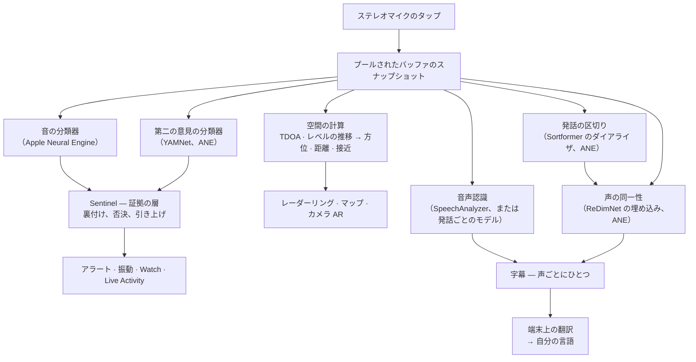
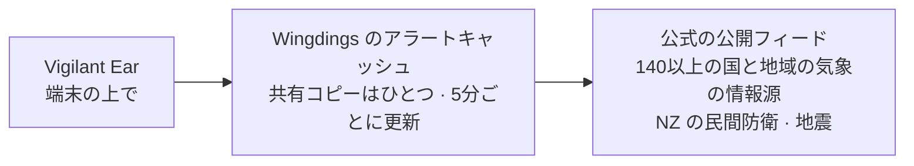

# Vigilant Ear 👂🛡️

📲 [App Storeからダウンロード](https://apps.apple.com/app/id6761978703)

*バージョン 1.1.14 · 2026年10月より有効です。*

## 聞こえない人のための、音響レーダー。

ろう者、難聴者、そして CODA のコミュニティのために作られたアプリです。多くの音認識アプリが伝えるのは、音が*何か*です。**Vigilant Ear が伝えるのは、どこにあるのか、誰が出しているのか、何を言っているのか**です。iPhone が、まわりの音を、起きているその場で描写する装置になります。

サイレンの方向と距離。背後のノック。会話のなかの人々は、文字起こしされた別々の声として描き分けられます。一人ひとりに字幕が付き、方向も置かれます。読めない言語で誰かが話していても、その言葉を**自分の言語に翻訳して**届けることができます。アラートは**ロック画面、Dynamic Island、Apple Watch** に届くので、ひと目で足ります。

大事な処理は、すべて端末の上で動きます。認識のために音声が録音されたり、アップロードされたりすることはありません。人間の耳が何かを聞くことに依存する部分は、ありません。

- 🧭 **検出だけでなく、方向。** *何か、どこで、誰が、*そして*何と言ったか*です。単に「音がした」だけではありません。
- 📣 **名前呼び。** 自分の名前、子ども、パートナーを登録しておくと、「Marie様、ご注文の準備ができました」で iPhone と Watch に知らせが届き、どちら側かも指します。
- 🔒 **設計からプライベート。** 分類、字幕、翻訳は iPhone 上で動きます。字幕はライブで、その場かぎりのものです。文字起こしの記録として保存されることはありません。
- ⌚ **手首とロック画面に。** Apple Watch の方向コンパニオンと Live Activity で、直前のアラートと、それがどちらから来たのかが、ひと目のところにあります。
- 🛰️ **複数の iPhone で、聞こえを共有。** Constellation のメッシュが Ultra-Wideband 対応の iPhone をつなぎ、それぞれが聞いたものを融合して、より鮮明な方向の像にします。
- 👁️ **ろう者 / 難聴者 / CODA のために。** 区別しやすい振動、コントラストの高い表示、色に頼らない手がかり、大きなタップ領域。そして全体を通して、視差効果を減らすに対応しています。

---

## 誰のためのものか

- 音の状況を把握したい**ろう者、難聴者、CODA のユーザー**。Home Watch（ノック、アラーム、赤ちゃん、電話）と Street Watch（サイレン、接近）は、オンのままにして信頼できます。
- **方向と話者の分離がついたライブ字幕**、あるいは近くに座っている人の**端末上の翻訳**が必要な人。
- 端末上の音の定位に関心のある、アクセシビリティや音響研究のユーザー。

> Vigilant Ear はアクセシビリティの**補助**であり、認定された生命安全装置ではありません。

---

## できること

### 🧭 音が見える — 方向と距離

iPhone の二つのマイクを使い、Vigilant Ear は**音の角度と、前方か後方か**を測ります。読み取りはおよそ1度の範囲で安定し、進行方向を上にしたレーダーリングとマップに、ライブのマーカーとして置かれます。一直線に並んだ二つのマイクだけでは、左右を自力では区別できません。右へ50°の音と左へ50°の音は、同じごくわずかな時間差で届きます。アプリは読み取りに加えて、**反対側により薄いゴースト**を描きます。手首をひねるか、もう一台の iPhone で、どちら側かが決まります。距離は、街路で校正した曲線に音の大きさを当てはめて推定し、推定そのものとして、ありそうな範囲とともに示します。単位は、アプリを読んでいる言語ではなく、いまいる国の単位です。米国の iPhone では *≈ 50 ft* と出ます。移動しても、マーカーは現実の位置を保ちます。これが核心です。聞こえない世界を、空間として把握することです。（数値はあとで述べます。）

### 🚨 大切な音を見分け、知らせる

端末上の分類器が、日常の何百もの音を見分け、重要な区分を見守ります。**サイレン、アラーム（カーアラーム専用のクラスを含む）、ドアベルやノック、赤ちゃんの泣き声、近くの人、そして悪天候**です。いずれかが見つかると、画面上のはっきりしたアラート、任意の**プッシュ通知**、区別できる**振動**が届きます。アプリがバックグラウンドでも、iPhone がスリープ中でも同じです。重要な区分ははじめから準備ができているので、通知をオンにしても「全部オフ」にはなりません。アラートの区分をすべてオフにすると、バックグラウンドのあいだエンジンは完全に休止し、バッテリーを節約します。**Sentinel** の層が、方向、動き、公開フィードという独立した証拠とアラートを照合します。発報するのは裏付けのあるもので、分類器ひとつだけの推測ではありません。働きは両方向です。曲のなかの、サイレンに似た一瞬は保留されます。しかし音楽を通して本物のサイレンが繰り返すと、それを突き抜けて知らせます。

悪天候の警報は、**140を超える国と地域の公式な政府の情報源**から届きます。情報源はたびたび追加されます。すべてのユーザーに無料です。民間防衛の緊急警報も含まれ、専用の**緊急アラート**のスイッチがあります。フィードは、いまいる場所を覆うものに絞られます。利用できるところでは、各国の気象機関の**事前の情報**も読みます。台風や大雨の数日前に出される、平易な言葉のお知らせであり、危険が到来してから出される警報だけではありません。急な豪雨と土砂崩れの情報も読みます。事前のお知らせは静かに表示され、本物の警報のために取ってある音と振動は使いません。

### 🌧️ マップの気象レーダー

雨と雪は、アプリを開いた瞬間からマップに表示されます。アメリカ合衆国、カナダ、日本、イタリア、そしてヨーロッパの多くの地域の気象レーダーと、世界のほかの大部分を覆う、衛星による雨の推定です。マップに触れると、直近の1時間が3回再生され、嵐がどちらへ動いているかが見えます。下の目盛りは「薄い」から「濃い」までを示します。その回だけ要らなければ、天気のボタンをタップしてオフにします。レーダーは警報と同じ道で届きます。自前のサーバーを通すので、iPhone が政府のサーバーに接続することはありません。薄い灰色の矢印は、世界のどこでも、風がどちらへ吹いているかを示します。出典は NOAA の、現在の1時間の全球予報です。

### 🛟 誰に連絡するか — 救命浮輪

マップのコンパスのそばにある救命浮輪を開くと、いま立っている国のための短い一覧が出ます。

- 緊急番号。通話とテキストのボタンがあり、緊急番号へのテキストが使えないことがある場所では、リアルタイムテキスト（Real-Time Text）についての注記
- その国の気象機関
- 安定したページがある場合は、ろう者の団体
- Vigilant Ear のサポート

ヘルプパネル（浮き輪のアイコン）からVigilant Earを共有できます。隣にいる人がスキャンしてアプリを入手できるコード、App Storeへのリンク、そして私たちのInstagramです。

### ⌚ Apple Watch と Live Activity — ひと目で分かる

- **Apple Watch のコンパニオン** — アラートの方向が手首の上で指すので、ひと目でどちらを見ればよいか分かります。Watch の画面は作り直され、アプリの耳のアイコン、脅威の HUD の配置、アラートを消すダブルタップがあります。Watch のアプリを開いていなくても、アラートは方向の矢印を表示できます。
- **Apple Watchで「名前呼び」。** 誰かがあなたの名前を呼ぶと、ウォッチが3回タップし、声のする方向を矢印で示します。iPhoneが左右を判別できないときは、扇形で両側を示します。iPhoneがロックされていても、ウォッチでVigilant Earアプリを開いていれば動作します。「名前呼び」を使うには、Speaker Modeをオンにする必要があります。
- **Apple Watchでビートを感じられます。** 音楽が流れていて、ウォッチでVigilant Earアプリを開いていると、キックとスネアがリングになって脈打ち、各小節の1拍目に印が付き、1拍目ごとに手首を軽くタップします。ウォッチの画面のどこかを2回続けてタップすると、音楽が止まるまでタップをオフにできます。アラートは常に優先されます。Music IDが曲を特定すると、曲名もウォッチに表示されます。
- **Live Activity** — Vigilant Ear は**ロック画面**、**Dynamic Island**、**Watch の Smart Stack** に残るので、直前のアラートとその方位は、いつでもひと目のところにあります。
- **手首に届くパートナーのアラート** — つながった Constellation の相手の iPhone がアラートを上げると、方向つきで Watch にも届くことがあります。コンパニオンが一日を通して使う Watch のバッテリーは、わずかです。

### 💬 Speaker Mode — ライブで、方向のついた字幕 *（無料）*

**Speaker Mode** をオンにすると、Vigilant Ear は近くで話している人を、**声ごとにひとつの字幕ブロック**へ文字起こしします。端末上の話者ダイアリゼーションが、声を分けたままにします。*誰*が*何*を言っているか。内側のリングには方向の手がかりが付きます。いま話している人は強調されます。古い文字は、場所が必要になると流れていきます。

**話者ごとに、その人の言語で。** メモリが 8 GB 以上の iPhone では、字幕モデルを一度ダウンロードすると（約 1 GB。Wi-Fi、または確認のあとならモバイル通信）、実際に話されている言語で、発話ごとに字幕を付けられます。英語、スペイン語、フランス語、アラビア語が入れ替わる部屋でも、内容が分かります。テストでは、4言語の会話での単語の誤りが、およそ 80% から 14% に下がりました。バージョン 1.1.12 以降、改良された音声モデルは、騒音のなかでの誤りがずっと少なくなります。iPhone 17 の、騒がしいバーでのドイツ語の字幕は、誤る単語が 45% だったところから 20% になりました。古いモデルは、Wi-Fi 経由で自動的に置き換わります。ダウンロードがない場合、そして Apple の認識のほうがよく読める中国語、日本語、韓国語の読み手については、字幕はこれまでどおり、Apple の端末上の音声認識を使います。

ほとんどの字幕アプリがしないことが、二つあります。

**確信度を隠さない。** 行ごとの控えめな品質の印と、疑わしい語の下の点線が、その行を信じてよいか、もう一度確かめるべきかを示します。

**自分で直す。** 文が出た直後、アプリは全体の文脈で音声を読み直し、聞き落とした語や聞き違えた語を数秒以内に戻せます。そのあと、文字は固定されます。

**名前呼び**（設定。オンにするまではオフ）は、登録した名前（自分、子ども、パートナー）を、その字幕から探します。誰かが「Marie様、ご注文の準備ができました」と言うと、別の字幕の吹き出しではなく、方向のついた、区別できる振動と Watch のアラートが届きます。その言葉は、話し言葉として Speaker Mode には引き続き出ます。これは、*自分に*話しかけていた、という知らせです。

**強い言葉は隠せます**（設定 → 字幕）。そうしなければ、罵りはそのままの文字で届き、和らげるものは何もなく、読む側が先に目をそらす余地もありません。オンにすると、それらの語は記号に置き換わり、文はその語がなくても読めます。何が該当するかは、端末自身の音声認識が決めます。こちらの単語リストではありません。だから、文字起こししている言語に従います。18歳未満と申告されたアカウントでは常にオンで、錠が表示されます。対象は、*この*端末が文字起こしする話し言葉です。ペアにした iPhone から中継された文字は、そちらで文字起こしされ、完成した文字として届きます。

**話者が力を入れた語は、太字になります。** 英語で声に出して言うと、"I didn't say THAT" と "I didn't say that" は二つの別の文であり、同じ文字起こしではその違いがまったく失われます。アプリは、話者の声がピッチを上げた一つの語を見て、それを太字にします。一行に多くても一つ、確信がなければ何も付けません。誤った語に印を付けると、その人が言っていないことを言った、と主張することになるからです。中国語と日本語ではオフです。そこではピッチが、どれだけ強く押したかではなく、*どの語なのか*を伝えるからです。

字幕は無料です。自動翻訳は、任意の Power Pack+ の層です。字幕は、**補聴器を含む Bluetooth 機器へ、声に出して読み上げる**こともできます。無料で、設定にあります。**方向トーン**（こちらも無料。設定 → 字幕）は、選んだ側の耳に、話者がどこにいるかを知らせる任意の音の手がかりを足します。補聴器や、片側だけの聞こえに有用で、誰でも使えます。

### 🌐 自動翻訳 — 自分の言語で、ライブ *（Power Pack+）*

Speaker Mode がオンのとき、近くの人が別の言語で話すと、Vigilant Ear はそれを検知し、字幕を**自分の言語で**出せます。元の言語は、その人のブロックに表示されます。聞く → 話者を分ける → 文字起こしする → 翻訳する → 表示する、という一連の処理は**端末上**で動きます。ネットワークを使うのは、Apple から言語パックを一度ダウンロードするときだけです。待っているのがそのダウンロードであるときは、未翻訳の文字を見せたままにせず、アプリがそのことを伝えます。相手の言語を、先に知っている必要も、選ぶ必要もありません。文が終わると、話者が話すのをやめるまで待たずに、すぐに翻訳されます。翻訳が届くまでの時間は、ごくわずかです。

これは、**サイエンス・フィクションの万能翻訳機**、つまりただ理解してしまう装置に、いま手に入るもののなかで最も近いものです。Vigilant Ear は言語を自ら検知し、部屋のすべての話者を追い、全員の字幕を自分の言語で出します。イヤホンは要らず、準備も要らず、端末の上です。

### 🎵 音楽と放送への気づき *（Power Pack+）*

**ShazamKit** は、まわりで流れている音楽を識別し、曲の変わり目を自動で検知します。だから曲名は、最新のままです。

### 🎛️ Acoustic Scope — 技術者のように音を見る

まわりの音を、プロのライブ画面で見ます。スペクトル、スペクトログラム、⅓オクターブの RTA バンド、クロマ、倍音のパーシャルです。**誰でも無料**です。**Partials は音楽を読みます。** 各音には音名が付き、倍音列がその横に並びます。煙感知器のような高い音は、本当のピッチで音名が付きます。目標の音を設定すると、歌ったり調律したりするための線として描かれます。スペクトログラムを開いたままにしても、どれだけ長く見ていても、かかるものはほとんどありません。自分のカスタムサウンドパックを訓練するために音を取り込む道具は、Power Pack+ の一部です。

### 📦 カスタムサウンドパック — 自分の世界を教える *（Power Pack+）*

自分にとって大切な音を、Vigilant Ear に教えられます。身近な鳥、建物のドアチャイム、発電機の異常なうなり、離陸していくある種類の飛行機。これらの追加パックは、内蔵の検出の上に積み重なるので、新しい音がサイレンやアラームを押しのけることはありません。手順を追った案内が、アプリのなかに入っています。

### 🛰️ Constellation — 多くの iPhone で、聞こえを共有 *（Power Pack+）*

Ultra-Wideband に対応した iPhone が二台以上あると（iPhone 11 以降のほとんど）、**Constellation** のメッシュがそれらを組にし、互いの位置を感じ取り、それぞれが聞いたものを融合して、音がどこから来ているかを、一つでより精密な像にします。分散した、受動的な聴取のアレイです。字幕も融合されます。各 iPhone は、自分のマイクが聞いたものを文字起こし、語は iPhone のあいだで揃えられます。話者に最も近い一台が、聞いたものを出します。一台だけが捉えた語は、失われずに残ります。

iPhone どうしは**互いに直接**つながります。ルーターも、共有の Wi-Fi ネットワークも、インターネットも要りません。Wi-Fi がオンであれば足ります。使うのは、AirDrop と同じピアツーピアのリンクで、適切なハードウェアを持つ iPhone だけが参加できます。iPhone のあいだのリンクは、常に暗号化されています。Vigilant Ear 1.1.6 以前を動かしている iPhone は、メッシュに参加するためにアプリの更新が必要です。

**パートナーへのメッセージ** — メッシュの相手の iPhone へ、短い文字を送れます。相手の字幕フィードに入り、相手の言語に翻訳されて届くこともあります。翻訳は端末上です。メッセージは年齢を考慮します。基盤は Apple の申告年齢範囲（Declared Age Range）です。成人と未成年のあいだのテキストは、双方が意図して互いを相手に選ばない限り、オフのままです。アラートと字幕が制限されることはありません。制限されるのは、人と人とのテキストだけです。

### 🔗 Remote Link — そばにいない人へ届く *（始めるには Power Pack+）*

ふだん電話が果たすことを、代わりに映像と文字でします。招待コードを送ります。相手は Vigilant Ear のなかから参加し、**Power Pack+ を持っている必要はありません**。Constellation と違い、近くにいる必要はありません。二人は、どこにいても構いません。

**どの時点でも、音声は使いません。** 映像と文字だけなので、このリンクの何も、どちらかの聞こえに依存しません。アプリを通して、誰かと手話をする手段にもなります。アプリ自身は手話を理解しません。運ぶのは映像で、あとは二人でします。ネットワークが許すところでは、接続は二台の iPhone のあいだで直接です。アプリは、**直接**か**中継**かを、はっきり示します。映像が中継を通っているかどうかは、いつも分かります。

**字幕も届きます。** 各 iPhone が文字起こししたものは相手側に表示され、必要なら、読む人の言語に翻訳されます。どちらからでも、リンク（映像と字幕）を一時停止して再開でき、メイン画面から切ることもできます。

### 📷 カメラ AR — 「音を見る」

円形メニューからカメラ AR を開き、検出した音を、ライブのカメラ映像のなかの本当の方位に留めます。マーカーは、話者ごと、あるいは音の区分と方向ごとにまとまるので、画面は読みやすいままです。音が静かなままでいると、マーカーは薄れていきます。

### 🗺️ マップ、道路、進路の予測

音の方位は、マップ上の実際の GPS 座標へ投影されます。車両の音は**近くの道路へスナップ**でき、進路が予測されるので、通り過ぎるトラックは、建物を貫くのではなく、*道路に沿って*動いているように読めます。（Feature Playground の消防車のデモを試せます。）

### 🪄 Feature Playground — 聞こえなくても確かめられる

**Feature Playground** は、誰にでも公開されています。Home と Street の見本アラート（ノック、アラーム、赤ちゃん、サイレン、天気）、複数の iPhone と会話のデモです。はっきりした透かしがあるので、練習がライブの出来事のふりをすることはありません。パネルを閉じると、デモはきれいに取り払われます（GPS の偽装が残ることも、フラグが残ることもありません）。

### ♿ アクセシビリティが先

ろう者 / 難聴者 / CODA、そして色覚特性のあるユーザーのために作られています。

- **色に依存しない**手がかり
- **≥44 pt** のタップ領域
- **視差効果を減らす**に従う
- アラビア語を読む人のための**右から左のレイアウト**
- 複数の手段によるアラート（振動 + 視覚 + Watch）
- 起動時の確認画面。許可の状態を、はっきりした緑 / 灰色 / 赤で示し、「不許可」はバーントオレンジです。通知の許可も含まれ、それがアラート全体の主スイッチとして働きます

---

## 無料と Power Pack+

安全の中核は、**永久に無料**です。

- **Home Watch と Street Watch** — その場の音のアラート（アラーム、サイレン、ノックやドアベル、赤ちゃん、近くの人）。画面、振動、任意のプッシュで届きます。
- **ライブ字幕** — Speaker Mode。端末上で、ハードウェアが許すところでは方向つき。確信度を隠さない印、約2秒の自己修正、Bluetooth 機器（補聴器を含む）への任意の読み上げ、そして方向トーン。
- **名前呼び** — 入力する任意の名前（自分、子ども、パートナー）。一致すると、二つ目の字幕ではなく、方位つきの Watch と iPhone のアラートになります。
- **Standing Watch** — 部屋そのものの状態です。設定するものは何もなく、常にオンです。部屋がそのパターンを保っているあいだは、安定したシアンのランプ。何かが変わるとアンバーです。新しい声、突然の静けさ、あるいは何かが近づいてくること。アプリが始まるとき、アラートを聴取していなかった時間がどれだけあったかを伝えます。
- **悪天候の警報** — いまいる地域への公式の警報です。140を超える国と地域の政府の情報源から届き、情報源はたびたび追加されます。
- **気象レーダー** — マップ上の雨と雪。直近1時間の再生と、風がどちらへ吹いているか。
- **救命浮輪** — いまいる国で、誰に連絡するか。
- **地震アラート（世界）** — 近くで地震が報じられると、振動で知らせ、マップ上で、その揺れを感じた範囲が見えます。公式の地震フィードからの確認であり、早期警報ではありません。揺れを感じたなら、それが何だったかを伝えます。フィードは5分ごとに確認され、バックグラウンドでも同じです。端末上の低い振動（インフラサウンド）の検知は、地面が動いた瞬間に、追加の確認を構えさせられます。
- **Feature Playground** — 練習用のアラートと機能のプレビューです。はっきりした PREVIEW の透かしが付きます。
- **Apple Watch のコンパニオンと Live Activity** — ひと目で分かる方向と、直前のアラート。
- **Acoustic Scope** — プロ仕様の、ライブの音の可視化です。誰でも無料です。（訓練のために取り込む道具は Power Pack+ です。）
- **Research Array** *（オフにするまでオン）* — オンのあいだは、地震に似た出来事の時刻、おおまかな位置（約 1 km）、周波数が共有されます。音声はなく、識別子もありません。地震や、そのほかの低い周波数の出来事を地図にするために役立ちます。マップ上の質問が、一度だけ尋ねます。報告は、その質問が画面に出るまで待ちます。

**Power Pack+** は、一度きりのアンロックです（**サブスクリプションではありません**）。**90日間の無料試用**が付きます。加わるのは、これらの強力な機能です。

- **自動翻訳** — 近くの話し言葉を、端末上で、自分の言語へ翻訳します。
- **Constellation** — Ultra-Wideband による、複数の iPhone での共有された聞こえです。パートナーへのメッセージが付きます。
- **Music ID** — ShazamKit による曲の認識です。
- **カスタムサウンドパック** — 自分の音のために訓練する、追加の分類器です。
- **Remote Link** — そばにいない人との、プライベートな映像と文字の通話です。どの時点でも音声はありません。始めるには Power Pack+ が必要です。招待した相手は、無料で参加します。

無料でも Power Pack+ でも、**認識のための音声は端末に留まります**。段階が変えるのは、どの機能が使えるかだけで、解析のために生の音声がどこへ送られるかではありません。

---

## どう動くか（内部）

Vigilant Ear は、層を重ねた**ローカル優先、端末上**のパイプラインです。一度取り込み、独立した専門家たちに同じ音を読ませ、互いの仕事を確かめさせます。生の音声は、優先度の高いタップで取り込まれ、**プールされたバッファのフリーリスト**へコピーされます（リアルタイムの経路で、割り当てを繰り返して乱れません）。UI を止めずに、分岐して渡されます。

どのモデルも、単独では信じません。**Sentinel** の層は、検出と発報のあいだにあります。独立したエンジンが、フレームごとに互いを裏付けるか、否決します。拒否に対して、繰り返される現実の証拠が積み上がると（音楽を通して本物のサイレンが鳴り続けると）、証拠が勝ち、アラートが発報します。

字幕には、独自のやり直しがあります。確定した文はすべて、メモリ内の短い音声リングから、全体の文脈で静かに読み直されます。修正はおよそ2秒以内に着地し、そのあと文字は完全に固定されます。

- **空間の計算** — FFT、コヒーレンスで重みづけた到達時間差（TDOA。両方のマイクが一致する周波数帯を優先し、ごくわずかな到達の遅れを方位に変えます）、そしてレベルの推移による接近の追跡です。バックグラウンドのタスクで動きます。マイクの対は固定した向きで読まれるので、iPhone を縦に持っても横に持っても、方向は同じように働きます。
- **音声** — 文字起こしには iOS 26 の `SpeechAnalyzer` / `SpeechTranscriber`。端末上の翻訳には、Apple の **Translation** フレームワークです。任意の字幕ダウンロードがあると、各発話は音声活動の検出で切られ、言語は音声言語のモデルが選び、オープンな音声認識モデルが文字起こしします。ヨーロッパの言語用が一つ、それ以外用が一つです。すべて端末上です。声の同一性は、証拠に基づきます。声が実在の人だと確認されるのは、独立した音の窓からだけで、不確かな一致は、誤った名前を推測せず、誰のものでもないものとして示されます。
- **二つの問いに、二つのモデル** — 声を聞き分けるには、*話者がいつ変わったか*と、*その話者が誰か*が必要で、これは同じ問題ではありません。**Sortformer** のストリーミング・ダイアライザが発話の境界を印づけ、**ReDimNet** の埋め込みが、それぞれのなかに誰の声があるかを決めます。境界で切ることは、見かけ以上に大事です。二人にまたがる窓には両方が入ってしまい、どの埋め込みモデルも、あとからそれをやり直せません。両方の下には、音声活動の下限があります。難しい部屋でダイアライザが推測せずに黙っても、発話はそれでも切れます。アプリは、二人の話者を一人に混ぜるのではなく、質を落とします。
- **音楽の真偽** — クロマの**曲シグネチャ検出**が、「本当に音楽が流れているか」の判断を持ちます。一般的な分類器は、静かな部屋やサイレンを「音楽」と呼ぶことで知られているからです。Shazam が動くのは、シグネチャが、音楽的なものが本当にあると一致してからです。
- **並行性** — Swift 6 の分離が、マイクのタップ、音響の計算、UI の描画ループを、きれいに分けたままにします。
- **効率** — ダウンサンプリング、負荷に合わせた分類、証拠があるときだけのネットワーク利用が、常時の聴取を、オンのままにしておける軽さに保ちます。

天候と地震のアラートは、音声とは逆の経路を取ります。音について外へ出るものは何もありませんが、アラートの*データ*は入ってきます。**すべての**公式フィード、そしてレーダーと風の画像は、こちらが運用する小さな中継キャッシュを通ります。公開データを一度取れば、すべてのユーザーに届きます。iPhone が政府のサーバーに接続することはありません。

---

## iPhone に聞こえるもの — 測定済み

iPhone には、およそ6インチ（15 cm）離れた二つのマイクと、気圧計と、とても正確な時計があります。それで、音がどちらから来たか、おおまかにどれだけ遠いか、こちらへ向かっているか、ドアがいま開いたかを伝えられます。それぞれがどれだけ正確か、どう確かめたか、自分ではその音が聞こえなくてもなぜ大事かを、ここに書きます。方向の表は、2026年9月に iPhone 17 で測定しました。同じ机の上の確認を iPhone 16 Pro Max で行っても、連続した角度は得られませんでした。あの像は、音を前方か横へ寄せてしまいます。だから、度数の行は 17 だけのものです。距離は、性質上ずっと推定のままです。画面でもそのように言います。この節でテープが測った距離は、フィートです。そのテープの単位です。

**方向 — 数度まで。** 音は、下のマイクより先に上のマイクへ届くか、そのあとで届きます。その差から、アプリは、音が iPhone の軸からどれだけ外れているか、前か後ろかを求めます。iPhone の二つのチャンネルは、素のマイクではなく、処理されたステレオ像です。部屋が騒がしいときは、その像が、自分自身の固定したパターンを足します。アプリは、起動のあとの静けさから、そのパターンを学びます。静かな部屋がおよそ1分続くと、方向を読む前にそのパターンを取り除きます。それまでは、読み取りはこの補正なしで動きます。

| 測ったもの | 結果 |
|---|---|
| 96の模擬の部屋での誤差の中央値。静かなオフィスから、SNR 5 dB の硬い壁の部屋まで | 1.0° |
| 机の上の iPhone 17。室内の騒音あり。スピーカーは軸から30° | 側面の平面から 61.7° と読んだ。期待は 60°。揺れは 1.6° |
| 同じ条件。スピーカーは iPhone の真横 | 4.5° と読んだ。期待は 0°。揺れは 2.2° |
| 同じ条件。スピーカーは軸から60° | 中央値 35.7°。期待は 30°。測定は分かれ、正面の遅れに第二の塊があり、最もありそうなのは測定装置からの反射 |
| 同じ条件。スピーカーは真正面 | すべての読み取りが最大の遅れ。そうあるべきとおり |
| 音ではなく、像自身のパターンに着地した読み取り | どの角度でも、なし |

*なぜ大事か。* サイレンが聞こえなくても、「背後、やや片側」が、どこを見るかを教えてくれます。じっとしている読み取りは、メジャーで確かめてはじめて、信じる価値があります。これは二度確かめました。最初の確認は、結果を実際よりよく見せてしまいました。

**距離 — 推定そのものとして示す。** マイク一つでは距離は測れず、測れるのは大きさだけです。遠くの大きなトラックは、近くの静かな車のように聞こえ得ます。アプリは、実際の街路で合わせた曲線を使い、大きさから距離を推定し、慎重な人が言うような言い方で示します。米国の iPhone では、*およそ 50 ft、ありそうな範囲は 25 から 100* です。

| 測ったもの | 結果 |
|---|---|
| 校正を通して再生した、実際の車の検出 | 1,131 |
| 実際にいた 100-foot の道路の内側に入ったもの | 73% |
| 遠い車線の車 | 推定は 78 と 87 ft。テープは 73 と 85 ft |

その道路（都市の交差点）は、車線ごとに測りました。曲線が外れるときは、近い側に外れます。校正は自動テストで固定されているので、気づかれないままずれることはありません。自分の空間のなかのアラーム、たとえば煙感知器には、距離の数字はまったく付きません。すでに同じ部屋のなかにあるからです。

**動き — こちらへ向かってくる。** 車とサイレンでは、大きくなることは、たいてい近づくことです。アプリは、数秒のあいだに音のレベルがどれだけ速く上がるかを見ます。およそ毎秒 1.5 dB の、持続した上昇（大きさが、はっきり、安定して増えること）は接近を意味します。それに見合う下降は、離れていくことです。変化が止まった音は、およそ4秒後に、どちらでも呼ばれなくなります。一度だけの大きな瞬間、つまりホーンの短い一声やドアの強い閉まりでは、これの引き金にはなりません。基盤は物理と、九つの自動テストです。録音した街路の通過が、次の現場での確認です。

**部屋の空気 — ドアにはシグネチャがある。** 気圧計は、およそ14フィート（4.3 m）離れたドアが開くことに気づけます。ドアが振れると圧力が下がり、閉まると戻ります。14時間の静けさと15回のドアの出来事で、どのドアもその二段の形を作り、家のなかのほかの何も、それを作りませんでした。

| 出来事 | 圧力の変化率 | 形 |
|---|---|---|
| 玄関のドア、開いて閉まる、×10 | 0.6–1.8 Pa/s | 下がり、それから戻り、間隔はおよそ5秒 |
| 玄関のドア、強く閉める、×5 | 1.1–2.5 Pa/s | 同じ対で、より大きい |
| エアコンが夜のあいだに入切、×8 | 0.11–0.46 Pa/s | 数分かけた遅い傾斜。両方の iPhone で同一 |
| 静かな部屋 | ~0.02 Pa/s | 何もない |
| 人の活動、そばを歩く | — | モーションセンサーが気づき、iPhone はそれを無視する |

部屋を密閉しないドアは、見えませんでした。このテストでは網戸です。そうあるべきとおりです。いまは、圧力の変化が、マップ上の低い振動として出ることがあります。静かな夜のための専用のドアのアラートは、測定され、設計されていますが、まだ毎日の初期状態ではありません。

**Constellation — 二台で、どちら側かが決まる。** メッシュ上の各 iPhone は、いる場所から音へ向かう線を引きます。線がきれいに交わるのは、片側だけです。交わると、ゴーストは消え、アプリは再び左か右かを言えます。シミュレーションでは、**40メートル離れた**二台が、50メートル先のサイレンを、およそ2メートル以内に置きます。

**ここにあるものが、どう信じられるか。** どの数字も、同じ三つの門を、順番に通りました。答えが先に分かっている模擬の部屋。アプリを騙すまさにそのケースを再現し、変更のたびに走る、小さな自動テスト。それから、距離を手で測った、本物の机の上の本物の iPhone です。三つ目を生き延びるまで、正確だとは数えません。その音が聞こえない人にとって、アプリの言葉が唯一の言葉です。研究室が信頼を得るのと同じやり方で、得るべきものです。

技術者向けの、より詳しい注記です。[物理](https://vigilantear.com/en/physics/) — TDOA、距離、動き、Constellation、気圧による検出。すべての数値は MEASURED / BENCHED / MODELLED とタグ付けされています。

---

## プライバシー

- **中核のパイプラインは、いつも端末上。** 分類、空間の計算、文字起こし、ダイアリゼーション、翻訳は iPhone 上で動きます。生の音声は、認識のために録音されたり、アップロードされたりしません。
- **字幕は、その場かぎり。** ライブ字幕は、そのセッションのメモリに留まります。書き出したデバッグログに、字幕の文字は含まれません。
- **広告の SDK も、行動分析の SDK もありません。** 限られたネットワークの利用は、マップ、公開の気象フィード、レーダーと風の画像、支援先の一覧、任意の字幕モデルのダウンロード、任意の Shazam の音響フィンガープリント、道路の文脈、その機能がオンのあいだの Research Array の報告、そして App Store での購入だけです。詳細はプライバシーポリシーにあります。

詳細はこちらです。[プライバシー](/ja/privacy/) · [利用規約](/ja/terms/) · [サポート](/ja/support/)

---

## ハードウェアとプラットフォーム

- **iPhone（完全な体験）。** 縦でも横でも動きます。持ち方は自由です。方向を知るには、ステレオマイクが必要です。推奨は **iPhone 13 以降**です。話者ごとの言語での字幕には、**8 GB のメモリ**が必要です（iPhone 15 Pro 以降）。
- **Apple Watch。** 方向の矢印が付いたコンパニオンのアラートです。Live Activity / Smart Stack とともに動きます。
- **iPad（ネイティブ）。** 適応するレイアウトです。大きな画面では、ライブ字幕がマップの横の透けるパネルになり、誰も話していないときには収納されます。単一チャンネルのマイク → 完全な方向のない字幕。
- **Constellation** には **Ultra-Wideband** が必要です。iPhone 11 以降で、SE と「e」のモデルは除きます。Wi-Fi のネットワークは**不要**です。Wi-Fi がオンなら、iPhone は互いを直接見つけます。だから Constellation は、ルーターもインターネットもなく、iPhone が近くにあれば動きます。
- **Android（利用できるとき）。** 別のビルドで、中核のレーダー、アラート、字幕、天気があります。Constellation のメッシュは、iOS が先です。

---

## ローカライズ

インターフェース、アラート、字幕は、**英語、スペイン語、ポルトガル語（ブラジル）、フランス語、ドイツ語、イタリア語、トルコ語、アラビア語、日本語、簡体字中国語、繁体字中国語、韓国語、ロシア語、ヒンディー語、ルーマニア語、ポーランド語**の16言語に、完全にローカライズされています。システムのロケールに従うか、アプリのなかで手動で選びます。ルーマニア語の字幕は端末上で動きます。Apple Translate にルーマニア語はないので、その言語では自動翻訳が原文を表示します。

---

## 状態と免責

Vigilant Ear は**実験的な、音響アクセシビリティの補助**であり、認定された生命安全の設備ではありません。音の定位の分解能は、周囲、天候、風、マイクのハードウェアによって変わります。**いつもの周囲への注意は、保ったままにしてください。** 安全に関する情報の、唯一の源にはしないでください。

いくつかの機能（カメラ AR のマーカー、Apple が認めたときの Critical Alerts のエンタイトルメントの引き上げ、複数パックによる高度な音の作成）は、これからも変わっていきます。無料の Home / Street の見守りとライブ字幕は、初日から信頼できるものです。

**出典とライセンス:** [api.vigilantear.com/sources](https://api.vigilantear.com/sources)

---

**連絡先:** [vigilantear@wingdingssocial.com](mailto:vigilantear@wingdingssocial.com)

ろう者・難聴のコミュニティと、音響の研究のために、❤️ を込めて作りました。

    
  <strong>© 2026 Wingdings, Inc.</strong> 
  すべての権利を留保します。 
  複数の特許を出願中

