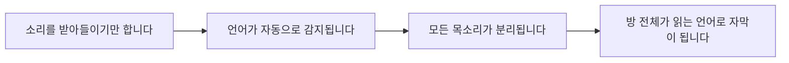
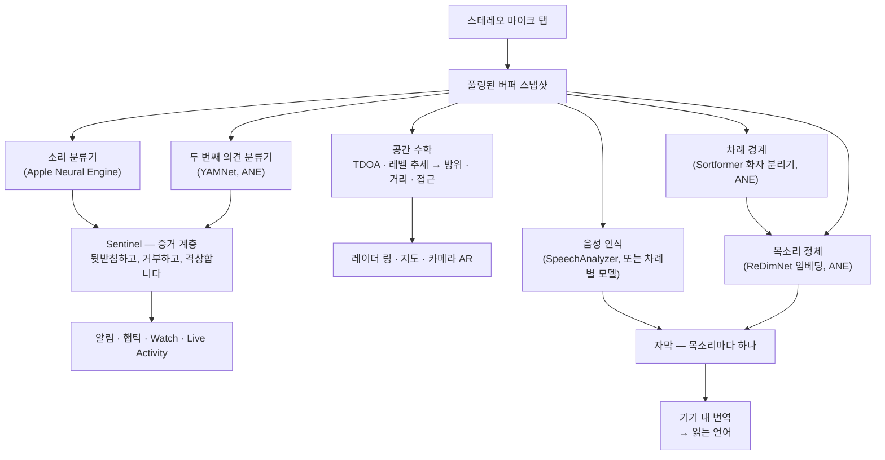
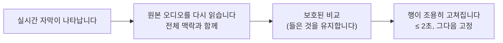
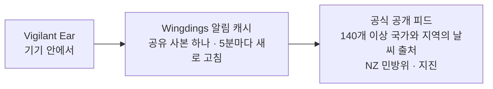

# Vigilant Ear 👂🛡️

*버전 1.1.14 기준 · 2026년 10월.*

## 들을 수 없는 사람을 위한 음향 레이더.

농인, 난청인, CODA 커뮤니티를 위해 특별히 만든 앱입니다. 대부분의 소리 인식 앱은 소리가 *무엇*인지 알려 줍니다. **Vigilant Ear는 그 소리가 어디에 있는지, 누가 내는지, 무슨 말을 하는지를 알려 줍니다** — iPhone을, 주변의 소리를 일어나는 대로 묘사하는 장치로 바꿉니다.

사이렌의 방향과 거리. 등 뒤의 노크. 대화 속의 사람들은 따로 받아 적힌 목소리로 그려집니다. 한 사람마다 자막이 붙고, 방향에 맞게 놓입니다. 누군가 읽지 못하는 언어로 말하고 있다면, 그 말이 **읽는 언어로 번역되어** 도착할 수 있습니다. 알림은 **잠금 화면, Dynamic Island, Apple Watch**까지 닿으므로, 한 번 보는 것으로 충분합니다.

중요한 것은 모두 기기에서 실행됩니다. 오디오는 인식을 위해 녹음되거나 업로드되지 않습니다. 사람의 귀가 무언가를 들어야만 하는 부분은 없습니다.

- 🧭 **감지만이 아니라 방향.** *무엇이, 어디서, 누가,* 그리고 *무슨 말이었는지* — 단지 “소리가 났다”가 아닙니다.
- 📣 **이름 호명.** 본인의 이름, 아이, 또는 파트너를 올립니다. “Marie 님, 주문 나왔습니다”라는 말은 휴대폰과 Watch에 알림을 보내고, 어느 쪽인지를 가리킵니다.
- 🔒 **설계부터 비공개.** 분류, 자막, 번역은 iPhone에서 실행됩니다. 자막은 실시간이고 일시적이며, 대화록 아카이브로 저장되지 않습니다.
- ⌚ **손목과 잠금 화면에서.** Apple Watch 방향 컴패니언과 Live Activity가 마지막 알림과 그 알림이 온 방향을, 한 번 보면 알 수 있는 곳에 둡니다.
- 🛰️ **더 많은 휴대폰, 함께 듣는 하나의 귀.** Constellation 메시는 Ultra-Wideband iPhone들을 이어, 각 기기가 듣는 것을 더 선명한 방향의 그림으로 합칩니다.
- 👁️ **농인 / 난청인 / CODA를 위해.** 구별되는 햅틱, 고대비 화면, 색에 의존하지 않는 신호, 큰 탭 영역, 그리고 앱 전체에 걸친 동작 줄이기.

---

## 누구를 위한 것인가

- 소리에 대한 상황 인식을 원하는 **농인, 난청인, CODA 사용자**. 켜 둔 채로 믿을 수 있는 Home Watch(노크, 알람, 아기, 전화)와 Street Watch(사이렌, 접근).
- **방향과 화자 분리가 있는 실시간 자막**이 필요하거나, 가까이 앉은 사람들의 **기기 내 번역**이 필요한 사람.
- 기기 내 음원 위치 추정에 관심 있는 접근성 및 음향 연구 사용자.

> Vigilant Ear는 접근성 **보조 도구**이며, 인증된 생명 안전 기기가 아닙니다.

---

## 무엇을 하는가

### 🧭 소리를 봅니다 — 방향과 거리
iPhone의 마이크 두 개로 Vigilant Ear는 **소리의 각도와, 그 소리가 앞에 있는지 뒤에 있는지**를 측정하고, 그 읽기를 약 1도 수준으로 안정되게 유지하며, 진행 방향이 위쪽인 레이더 링과 지도 위에 실시간 마커로 놓습니다. 한 줄 위에 있는 마이크 두 개는 그것만으로는 왼쪽과 오른쪽을 구별하지 못합니다. 오른쪽 50°의 소리와 왼쪽 50°의 소리는 똑같은 아주 작은 시간 차로 도착합니다. 앱은 그 읽기와 함께, 반대쪽에 더 흐리게 남는 두 번째 표시인 **고스트**를 그립니다. 손목을 돌리거나 두 번째 휴대폰이 있으면 어느 쪽인지 정해집니다. 거리는 도로에서 보정한 곡선에 소리의 크기를 대어 추정하고, 추정치라는 사실 그대로, 가능성 높은 범위와 함께 보여 줍니다. 단위는 앱을 읽는 언어가 아니라 지금 있는 나라의 단위입니다. 미국 휴대폰에서는 *≈ 50 ft*로 읽힙니다. 움직여도 마커는 실제 세계의 위치를 유지합니다. 이것이 핵심입니다. 들을 수 없는 세계를 공간으로 파악하는 일입니다. (수치는 아래에 있습니다.)

### 🚨 중요한 소리를 알아듣고 — 경고합니다
기기 내 분류기가 수백 가지 일상 소리를 식별하고, 중요한 범주를 지켜봅니다. **사이렌, 알람 — 전용 자동차 알람 클래스를 포함합니다 — 초인종/노크, 아기 울음, 근처의 사람, 악천후**입니다. 그중 하나가 감지되면, 분명한 화면 알림, 선택할 수 있는 **푸시 알림**, 구별되는 **햅틱**이 옵니다. 앱이 백그라운드에 있거나 휴대폰이 잠들어 있을 때도 마찬가지입니다. 중요한 범주는 기본으로 준비되어 있으므로, 알림을 켠다고 해서 “모두 꺼짐”에서 시작하지는 않습니다. 알림 범주를 모두 끄면, 백그라운드에 있는 동안 엔진이 완전히 휴면하여 배터리를 아낍니다. **Sentinel** 계층은 알림을 독립된 증거 — 방향, 움직임, 공공 피드 — 와 교차 확인합니다. 그래서 나가는 알림은 분류기 하나의 추측이 아니라 뒷받침된 결과입니다. 이것은 양방향으로 작동합니다. 노래 속의 사이렌 같은 순간은 보류되지만, 음악 사이로 반복되는 진짜 사이렌은 뚫고 나와 알립니다.

악천후 경보는 **140개가 넘는 국가와 지역의 공식 정부 출처**에서 오며, 더 많은 곳이 자주 추가됩니다. 모든 사용자에게 무료입니다. 민방위 긴급 경보도 포함되며, 별도의 **긴급 경보** 토글이 있습니다. 피드는 지금 있는 곳을 담당하는 것으로 좁혀집니다. 이용할 수 있는 곳에서는 각국 기상 기관의 **사전 발표**도 읽습니다. 위험이 닥친 뒤에야 나오는 경보만이 아니라, 태풍이나 많은 비가 오기 며칠 전에 쉬운 말로 내는 안내입니다. 갑작스러운 호우 발표와 산사태 발표도 함께입니다. 사전 안내는 조용히 표시되며, 실제 경보에만 남겨 둔 소리와 진동은 쓰지 않습니다.

### 🌧️ 지도 위의 날씨 레이더
비와 눈은 앱이 열리는 순간부터 지도에 나타납니다. 미국, 캐나다, 일본, 이탈리아와 유럽의 많은 지역은 그 나라의 레이더에서, 나머지 세계 대부분은 위성 강우 추정에서 옵니다. 지도를 터치하면 최근 한 시간이 세 번 재생되어, 폭풍이 어느 쪽으로 움직이는지 볼 수 있습니다. 아래쪽 눈금은 약함에서 짙음까지 읽힙니다. 이번 사용에서 원하지 않으면 날씨 버튼을 눌러 끕니다. 레이더는 경보와 같은 길로 도착합니다. 자체 서버를 통하므로, 휴대폰은 정부 서버에 접속하지 않습니다. 연한 회색 화살표는 전 세계 어디에서나 바람이 부는 방향을 보여 주며, NOAA의 현재 시각 전지구 예보에서 옵니다.

### 🛟 누구에게 연락하나 — 구명환
지도의 나침반 옆에 있는 구명환은, 지금 서 있는 나라의 짧은 목록을 엽니다.

- 긴급 번호. 전화 버튼과 문자 버튼이 있고, 긴급 번호로 문자가 되지 않을 수 있는 곳에서는 실시간 텍스트에 대한 안내가 있습니다
- 그 나라의 기상 기관
- 안정된 페이지가 있는 농인 단체
- Vigilant Ear 지원

도움말 패널(구명 튜브)에서 Vigilant Ear를 공유하세요. 옆 사람이 스캔해서 앱을 받을 수 있는 코드, App Store 링크, 그리고 저희 Instagram이 있습니다.

### ⌚ Apple Watch + Live Activity — 보면 압니다
- **Apple Watch 컴패니언** — 알림의 방향이 손목 위에 가리키므로, 한 번 보면 어디를 볼지 알 수 있습니다. Watch 화면은 새로 디자인되었습니다. 앱의 귀 아이콘, 위협 HUD 레이아웃, 알림을 닫는 두 번 탭이 있습니다. Watch 앱이 열려 있지 않아도 알림은 방향 화살표를 보여줄 수 있습니다.
- **Apple Watch의 이름 호명.** 누군가 내 이름을 부르면 워치가 손목을 세 번 톡톡 두드리고 목소리 쪽을 가리키는 화살표를 보여 줍니다. iPhone이 왼쪽과 오른쪽을 구분하지 못할 때는 부채꼴로 양쪽을 모두 표시합니다. iPhone이 잠겨 있어도 워치에서 Vigilant Ear 앱이 열려 있으면 작동합니다. 이름 호명을 사용하려면 Speaker Mode를 켜야 합니다.
- **Apple Watch에서 비트를 느껴 보세요.** 음악이 재생되고 워치에서 Vigilant Ear 앱이 열려 있으면 킥과 스네어가 링으로 고동치고, 마디마다 1박이 표시되며, 1박마다 손목을 가볍게 탭합니다. 워치 화면 아무 곳이나 두 번 탭하면 음악이 멈출 때까지 탭이 꺼집니다. 알림이 항상 우선입니다. Music ID가 곡을 알아내면 곡 제목도 워치에 표시됩니다.
- **Live Activity** — Vigilant Ear는 **잠금 화면**, **Dynamic Island**, **Watch Smart Stack**에 머뭅니다. 그래서 마지막 알림과 그 방위는 항상 한 번 보면 알 수 있는 곳에 있습니다.
- **손목 위의 파트너 알림** — 연결된 Constellation 파트너의 휴대폰이 알림을 올리면, 방향과 함께 Watch에도 닿을 수 있습니다. 컴패니언은 하루 동안 Watch 배터리를 거의 쓰지 않습니다.

### 💬 Speaker Mode — 실시간 방향 자막 *(무료)*
**Speaker Mode**를 켜면 Vigilant Ear가 가까이에서 말하는 사람들을 **자막 블록으로 받아 적습니다. 목소리마다 하나**입니다. 기기 내 화자 분리가 목소리를 구분해 둡니다. *누가* *무엇을* 말하는지, 안쪽 링의 방향 신호와 함께입니다. 지금 말하는 사람은 강조되고, 공간이 필요해지면 이전 글은 밀려 나갑니다.

**화자마다 그 사람의 언어로.** 메모리가 8 GB 이상인 iPhone에서는 자막 모델을 한 번 내려받으면(약 1 GB — Wi-Fi로, 또는 물은 뒤 셀룰러로) 실제로 말한 언어로 각 차례를 자막으로 만들 수 있습니다. 그래서 영어, 스페인어, 프랑스어, 아랍어가 오가는 방도 이해할 수 있습니다. 시험에서 네 개 언어가 섞인 대화의 단어 오류는 약 80%에서 14%로 줄었습니다. 버전 1.1.12부터는 개선된 음성 모델이 소음 속에서 실수를 훨씬 적게 합니다. 시끄러운 바에서 iPhone 17로 측정한 독일어 자막은 틀린 단어가 45%에서 20%로 줄었습니다. 이 모델은 Wi-Fi에서 이전 모델을 스스로 교체합니다. 내려받지 않은 경우, 그리고 Apple의 인식기가 더 잘 읽는 중국어·일본어·한국어 독자에게는, 자막이 이전과 같이 Apple의 기기 내 음성 인식을 사용합니다.

대부분의 자막 앱이 하지 않는 두 가지입니다.

**확신에 대한 정직함.** 행마다 있는 은은한 품질 표시와, 의심스러운 단어 아래의 점선 밑줄이, 그 줄을 믿어도 되는지 다시 확인해야 하는지를 알려 줍니다.

**스스로 고칩니다.** 문장이 자리 잡자마자 앱이 전체 맥락으로 오디오를 다시 읽고, 몇 초 안에 빠지거나 잘못 들은 단어를 되돌릴 수 있습니다. 그다음 텍스트는 고정됩니다.

**이름 호명**(설정, 켤 때까지 꺼져 있음)은 그 자막에서 올려 둔 이름 — 본인, 아이, 파트너 — 을 지켜봅니다. 누군가가 “Marie 님, 주문 나왔습니다”라고 하면, 또 하나의 자막 말풍선이 아니라 방향이 담긴 구별되는 햅틱과 Watch 알림을 받습니다. 그 말은 Speaker Mode에 발화로 그대로 나타납니다. 이 두드림은 그 말이 *본인에게* 한 말이었다는 신호입니다.

**거친 표현을 가릴 수 있습니다**(설정 → 자막). 그렇지 않으면 욕설이 완화 없이 일반 텍스트로 도착하고, 읽는 사람은 먼저 눈을 돌릴 기회가 없습니다. 이것을 켜면 그 단어가 기호로 바뀌어, 그 단어 없이도 문장을 읽을 수 있습니다. 무엇이 해당되는지는 당사의 단어 목록이 아니라 기기 자신의 음성 인식기가 정하므로, 받아 적히는 언어를 따릅니다. 18세 미만으로 선언된 계정에서는 항상 켜져 있고 자물쇠가 표시됩니다. *이* 기기가 받아 적는 말에 적용됩니다. 페어링된 휴대폰에서 중계된 텍스트는 그곳에서 받아 적힌 뒤, 완성된 텍스트로 도착합니다.

**화자가 힘을 준 단어는 굵게 표시됩니다.** 영어로 소리 내어 말하면 "I didn't say THAT"와 "I didn't say that"는 서로 다른 두 문장인데, 똑같은 받아쓰기에서는 그 차이가 완전히 사라집니다. 앱은 화자의 목소리가 음높이를 올린 단어 하나를 찾아 굵게 표시합니다. 한 줄에 많아야 하나이며, 확신이 없으면 아무것도 표시하지 않습니다. 잘못된 단어를 표시하면, 그 사람이 하지 않은 말을 했다고 주장하는 일이 되기 때문입니다. 중국어와 일본어에서는 꺼져 있습니다. 그 언어에서 음높이는 얼마나 세게 밀었는지를 말하는 것이 아니라 *어느 단어인지*를 알려 주기 때문입니다.

자막은 무료입니다. 자동 번역은 선택인 Power Pack+ 계층입니다. 자막은 보청기를 포함한 Bluetooth 기기로 소리 내어 읽어 줄 수도 있습니다. 무료이며, 설정에 있습니다. **방향 톤**(역시 무료, 설정 → 자막)은 선택한 쪽 귀에, 화자가 어디에 있는지를 알리는 선택적 소리 신호를 더합니다. 보청기나 한쪽 청력에 유용하며, 누구나 쓸 수 있습니다.

### 🌐 자동 번역 — 실시간으로, 읽는 언어로 *(Power Pack+)*
Speaker Mode가 켜져 있을 때 가까운 사람이 다른 언어로 말하면, Vigilant Ear가 그 언어를 감지하고 자막을 **읽는 언어로** 보여 줍니다. 원문 언어는 그 사람의 블록에 표시됩니다. 듣기 → 화자 분리 → 받아쓰기 → 번역 → 표시의 연쇄는 **기기에서** 실행됩니다. 네트워크가 필요한 순간은 Apple에서 언어 팩을 한 번 내려받는 것뿐입니다. 기다리고 있는 것이 그 다운로드라면, 앱은 번역되지 않은 텍스트만 남겨 두지 않고 그 사실을 알려 줍니다. 상대의 언어를 미리 알거나 고를 필요가 없습니다. 끝난 문장은 화자가 말을 멈추기를 기다리지 않고, 끝나는 즉시 번역됩니다. 번역은 아주 짧은 시간 안에 도착합니다.

이것은 **공상 과학의 만능 번역기** — 그저 알아듣는 장치 — 에 지금 구할 수 있는 것 가운데 가장 가깝습니다. Vigilant Ear는 언어를 스스로 감지하고, 방 안의 모든 화자를 따라가며, 그 모두를 읽는 언어로 자막을 만듭니다. 이어폰도 없고, 사전 설정도 없으며, 기기 안에서 이루어집니다.

### 🎵 음악과 방송 인식 *(Power Pack+)*
**ShazamKit**은 주변에서 재생되는 음악을 식별하고, 곡이 바뀌는 것을 자동으로 감지하여 제목이 현재 곡으로 유지됩니다.

### 🎛️ Acoustic Scope — 엔지니어처럼 소리를 봅니다
주변 소리를 전문가가 보듯 실시간으로 보여 줍니다. 스펙트럼, 스펙트로그램, ⅓ 옥타브 RTA 밴드, 크로마, 배음 성분. **모두에게 무료**입니다. **Partials는 음악을 읽습니다.** 각 음은 음이름으로 불리고 그 옆에 배음열이 붙습니다. 연기 경보처럼 높은 소리는 실제 음높이로 이름 붙여지며, 노래하거나 조율할 기준이 되는 목표 음을 선으로 그어 둘 수 있습니다. 스펙트로그램을 열어 둔 채 아무리 오래 보아도, 그에 드는 것은 거의 없습니다. 맞춤형 사운드 팩을 학습시키기 위해 소리를 포착하는 도구는 Power Pack+에 속합니다.

### 📦 맞춤형 사운드 팩 — 자신의 세계를 가르칩니다 *(Power Pack+)*
Vigilant Ear에게 중요한 소리를 가르칠 수 있습니다. 지역의 새, 건물의 문 차임, 발전기의 비정상적인 웅웅거림, 이륙하는 특정한 종류의 비행기. 이 추가 팩은 기본 감지 위에 쌓이므로, 새로운 소리가 사이렌과 알람을 밀어내는 일은 없습니다. 단계별 안내가 앱 안에 들어 있습니다.

### 🛰️ Constellation — 여러 대의 iPhone, 함께 듣는 하나의 귀 *(Power Pack+)*
Ultra-Wideband가 되는 iPhone이 두 대 이상이면(iPhone 11 이후의 대부분), **Constellation** 메시가 그들을 짝지어 서로의 위치를 감지하고, 각 기기가 듣는 것을 합쳐 소리가 어디에서 오는지 더 정확한 하나의 그림으로 만듭니다. 분산된 수동 청취 배열입니다. 자막도 합쳐집니다. 각 휴대폰은 자기 마이크가 들은 것을 받아 적고, 단어는 휴대폰들 사이에서 맞춰집니다. 화자에게 가장 가까운 휴대폰이 들은 것을 내놓으며, 한 대만 잡은 단어는 버리지 않고 남습니다.

휴대폰은 **서로 직접** 연결됩니다. 라우터도, 공유 Wi-Fi 네트워크도, 인터넷도 필요 없습니다. Wi-Fi만 켜져 있으면 됩니다. AirDrop이 쓰는 것과 같은 피어 투 피어 연결을 사용하며, 맞는 하드웨어가 있는 휴대폰만 참여할 수 있습니다. 휴대폰 사이의 연결은 항상 암호화됩니다. Vigilant Ear 1.1.6 이하를 실행하는 휴대폰은 메시에 참여하려면 앱을 업데이트해야 합니다.

**파트너 메시지** — 메시 파트너의 휴대폰으로 짧은 글을 보냅니다. 상대의 자막 피드에 도착하며, 기기 안에서 상대의 언어로 번역되어 올 수 있습니다. 메시지는 연령을 인식합니다. Apple의 선언된 연령 범위(Declared Age Range)에 기반하며, 성인과 미성년자 사이의 문자는 두 사람이 서로를 의도적으로 지명하지 않는 한 꺼져 있습니다. 알림과 자막은 결코 막지 않습니다. 막는 것은 사람 사이의 문자뿐입니다.

### 🔗 Remote Link — 함께 있지 않은 사람에게 닿습니다 *(시작에는 Power Pack+)*
전화 통화가 보통 하는 일을, 대신 영상과 글로 합니다. 초대 코드를 보내면 상대는 Vigilant Ear 안에서 **Power Pack+ 없이도** 참여합니다. Constellation과 달리 가까이 있을 필요가 없습니다. 두 사람은 어디에 있든 됩니다.

**어느 시점에도 오디오는 쓰이지 않습니다.** 영상과 글뿐입니다. 그래서 연결의 어떤 부분도 양쪽의 청력에 의존하지 않으며, 앱을 통해 누군가와 수어로 대화할 방법이 됩니다. 앱 자체는 수어를 이해하지 않습니다. 영상을 전달할 뿐이고, 나머지는 두 사람이 합니다. 네트워크가 허용하는 곳에서는 두 휴대폰이 직접 연결되며, 앱은 그것이 **직접**인지 **중계**인지 분명하게 보여 줍니다. 그래서 영상이 중계를 거치는지 항상 알 수 있습니다.

**자막도 함께 이동합니다.** 각 휴대폰이 받아 적은 내용이 상대 쪽에 나타나며, 필요할 때는 읽는 사람의 언어로 번역됩니다. 어느 쪽이든 연결을 — 영상과 자막을 — 잠시 멈추었다가 다시 시작할 수 있고, 메인 화면에서 끊을 수 있습니다.

### 📷 카메라 AR — “소리를 보다”
액션 팬에서 카메라 AR을 열고, 감지된 소리를 실시간 카메라 화면의 실제 방위에 고정합니다. 마커는 화자별로, 또는 소리 범주와 방향별로 모여 화면이 읽기 쉽게 유지됩니다. 소리가 조용한 채로 있으면 마커는 옅어집니다.

### 🗺️ 지도, 도로, 경로 예측
소리의 방위는 지도의 실제 GPS 좌표로 투영됩니다. 차량 소리는 **가까운 도로에 스냅**될 수 있고 경로가 예측되어, 지나가는 트럭이 건물을 뚫고 가는 것이 아니라 *길을 따라* 움직이는 것으로 읽힙니다. (Feature Playground의 소방차 데모를 실행해 보십시오.)

### 🪄 Feature Playground — 귀 없이도 확인합니다
**Feature Playground**는 모두에게 공개되어 있습니다. Home과 Street의 샘플 알림(노크, 알람, 아기, 사이렌, 날씨), 여러 휴대폰 데모와 대화 데모가 있습니다. 분명한 워터마크가 있어, 연습이 실제 사건인 척하지 않습니다. 패널을 닫으면 데모가 깨끗이 걷힙니다(GPS 스푸핑이 붙어 남지 않고, 플래그도 남지 않습니다).

### ♿ 접근성이 먼저
농인 / 난청인 / CODA와 색각 이상 사용자를 위해 만들었습니다.

- **색에 의존하지 않는** 신호
- **≥44 pt** 탭 영역
- **동작 줄이기** 존중
- 아랍어 독자를 위한 **오른쪽에서 왼쪽 레이아웃**
- 여러 감각의 알림(햅틱 + 시각 + Watch)
- 시작 확인 화면이 권한 상태를 분명한 초록 / 회색 / 빨강으로 보여 주고, “허용되지 않음”은 번트 오렌지입니다. 마스터 알림 스위치 역할을 하는 알림 허용도 포함됩니다

---

## 무료와 Power Pack+

안전의 핵심은 **무료이며, 영원히** 그렇습니다.

- **Home Watch와 Street Watch** — 로컬 소리 알림(알람, 사이렌, 노크/초인종, 아기, 근처의 사람). 화면, 햅틱, 선택적 푸시로 전달됩니다.
- **실시간 자막** — Speaker Mode, 기기 내, 하드웨어가 허용하는 곳에서 방향 포함. 정직한 확신 표시, ~2초의 자기 교정, Bluetooth 기기(보청기 포함)로의 선택적 음성 출력, 방향 톤.
- **이름 호명** — 직접 입력하는 선택적 이름(본인, 아이들, 파트너). 일치하면 두 번째 자막이 아니라, 방위가 있는 Watch/휴대폰 알림입니다.
- **Standing Watch** — 방 자체의 상태이며, 설정할 것 없이 항상 켜져 있습니다. 방이 자신의 패턴을 유지하는 동안은 안정된 시안색 등, 무언가가 바뀌면 — 새로운 목소리, 갑작스러운 정적, 다가오는 무언가 — 호박색입니다. 앱이 시작되면, 알림을 듣고 있지 않던 시간이 얼마나 되는지를 알려 줍니다.
- **악천후 알림** — 140개가 넘는 국가와 지역의 정부 출처에서 온, 해당 지역의 공식 경보. 더 많은 곳이 자주 추가됩니다.
- **날씨 레이더** — 지도 위의 비와 눈, 최근 한 시간의 재생, 바람이 부는 방향.
- **구명환** — 지금 있는 나라에서 누구에게 연락할지.
- **지진 알림(전 세계)** — 가까운 곳에서 지진이 보고되면 진동을 느끼고, 그 흔들림을 느낀 지역을 지도에서 봅니다. 공식 지진 피드의 확인입니다. 조기 경보가 아닙니다. 흔들림을 느꼈다면, 그것이 무엇이었는지를 알려 줍니다. 피드는 5분마다 확인되며, 백그라운드에서도 확인됩니다. 기기 내의 깊은 울림(초저주파) 감지는 땅이 움직이는 순간 추가 확인을 준비할 수 있습니다.
- **Feature Playground** — 분명한 PREVIEW 워터마크가 있는 연습 알림과 기능 미리보기.
- **Apple Watch 컴패니언과 Live Activity** — 한눈에 보는 방향과 마지막 알림.
- **Acoustic Scope** — 전문가급 실시간 소리 시각화이며, 모두에게 무료입니다. (학습용으로 소리를 포착하는 도구는 Power Pack+입니다.)
- **리서치 어레이** *(끌 때까지 켜져 있습니다)* — 켜져 있는 동안, 시각과 대략적인 위치(약 1 km), 지진과 비슷한 사건의 빈도가 공유됩니다. 오디오도 없고, 식별자도 없습니다. 지진과 그 밖의 저주파 사건을 지도로 만드는 데 보탬이 됩니다. 지도의 질문이 한 번 나옵니다. 보고는 그 질문이 화면에 나타난 뒤에야 나갑니다.

**Power Pack+**는 일회성 잠금 해제이며(**구독이 아닙니다**), **90일 무료 체험**이 있습니다. 여기에 초능력이 더해집니다.

- **자동 번역** — 가까운 말을 읽는 언어로, 기기 안에서 번역합니다.
- **Constellation** — Ultra-Wideband로 여러 iPhone이 청각을 공유하며, 파트너 메시지가 있습니다.
- **Music ID** — ShazamKit 곡 인식.
- **맞춤형 사운드 팩** — 자신의 소리를 위해 학습시키는 추가 분류기.
- **Remote Link** — 함께 있지 않은 사람과 나누는 비공개 영상·문자 통화. 어느 시점에도 오디오는 없습니다. 하나를 시작하려면 Power Pack+가 필요합니다. 초대한 사람은 무료로 참여합니다.

무료이든 Power Pack+이든, **인식을 위한 오디오는 기기에 남습니다.** 등급이 바꾸는 것은 어떤 기능이 열리느냐뿐이며, 분석을 위해 원본 오디오가 보내지는 곳은 결코 바뀌지 않습니다.

---

## 작동 방식(내부를 보면)

Vigilant Ear는 **로컬을 우선하는, 기기 내** 파이프라인이며 여러 계층으로 이루어져 있습니다. 한 번 포착한 뒤, 독립된 전문 단계들이 같은 소리를 읽고 서로의 결과를 확인합니다. 원본 오디오는 우선순위가 높은 탭에서 포착되어 **풀링된 버퍼 프리 리스트**로 복사되고(실시간 경로에서 할당이 반복되지 않습니다), UI를 멈추지 않은 채 여러 갈래로 나갑니다.

어떤 모델도 단독으로는 신뢰하지 않습니다. **Sentinel** 계층은 감지와 알림 사이에 있습니다. 독립된 엔진들이 프레임마다 서로를 뒷받침하거나 거부합니다. 거부 판정에 맞서는 실제 세계의 증거가 반복해 쌓이면(음악 사이로 진짜 사이렌이 울부짖을 때), 증거가 이기고 알림이 나갑니다.

자막에는 한 번의 기회가 더 있습니다. 확정된 문장마다 메모리 속의 짧은 오디오 링에서 전체 맥락과 함께 조용히 다시 읽힙니다. 교정은 약 2초 안에 반영되고, 그다음 텍스트는 완전히 고정됩니다.

- **공간 수학** — FFT, 코히어런스 가중 도착 시간 차(TDOA — 두 마이크가 동의하는 주파수 대역을 우선하고, 그다음 아주 작은 도착 지연을 방위로 바꿉니다), 그리고 백그라운드 작업에서의 레벨 추세 접근 추적. 마이크 쌍은 고정된 방향으로 읽히므로, 휴대폰을 세로로 들든 가로로 들든 방향은 같게 작동합니다.
- **음성** — 받아쓰기에는 iOS 26의 `SpeechAnalyzer` / `SpeechTranscriber`, 기기 내 번역에는 Apple의 **Translation** 프레임워크. 선택적 자막 다운로드가 있으면, 각 차례는 음성 활동 감지기가 자르고, 음성 언어 모델이 언어를 고르며, 공개 음성 인식 모델이 받아 적습니다. 유럽 언어용 하나, 그 밖의 언어용 하나이며, 모두 기기 안입니다. 목소리 정체는 증거에 기반합니다. 목소리는 서로 독립된 소리 구간에서만 실제 사람으로 확인되며, 불확실한 일치는 잘못된 이름을 추측하지 않고 누구의 것인지 밝히지 않은 채로 표시됩니다.
- **두 개의 모델, 두 개의 질문** — 목소리를 가르려면 *화자가 언제 바뀌었는지*와 *그 화자가 누구인지*가 필요하며, 둘은 같은 문제가 아닙니다. **Sortformer** 스트리밍 화자 분리기가 차례의 경계를 표시하고, **ReDimNet** 임베딩이 각 구간 안의 목소리가 누구인지 정합니다. 경계에서 자르는 일은 듣기보다 더 중요합니다. 두 사람에 걸쳐 있는 창에는 둘 다 들어 있고, 어떤 임베딩 모델도 그 뒤를 되돌릴 수 없습니다. 둘 아래에는 음성 활동의 바닥이 있습니다. 어려운 방에서 화자 분리기가 추측하지 않고 조용해지면 차례는 여전히 잘리므로, 앱은 두 화자를 하나로 섞지 않고 품질을 낮춰 대응합니다.
- **음악의 진실** — 크로마 **곡 서명 감지기**가 “정말로 음악이 재생 중인가?”라는 결정을 맡습니다. 일반 분류기는 조용한 방과 사이렌을 “음악”이라고 부르기로 알려져 있기 때문입니다. Shazam은 서명이 정말로 음악적인 것이 있다고 동의한 뒤에만 실행됩니다.
- **동시성** — Swift 6 격리가 마이크 탭, 음향 수학, UI 렌더 루프를 깨끗이 분리합니다.
- **효율** — 다운샘플링, 부하에 적응하는 분류, 증거로 열리는 네트워크 사용으로, 항상 듣는 상태가 켜 두기에 충분히 가볍습니다.

날씨와 지진 알림은 오디오와 반대 경로를 갑니다. 소리에 관한 것은 아무것도 나가지 않지만, 알림 *데이터*는 들어옵니다. **모든** 공식 피드 — 그리고 레이더와 바람 이미지 — 는 당사가 운영하는 작은 중계 캐시를 통과합니다. 그래서 공개 데이터를 한 번 가져오면 모든 사용자에게 제공되고, 휴대폰은 정부 서버에 접속하지 않습니다.

---

## 휴대폰이 들을 수 있는 것 — 측정

iPhone에는 약 6인치(15 cm) 떨어진 마이크 두 개, 기압계, 그리고 매우 좋은 시계가 있습니다. 그것으로 소리가 어느 쪽에서 왔는지, 대략 얼마나 먼지, 다가오고 있는지, 문이 방금 열렸는지를 알 수 있습니다. 각각의 정확도가 어느 정도인지, 어떻게 확인했는지, 그 소리를 직접 들을 수 없을 때 왜 중요한지를 아래에 적습니다. 방향 표는 2026년 9월에 iPhone 17에서 측정했습니다. 같은 책상 확인을 iPhone 16 Pro Max에서 했을 때는 연속적인 각도가 나오지 않았습니다. 그 기기의 이미지는 소리를 앞쪽이나 옆쪽으로 붙입니다. 그래서 도 단위의 행은 17만의 것입니다. 거리는 본질적으로 추정치로 남으며, 화면에서도 그렇게 말합니다. 이 절에서 줄자로 잰 거리는 피트이며, 바로 그 줄자의 단위입니다.

**방향 — 두세 도까지.** 소리는 위쪽 마이크에 아래쪽보다 먼저 도착하거나, 나중에 도착합니다. 그 간격으로 앱은 소리가 휴대폰의 축에서 얼마나 벗어나 있는지, 앞인지 뒤인지를 계산합니다. 휴대폰의 두 채널은 평범한 마이크가 아니라 처리된 스테레오 이미지이며, 그 이미지는 방이 시끄러울 때마다 자기만의 고정된 패턴을 더합니다. 앱은 실행 직후의 조용한 구간에서 그 패턴을 배웁니다. 조용한 방이 약 1분 이어진 뒤, 방향을 읽기 전에 그 패턴을 빼며, 그때까지 읽기는 그 교정 없이 진행됩니다.

| 측정한 것 | 결과 |
|---|---|
| 조용한 사무실부터 5 dB SNR의 벽이 단단한 방까지, 시뮬레이션한 96개 방의 중앙값 오차 | 1.0° |
| 책상 위의 iPhone 17, 방의 소음이 켜진 상태, 축에서 30° 벗어난 스피커 | 옆 평면 기준 61.7°로 읽음. 기대값은 60°, 흔들림 1.6° |
| 같은 조건, 휴대폰의 옆면에서 곧장 놓인 스피커 | 4.5°로 읽음. 기대값은 0°, 흔들림 2.2° |
| 같은 조건, 축에서 60° 벗어난 스피커 | 중앙값 35.7°, 기대값은 30°. 측정이 갈라졌고, 정면 지연에 두 번째 군집이 있었으며, 가장 유력한 원인은 시험 장치에서의 반사 |
| 같은 조건, 정면의 스피커 | 모든 읽기가 최대 지연에 있음. 그래야 합니다 |
| 소리 대신 이미지 자체의 패턴에 떨어진 읽기 | 어떤 각도에서도 없음 |

*왜 중요한가:* 사이렌이 들리지 않는다면, “뒤쪽, 한쪽으로 벗어남”이 어디를 볼지 알려 줍니다. 가만히 유지되는 읽기는 줄자와 맞춰 본 뒤에야 믿을 만하며, 이번 것은 두 번 맞춰 보았습니다. 첫 번째 확인은 결과를 실제보다 좋아 보이게 했습니다.

**거리 — 추정치임을 그대로 보여 줍니다.** 마이크 하나로는 거리를 잴 수 없고 크기만 알 수 있으며, 멀리 있는 큰 트럭이 가까이 있는 조용한 차처럼 들릴 수 있습니다. 앱은 실제 도로에서 맞춘 곡선으로 크기에서 거리를 추정한 뒤, 신중한 사람이 말하듯 말합니다. 미국 휴대폰에서는 *약 50 ft, 대체로 25에서 100 사이*입니다.

| 측정한 것 | 결과 |
|---|---|
| 보정을 통해 다시 재생한 실제 자동차 감지 | 1,131 |
| 실제로 있던 100-foot 도로 안에 떨어진 경우 | 73% |
| 먼 차선의 자동차 | 줄자가 73 and 85 ft라고 한 곳을 78 and 87 ft로 추정 |

그 도로(도시 교차로)는 차선마다 측정했습니다. 곡선이 틀릴 때는 가까운 쪽으로 틀립니다. 보정은 자동 테스트로 잠겨 있어, 소리 없이 흘러가지 않습니다. 연기 감지기처럼 자기 공간 안의 알람에는 거리 수치가 전혀 붙지 않습니다. 이미 같은 방에 있기 때문입니다.

**움직임 — 다가오고 있음.** 자동차와 사이렌에서는, 커지는 소리가 보통 가까워진다는 뜻입니다. 앱은 몇 초에 걸쳐 소리의 레벨이 얼마나 빨리 오르는지 봅니다. 초당 약 1.5 dB의 지속적인 상승(분명하고 꾸준한 크기의 증가)은 접근이고, 그에 맞는 하강은 멀어짐이며, 변화가 멈춘 소리는 약 4초 뒤에 어느 쪽으로도 불리지 않습니다. 한 번의 큰 순간 — 경적을 짧게 누르는 것, 문을 쾅 닫는 것 — 으로는 작동하지 않습니다. 물리 위에, 자동 테스트 아홉 개로 만들어졌습니다. 녹화된 도로 통과가 다음 현장 확인입니다.

**방 안의 공기 — 문에는 고유한 형태가 있습니다.** 기압계는 약 14피트(4.3 m) 떨어진 문이 열리는 것을 알아챌 수 있습니다. 문이 돌면 압력이 내려갔다가, 닫히면 되돌아옵니다. 14시간의 정적과 15번의 문 사건에서, 모든 문이 그 두 부분의 형태를 만들었고 집 안의 다른 것은 만들지 않았습니다.

| 사건 | 압력 변화율 | 형태 |
|---|---|---|
| 현관문, 열고 닫음, ×10 | 0.6–1.8 Pa/s | 내려갔다가 되돌아옴, 약 5초 간격 |
| 현관문, 쾅 닫음, ×5 | 1.1–2.5 Pa/s | 같은 쌍, 더 큼 |
| 밤새 에어컨이 순환, ×8 | 0.11–0.46 Pa/s | 몇 분에 걸친 느린 상승, 두 휴대폰에서 동일 |
| 조용한 방 | ~0.02 Pa/s | 없음 |
| 사람의 활동, 옆을 걸어 지나감 | — | 모션 센서가 알아채고 휴대폰은 무시합니다 |

방을 밀폐하지 않는 문은 보이지 않았습니다. 이 시험에서는 방충망 문이었고, 바로 그래야 합니다. 지금은 압력 변화가 지도 위에 깊은 울림으로 나타날 수 있습니다. 조용한 밤을 위한 전용 문 알림은 측정되어 있고 설계되어 있으며, 아직 매일의 기본값은 아닙니다.

**Constellation — 휴대폰 두 대가 어느 쪽을 정합니다.** 메시의 각 휴대폰은 자기가 있는 곳에서 소리를 향해 선을 긋고, 그 선들은 한쪽에서만 깨끗이 교차합니다. 그렇게 되면 고스트는 사라지고, 앱은 왼쪽 또는 오른쪽을 다시 말할 수 있습니다. 시뮬레이션에서, **40미터** 떨어진 휴대폰 두 대는 50미터 떨어진 사이렌의 위치를 약 2미터 이내로 잡습니다.

**여기에 적힌 것을 믿게 되는 방법.** 모든 숫자는 같은 세 관문을 순서대로 통과했습니다. 정답을 미리 아는 시뮬레이션 방. 앱을 속일 바로 그 경우를 재현하고, 변경이 있을 때마다 실행되는 작은 자동 테스트. 그다음, 손으로 거리를 잰 실제 책상 위의 실제 휴대폰. 세 번째를 견디기 전에는 아무것도 정확하다고 치지 않습니다. 소리를 들을 수 없는 사람에게 앱의 말은 유일한 말이므로, 실험실이 신뢰를 얻듯이 얻어야 합니다.

엔지니어를 위한 더 깊은 설명: [물리](https://vigilantear.com/en/physics/) — TDOA, 거리, 움직임, Constellation, 기압 감지. 모든 수치에는 MEASURED / BENCHED / MODELLED 태그가 붙어 있습니다.

---

## 개인정보

- **핵심 파이프라인은 항상 기기 내.** 분류, 공간 수학, 받아쓰기, 화자 분리, 번역은 iPhone에서 실행됩니다. 원본 오디오는 인식을 위해 녹음되거나 업로드되지 않습니다.
- **자막은 일시적입니다.** 실시간 자막은 그 세션의 메모리에 머물며, 내보낸 디버그 로그에는 자막 텍스트가 들어 있지 않습니다.
- **광고 SDK도, 행동 분석 SDK도 없습니다.** 제한된 네트워크 사용은 지도, 공개 날씨 피드, 레이더와 바람 이미지, 도움 목록, 선택적 자막 모델 다운로드, 선택적 Shazam 지문, 도로 맥락, 그 기능이 켜져 있는 동안의 리서치 어레이 보고, App Store 구매뿐입니다. 자세한 내용은 개인정보 처리방침에 있습니다.

자세한 내용: [개인정보 처리방침](/ko/privacy/) · [이용약관](/ko/terms/) · [지원](/ko/support/)

---

## 하드웨어와 플랫폼

- **iPhone(완전한 경험).** 세로와 가로 모두에서 작동합니다. 원하는 대로 드시면 됩니다. 방향을 찾으려면 스테레오 마이크가 필요합니다. **iPhone 13 이상**을 권합니다. 화자마다 그 언어로 된 자막에는 **8 GB의 메모리**가 필요합니다(iPhone 15 Pro 이후).
- **Apple Watch.** 방향 화살표가 있는 컴패니언 알림. Live Activity / Smart Stack과 함께 작동합니다.
- **iPad(네이티브).** 적응형 레이아웃입니다. 큰 화면에서는 실시간 자막이 지도 옆의 비쳐 보이는 패널에 놓이고, 아무도 말하지 않으면 접혀 들어갑니다. 단일 채널 마이크 → 완전한 방향 없는 자막.
- **Constellation**에는 **Ultra-Wideband**가 필요합니다. iPhone 11 이후이며, SE와 “e” 모델은 제외됩니다. Wi-Fi 네트워크는 **필요 없습니다**. Wi-Fi가 켜져 있으면 휴대폰이 서로를 직접 찾으므로, 휴대폰이 가까이 있는 한 라우터도 인터넷도 없이 Constellation이 작동합니다.
- **Android(제공될 때).** 핵심 레이더, 알림, 자막, 날씨가 있는 별도 빌드입니다. Constellation 메시는 iOS가 우선입니다.

---

## 현지화

인터페이스, 알림, 자막이 **영어, 스페인어, 포르투갈어(브라질), 프랑스어, 독일어, 이탈리아어, 터키어, 아랍어, 일본어, 중국어 간체, 중국어 번체, 한국어, 러시아어, 힌디어, 루마니아어, 폴란드어**(16개 언어)로 완전히 현지화되어 있습니다. 시스템 로케일을 따르거나, 앱에서 직접 고릅니다. 루마니아어 자막은 기기에서 작동합니다. Apple Translate에는 루마니아어가 없으므로, 자동 번역은 그 언어에 대해 원문을 보여 줍니다.

---

## 상태와 고지

Vigilant Ear는 **실험적인 음향 접근성 보조 도구**이며, 인증된 생명 안전 설비가 아닙니다. 음원 위치의 분해능은 주변, 날씨, 바람, 마이크 하드웨어에 따라 달라집니다. **평소의 환경 인식을 항상 유지하십시오.** 안전 정보의 유일한 출처로 삼지 마십시오.

일부 기능(카메라 AR 마커, Apple이 부여할 때의 Critical Alerts 권한 업그레이드, 고급 다중 팩 소리 저작)은 계속 발전합니다. 무료인 Home / Street 감시와 실시간 자막이, 첫날부터 믿을 수 있는 제품입니다.

**출처와 라이선스:** [api.vigilantear.com/sources](https://api.vigilantear.com/sources)

---

**연락:** [vigilantear@wingdingssocial.com](mailto:vigilantear@wingdingssocial.com)

농인·난청 커뮤니티와 음향 연구를 위해 ❤️로 만들었습니다.

    
  <strong>© 2026 Wingdings, Inc.</strong> 
  모든 권리 보유. 
  다수의 특허 출원 중

