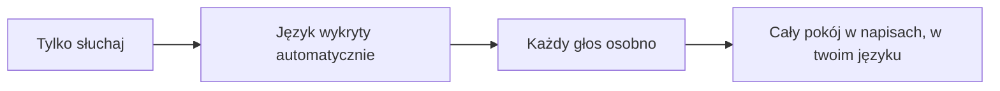
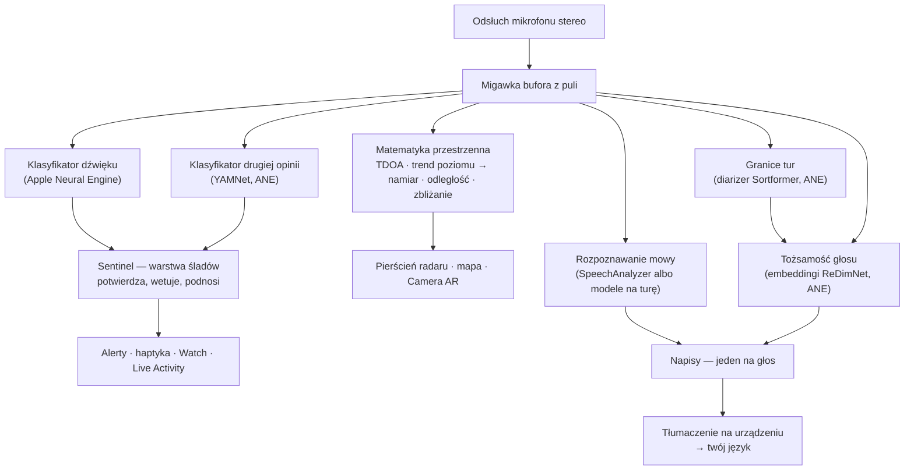
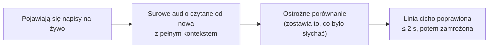
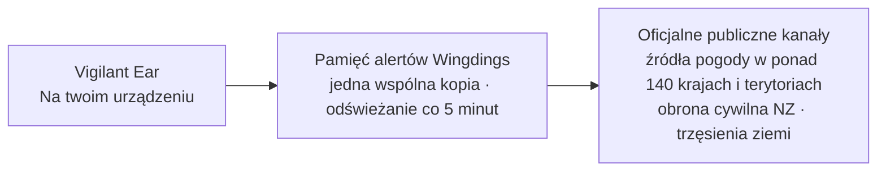

# Vigilant Ear 👂🛡️

*Obowiązuje od wersji 1.1.13 · październik 2026.*

## Radar akustyczny dla osób, które nie słyszą.

Aplikacja zbudowana specjalnie dla społeczności Głuchych, słabosłyszących i CODA. Większość aplikacji do rozpoznawania dźwięku mówi ci, *czym* jest dźwięk. **Vigilant Ear mówi, gdzie jest, kto go wydaje i co mówi** — i zamienia iPhone w urządzenie, które opisuje dźwięk wokół ciebie, gdy się dzieje.

Kierunek i odległość syreny. Pukanie za tobą. Osoby w rozmowie, narysowane jako osobne głosy w napisach — każdy z napisem i ze swoim kierunkiem. Jeśli ktoś mówi językiem, którego nie czytasz, jego słowa mogą przyjść **przetłumaczone na twój.** Alerty dochodzą na **Ekran blokady, do Dynamic Island i na Apple Watch**, więc wystarczy rzut oka.

Wszystko, co ważne, działa na urządzeniu. Dźwięku nie nagrywamy i nie wysyłamy do rozpoznania. Nic nie zależy od tego, że ludzkie ucho coś usłyszy.

- 🧭 **Kierunek, nie samo wykrycie.** *Co, gdzie, kto* i *co powiedziano* — nie tylko „odezwał się dźwięk”.
- 📣 **Wywołane imię.** Wpisz swoje imię, imię dziecka albo partnera lub partnerki — „zamówienie dla Marie gotowe” daje alert na telefonie i zegarku i pokazuje, z której strony.
- 🔒 **Prywatne z założenia.** Klasyfikacja, napisy i tłumaczenie działają na twoim iPhonie. Napisy są na żywo i znikają; nie zapisujemy ich jako archiwum transkrypcji.
- ⌚ **Na nadgarstku i na Ekranie blokady.** Towarzysz kierunku na Apple Watch i Live Activity trzymają ostatni alert i stronę, z której przyszedł, o jeden rzut oka.
- 🛰️ **Więcej telefonów, jedno wspólne ucho.** Nasz mesh Constellation łączy iPhone'y z Ultra-Wideband i składa to, co słyszy każdy, w ostrzejszy obraz kierunku.
- 👁️ **Dla osób Głuchych / słabosłyszących / CODA.** Osobna haptyka, mocny kontrast, sygnały niezależne od koloru, duże cele stuknięcia i Ogranicz ruch w całej aplikacji.

---

## Dla kogo

- **Osoby Głuche, słabosłyszące i CODA**, które chcą wiedzieć, co dzieje się w dźwięku — Home Watch (pukanie, alarm, dziecko, telefon) i Street Watch (syrena, zbliżanie), które możesz zostawić włączone i im ufać.
- Każdy, kto potrzebuje **napisów na żywo z kierunkiem i rozdzieleniem mówców** albo **tłumaczenia na urządzeniu** osób siedzących obok.
- Osoby od dostępności i badań akustycznych, które interesuje namierzanie dźwięku na urządzeniu.

> Vigilant Ear to **pomoc** w dostępności, nie certyfikowane urządzenie bezpieczeństwa życia.

---

## Co robi

### 🧭 Widzi dźwięk — kierunek i odległość
Na dwóch mikrofonach iPhone'a Vigilant Ear mierzy **kąt dźwięku i to, czy jest przed tobą, czy za tobą**. Trzyma ten odczyt stabilnie w granicach około stopnia i kładzie go jako znacznik na żywo na pierścieniu radaru z kursem do góry i na mapie. Dwa mikrofony na jednej linii same nie odróżnią lewej od prawej. Dźwięk 50° w prawo i dźwięk 50° w lewo przychodzą z tą samą maleńką różnicą czasu. Aplikacja rysuje odczyt oraz **bledsze echo po drugiej stronie**. Obrót nadgarstka albo drugi telefon to rozstrzyga. Odległość szacujemy z głośności, na krzywej skalibrowanej na ulicy, i pokazujemy ją jako szacunek, którym jest, z prawdopodobnym zakresem. Jednostki biorą się z kraju, w którym jesteś, a nie z języka, w którym czytasz aplikację. Na telefonie w Stanach Zjednoczonych widać *≈ 50 ft*. Gdy się ruszysz, znaczniki trzymają swoje miejsce w prawdziwym świecie. To jest rdzeń: przestrzenna świadomość świata, którego nie słyszysz. (Liczby niżej.)

### 🚨 Rozpoznaje ważne dźwięki — i ostrzega
Klasyfikator na urządzeniu rozpoznaje setki codziennych dźwięków i pilnuje kategorii krytycznych — **syreny, alarmy — w tym osobna klasa alarmu samochodowego — dzwonki i pukanie, płacz dziecka, osoba w pobliżu oraz Groźna pogoda.** Gdy któryś wchodzi, dostajesz wyraźny alert na ekranie, opcjonalne **powiadomienie push** i osobną **haptykę** — nawet gdy aplikacja jest w tle albo telefon śpi. Kategorie krytyczne są gotowe od startu, więc włączenie powiadomień nie znaczy „wszystko wyłączone”. Wyłącz wszystkie kategorie alertów, a silnik w tle całkiem zasypia, żeby oszczędzać baterię. Warstwa **Sentinel** sprawdza alerty wobec niezależnych śladów — kierunku, ruchu i publicznych kanałów — więc to, co wchodzi, jest potwierdzone, a nie samotny strzał klasyfikatora. Działa w obie strony. Aplikacja wstrzymuje moment w piosence, który brzmi jak syrena, ale prawdziwa syrena, która powtarza się przez twoją muzykę, przebija się i daje alert.

Ostrzeżenia o groźnej pogodzie przychodzą z **oficjalnych źródeł rządowych w ponad 140 krajach i terytoriach**, a kolejne dochodzą często — za darmo dla wszystkich. Są też alerty obrony cywilnej, z własnym przełącznikiem **Alerty awaryjne**. Kanały zawężamy do tych, które obejmują miejsce, w którym jesteś. Tam, gdzie się da, aplikacja czyta też **komunikaty z wyprzedzeniem** krajowych służb pogody — zwykłym językiem, wydawane dni przed tajfunem albo silnym deszczem, a nie tylko ostrzeżenia, gdy niebezpieczeństwo już jest — oraz komunikaty o nagłej ulewie i o osuwiskach. Komunikaty z wyprzedzeniem pokazujemy po cichu, bez dźwięku i wibracji zarezerwowanych dla prawdziwego ostrzeżenia.

### 🌧️ Radar pogodowy na mapie
Deszcz i śnieg widać na mapie od chwili, gdy aplikacja się otwiera — z radarów krajowych Stanów Zjednoczonych, Kanady, Japonii, Włoch i dużej części Europy, oraz z satelitarnego szacunku deszczu na większości reszty świata. Dotknij mapy, a ostatnia godzina odtwarza się trzy razy, więc widzisz, w którą stronę idzie burza. Skala na dole idzie od Lekkie do Gęste. Nie chcesz go na tę sesję? Stuknij przycisk pogody, żeby go wyłączyć. Radar dochodzi tak samo jak ostrzeżenia — przez nasz serwer, więc telefon nigdy nie kontaktuje się z serwerami rządowymi. Jasnoszare strzałki pokazują też, w którą stronę wieje wiatr, w dowolnym miejscu na świecie, z globalnej prognozy NOAA na bieżącą godzinę.

### 🛟 Do kogo dzwonić — koło ratunkowe
Koło ratunkowe obok kompasu mapy otwiera krótką listę dla kraju, w którym stoisz:

- numer alarmowy, z przyciskami połączenia i wiadomości, oraz notatka o Real-Time Text tam, gdzie wiadomość na numer alarmowy może nie zadziałać
- krajowa służba pogody
- organizacja osób Głuchych, tam, gdzie ma stabilną stronę
- pomoc Vigilant Ear

Udostępnij Vigilant Ear z panelu pomocy (koło ratunkowe): kod, który osoba obok może zeskanować, żeby pobrać aplikację, link do App Store i nasz Instagram.

### ⌚ Apple Watch + Live Activity — rzut oka i wiesz
- **Towarzysz na Apple Watch** — kierunek alertu wskazuje na nadgarstku, więc rzut oka mówi, gdzie patrzeć. Przeprojektowany układ Watch z ikoną ucha aplikacji i układem HUD zagrożeń. Stuknij dwukrotnie, żeby zamknąć alert. Alerty mogą dalej pokazywać strzałkę kierunku, gdy aplikacja na Watch nie jest otwarta.
- **Wywołane imię na Apple Watch.** Gdy ktoś mówi twoje imię, zegarek stuka trzy razy i pokazuje strzałkę w stronę głosu. Gdy telefon nie odróżnia lewej od prawej, wachlarz pokazuje obie strony. Działa przy zablokowanym iPhonie, gdy aplikacja Vigilant Ear jest otwarta na zegarku. Wywołane imię potrzebuje włączonego Speaker Mode.
- **Live Activity** — Vigilant Ear zostaje na **Ekranie blokady**, w **Dynamic Island** i w **Stosie inteligentnym** Watch, więc ostatni alert i jego kierunek są zawsze o jeden rzut oka.
- **Alerty partnera na nadgarstku** — gdy telefon połączonego partnera Constellation podnosi alert, może dojść też na twój Watch, z kierunkiem. Towarzysz zużywa mało baterii Watch w ciągu dnia.

### 💬 Speaker Mode — napisy na żywo, z kierunkiem *(za darmo)*
Włącz **Speaker Mode**, a Vigilant Ear przepisuje osoby mówiące blisko ciebie na **bloki napisów, jeden na głos.** Diarizacja mówców na urządzeniu trzyma głosy osobno — *kto* mówi *co* — ze wskazówką kierunku na wewnętrznym pierścieniu. Mówca na żywo jest wyróżniony. Starszy tekst zjeżdża, gdy potrzeba miejsca.

**Każdy mówca w swoim języku.** Na iPhone'ach z co najmniej 8 GB pamięci jednorazowe pobranie modelu napisów (około 1 GB — przez Wi-Fi albo w sieci komórkowej, gdy aplikacja zapyta) daje napisy każdej tury w języku, który naprawdę padł. Pokój, który przeskakuje między angielskim, hiszpańskim, francuskim i arabskim, zostaje zrozumiały. W naszych testach błędy słów w rozmowie w czterech językach spadły z około 80% do 14%. Od wersji 1.1.12 lepszy model mowy myli się w hałasie dużo rzadziej — w głośnym barze na iPhone 17 napisy po niemiecku spadły z 45% błędnych słów do 20% — i sam podmienia stary model przez Wi-Fi. Bez pobrania — oraz dla osób czytających po chińsku, japońsku i koreańsku, gdzie rozpoznawanie Apple czyta lepiej — napisy korzystają, jak wcześniej, z rozpoznawania mowy Apple na urządzeniu. Od wersji 1.1.13 aplikacja puszcza te modele po 30 sekundach w tle — na iPhone 17 pamięć spadła z około 1.6 GB do 85 MB — więc iOS dużo rzadziej ją zamyka, gdy inna aplikacja potrzebuje miejsca. Napisy wracają około sekundy po twoim powrocie.

Dwie rzeczy, których większość aplikacji z napisami nie robi.

**Szczerość co do pewności.** Dyskretny znak jakości przy każdym wierszu i kropkowane podkreślenia pod wątpliwymi słowami mówią, kiedy ufać linii, a kiedy sprawdzić jeszcze raz.

**Sama się poprawia.** Zaraz po tym, jak zdanie siada, aplikacja czyta audio od nowa, z pełnym kontekstem, i może przywrócić zgubione albo źle usłyszane słowo w ciągu paru sekund. Potem tekst staje.

**Wywołane imię** (Preferencje, wyłączone, dopóki tego nie włączysz) pilnuje tych napisów w poszukiwaniu imion, które wpisujesz — swojego, dziecka, partnera albo partnerki. Gdy ktoś mówi „zamówienie dla Marie gotowe”, dostajesz osobną haptykę i alert na Watch z kierunkiem, a nie kolejny dymek napisów. Słowa i tak wchodzą w Speaker Mode jako mowa. To jest stuknięcie, że mówili *do ciebie*.

**Mocny język da się zasłonić** (Preferencje → Napisy). Inaczej przekleństwa wchodzą zwykłym tekstem, bez niczego, co je łagodzi, a osoba czytająca nie zdąży najpierw odwrócić wzroku. Włącz to, a te słowa zamieniają się w symbole, więc zdanie da się czytać bez tego słowa. O tym, co się liczy, decyduje rozpoznawanie mowy twojego urządzenia — nie nasza lista słów — więc idzie za językiem, który właśnie przepisujemy. Na koncie deklarowanym jako poniżej 18 lat jest zawsze włączone i pokazuje kłódkę. Dotyczy mowy, którą przepisuje *to* urządzenie. Tekst ze sparowanego telefonu przepisał tamten telefon i przysyła go jako gotowy tekst.

**Słowo, na które mówca nacisnął, jest pogrubione.** Powiedziane na głos po angielsku, "I didn't say THAT" i "I didn't say that" to dwa różne zdania, a identyczny zapis gubi tę różnicę całkowicie. Aplikacja szuka jednego słowa, przy którym głos podniósł ton, i stawia je pogrubione — najwyżej jedno na linię, a nic, gdy nie jest pewna, bo pogrubienie złego słowa mówiłoby, że osoba powiedziała coś, czego nie powiedziała. Wyłączone po chińsku i po japońsku, gdzie wysokość tonu mówi *które to słowo*, a nie jak mocno je popchnięto.

Napisy są za darmo. Automatyczne tłumaczenie to opcjonalna warstwa Power Pack+. Napisy można też **czytać na głos do urządzenia Bluetooth, także aparatu słuchowego** — za darmo, w Preferencjach. **Tony kierunku** (też za darmo, w Preferencjach → Napisy) dodają opcjonalny sygnał w uchu, które wybierzesz. Sygnał mówi, gdzie jest mówca — przydaje się z aparatem słuchowym albo przy słuchu z jednej strony i jest dla każdego.

### 🌐 Automatyczne tłumaczenie — twój język, na żywo *(Power Pack+)*
Przy włączonym Speaker Mode, gdy osoba w pobliżu mówi innym językiem, Vigilant Ear może go wykryć i pokazać jej napisy **w twoim języku**, z językiem źródłowym na jej bloku. Łańcuch — usłyszeć → rozdzielić mówców → przepisać → przetłumaczyć → pokazać — działa **na urządzeniu**. Jedyny moment sieci to jednorazowe pobranie paczki języka od Apple. Gdy czekasz właśnie na to pobranie, aplikacja tak mówi, zamiast zostawiać cię z nieprzetłumaczonym tekstem. Nie musisz znać ani wcześniej wybrać drugiego języka. Skończone zdanie tłumaczy się, gdy tylko się kończy, bez czekania, aż mówca umilknie. Tłumaczenia dochodzą w ułamku czasu.

To najbliższa dostępna rzecz **uniwersalnego tłumacza z fantastyki naukowej** — urządzenia, które po prostu rozumie. Vigilant Ear sam wykrywa język, śledzi każdego mówcę w pokoju i daje napisy wszystkich w twoim języku — bez słuchawek, bez konfiguracji, na twoim urządzeniu.

### 🎵 Muzyka i audycje *(Power Pack+)*
**ShazamKit** rozpoznaje muzykę graną wokół ciebie i sam wykrywa zmiany utworu, więc tytuł zostaje aktualny.

### 🎛️ Acoustic Scope — zobacz dźwięk jak inżynier
Profesjonalny widok na żywo dźwięku wokół ciebie: widmo, spektrogram, pasma RTA co ⅓ oktawy, barwa i składowe harmoniczne — **za darmo dla wszystkich**. **Składowe czyta muzykę:** każdy ton ma nazwę swojej nuty, a obok serię harmoniczną. Wyższe dźwięki, takie jak alarmy dymowe, dostają nazwę w swojej prawdziwej wysokości. Możesz ustawić nutę celu, która rysuje się jako linia — do śpiewu albo strojenia. Otwarty Spektrogram kosztuje prawie nic, niezależnie od tego, jak długo patrzysz. Narzędzia, które łapią dźwięki do trenowania własnych pakietów dźwięków, są w Power Pack+.

### 📦 Własne pakiety dźwięków — naucz je swojego świata *(Power Pack+)*
Możesz nauczyć Vigilant Ear dźwięków, które są dla ciebie ważne — lokalnych ptaków, dzwonka drzwi w budynku, nienormalnego szumu generatora albo typu samolotu przy starcie. Te pakiety dokładają się na wbudowane wykrywanie, więc nowe dźwięki nigdy nie wypychają syren i alarmów. W aplikacji jest przewodnik krok po kroku.

### 🛰️ Constellation — wiele iPhone'ów, jedno wspólne ucho *(Power Pack+)*
Przy dwóch lub więcej iPhone'ach z Ultra-Wideband (większość od iPhone 11) mesh **Constellation** łączy je w pary, więc wyczuwają swoje położenie i składają to, co słyszy każdy, w jeden dokładniejszy obraz tego, skąd idzie dźwięk — rozproszona, bierna sieć nasłuchu. Napisy też się składają: każdy telefon przepisuje to, co słyszy jego mikrofon, a słowa układają się między telefonami, więc ten najbliżej mówcy dokłada to, co usłyszał. Słowa, które złapał tylko jeden telefon, zostają, zamiast zginąć.

Telefony łączą się **bezpośrednio ze sobą** — bez routera, bez wspólnej sieci Wi-Fi i bez internetu. Wi-Fi musi być po prostu włączone. Używają tego samego łącza peer-to-peer co AirDrop, a dołączyć mogą tylko telefony z właściwym sprzętem. Łącze między telefonami jest zawsze szyfrowane. Telefony z Vigilant Ear 1.1.6 lub starszym muszą zaktualizować aplikację, żeby wejść do mesh.

**Wiadomości do partnera** — wyślij krótki tekst na telefon partnera w mesh. Wpada w jego napisy i może dojść przetłumaczony na jego język, na urządzeniu. Wiadomości biorą pod uwagę wiek: opierają się na zadeklarowanym przedziale wieku Apple, a nie włączamy pisania między dorosłym a osobą niepełnoletnią, dopóki obie osoby świadomie się nie nazwą. Alerty i napisy nigdy nie są zamykane — tylko wiadomości między osobami.

### 🔗 Remote Link — dotrzyj do kogoś, kogo nie ma obok *(Power Pack+, żeby zacząć)*
To, co zwykle robi telefon, zrobione wideo i tekstem. Wysyłasz kod zaproszenia. Druga osoba dołącza z wnętrza Vigilant Ear **bez Power Pack+**. Inaczej niż w Constellation nie trzeba być blisko — możecie być gdziekolwiek.

**W żadnym momencie nie używamy dźwięku.** Tylko wideo i tekst, więc nic w tym łączu nie zależy od słuchu po żadnej stronie — i możesz migać z kimś przez aplikację. Sama aplikacja nie rozumie języka migowego. Niesie wideo, a resztę robicie we dwoje. Połączenie jest bezpośrednie między dwoma telefonami tam, gdzie sieć na to pozwala, a aplikacja pokazuje jasno, czy to **Wprost**, czy **Przekaźnik**, więc zawsze wiesz, czy twoje wideo idzie przez przekaźnik.

**Napisy też jadą.** To, co przepisuje każdy telefon, pojawia się na drugim, przetłumaczone na język osoby czytającej, gdy trzeba. Każde z was może wstrzymać łącze — wideo i napisy — i wznowić je, oraz rozłączyć się z ekranu głównego.

### 📷 Camera AR — „zobacz dźwięk”
Otwórz Camera AR z panelu **Wachlarz działań** i przypnij wykryte dźwięki do ich prawdziwego namiaru w podglądzie kamery na żywo. Znaczniki grupują się według mówcy albo według kategorii dźwięku i kierunku, więc widok zostaje czytelny, i bledną, gdy dźwięk pozostaje cichy.

### 🗺️ Mapy, drogi i przewidywanie trasy
Namiary dźwięku padają na prawdziwe współrzędne GPS na mapie. Dźwięki pojazdów można **przypiąć do pobliskich ulic**, a ich trasy przewidzieć, więc przejeżdżająca ciężarówka czyta się jako ruch *wzdłuż drogi*, a nie przez budynki. (Wypróbuj demo wozu strażackiego w Feature Playground.)

### 🪄 Feature Playground — pokaż to bez uszu
**Feature Playground** jest publiczny dla wszystkich: próbne alerty Home Watch i Street Watch (pukanie, alarm, dziecko, syrena, pogoda), demo na kilka telefonów i demo rozmowy. Mają wyraźny znak wodny, więc ćwiczenie nigdy nie udaje zdarzenia na żywo. Zamknięcie panelu sprząta demo do czysta (żaden fałszywy GPS nie zostaje, żadne przełączniki demo nie zostają włączone).

### ♿ Najpierw dostępność
Zbudowane dla osób Głuchych / słabosłyszących / CODA i dla osób, które nie rozróżniają kolorów:

- sygnały **niezależne od koloru**
- cele stuknięcia **≥44 pt**
- poszanowanie **Ogranicz ruch**
- **układy od prawej do lewej** dla osób czytających po arabsku
- alerty na kilka sposobów (haptyka + obraz + Watch)
- ekran sprawdzenia przy starcie, który pokazuje stan uprawnień wyraźną zielenią / szarością / czerwienią, a spalonym pomarańczem dla „niedozwolone”, w tym zgodę na powiadomienia, która działa jako główny przełącznik alertów

---

## Za darmo i Power Pack+

Rdzeń bezpieczeństwa jest **za darmo, na zawsze**:

- **Home Watch i Street Watch** — lokalne alerty dźwiękowe (alarmy, syreny, pukanie i dzwonki, dziecko, osoba w pobliżu) na ekranie, haptyką i opcjonalnym powiadomieniem push.
- **Napisy na żywo** — Speaker Mode, na urządzeniu, z kierunkiem tam, gdzie pozwala sprzęt, ze szczerymi znakami pewności, autokorektą około 2 sekund, opcjonalnym czytaniem na głos do urządzenia Bluetooth (także aparatu słuchowego) i Tonami kierunku.
- **Wywołane imię** — opcjonalne imiona, które wpisujesz (swoje, dzieci, partnera albo partnerki). Trafienie to alert na Watch i telefonie z kierunkiem, nie drugi napis.
- **Standing Watch** — własny stan pomieszczenia, zawsze włączony i bez niczego do ustawiania: równa lampa cyjan, gdy pomieszczenie trzyma swój wzorzec, bursztyn, gdy coś się zmienia — nowy głos, nagła cisza albo coś, co się zbliża. Gdy aplikacja startuje, mówi, jak długo nie słuchała alertów.
- **Groźna pogoda** — oficjalne ostrzeżenia dla twojego regionu, ze źródeł rządowych w ponad 140 krajach i terytoriach, a kolejne dochodzą często.
- **Radar pogodowy** — deszcz i śnieg na mapie, z ostatnią godziną w powtórce, i to, w którą stronę wieje wiatr.
- **Koło ratunkowe** — do kogo dzwonić w kraju, w którym jesteś.
- **Alerty o trzęsieniu ziemi (na całym świecie)** — poczujesz brzęczenie i zobaczysz na mapie obszar, który je poczuł, gdy w pobliżu zgłoszą wstrząs. Potwierdzenie z oficjalnego kanału trzęsień ziemi — nie wczesne ostrzeżenie: jeśli ziemia już się trzęsła, to mówi, czym to było. Kanał sprawdzamy co pięć minut, także w tle, a wykrywanie Głębokich dudnień (infradźwięków) na urządzeniu może uzbroić dodatkowe sprawdzenie w chwili, gdy ziemia się rusza.
- **Feature Playground** — próbne alerty i podglądy funkcji, z wyraźnym znakiem wodnym PODGLĄD.
- **Towarzysz na Apple Watch i Live Activity** — kierunek i ostatni alert na jeden rzut oka.
- **Acoustic Scope** — profesjonalny obraz dźwięku na żywo, za darmo dla wszystkich. (Narzędzia przechwytywania do trenowania są w Power Pack+.)
- **Research Array** *(włączone, dopóki tego nie wyłączysz)* — gdy jest włączone, udostępniamy czas, przybliżone miejsce (około 1 km) i częstotliwość zdarzeń podobnych do wstrząsu — bez dźwięku, bez identyfikatora — żeby pomóc mapować trzęsienia ziemi i inne zdarzenia o niskiej częstotliwości. Pytanie na mapie pyta raz. Raporty czekają, aż to pytanie pokaże się na ekranie.

**Power Pack+** to jednorazowe odblokowanie (**nie subskrypcja**) z **darmową próbą na 90 dni**. Dodaje supermoce:

- **Automatyczne tłumaczenie** — tłumaczenie mowy w pobliżu na twój język, na urządzeniu.
- **Constellation** — wspólny słuch wielu iPhone'ów przez Ultra-Wideband, z wiadomościami do partnera.
- **Music ID** — rozpoznawanie utworów przez ShazamKit.
- **Własne pakiety dźwięków** — dodatkowe klasyfikatory, które trenujesz na swoich dźwiękach.
- **Remote Link** — prywatne połączenia wideo i tekstem z kimś, kogo nie ma obok, bez dźwięku w żadnym momencie. Żeby je zacząć, potrzeba Power Pack+. Osoba, którą zaprosisz, dołącza za darmo.

Za darmo czy z Power Pack+, **twój dźwięk zostaje na urządzeniu do rozpoznania** — poziom zmienia tylko to, które funkcje są otwarte, nigdy to, dokąd idzie surowy dźwięk do analizy.

---

## Jak to działa (pod maską)

Vigilant Ear to potok **najpierw lokalny, na urządzeniu**, zbudowany warstwami: łapiemy raz, a potem niezależni specjaliści czytają ten sam dźwięk i sprawdzają swoją pracę nawzajem. Surowe audio łapiemy na odsłuchu o wysokim priorytecie, kopiujemy do puli buforów na free-list (bez lawiny alokacji na ścieżce czasu rzeczywistego) i rozsyłamy dalej, bez zatrzymywania interfejsu:

Żadnemu modelowi nie ufamy samemu. Warstwa **Sentinel** stoi między wykryciem a alertem: niezależne silniki potwierdzają się albo wetują nawzajem, klatka po klatce — a gdy powtarzający się ślad z prawdziwego świata narasta przeciw wetu (prawdziwa syrena wyje przez twoją muzykę), wygrywa ślad i alert wchodzi.

Napisy dostają własną drugą szansę. Każde domknięte zdanie czytamy po cichu od nowa z krótkiego pierścienia audio w pamięci, z pełnym kontekstem — poprawki dochodzą w ciągu około dwóch sekund, a potem tekst staje na dobre:

- **Matematyka przestrzenna** — FFT, różnica czasu przyjścia ważona zgodnością (TDOA — bierzemy pasma częstotliwości, co do których oba mikrofony się zgadzają, i z maleńkiego opóźnienia robimy namiar) oraz śledzenie zbliżania po trendzie poziomu, na zadaniach w tle. Parę mikrofonów czytamy w stałej orientacji, więc kierunek działa tak samo, gdy trzymasz telefon pionowo albo bokiem.
- **Mowa** — `SpeechAnalyzer` / `SpeechTranscriber` z iOS 26 do transkrypcji; framework **Translation** od Apple do tłumaczenia na urządzeniu. Z opcjonalnym pobraniem napisów każdą turę tnie detektor aktywności głosu, jej język wybiera model języka mówionego, a przepisują ją otwarte modele rozpoznawania mowy — jeden dla języków europejskich, jeden dla reszty — wszystko na urządzeniu. Tożsamość głosu opiera się na śladach: głos potwierdzamy jako prawdziwą osobę tylko z niezależnych okien dźwięku, a niepewne trafienie pokazujemy bez przypisania, zamiast zgadywać złe imię.
- **Dwa modele na dwa pytania** — rozdzielenie głosów potrzebuje *kiedy zmienił się mówca* i *kto to jest*, a to nie jest ten sam problem. Strumieniowy diarizer **Sortformer** znaczy granice tur. Embeddingi **ReDimNet** decydują, czyj głos siedzi w każdej. Cięcie na granicy waży więcej, niż brzmi: okno, które zachodzi na dwie osoby, zawiera obie, i żaden model embeddingów nie cofnie tego później. Pod oboma siedzi próg aktywności głosu — jeśli diarizer w trudnym pokoju milknie, zamiast zgadywać, tury i tak są cięte, więc aplikacja obniża jakość, zamiast zlewać dwóch mówców w jednego.
- **Prawda o muzyce** — detektor sygnatury utworu na chromie ma decyzję „czy muzyka naprawdę gra?”, bo ogólne klasyfikatory słyną z tego, że ciche pokoje i syreny nazywają „muzyką”. Shazam rusza dopiero, gdy sygnatura zgadza się, że coś muzycznego naprawdę tam jest.
- **Współbieżność** — izolacja Swift 6 trzyma odsłuch mikrofonu, matematykę akustyczną i pętlę rysowania interfejsu wyraźnie osobno.
- **Wydajność** — zmniejszanie próbkowania, klasyfikacja dopasowana do obciążenia i sieć otwierana tylko przy śladzie trzymają stały nasłuch na tyle lekko, że można go zostawić włączonego.

Alerty pogody i trzęsień ziemi idą ścieżką odwrotną do audio — nic z twojego dźwięku nigdy nie wychodzi, ale *dane* alertów wchodzą. **Każdy** oficjalny kanał — oraz obrazy radaru i wiatru — płynie przez niewielką pamięć podręczną przekaźnika, którą prowadzimy, więc jedno pobranie danych publicznych służy każdej osobie, a twój telefon nigdy nie kontaktuje się z serwerami rządowymi:

---

## Co twój telefon słyszy — zmierzone

Twój iPhone ma dwa mikrofony w odstępie około sześciu cali (15 cm), barometr i bardzo dobry zegar. To wystarcza, żeby powiedzieć, z której strony przyszedł dźwięk, z grubsza jak daleko, czy idzie w twoją stronę i czy drzwi właśnie się otworzyły. Oto jak dokładny jest każdy z tych pomiarów, jak to sprawdziliśmy i dlaczego to ważne, jeśli sam dźwięku nie słyszysz. Tabelę kierunku zmierzyliśmy na iPhone 17 we wrześniu 2026. Ten sam test na biurku na iPhone 16 Pro Max nie dał ciągłego kąta — ten obraz przyciąga dźwięk do przodu albo w bok — więc wiersze ze stopniami są tylko z iPhone 17. Odległość z natury zostaje szacunkiem. Mówimy to na ekranie. Odległości z taśmy w tej sekcji są w stopach (feet), czyli w jednostkach tej taśmy.

**Kierunek — do paru stopni.** Dźwięk dochodzi do górnego mikrofonu przed dolnym albo po nim, i z tej różnicy aplikacja wylicza, jak daleko od osi telefonu jest dźwięk i czy jest z przodu, czy z tyłu. Dwa kanały telefonu to nie zwykłe mikrofony, tylko przetworzony obraz stereo, i ten obraz dokłada własny stały wzorzec, gdy w pokoju jest hałas. Aplikacja uczy się tego wzorca z ciszy po starcie. Po około minucie cichego pokoju zdejmuje wzorzec, zanim czyta kierunek. Do tego czasu odczyt idzie bez tej poprawki.

| Co zmierzyliśmy | Wynik |
|---|---|
| Błąd mediany w 96 symulowanych pokojach, od cichego biura do pokoju o twardych ścianach przy 5 dB SNR | 1.0° |
| iPhone 17 na biurku, hałas pokoju włączony, głośnik 30° od osi | odczyt 61.7° od płaszczyzny bocznej wobec oczekiwanych 60°, wahanie 1.6° |
| To samo, głośnik prosto z boku telefonu | odczyt 4.5° wobec oczekiwanych 0°, wahanie 2.2° |
| To samo, głośnik 60° od osi | mediana 35.7° wobec oczekiwanych 30°; przebieg się rozdzielił, z drugim skupiskiem na opóźnieniu na wprost, najpewniej odbicie od stanowiska |
| To samo, głośnik prosto z przodu | każdy odczyt na maksymalnym opóźnieniu, tak jak powinien |
| Odczyty, które siadły na własnym wzorcu obrazu zamiast na dźwięku | żadne, przy żadnym kącie |

*Dlaczego to ważne:* jeśli nie słyszysz syreny, „za tobą, z boku” mówi, gdzie patrzeć. Odczyt, który stoi w miejscu, warto uznać dopiero po sprawdzeniu taśmą mierniczą, a ten sprawdziliśmy dwa razy. Pierwsze sprawdzenie pokazywało wynik lepszy, niż był.

**Odległość — pokazana jako szacunek, którym jest.** Jeden mikrofon nie zmierzy odległości, tylko głośność, a głośna ciężarówka daleko może brzmieć jak cichy samochód z bliska. Aplikacja szacuje odległość z głośności krzywą dopasowaną na prawdziwej ulicy, a potem mówi to tak, jak powiedziałaby ostrożna osoba. Na telefonie w Stanach Zjednoczonych to *około 50 ft, najpewniej między 25 a 100.*

| Co zmierzyliśmy | Wynik |
|---|---|
| Prawdziwe wykrycia samochodów puszczone przez kalibrację | 1,131 |
| Trafienie wewnątrz drogi 100-foot, na której naprawdę były | 73% |
| Samochody z dalekiego pasa | szacunek 78 i 87 ft tam, gdzie taśma mówiła 73 i 85 ft |

Drogę (skrzyżowanie w mieście) zmierzyliśmy pas po pasie. Gdy krzywa się myli, myli się w stronę bliższą. Kalibrację trzyma test automatyczny, więc nie może cicho odpłynąć. Alarmy w twojej własnej przestrzeni, jak czujnik dymu, nie dostają żadnej liczby odległości — już są w pokoju z tobą.

**Ruch — idzie w twoją stronę.** Przy samochodach i syrenach głośniej zwykle znaczy bliżej. Aplikacja patrzy, jak szybko poziom dźwięku rośnie przez kilka sekund: trwałe wejście około 1.5 dB na sekundę (wyraźny, równy wzrost głośności) znaczy zbliżanie, taki sam spadek znaczy oddalanie, a dźwięk, który przestaje się zmieniać, po około czterech sekundach przestaje być nazywany jednym albo drugim. Pojedynczy głośny moment — krótki klakson, trzaśnięcie drzwiami — nie może tego włączyć. Opiera się na fizyce i dziewięciu testach automatycznych. Nagrany przejazd ulicą to następne potwierdzenie w terenie.

**Powietrze w pokoju — drzwi mają sygnaturę.** Barometr może zauważyć drzwi otwierane około czternastu stóp (4.3 m) stąd: ciśnienie spada, gdy drzwi idą, a potem odbija, gdy się zamykają. Przez czternaście godzin ciszy i piętnaście zdarzeń z drzwiami każde drzwi dały ten kształt z dwóch części. Nic innego w domu go nie dało.

| Zdarzenie | Tempo ciśnienia | Kształt |
|---|---|---|
| Drzwi wejściowe, otwarte i zamknięte, ×10 | 0.6–1.8 Pa/s | spadek, potem odbicie, ~5 s od siebie |
| Drzwi wejściowe, trzaśnięte, ×5 | 1.1–2.5 Pa/s | ta sama para, wyższa |
| Klimatyzacja w cyklu przez noc, ×8 | 0.11–0.46 Pa/s | wolna rampa przez minuty, identyczna na obu telefonach |
| Cichy pokój | ~0.02 Pa/s | nic |
| Aktywność człowieka, przejście obok | — | czujnik ruchu to zauważa, a telefon to ignoruje |

Drzwi, które nie uszczelniają pokoju, nie było widać — drzwi siatkowe, w tym teście — dokładnie tak, jak powinno. Dziś przesunięcie ciśnienia może pokazać się na mapie jako Głębokie dudnienia. Osobny alert drzwi na cichą noc zmierzyliśmy i zaprojektowaliśmy. Nie jest jeszcze codziennym ustawieniem.

**Constellation — dwa telefony rozstrzygają stronę.** Każdy telefon w mesh rysuje linię w stronę dźwięku z miejsca, w którym stoi, i linie krzyżują się czysto tylko po jednej stronie. Gdy tak jest, echo znika i aplikacja może znowu powiedzieć: lewo albo prawo. W symulacji dwa telefony **40 metrów od siebie** kładą syrenę 50 metrów stąd w granicach około 2 metrów.

**Jak cokolwiek tutaj zyskuje wiarę.** Każda liczba przeszła te same trzy bramki, po kolei: symulowany pokój ze znaną wcześniej odpowiedzią; małe testy automatyczne, które odtwarzają dokładnie przypadek, który oszukałby aplikację, i chodzą przy każdej zmianie; potem prawdziwe telefony na prawdziwym biurku, a odległości zmierzyliśmy ręcznie. Nic nie liczy się jako dokładne, dopóki nie przejdzie trzeciej. Dla kogoś, kto nie słyszy dźwięku, słowo aplikacji jest jedynym słowem — powinno być zdobyte tak, jak zdobywa je laboratorium.

Głębsze notatki dla inżynierów: [Fizyka](https://vigilantear.com/en/physics/) — TDOA, odległość, ruch, Constellation i wykrywanie barometryczne, z każdą liczbą oznaczoną MEASURED / BENCHED / MODELLED.

---

## Prywatność

- **Na urządzeniu, zawsze, dla głównego potoku.** Klasyfikacja, matematyka przestrzenna, transkrypcja, diarizacja i tłumaczenie działają na twoim iPhonie. Surowego dźwięku nie nagrywamy i nie wysyłamy do rozpoznania.
- **Napisy są ulotne.** Napisy na żywo zostają w pamięci na czas sesji. Wyeksportowane logi debugowania nie zawierają tekstu napisów.
- **Żadnych SDK reklam ani analityki zachowania.** Ograniczona sieć służy tylko mapom, publicznym kanałom pogody, obrazom radaru i wiatru, liście pomocy, opcjonalnemu pobraniu modelu napisów, opcjonalnym odciskom Shazam, kontekstowi dróg, raportom Research Array, gdy ta funkcja jest włączona, i zakupom w App Store — szczegóły są w naszej polityce prywatności.

Pełne szczegóły: [PRIVACY.md](/pl/privacy/) · [TERMS.md](/pl/terms/) · [SUPPORT.md](/pl/support/)

---

## Sprzęt i platformy

- **iPhone (pełne działanie).** Działa w pionie i w poziomie — trzymaj go, jak chcesz. Do namierzania kierunku potrzeba mikrofonów stereo. Polecamy **iPhone 13 lub nowszy**. Napisy w języku każdego mówcy potrzebują **8 GB pamięci** (iPhone 15 Pro i nowsze).
- **Apple Watch.** Alerty towarzysza ze strzałką kierunku. Działa z Live Activity / Stos inteligentny.
- **iPad (natywnie).** Układ dopasowuje się: na dużym ekranie napisy na żywo dostają przejrzysty panel obok mapy, który chowa się, gdy nikt nie mówi. Mikrofony jednokanałowe → napisy bez pełnego kierunku.
- **Constellation** potrzebuje **Ultra-Wideband** — iPhone 11 lub nowszy, bez modeli SE i „e”. **Nie** potrzebuje sieci Wi-Fi: przy włączonym Wi-Fi telefony znajdują się bezpośrednio, więc Constellation działa bez routera i bez internetu, dopóki telefony są blisko siebie.
- **Android (gdy będzie dostępny).** Osobna wersja z podstawowym radarem, alertami, napisami i pogodą. Mesh Constellation jest najpierw na iOS.

---

## Lokalizacja

W pełni zlokalizowane — interfejs, alerty i napisy — na **angielski, hiszpański, portugalski (Brazylia), francuski, niemiecki, włoski, turecki, arabski, japoński, chiński uproszczony, chiński tradycyjny, koreański, rosyjski, hindi, rumuński i polski** (16 języków). Idzie za językiem systemu albo za ręcznym wyborem w aplikacji. Napisy rumuńskie działają na urządzeniu. Apple Translate nie ma rumuńskiego, więc Automatyczne tłumaczenie pokazuje oryginał dla tego języka.

---

## Stan i zastrzeżenie

Vigilant Ear to **eksperymentalna pomoc w dostępności akustycznej**, nie certyfikowane narzędzie bezpieczeństwa życia. Rozdzielczość namierzania zmienia się wraz z otoczeniem, pogodą, wiatrem i sprzętem mikrofonów. **Zawsze zachowuj swoją zwykłą czujność wobec otoczenia** — nie opieraj się na Vigilant Ear jako na jedynym źródle informacji o bezpieczeństwie.

Niektóre możliwości (znaczniki Camera AR, podniesienie uprawnienia Alerty krytyczne, gdy przyzna je Apple, zaawansowane tworzenie dźwięków w wielu pakietach) dalej się rozwijają. Darmowy nasłuch Home Watch / Street Watch i napisy na żywo to produkt, któremu możesz ufać od pierwszego dnia.

**Źródła i licencje:** [api.vigilantear.com/sources](https://api.vigilantear.com/sources)

---

**Kontakt:** [vigilantear@wingdingssocial.com](mailto:vigilantear@wingdingssocial.com)

Zrobione z ❤️ dla społeczności Głuchych i słabosłyszących oraz badań akustycznych.

    
  <strong>© 2026 Wingdings, Inc.</strong> 
  Wszelkie prawa zastrzeżone. 
  Wiele patentów w toku

