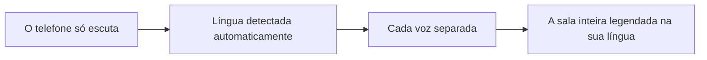
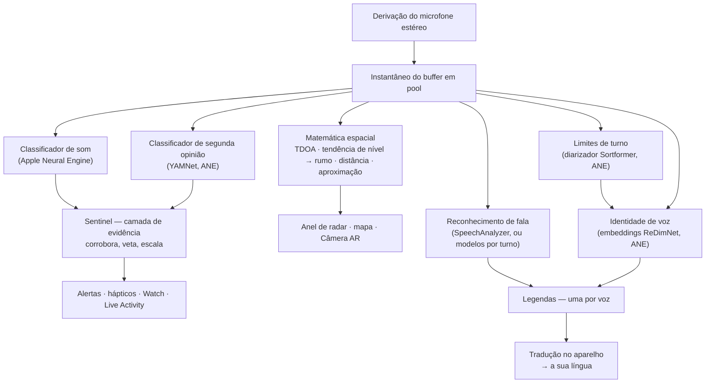
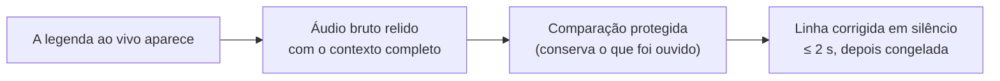
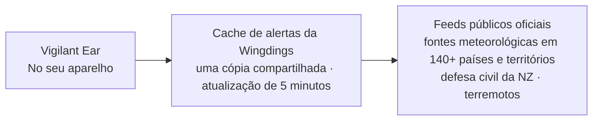

# Vigilant Ear 👂🛡️

*Vigente a partir da versão 1.1.14 · outubro de 2026.*

## Um radar acústico para quem não pode ouvir.

Um app feito especificamente para a comunidade Surda, com perda auditiva e CODA. A maioria dos apps de reconhecimento de som te diz *o que* um som é. **Vigilant Ear te diz onde ele está, quem o produz e o que estão dizendo** — transformando um iPhone num aparelho que descreve o som ao seu redor no momento em que acontece.

A direção e a distância de uma sirene. Uma batida atrás de você. As pessoas numa conversa, desenhadas como vozes transcritas separadas — cada uma legendada e posicionada pela direção. Se alguém fala uma língua que você não lê, as palavras podem chegar **traduzidas para a sua.** Os alertas chegam à sua **Tela Bloqueada, à Dynamic Island e ao Apple Watch**, e um olhar basta.

Tudo o que importa roda no aparelho. O áudio não é gravado nem enviado para reconhecimento. Nada depende de um ouvido humano ouvir alguma coisa.

- 🧭 **Direção, não só detecção.** *O quê, onde, quem* e *o que foi dito* — não apenas “um som aconteceu”.
- 📣 **Nome chamado.** Liste o seu nome, o de uma criança ou o de um parceiro ou de uma parceira — “pedido da Marie pronto” alerta o telefone e o relógio, e aponta a direção.
- 🔒 **Privado desde a concepção.** Classificação, legendas e tradução rodam no seu iPhone. As legendas são ao vivo e efêmeras; não são salvas como um arquivo de transcrição.
- ⌚ **No pulso e na Tela Bloqueada.** O acompanhamento de direção no Apple Watch + a Live Activity mantêm o último alerta, e a direção de onde ele veio, a um olhar de distância.
- 🛰️ **Mais telefones, uma audição compartilhada.** Nossa malha Constellation liga iPhones com Ultra-Wideband para fundir o que cada um ouve num quadro direcional mais nítido.
- 👁️ **Feito para Surdos / perda auditiva / CODA.** Hápticos distintos, visuais de alto contraste, pistas que não dependem da cor, alvos de toque grandes e Reduzir movimento em todo o app.

---

## Para quem é

- **Pessoas Surdas, com perda auditiva e CODA** que querem consciência situacional do som — Home Watch (batida, alarme, bebê, telefone) e Street Watch (sirene, aproximação) que você pode deixar ligados e em que pode confiar.
- Quem precisa de **legendas ao vivo com direção e separação de falantes**, ou de **tradução no aparelho** de pessoas sentadas por perto.
- Pessoas da acessibilidade e da pesquisa acústica interessadas na localização de som no aparelho.

> Vigilant Ear é um **auxílio** de acessibilidade, não um dispositivo certificado de segurança da vida.

---

## O que ele faz

### 🧭 Ele vê o som — direção e distância
Usando os dois microfones do iPhone, o Vigilant Ear mede **o ângulo de um som e se ele está à sua frente ou atrás de você**, mantém essa leitura estável até cerca de um grau e a coloca como um marcador ao vivo num anel de radar em rumo para cima e no mapa. Dois microfones numa mesma linha não distinguem esquerda de direita sozinhos. Um som a 50° à sua direita e um a 50° à sua esquerda chegam com o mesmo intervalo mínimo de tempo. O app desenha a leitura e mais um **fantasma mais fraco do outro lado**, e um giro do pulso ou um segundo telefone resolve. A distância é estimada a partir do volume, contra uma curva calibrada na rua, e mostrada como a estimativa que é, com uma faixa provável, nas unidades do país em que você está, e não da língua em que você lê o app. Num telefone dos EUA, isso aparece como *≈ 50 ft*. Ao se mover, os marcadores mantêm a posição no mundo real. Este é o núcleo: consciência espacial de um mundo que você não pode ouvir. (Números abaixo.)

### 🚨 Ele reconhece sons importantes — e avisa você
Um classificador no aparelho identifica centenas de sons do dia a dia e vigia as categorias críticas — **sirenes, alarmes — inclusive uma classe dedicada de alarme de carro —, campainhas/batidas, choro de bebê, uma pessoa por perto e tempo severo.** Quando uma dispara, você recebe um alerta claro na tela, uma **notificação push** opcional e um **háptico** distinto — mesmo com o app em segundo plano ou o telefone adormecido. As categorias críticas já vêm prontas, de modo que ativar as notificações não significa “tudo desligado”. Desligue todas as categorias de alerta e o motor hiberna por completo em segundo plano, para poupar bateria. Uma camada **Sentinel** confronta os alertas com evidências independentes — direção, movimento e feeds públicos — de modo que o que dispara está corroborado, e não é um palpite isolado do classificador. Funciona nos dois sentidos: um momento com forma de sirene dentro de uma música fica retido, mas uma sirene de verdade que se repete por cima da sua música atravessa e alerta.

Os avisos de tempo severo vêm de **fontes oficiais do governo em mais de 140 países e territórios**, com mais sendo acrescentados com frequência — grátis para todos. Os alertas de emergência da defesa civil também entram, com o próprio interruptor **Alertas de emergência**. Os feeds são reduzidos aos que cobrem onde você está. Onde houver, o app também lê os **boletins antecipados** das agências nacionais de meteorologia — os avisos em linguagem simples emitidos dias antes de um tufão ou de chuva forte, não só os alertas emitidos quando o perigo já chegou — além dos boletins de chuva súbita e de deslizamento. Os avisos antecipados aparecem em silêncio, sem o som e a vibração reservados a um alerta de verdade.

### 🌧️ Radar do tempo no mapa
Chuva e neve aparecem no mapa desde o momento em que o app abre — a partir dos radares nacionais dos Estados Unidos, do Canadá, do Japão, da Itália e de boa parte da Europa, e de uma estimativa de chuva por satélite na maior parte do resto do mundo. Toque no mapa e a última hora é reproduzida três vezes, para você ver para que lado uma tempestade está indo; uma escala embaixo vai de Leve a Denso. Se você não quiser isso numa sessão, toque no botão do tempo para desligar. O radar chega do mesmo jeito que os avisos — pelo nosso próprio servidor, de modo que o seu telefone nunca contata servidores do governo. Setas cinza-claras também mostram para que lado o vento sopra, em qualquer lugar do mundo, a partir da previsão global da NOAA para a hora atual.

### 🛟 Para quem ligar — a boia salva-vidas
Uma boia salva-vidas ao lado da bússola do mapa abre uma lista curta do país em que você está:

- o número de emergência, com botões de ligação e de mensagem, e uma nota sobre Texto em Tempo Real onde mandar mensagem para um número de emergência pode não funcionar
- a agência nacional de meteorologia
- uma organização de Surdos, onde houver uma página estável
- o suporte do Vigilant Ear

Compartilhe o Vigilant Ear pelo painel de ajuda (a boia salva-vidas): um código que alguém ao seu lado pode escanear para baixar o app, um link para a App Store e nosso Instagram.

### ⌚ Apple Watch + Live Activity — olhe e saiba
- **Acompanhamento no Apple Watch** — a direção de um alerta aponta no pulso, e um olhar diz para onde olhar. Interface do Watch redesenhada, com o ícone de orelha do app, o layout de HUD de ameaça e toque duplo para dispensar um alerta. Os alertas ainda podem mostrar a seta de direção quando o app do Watch não está aberto.
- **Nome chamado no Apple Watch.** Quando alguém diz seu nome, o relógio dá três toques e mostra uma seta na direção da voz. Quando o iPhone não consegue distinguir esquerda de direita, um leque mostra os dois lados. Funciona com o iPhone bloqueado enquanto o app Vigilant Ear estiver aberto no relógio. O Nome chamado precisa do Speaker Mode ativado.
- **Sinta a batida no Apple Watch.** Com música tocando e o app Vigilant Ear aberto no relógio, o bumbo e a caixa pulsam como anéis, o tempo 1 de cada compasso fica marcado e seu pulso recebe um toque leve a cada tempo 1. Toque duas vezes em qualquer lugar da tela do relógio para desativar o toque até a música parar. Os alertas sempre vêm primeiro. Quando o Music ID reconhece a música, o título também aparece no relógio.
- **Live Activity** — o Vigilant Ear fica na sua **Tela Bloqueada**, na **Dynamic Island** e no **Smart Stack do Watch**, de modo que o último alerta e o rumo dele estão sempre a um olhar de distância.
- **Alertas de parceiro no pulso** — quando o telefone de um parceiro Constellation vinculado dispara um alerta, ele também pode chegar ao seu Watch, com a direção. O acompanhamento usa pouca bateria do Watch ao longo de um dia.

### 💬 Speaker Mode — legendas ao vivo e direcionais *(grátis)*
Ative o **Speaker Mode** e o Vigilant Ear transcreve as pessoas que falam perto de você em **blocos de legenda, um por voz.** A diarização de falantes no aparelho mantém as vozes distintas — *quem* está dizendo *o quê* — com uma pista de direção no anel interno. Quem está falando fica em destaque; o texto mais antigo sai de vista conforme o espaço é necessário.

**Cada falante na própria língua.** Em iPhones com pelo menos 8 GB de memória, um download único do modelo de legendas (cerca de 1 GB — por Wi-Fi, ou pela rede celular depois de perguntar) permite que o app legende cada turno na língua de fato falada, de modo que uma sala que alterna entre inglês, espanhol, francês e árabe fica compreensível. Nos nossos testes, os erros de palavra numa conversa em quatro línguas caíram de cerca de 80% para 14%. Desde a versão 1.1.12, um modelo de fala melhorado erra bem menos no ruído — num bar barulhento, num iPhone 17, as legendas em alemão passaram de 45% das palavras erradas para 20% — e substitui o antigo sozinho, por Wi-Fi. Sem o download — e para quem lê chinês, japonês e coreano, em que o reconhecedor da Apple lê melhor — as legendas usam o reconhecimento de fala no aparelho da Apple, como antes.

Duas coisas que a maioria dos apps de legenda não faz.

**Honestidade sobre a confiança.** Uma marca sutil de qualidade por linha e sublinhados pontilhados sob as palavras duvidosas dizem quando confiar numa linha e quando conferir de novo.

**Autocorreção.** Logo depois que uma frase assenta, o app relê o áudio com o contexto completo e pode restaurar uma palavra perdida ou ouvida errado em alguns segundos; depois, o texto congela.

**Nome chamado** (Ajustes, desligado até você ligar) vigia essas legendas em busca dos nomes que você lista — o seu, o de uma criança, o de um parceiro ou de uma parceira. Quando alguém diz “pedido da Marie pronto”, você recebe um háptico distinto e um alerta no Watch com direção, não outra bolha de legenda. As palavras ainda aparecem no Speaker Mode como fala; este é o toque de que estavam falando *com você*.

**A linguagem forte pode ser mascarada** (Ajustes → Legendas). O palavrão, de outro modo, chega como texto puro, sem nada que o suavize, e quem lê não tem chance de desviar o olhar antes; ligue isto e essas palavras são trocadas por símbolos, de modo que a frase ainda se lê sem a palavra. O próprio reconhecedor de fala do seu aparelho decide o que conta — não uma lista de palavras nossa — e por isso acompanha a língua que está sendo transcrita. Numa conta declarada como menor de 18, fica sempre ligado e mostra um cadeado. Vale para a fala que *este* aparelho transcreve; o texto repassado de um telefone pareado foi transcrito lá e chega como texto pronto.

**A palavra em que o falante apoiou a voz fica em negrito.** Ditas em voz alta em inglês, "I didn't say THAT" e "I didn't say that" são duas frases diferentes, e uma transcrição idêntica perde a diferença por completo. O app observa a única palavra em que a voz do falante subiu o tom e a põe em negrito — no máximo uma por linha, e nada quando não tem certeza, porque marcar a palavra errada afirmaria que a pessoa disse algo que não disse. Desligado em chinês e em japonês, em que o tom diz *qual é a palavra*, e não o quanto ela foi forçada.

Legendas são grátis; a tradução automática é a camada opcional do Power Pack+. As legendas também podem ser **faladas em voz alta para um dispositivo Bluetooth, inclusive um aparelho auditivo** — grátis, em Ajustes. Os **Tons de direção** (também grátis, em Ajustes → Legendas) acrescentam uma pista de áudio opcional no ouvido que você escolher, indicando onde está um falante — útil com aparelho auditivo ou audição de um lado só, e disponível para qualquer pessoa.

### 🌐 Tradução automática — a sua língua, ao vivo *(Power Pack+)*
Com o Speaker Mode ligado, quando uma pessoa por perto fala outra língua, o Vigilant Ear pode detectá-la e apresentar as legendas **na sua língua**, com a língua de origem mostrada no bloco. A cadeia — ouvir → separar falantes → transcrever → traduzir → exibir — roda **no aparelho**; o único momento de rede é um download único do pacote de idioma da Apple, e, quando é esse download que você está esperando, o app diz isso em vez de deixar você olhando texto sem tradução. Você não precisa conhecer nem escolher a outra língua antes. Uma frase terminada é traduzida assim que acaba, sem esperar a pessoa parar de falar, e as traduções chegam numa fração do tempo.

Esta é a coisa mais próxima disponível do **tradutor universal da ficção científica** — um aparelho que simplesmente entende. O Vigilant Ear detecta a língua por conta própria, acompanha cada falante na sala e legenda todos na sua língua — sem fones de ouvido, sem configuração, no seu aparelho.

### 🎵 Consciência de música e de transmissões *(Power Pack+)*
O **ShazamKit** identifica a música que toca ao seu redor e detecta a troca de faixa automaticamente, para o título permanecer atual.

### 🎛️ Acoustic Scope — veja o som como um engenheiro
Uma visão profissional ao vivo do som ao seu redor: espectro, espectrograma, bandas RTA de ⅓ de oitava, croma e parciais harmônicos — **grátis para todo mundo**. O **Partials lê música:** cada tom recebe o nome da sua nota, com a série harmônica ao lado, sons mais agudos, como alarmes de fumaça, recebem o nome na altura real, e você pode definir uma nota alvo que se desenha como uma linha para cantar ou afinar. Deixar o Espectrograma aberto custa quase nada, por mais tempo que você olhe. As ferramentas que capturam sons para treinar os seus próprios Pacotes de Som Personalizados fazem parte do Power Pack+.

### 📦 Pacotes de Som Personalizados — ensine a ele o seu mundo *(Power Pack+)*
Você pode ensinar ao Vigilant Ear os sons que importam para você — pássaros locais, o aviso sonoro da porta de um prédio, o zumbido anormal de um gerador ou um tipo de avião decolando. Esses pacotes adicionais se empilham sobre a detecção embutida, de modo que sons novos nunca tomam o lugar de sirenes e alarmes. Um guia passo a passo está dentro do app.

### 🛰️ Constellation — muitos iPhones, uma audição compartilhada *(Power Pack+)*
Com dois ou mais iPhones com Ultra-Wideband (a maioria desde o iPhone 11), a malha **Constellation** os pareia para que sintam a posição uns dos outros e fundam o que cada um ouve num único quadro mais preciso de onde vem um som — um arranjo de escuta distribuído e passivo. As legendas também são fundidas: cada telefone transcreve o que o próprio microfone ouve, e as palavras são alinhadas entre os telefones, de modo que o mais próximo de um falante contribui com o que ouviu — palavras que só um telefone captou são mantidas, em vez de perdidas.

Os telefones se conectam **diretamente uns aos outros** — sem roteador, sem rede Wi-Fi compartilhada e sem internet; o Wi-Fi só precisa estar ligado. Usam o mesmo link ponto a ponto que o AirDrop usa, e só telefones com o hardware certo podem entrar. O link entre os telefones é sempre criptografado; telefones com o Vigilant Ear 1.1.6 ou anterior precisam atualizar o app para participar da malha.

**Mensagens de parceiro** — envie um texto rápido ao telefone de um parceiro da malha; ele cai no feed de legendas dessa pessoa e pode chegar traduzido para a língua dela, no aparelho. As mensagens levam a idade em conta: com base no Declared Age Range da Apple, o texto entre um adulto e um menor fica desligado, a menos que as duas pessoas tenham nomeado uma à outra de propósito. Alertas e legendas nunca são barrados — só o texto de pessoa para pessoa.

### 🔗 Remote Link — alcance alguém que não está com você *(Power Pack+ para começar)*
O que uma ligação telefônica normalmente faria, feito com vídeo e texto. Você envia um código de convite; a outra pessoa entra de dentro do Vigilant Ear **sem ter o Power Pack+**. Ao contrário do Constellation, não há exigência de proximidade — vocês dois podem estar em qualquer lugar.

**Nenhum áudio é usado em momento algum.** Só vídeo e texto, de modo que nada no link depende de ouvir em qualquer das pontas — e isso dá um jeito de sinalizar com alguém pelo app. O próprio app não entende língua de sinais; ele carrega o vídeo, e vocês dois fazem o resto. A conexão é direta entre os dois telefones sempre que a rede permite, e o app mostra com clareza se está **Direto** ou **Revezado**, para você sempre saber se o seu vídeo está passando por um revezamento.

**As legendas também viajam.** O que cada telefone transcreve aparece no outro, traduzido para a língua de quem lê quando precisa. Qualquer um dos dois pode pausar o link — vídeo e legendas — e retomá-lo, e desligar pela tela principal.

### 📷 Câmera AR — “ver o som”
Abra a Câmera AR pelo Leque de Ações e prenda os sons detectados no rumo real, na visão ao vivo da câmera. Os marcadores se agrupam por falante ou por categoria de som e direção, para a visão continuar legível, e esmaecem enquanto um som continua baixo.

### 🗺️ Mapas, ruas e previsão de trajeto
Os rumos do som se projetam em coordenadas reais de GPS no mapa. Sons de veículos podem ser **encaixados nas ruas próximas**, e os trajetos, previstos, de modo que um caminhão que passa se lê como se movendo *ao longo da rua*, e não através dos prédios. (Experimente a demonstração do caminhão de bombeiros no Feature Playground.)

### 🪄 Feature Playground — provar sem ouvidos
O **Feature Playground** é público para todo mundo: alertas de amostra do Home Watch e do Street Watch (batida, alarme, bebê, sirene, tempo), demonstrações com vários telefones e de conversa. Eles têm uma marca d'água clara, para o treino nunca se passar por um evento ao vivo. Fechar o painel desmonta as demonstrações por completo (sem falsificação de GPS que fica presa, sem sinalizadores restantes).

### ♿ Acessibilidade em primeiro lugar
Feito para pessoas Surdas, com perda auditiva e CODA, e para pessoas com daltonismo:

- pistas **independentes de cor**
- alvos de toque de **≥44 pt**
- respeito a **Reduzir movimento**
- **layouts da direita para a esquerda** para quem lê em árabe
- alertas multimodais (háptico + visual + Watch)
- uma tela de verificação na inicialização que mostra o estado das permissões em verde / cinza / vermelho bem claros, e em laranja-queimado para “não permitido”, inclusive a permissão de notificação que funciona como o interruptor geral dos alertas

---

## Grátis e Power Pack+

O núcleo de segurança é **grátis, para sempre**:

- **Home Watch e Street Watch** — alertas de som local (alarmes, sirenes, batidas/campainhas, bebê, pessoa por perto) com entrega na tela, háptica e push opcional.
- **Legendas ao vivo** — Speaker Mode, no aparelho, direcionais quando o hardware permite, com marcas honestas de confiança, autocorreção de ~2 segundos, saída falada opcional para um dispositivo Bluetooth (inclusive um aparelho auditivo) e Tons de direção.
- **Nome chamado** — nomes opcionais que você digita (o seu, os de crianças, o de um parceiro ou de uma parceira). Uma correspondência é um alerta no Watch e no telefone, com rumo, não uma segunda legenda.
- **Standing Watch** — a condição da própria sala, sempre ligado, sem nada para configurar: uma lâmpada ciano estável enquanto a sala mantém o seu padrão, âmbar quando algo muda — uma voz nova, um silêncio súbito ou algo se aproximando. Quando o app inicia, ele diz por quanto tempo não estava escutando em busca de alertas.
- **Alertas de tempo severo** — avisos oficiais para a sua região, de fontes do governo em mais de 140 países e territórios, com mais acrescentados com frequência.
- **Radar do tempo** — chuva e neve no mapa, com a última hora em repetição, e para que lado o vento sopra.
- **A boia salva-vidas** — para quem ligar no país em que você está.
- **Alertas de terremoto (no mundo todo)** — sinta uma vibração e veja no mapa a área que sentiu o tremor, quando um terremoto é registrado por perto. Uma confirmação vinda do feed oficial de terremotos — não um alerta antecipado: se você sentiu o chão tremer, isto diz o que foi. O feed é verificado a cada cinco minutos, também em segundo plano, e a detecção no aparelho de **Estrondos profundos** (infrassom) pode armar uma verificação extra no momento em que o chão se move.
- **Feature Playground** — alertas de prática e prévias de recursos com uma marca d'água PREVIEW bem clara.
- **Acompanhamento no Apple Watch e Live Activity** — direção que se vê de relance e o último alerta.
- **Acoustic Scope** — visualização de som ao vivo em nível profissional, grátis para todo mundo. (As ferramentas de captura para treino são do Power Pack+.)
- **Rede de pesquisa** *(ligada até você desligar)* — enquanto está ligada, o horário, uma localização aproximada (cerca de 1 km) e a frequência de eventos parecidos com terremotos são compartilhados — sem áudio, sem identificador — para ajudar a mapear terremotos e outros eventos de baixa frequência. Uma pergunta no mapa é feita uma vez. Os relatórios esperam até que essa pergunta tenha estado na tela.

**Power Pack+** é um desbloqueio único (**não é uma assinatura**) com um **teste grátis de 90 dias**. Ele acrescenta os superpoderes:

- **Tradução automática** — tradução no aparelho da fala por perto para a sua língua.
- **Constellation** — audição compartilhada entre vários iPhones por Ultra-Wideband, com mensagens de parceiro.
- **Music ID** — reconhecimento de músicas pelo ShazamKit.
- **Pacotes de Som Personalizados** — classificadores adicionais que você treina para os seus próprios sons.
- **Remote Link** — chamadas privadas de vídeo e texto com alguém que não está com você, sem áudio em momento algum. Começar uma exige Power Pack+; a pessoa que você convida entra de graça.

Grátis ou Power Pack+, **o seu áudio fica no aparelho para o reconhecimento** — o nível só muda quais recursos estão desbloqueados, nunca para onde o áudio bruto é enviado para análise.

---

## Como funciona (por baixo do capô)

Vigilant Ear é um pipeline **local em primeiro lugar, no aparelho**, construído em camadas: capturar uma vez e então deixar especialistas independentes lerem o mesmo som e conferirem o trabalho uns dos outros. O áudio bruto é capturado numa derivação de alta prioridade, copiado para uma **lista livre de buffers em pool** (sem alocação frenética no caminho de tempo real) e distribuído em leque sem travar a interface:

Nenhum modelo é confiável sozinho. A camada **Sentinel** fica entre a detecção e o alerta: motores independentes se corroboram ou se vetam quadro a quadro — e, quando evidências repetidas do mundo real se acumulam contra um veto (uma sirene de verdade uivando por cima da sua música), a evidência vence e o alerta dispara.

As legendas ganham uma segunda chance própria. Cada frase finalizada é relida em silêncio a partir de um anel curto de áudio na memória, com o contexto completo — as correções chegam em cerca de dois segundos, e então o texto congela de vez:

- **Matemática espacial** — FFTs, diferença de tempo de chegada ponderada pela coerência (TDOA — favorece as bandas de frequência em que os dois microfones concordam e depois transforma o minúsculo atraso de chegada num rumo) e acompanhamento de aproximação pela tendência de nível, em tarefas de segundo plano. O par de microfones é lido numa orientação fixa, para a direção funcionar do mesmo jeito quer você segure o telefone em pé, quer de lado.
- **Fala** — `SpeechAnalyzer` / `SpeechTranscriber` do iOS 26 para a transcrição; o framework **Translation** da Apple para a tradução no aparelho. Com o download opcional de legendas, cada turno é cortado por um detector de atividade de voz, a língua é escolhida por um modelo de língua falada e a transcrição é feita por modelos abertos de reconhecimento de fala — um para línguas europeias, um para as demais — tudo no aparelho. A identidade de voz se baseia em evidência: uma voz só é confirmada como uma pessoa real a partir de janelas independentes de som, e uma correspondência incerta aparece sem atribuição, em vez de adivinhar o nome errado.
- **Dois modelos para duas perguntas** — separar vozes exige *quando o falante mudou* e *quem é esse falante*, e não são o mesmo problema. Um diarizador em fluxo **Sortformer** marca os limites dos turnos; embeddings **ReDimNet** decidem de quem é a voz dentro de cada um. Cortar no limite importa mais do que parece: uma janela que atravessa duas pessoas contém as duas, e nenhum modelo de embedding desfaz isso depois. Por baixo dos dois há um piso de atividade de voz — se o diarizador se cala numa sala difícil em vez de adivinhar, os turnos ainda são cortados, e o app degrada em vez de fundir dois falantes num só.
- **Verdade da música** — um **detector de assinatura de música** por croma é dono da decisão “está tocando música de verdade?”, porque classificadores gerais são famosos por chamar salas silenciosas e sirenes de “música”. O Shazam só roda quando a assinatura concorda que há algo musical de fato ali.
- **Concorrência** — o isolamento do Swift 6 mantém a derivação do microfone, a matemática acústica e o laço de renderização da interface bem separados.
- **Eficiência** — subamostragem, classificação adaptada à carga e uso de rede condicionado à evidência mantêm a escuta contínua leve o bastante para deixar ligada.

Alertas de tempo e de terremoto seguem o caminho oposto ao do áudio — nada do seu som jamais sai, mas *dados* de alerta entram. **Cada** feed oficial — e as imagens de radar e de vento — passa por um pequeno cache de retransmissão que nós operamos, de modo que uma busca dos dados públicos serve a todos, e o seu telefone nunca contata servidores do governo:

---

## O que o seu telefone pode ouvir — medido

O seu iPhone tem dois microfones a cerca de seis polegadas (15 cm) um do outro, um barômetro e um relógio muito bom. Isso basta para dizer de que lado um som veio, mais ou menos quão longe, se está vindo na sua direção e se uma porta acabou de abrir. Aqui está o quão preciso é cada um desses pontos, como verificamos e por que importa se você não pode ouvir o som. A tabela de direção foi medida num iPhone 17 em setembro de 2026. A mesma verificação de mesa num iPhone 16 Pro Max não produziu um ângulo contínuo — essa imagem puxa um som para a frente ou para o lado — então as linhas em graus são só as do 17. A distância continua sendo uma estimativa por natureza — e é o que dizemos na tela. As distâncias medidas com trena nesta seção estão em pés, as unidades dessa trena.

**Direção — até cerca de dois graus.** Um som chega ao microfone de cima antes do de baixo, ou depois, e a partir desse intervalo o app calcula o quanto o som está fora do eixo do telefone e se está à frente ou atrás. Os dois canais do telefone não são microfones simples, e sim uma imagem estéreo processada, e essa imagem acrescenta um padrão fixo próprio sempre que a sala está barulhenta. O app aprende esse padrão a partir do silêncio depois da abertura. Depois de cerca de um minuto de uma sala silenciosa, ele retira o padrão antes de ler a direção; até lá, a leitura segue sem essa correção.

| O que medimos | Resultado |
|---|---|
| Erro mediano em 96 salas simuladas, de um escritório silencioso a uma sala de paredes duras a 5 dB SNR | 1.0° |
| iPhone 17 sobre uma mesa, ruído da sala ligado, alto-falante a 30° do eixo | leu 61.7° a partir do plano lateral, contra os 60° esperados, oscilação de 1.6° |
| Igual, alto-falante exatamente na lateral do telefone | leu 4.5° contra os 0° esperados, oscilação de 2.2° |
| Igual, alto-falante a 60° do eixo | mediana de 35.7° contra os 30° esperados; a rodada se dividiu, com um segundo agrupamento no atraso de som à frente, muito provavelmente um reflexo do aparato |
| Igual, alto-falante bem à frente | todas as leituras no atraso máximo, como deve ser |
| Leituras que caíram no padrão próprio da imagem, em vez de no som | nenhuma, em qualquer ângulo |

*Por que importa:* se você não pode ouvir uma sirene, “atrás de você, para um dos lados” diz para onde olhar. Uma leitura que fica parada só merece confiança depois de conferida com uma trena, e esta foi conferida duas vezes. A primeira verificação fez o resultado parecer melhor do que era.

**Distância — mostrada como a estimativa que é.** Um microfone não mede distância, só volume, e um caminhão barulhento longe pode soar como um carro silencioso perto. O app estima a distância a partir do volume, com uma curva ajustada numa rua de verdade, e depois diz do jeito que uma pessoa cuidadosa diria. Num telefone dos EUA, isso é *cerca de 50 ft, provavelmente entre 25 e 100.*

| O que medimos | Resultado |
|---|---|
| Detecções reais de carro reproduzidas pela calibração | 1131 |
| Caindo dentro da estrada de 100-foot em que realmente estavam | 73% |
| Carros da faixa distante | estimados em 78 e 87 ft, onde a trena dizia 73 e 85 ft |

A via (um cruzamento urbano) foi medida faixa por faixa; quando a curva erra, erra para o lado mais próximo. A calibração fica travada por um teste automatizado, para não desviar em silêncio. Alarmes dentro do seu próprio espaço, como um detector de fumaça, não recebem número de distância nenhum — já estão na sala com você.

**Movimento — vindo na sua direção.** Para carros e sirenes, ficar mais alto em geral significa ficar mais perto. O app observa a rapidez com que o nível de um som sobe ao longo de alguns segundos: uma subida sustentada de cerca de 1.5 dB por segundo (um aumento claro e estável de volume) significa aproximação, uma queda correspondente significa afastamento, e um som que para de mudar deixa de ser chamado de um ou de outro depois de cerca de quatro segundos. Um momento alto isolado — um toque de buzina, uma porta batendo — não pode disparar isso. Construído sobre a física e nove testes automatizados; uma passagem gravada na rua é a próxima confirmação de campo.

**O ar da sala — uma porta tem assinatura.** O barômetro pode notar uma porta se abrindo a cerca de quatorze pés (4.3 m): a pressão cai enquanto a porta gira e depois rebate quando ela fecha. Ao longo de quatorze horas de silêncio e quinze eventos de porta, toda porta fez essa forma em duas partes, e nada mais na casa fez.

| Evento | Taxa de pressão | Forma |
|---|---|---|
| Porta da frente, aberta e fechada, ×10 | 0.6–1.8 Pa/s | queda e depois rebote, ~5 s de intervalo |
| Porta da frente, batida, ×5 | 1.1–2.5 Pa/s | o mesmo par, mais alto |
| Ar-condicionado ciclando de noite, ×8 | 0.11–0.46 Pa/s | rampa lenta ao longo de minutos, idêntica nos dois telefones |
| Uma sala silenciosa | ~0.02 Pa/s | nada |
| Atividade humana, passando a pé | — | o sensor de movimento nota, e o telefone ignora |

Uma porta que não veda a sala ficou invisível — uma porta telada, neste teste — exatamente como deveria. Hoje uma mudança de pressão pode aparecer como **Estrondos profundos** no mapa; um alerta dedicado de porta para a noite silenciosa está medido e desenhado, e ainda não é o padrão do dia a dia.

**Constellation — dois telefones resolvem o lado.** Cada telefone na malha traça uma linha na direção do som a partir de onde está, e as linhas só se cruzam com nitidez de um lado. Quando isso acontece, o fantasma some e o app pode dizer esquerda ou direita de novo. Em simulação, dois telefones a **40 metros** um do outro posicionam uma sirene a 50 metros com precisão de cerca de 2 metros.

**Como qualquer coisa daqui passa a ser acreditada.** Todo número passou pelas mesmas três portas, nesta ordem: uma sala simulada com a resposta conhecida de antemão; pequenos testes automatizados que recriam o caso exato que enganaria o app e rodam a cada mudança; depois os telefones de verdade numa mesa de verdade, com distâncias medidas à mão. Nada conta como preciso até sobreviver à terceira. Para quem não pode ouvir o som, a palavra do app é a única palavra — ela deve ser conquistada do jeito que um laboratório conquista.

Notas mais profundas para engenheiros: [Física](https://vigilantear.com/en/physics/) — TDOA, distância, movimento, Constellation e detecção barométrica, com cada número marcado como MEASURED / BENCHED / MODELLED.

---

## Privacidade

- **No aparelho, sempre, no pipeline central.** Classificação, matemática espacial, transcrição, diarização e tradução rodam no seu iPhone. O áudio bruto não é gravado nem enviado para reconhecimento.
- **As legendas são efêmeras.** As legendas ao vivo ficam na memória pela sessão; registros de depuração exportados não incluem o texto das legendas.
- **Sem SDKs de publicidade ou de análise comportamental.** O uso limitado de rede é só para mapas, feeds públicos de meteorologia, imagens de radar e de vento, a lista de ajuda, o download opcional do modelo de legendas, fingerprints opcionais do Shazam, contexto de vias, relatórios da Rede de pesquisa enquanto esse recurso está ligado, e compras na App Store — veja os detalhes na nossa política de privacidade.

Detalhes completos: [Privacidade](/pt-BR/privacy/) · [Termos](/pt-BR/terms/) · [Suporte](/pt-BR/support/)

---

## Hardware e plataformas

- **iPhone (experiência completa).** Funciona em retrato ou paisagem — segure como você quiser. Microfones estéreo são necessários para achar a direção. Recomendado **iPhone 13 ou mais novo**; legendas na língua de cada falante exigem **8 GB de memória** (iPhone 15 Pro e posteriores).
- **Apple Watch.** Alertas do acompanhamento com seta de direção; funciona com Live Activity / Smart Stack.
- **iPad (nativo).** Layout adaptativo: na tela grande, as legendas ao vivo ganham um painel transparente ao lado do mapa, que se recolhe quando ninguém está falando. Microfones de um só canal → legendas sem direção completa.
- **Constellation** precisa de **Ultra-Wideband** — iPhone 11 ou posterior, excluindo os modelos SE e “e”. **Não** precisa de uma rede Wi-Fi: com o Wi-Fi ligado, os telefones se descobrem diretamente, então o Constellation funciona sem roteador e sem internet, desde que os telefones estejam perto uns dos outros.
- **Android (quando disponível).** Versão separada com o radar central, alertas, legendas e tempo; a malha Constellation é iOS em primeiro lugar.

---

## Localização

Totalmente localizado — interface, alertas e legendas — em **inglês, espanhol, português (Brasil), francês, alemão, italiano, turco, árabe, japonês, chinês simplificado, chinês tradicional, coreano, russo, hindi, romeno e polonês** (16 línguas). Segue o idioma do sistema ou uma escolha manual no app. As legendas em romeno funcionam no aparelho; o Apple Translate não tem romeno, então a Tradução automática mostra o original para essa língua.

---

## Status e aviso

Vigilant Ear é um **auxílio experimental de acessibilidade acústica**, não um utilitário certificado de segurança da vida. A resolução da localização do som varia com o entorno, o tempo, o vento e o hardware dos microfones. **Mantenha sempre a sua consciência habitual do ambiente** — não dependa dele como única fonte de informação de segurança.

Algumas capacidades (marcadores da Câmera AR, a atualização da autorização de Alertas Críticos quando concedida pela Apple, a criação avançada de sons em vários pacotes) continuam a evoluir; o Home Watch e o Street Watch grátis e as legendas ao vivo são o produto em que você pode confiar desde o primeiro dia.

**Fontes e licenças:** [api.vigilantear.com/sources](https://api.vigilantear.com/sources)

---

**Contato:** [vigilantear@wingdingssocial.com](mailto:vigilantear@wingdingssocial.com)

Feito com ❤️ para a comunidade Surda e com perda auditiva, e para a pesquisa acústica.

    
  <strong>© 2026 Wingdings, Inc.</strong> 
  Todos os direitos reservados. 
  Várias patentes pendentes

