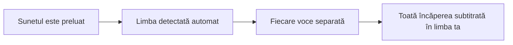
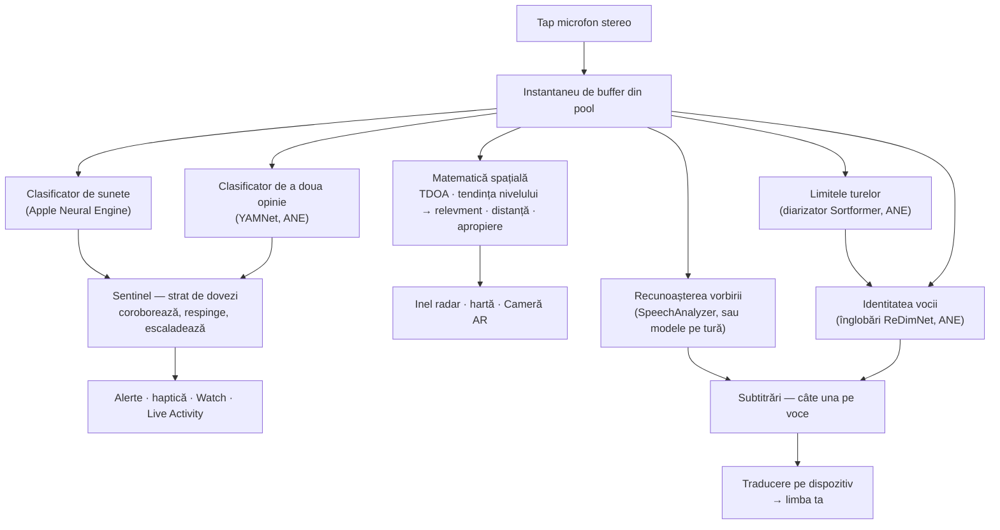
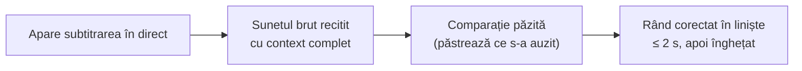
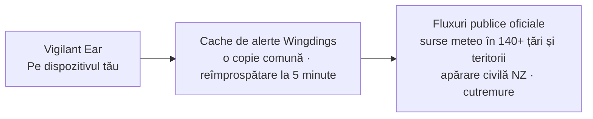

# Vigilant Ear 👂🛡️

*În vigoare începând cu versiunea 1.1.14 · octombrie 2026.*

## Un radar acustic pentru oamenii care nu pot auzi.

O aplicație construită special pentru comunitatea Surzilor, a persoanelor cu deficiențe de auz și CODA. Cele mai multe aplicații de recunoaștere a sunetelor îți spun *ce* este un sunet. **Vigilant Ear îți spune unde este, cine îl produce și ce spun** — transformând un iPhone într-un dispozitiv care descrie sunetul din jurul tău, pe măsură ce se întâmplă.

Direcția și distanța unei sirene. Un ciocănit în spatele tău. Oamenii dintr-o conversație, desenați ca voci transcrise separat — fiecare subtitrată și plasată după direcție. Dacă cineva vorbește o limbă pe care nu o citești, cuvintele pot ajunge **traduse în a ta.** Alertele ajung pe **Ecranul de blocare, în Dynamic Island și pe Apple Watch**, așa că îți ajunge o privire.

Tot ce contează rulează pe dispozitiv. Sunetul nu este înregistrat și nici încărcat pentru recunoaștere. Nimic nu depinde de o ureche umană care să audă ceva.

- 🧭 **Direcție, nu doar detecție.** *Ce, unde, cine* și *ce s-a spus* — nu doar „s-a întâmplat un sunet.”
- 📣 **Nume strigat.** Treci numele tău, al unui copil sau al unui partener — „comanda pentru Marie e gata” alertează telefonul și ceasul și arată în ce parte.
- 🔒 **Privat prin construcție.** Clasificarea, subtitrarea și traducerea rulează pe iPhone-ul tău. Subtitrările sunt în direct și efemere; nu sunt salvate ca arhivă de transcriere.
- ⌚ **Pe încheietură și pe Ecranul de blocare.** Companionul de direcție Apple Watch + Live Activity țin ultima alertă, și direcția din care a venit, la o singură privire.
- 🛰️ **Mai multe telefoane, un auz comun.** Plasa noastră Constellation leagă iPhone-uri Ultra-Wideband, ca să contopească ce aude fiecare într-o imagine direcțională mai clară.
- 👁️ **Făcut pentru Surzi / hipoacuzici / CODA.** Haptică distinctă, imagini cu contrast mare, indicii independente de culoare, ținte mari de atingere și Redu mișcarea peste tot.

---

## Pentru cine este

- **Utilizatori surzi, cu deficiențe de auz și CODA** care vor conștientizarea situației prin sunet — Home Watch (ciocănit, alarmă, bebeluș, telefon) și Street Watch (sirenă, apropiere), pe care le poți lăsa pornite și în care poți avea încredere.
- Oricine are nevoie de **subtitrări în direct, cu direcție și separarea vorbitorilor**, sau de **traducere pe dispozitiv** pentru oamenii așezați în apropiere.
- Utilizatori de accesibilitate și de cercetare acustică, interesați de localizarea sunetului pe dispozitiv.

> Vigilant Ear este un **ajutor** de accesibilitate, nu un dispozitiv certificat pentru siguranța vieții.

---

## Ce face

### 🧭 Vede sunetul — direcție și distanță
Cu cele două microfoane ale iPhone-ului, Vigilant Ear măsoară **unghiul unui sunet și dacă este în fața ta sau în spatele tău**, ține citirea stabilă până la aproximativ un grad și o plasează ca marcaj în direct pe un inel radar orientat după direcția ta și pe hartă. Două microfoane pe o singură linie nu pot deosebi stânga de dreapta de unele singure. Un sunet la 50° în dreapta ta și unul la 50° în stânga ta sosesc cu același decalaj minuscul de timp. Aplicația desenează citirea plus **un semn fantomă mai slab pe partea cealaltă**, iar o răsucire a încheieturii sau un al doilea telefon o stabilește. Distanța se estimează din tărie, după o curbă calibrată pe stradă, și se arată ca estimarea care este, cu un interval probabil, în unitățile țării în care ești, nu ale limbii în care citești aplicația. Pe un telefon din SUA scrie *≈ 50 ft*. Când te miști, marcajele își păstrează poziția din lumea reală. Acesta este nucleul: conștientizarea spațială a unei lumi pe care nu o poți auzi. (Cifrele, mai jos.)

### 🚨 Recunoaște sunetele importante — și te avertizează
Un clasificator pe dispozitiv identifică sute de sunete de zi cu zi și urmărește categoriile critice — **sirene, alarme — inclusiv o clasă dedicată de alarmă auto — sonerii/ciocănituri, plâns de bebeluș, o persoană în apropiere și vreme severă.** Când se declanșează una, primești o alertă clară pe ecran, o **notificare push** opțională și un **haptic** distinct — chiar și când aplicația este în fundal sau telefonul doarme. Categoriile critice sunt gata din start, așa că activarea notificărilor nu înseamnă „totul oprit.” Oprește toate categoriile de alerte, și motorul hibernează complet cât stă în fundal, ca să economisească bateria. Un strat **Sentinel** verifică alertele încrucișat cu dovezi independente — direcție, mișcare și fluxuri publice — așa că ceea ce se declanșează este coroborat, nu o simplă bănuială a clasificatorului. Merge în ambele sensuri: un moment cu formă de sirenă dintr-o melodie este reținut, dar o sirenă reală care se repetă prin muzica ta străpunge și alertează.

Avertizările de vreme severă vin din **surse guvernamentale oficiale, din peste 140 de țări și teritorii**, iar altele se adaugă des — gratuite pentru toți utilizatorii. Sunt incluse și alertele de urgență ale apărării civile, cu propriul comutator **Alerte de urgență**. Fluxurile sunt restrânse la cele care acoperă locul în care ești. Unde sunt disponibile, aplicația citește și **buletinele anticipate** ale agențiilor naționale de meteorologie — anunțurile în limbaj simplu, emise cu zile înainte de un taifun sau de o ploaie puternică, nu doar avertizările emise după ce pericolul a ajuns — plus buletinele de aversă bruscă și de alunecări de teren. Anunțurile anticipate se arată discret, fără sunetul și vibrația rezervate unei avertizări reale.

### 🌧️ Radar meteo pe hartă
Ploaia și zăpada apar pe hartă din clipa în care se deschide aplicația — de la radarele naționale ale Statelor Unite, Canadei, Japoniei, Italiei și ale unei mari părți din Europa, și o estimare satelitară a ploii pe cea mai mare parte din restul lumii. Atinge harta, și ultima oră se redă de trei ori, ca să vezi încotro se mișcă o furtună; o scară jos merge de la Ușor la Dens. Dacă nu îl vrei pentru o sesiune, atinge butonul meteo ca să îl oprești. Radarul ajunge la fel ca avertizările — prin propriul nostru server, așa că telefonul tău nu contactează niciodată servere guvernamentale. Săgeți gri deschis arată și încotro bate vântul, oriunde în lume, din prognoza globală NOAA pentru ora curentă.

### 🛟 Pe cine să suni — colacul de salvare
Un colac de salvare lângă busola hărții deschide o listă scurtă pentru țara în care te afli:

- numărul de urgență, cu butoane de apel și de mesaj, și o notă despre Textul în timp real, acolo unde un mesaj către numărul de urgență s-ar putea să nu meargă
- agenția națională de meteorologie
- o organizație a Surzilor, acolo unde una are o pagină stabilă
- asistența Vigilant Ear

Distribuie Vigilant Ear din panoul de ajutor (colacul de salvare): un cod pe care cineva de lângă tine îl poate scana ca să ia aplicația, un link către App Store și Instagramul nostru.

### ⌚ Apple Watch + Live Activity — o privire și știi
- **Companion Apple Watch** — direcția unei alerte se arată pe încheietură, așa că o privire îți spune unde să te uiți. Interfață Watch reproiectată, cu pictograma urechii din aplicație, aranjament HUD de amenințare și dublă atingere ca să închizi o alertă. Alertele pot arăta în continuare săgeata de direcție și când aplicația de pe Watch nu este deschisă.
- **Nume strigat pe Apple Watch.** Când cineva îți rostește numele, ceasul te atinge de trei ori și arată o săgeată spre voce. Când iPhone-ul nu poate deosebi stânga de dreapta, un evantai arată ambele părți. Funcționează cu iPhone-ul blocat cât timp aplicația Vigilant Ear este deschisă pe ceas. Nume strigat are nevoie de Speaker Mode activat.
- **Simte ritmul pe Apple Watch.** Când se aude muzică și aplicația Vigilant Ear e deschisă pe ceas, toba mare și toba mică pulsează ca inele, timpul 1 al fiecărei măsuri e marcat, iar încheietura primește o atingere ușoară la fiecare timp 1. Atinge de două ori oriunde pe ecranul ceasului ca să oprești atingerea până se oprește muzica. Alertele au mereu prioritate. Când Music ID recunoaște melodia, titlul ei apare și pe ceas.
- **Live Activity** — Vigilant Ear rămâne pe **Ecranul de blocare**, în **Dynamic Island** și în **Smart Stack** de pe Watch, așa că ultima alertă și relevmentul ei sunt mereu la o privire distanță.
- **Alerte de la partener, pe încheietură** — când telefonul unui partener Constellation legat ridică o alertă, ea poate ajunge și pe Watch-ul tău, cu direcția inclusă. Companionul folosește puțin din bateria Watch-ului de-a lungul unei zile.

### 💬 Speaker Mode — subtitrări în direct, direcționale *(gratuite)*
Pornește **Speaker Mode** și Vigilant Ear transcrie oamenii care vorbesc lângă tine în **blocuri de subtitrare, câte unul pe voce.** Diarizarea vorbitorilor pe dispozitiv ține vocile distincte — *cine* spune *ce* — cu un indiciu direcțional pe inelul interior. Vorbitorul în direct este evidențiat; textul mai vechi se derulează pe măsură ce e nevoie de spațiu.

**Fiecare vorbitor, în propria limbă.** Pe iPhone-urile cu cel puțin 8 GB de memorie, o descărcare unică a modelului de subtitrare (aproximativ 1 GB — prin Wi-Fi, sau pe celular după ce te întreabă) lasă aplicația să subtitreze fiecare tură în limba vorbită de fapt, așa că o încăpere care trece între engleză, spaniolă, franceză și arabă se înțelege. În testele noastre, erorile de cuvinte într-o conversație în patru limbi au scăzut de la aproximativ 80% la 14%. De la versiunea 1.1.12, un model de vorbire îmbunătățit face mult mai puține greșeli în zgomot — într-un bar zgomotos, pe un iPhone 17, subtitrările în germană au trecut de la 45% dintre cuvinte greșite la 20% — și îl înlocuiește pe cel vechi de la sine, prin Wi-Fi. Fără descărcare — și pentru cititorii de chineză, japoneză și coreeană, unde recunoașterea Apple citește mai bine — subtitrările folosesc recunoașterea vorbirii pe dispozitiv de la Apple, ca înainte.

Două lucruri pe care cele mai multe aplicații de subtitrare nu le fac.

**Onestitate despre încredere.** Un semn discret de calitate pe fiecare rând și sublinieri punctate sub cuvintele nesigure îți spun când să te încrezi într-un rând și când să mai verifici o dată.

**Autocorectare.** Chiar după ce se așază o propoziție, aplicația recitește sunetul cu contextul complet și poate readuce un cuvânt ratat sau auzit greșit în câteva secunde, apoi textul îngheață.

**Nume strigat** (Setări, oprit până îl pornești) urmărește subtitrările acelea pentru numele pe care le treci — al tău, al unui copil, al unui partener. Când cineva spune „comanda pentru Marie e gata”, primești un haptic distinct și o alertă pe Watch, cu direcție, nu încă un balon de subtitrare. Cuvintele apar în continuare în Speaker Mode ca vorbire; acesta este semnalul că vorbeau *cu tine*.

**Limbajul vulgar poate fi mascat** (Setări → Subtitrări). Altfel, înjurăturile ajung ca text simplu, fără nimic care să le atenueze, iar cine citește nu apucă să privească în altă parte mai întâi; pornește opțiunea, și cuvintele acelea sunt înlocuite cu simboluri, așa că propoziția se citește în continuare, fără cuvântul acela. Propriul sistem de recunoaștere a vorbirii al dispozitivului tău decide ce contează — nu o listă de cuvinte de-a noastră — așa că urmează limba care se transcrie. Pe un cont declarat ca având sub 18 ani, mascarea este mereu pornită și arată un lacăt. Se aplică vorbirii pe care o transcrie *acest* dispozitiv; textul adus de la un telefon împerecheat a fost transcris acolo și ajunge ca text gata.

**Cuvântul pe care un vorbitor l-a apăsat este marcat îngroșat.** Rostite cu voce tare în engleză, "I didn't say THAT" și "I didn't say that" sunt două propoziții diferite, iar o transcriere identică pierde diferența cu totul. Aplicația urmărește singurul cuvânt pe care vocea vorbitorului l-a ridicat în înălțime și îl pune îngroșat — cel mult unul pe rând, și nimic deloc când nu este sigură, pentru că marcarea cuvântului greșit ar susține că persoana a spus ceva ce nu a spus. Oprit în chineză și în japoneză, unde înălțimea îți spune *care este cuvântul*, nu cât de apăsat a fost.

Subtitrările sunt gratuite; traducerea automată este stratul opțional Power Pack+. Subtitrările pot fi și **rostite cu voce tare către un dispozitiv Bluetooth, inclusiv un aparat auditiv** — gratuit, în Setări. **Tonuri de direcție** (și ele gratuite, în Setări → Subtitrări) adaugă un indiciu audio opțional în urechea pe care o alegi, care semnalează unde este un vorbitor — util cu un aparat auditiv sau cu auz pe o singură parte, și disponibil oricui.

### 🌐 Traducere automată — limba ta, în direct *(Power Pack+)*
Cu Speaker Mode pornit, când o persoană din apropiere vorbește altă limbă, Vigilant Ear poate detecta limba și reda subtitrările **în limba ta**, cu limba sursă arătată pe blocul ei. Lanțul — auzire → separarea vorbitorilor → transcriere → traducere → afișare — rulează **pe dispozitiv**; singurul moment de rețea este o descărcare unică a pachetului de limbă de la Apple, iar când acea descărcare este ceea ce aștepți, aplicația o spune, în loc să te lase să te uiți la text netradus. Nu trebuie să știi sau să alegi dinainte cealaltă limbă. O propoziție terminată se traduce de îndată ce se încheie, fără să aștepte ca vorbitorul să se oprească, iar traducerile ajung într-o fracțiune din timp.

Este cel mai apropiat lucru disponibil de **traducătorul universal din științifico-fantastic** — un dispozitiv care pur și simplu înțelege. Vigilant Ear detectează limba de la sine, urmărește fiecare vorbitor din încăpere și îi subtitrează pe toți în limba ta — fără căști, fără configurare, pe dispozitivul tău.

### 🎵 Conștientizare muzicală și de difuzare *(Power Pack+)*
**ShazamKit** identifică muzica care se aude în jurul tău și detectează automat schimbările de melodie, așa că titlul rămâne la zi.

### 🎛️ Acoustic Scope — vezi sunetul ca un inginer
O privire în direct, de nivel profesional, asupra sunetului din jurul tău: spectru, spectrogramă, benzi RTA de ⅓ de octavă, cromă și parțiale armonice — **gratuit pentru toată lumea**. **Partials citește muzica:** fiecare ton este numit după nota lui, cu seria lui armonică alături, sunetele mai înalte, cum sunt alarmele de fum, sunt numite la înălțimea lor reală, și poți pune o notă țintă care se desenează ca o linie după care să cânți sau să acordezi. Lăsarea spectrogramei deschise nu costă aproape nimic, oricât de mult te uiți. Uneltele care captează sunete ca să îți antrenezi propriile pachete de sunete personalizate fac parte din Power Pack+.

### 📦 Pachete de sunete personalizate — învață-o lumea ta *(Power Pack+)*
Poți învăța Vigilant Ear sunetele care contează pentru tine — păsări locale, soneria ușii unei clădiri, zumzetul anormal al unui generator sau un tip de avion la decolare. Pachetele acestea suplimentare se așază peste detecția încorporată, așa că sunetele noi nu dau niciodată la o parte sirenele și alarmele. Un ghid pas cu pas este încorporat în aplicație.

### 🛰️ Constellation — mai multe iPhone-uri, un auz comun *(Power Pack+)*
Cu două sau mai multe iPhone-uri cu Ultra-Wideband (cele mai multe de la iPhone 11 încoace), plasa **Constellation** le împerechează, ca să își simtă poziția una alteia și să contopească ce aude fiecare într-o singură imagine, mai precisă, a locului de unde vine un sunet — o rețea de ascultare distribuită și pasivă. Se contopesc și subtitrările: fiecare telefon transcrie ce aude propriul microfon, iar cuvintele sunt aliniate între telefoane, așa că cel mai apropiat de un vorbitor contribuie cu ce a auzit — cuvintele prinse de un singur telefon sunt păstrate, nu pierdute.

Telefoanele se conectează **direct unul la altul** — fără router, fără rețea Wi-Fi comună și fără internet; Wi-Fi trebuie doar să fie pornit. Folosesc aceeași legătură peer-to-peer ca AirDrop, și doar telefoanele cu hardware-ul potrivit pot intra. Legătura dintre telefoane este mereu criptată; telefoanele care rulează Vigilant Ear 1.1.6 sau mai vechi trebuie să actualizeze aplicația ca să participe la plasă.

**Mesaje către partener** — trimite un text scurt către telefonul unui partener din plasă; ajunge în fluxul său de subtitrări și poate sosi tradus în limba sa, pe dispozitiv. Mesageria ține cont de vârstă: construită pe Declared Age Range de la Apple, mesajele dintre un adult și un minor rămân oprite, cu excepția cazului în care ambele persoane s-au numit deliberat una pe alta. Alertele și subtitrările nu sunt niciodată condiționate — doar mesajele de la o persoană la alta.

### 🔗 Remote Link — ajungi la cineva care nu e cu tine *(Power Pack+ ca să începi)*
Lucrul pe care l-ar face în mod normal un apel, făcut în schimb cu video și text. Trimiți un cod de invitație; cealaltă persoană intră din Vigilant Ear **fără să aibă Power Pack+**. Spre deosebire de Constellation, nu există o condiție de apropiere — voi doi puteți fi oriunde.

**Nu se folosește sunet în niciun moment.** Doar video și text, așa că nimic din legătură nu depinde de auz, la niciun capăt — și îți dă o cale să vorbești prin semne cu cineva, prin aplicație. Aplicația însăși nu înțelege limbajul semnelor; duce videoul, iar voi doi faceți restul. Conexiunea este directă între cele două telefoane oriunde permite rețeaua, iar aplicația îți arată limpede dacă este **Direct** sau **Relayed**, ca să știi mereu dacă videoul tău trece printr-un releu.

**Călătoresc și subtitrările.** Ce transcrie fiecare telefon apare pe celălalt, tradus în limba cititorului când e nevoie. Oricare dintre voi poate pune legătura pe pauză — video și subtitrări — și o poate relua, și poate închide din ecranul principal.

### 📷 Cameră AR — „vezi sunetul”
Deschide Cameră AR din Evantaiul de acțiuni și fixează sunetele detectate la relevmentul lor real, în imaginea în direct a camerei. Marcajele se grupează după vorbitor sau după categoria de sunet și direcție, ca imaginea să rămână lizibilă, și se estompează pe măsură ce un sunet rămâne liniștit.

### 🗺️ Hărți, drumuri și predicția traseului
Relevmentele sunetelor se proiectează pe coordonate GPS reale, pe hartă. Sunetele de vehicule pot fi **lipite de străzile apropiate**, iar traseele lor pot fi prezise, așa că un camion care trece se citește ca mișcându-se *de-a lungul drumului*, nu prin clădiri. (Încearcă demonstrația cu mașina de pompieri din Feature Playground.)

### 🪄 Feature Playground — dovedește-o fără urechi
**Feature Playground** este public pentru toată lumea: alerte exemplu Home și Street (ciocănit, alarmă, bebeluș, sirenă, vreme), demonstrații cu mai multe telefoane și cu conversații. Au un filigran clar, ca exercițiul să nu se dea niciodată drept un eveniment în direct. Închiderea panoului demontează demonstrațiile curat (fără un GPS fals rămas agățat, fără stegulețe rămase).

### ♿ Accesibilitatea pe primul loc
Construită pentru utilizatori surzi / cu deficiențe de auz / CODA și pentru utilizatori daltoniști:

- indicii **independente de culoare**
- ținte de atingere de **≥44 pt**
- respect pentru **Redu mișcarea**
- **aranjamente de la dreapta la stânga** pentru cititorii de arabă
- alerte multimodale (haptic + vizual + Watch)
- un ecran de verificare la pornire, care arată starea permisiunilor în verde / gri / roșu limpede, și portocaliu ars pentru „nepermis”, inclusiv permisiunea de notificări, care funcționează ca întrerupătorul principal al alertelor

---

## Gratuit și Power Pack+

Nucleul de siguranță este **gratuit, pentru totdeauna**:

- **Home Watch și Street Watch** — alerte locale de sunet (alarme, sirene, ciocănituri/sonerii, bebeluș, persoană în apropiere), cu livrare pe ecran, haptică și push opțional.
- **Subtitrări în direct** — Speaker Mode, pe dispozitiv, direcționale acolo unde permite hardware-ul, cu semne oneste de încredere, autocorectare în ~2 secunde, ieșire vorbită opțională către un dispozitiv Bluetooth (inclusiv un aparat auditiv) și Tonuri de direcție.
- **Nume strigat** — nume opționale pe care le tastezi (al tău, al copiilor, al partenerului). O potrivire este o alertă pe Watch/telefon, cu relevment, nu o a doua subtitrare.
- **Standing Watch** — starea proprie a încăperii, mereu pornită, fără nimic de configurat: o lampă cyan constantă cât timp încăperea își ține tiparul, chihlimbar când se schimbă ceva — o voce nouă, o liniște bruscă sau ceva care se apropie. Când pornește aplicația, îți spune cât timp nu a ascultat pentru alerte.
- **Alerte de vreme severă** — avertizări oficiale pentru regiunea ta, din surse guvernamentale din peste 140 de țări și teritorii, iar altele se adaugă des.
- **Radar meteo** — ploaie și zăpadă pe hartă, cu ultima oră reluată, și încotro bate vântul.
- **Colacul de salvare** — pe cine să suni în țara în care ești.
- **Alerte de cutremur (în toată lumea)** — simți un bâzâit și vezi pe hartă zona care l-a simțit, când se raportează un cutremur în apropiere. O confirmare din fluxul oficial de cutremure — nu o avertizare timpurie: dacă ai simțit zguduirea, asta îți spune ce a fost. Fluxul se verifică la fiecare cinci minute, și în fundal, iar detectarea pe dispozitiv a huruielilor joase (infrasunete) poate arma o verificare în plus în clipa în care pământul se mișcă.
- **Feature Playground** — alerte de exercițiu și previzualizări de funcții, cu un filigran PREVIEW clar.
- **Companion Apple Watch și Live Activity** — direcție dintr-o privire și ultima alertă.
- **Acoustic Scope** — vizualizare în direct a sunetului, de nivel profesional, gratuită pentru toată lumea. (Uneltele de captură pentru antrenare sunt Power Pack+.)
- **Rețea de cercetare** *(pornită până o oprești)* — cât timp este pornită, se partajează ora, o locație aproximativă (aproximativ 1 km) și frecvența evenimentelor de tip cutremur — fără sunet, fără identificator — ca să ajute la cartografierea cutremurelor și a altor evenimente de frecvență joasă. O întrebare pe hartă întreabă o singură dată. Rapoartele așteaptă până când întrebarea aceea a fost pe ecran.

**Power Pack+** este o deblocare unică (**nu un abonament**), cu o **perioadă de încercare gratuită de 90 de zile**. Adaugă superputerile:

- **Traducere automată** — traducerea pe dispozitiv a vorbirii din apropiere, în limba ta.
- **Constellation** — auz comun pe mai multe iPhone-uri, prin Ultra-Wideband, cu mesaje către partener.
- **Music ID** — recunoașterea melodiilor prin ShazamKit.
- **Pachete de sunete personalizate** — clasificatori suplimentari, pe care îi antrenezi pentru sunetele tale.
- **Remote Link** — apeluri private video și text cu cineva care nu este cu tine, fără sunet în niciun moment. Ca să pornești unul îți trebuie Power Pack+; persoana pe care o inviți intră gratuit.

Gratuit sau Power Pack+, **sunetul tău rămâne pe dispozitiv pentru recunoaștere** — nivelul schimbă doar care funcții sunt deblocate, niciodată unde este trimis sunetul brut pentru analiză.

---

## Cum funcționează (sub capotă)

Vigilant Ear este o conductă **întâi locală, pe dispozitiv**, construită în straturi: se captează o dată, apoi specialiști independenți citesc același sunet și își verifică lucrul unul altuia. Sunetul brut este captat pe un tap cu prioritate ridicată, copiat într-o **listă liberă de buffere dintr-un pool** (fără agitație de alocări pe calea în timp real) și distribuit fără a bloca interfața:

Niciun model nu este crezut singur. Stratul **Sentinel** stă între detecție și alertare: motoare independente se coroborează sau se resping reciproc, cadru cu cadru — iar când dovezi repetate din lumea reală se adună împotriva unei respingeri (o sirenă reală care urlă prin muzica ta), dovezile câștigă și alerta pornește.

Subtitrările primesc și ele o a doua șansă. Fiecare propoziție finalizată este recitită în liniște dintr-un inel scurt de sunet ținut în memorie, cu context complet — corecturile ajung în aproximativ două secunde, apoi textul îngheață definitiv:

- **Matematică spațială** — FFT-uri, diferență de timp de sosire ponderată cu coerența (TDOA — favorizează benzile de frecvență asupra cărora ambele microfoane cad de acord, apoi transformă întârzierea minusculă de sosire într-un relevment) și urmărirea apropierii după tendința nivelului, pe sarcini de fundal. Perechea de microfoane este citită într-o orientare fixă, așa că direcția funcționează la fel fie că ții telefonul vertical, fie pe lateral.
- **Vorbire** — `SpeechAnalyzer` / `SpeechTranscriber` din iOS 26 pentru transcriere; framework-ul **Translation** de la Apple pentru traducerea pe dispozitiv. Cu descărcarea opțională pentru subtitrări, fiecare tură este tăiată de un detector de activitate vocală, limba ei este aleasă de un model de limbă vorbită, iar transcrierea o fac modele deschise de recunoaștere a vorbirii — unul pentru limbile europene, unul pentru restul — toate pe dispozitiv. Identitatea vocii se bazează pe dovezi: o voce este confirmată ca persoană reală doar din ferestre independente de sunet, iar o potrivire nesigură apare neatribuită, în loc să ghicească numele greșit.
- **Două modele pentru două întrebări** — ca să deosebești vocile îți trebuie *când s-a schimbat vorbitorul* și *cine este vorbitorul acela*, iar nu sunt aceeași problemă. Un diarizator în flux **Sortformer** marchează limitele turelor; înglobările **ReDimNet** decid a cui voce stă înăuntrul fiecăreia. Tăierea pe limită contează mai mult decât pare: o fereastră care cade peste doi oameni îi conține pe amândoi, și niciun model de înglobare nu poate repara asta după aceea. Sub amândouă stă un prag de activitate vocală — dacă diarizatorul tace într-o încăpere dificilă, în loc să ghicească, turele tot se taie, așa că aplicația se degradează în loc să amestece doi vorbitori într-unul.
- **Adevărul muzicii** — un **detector de semnătură a melodiei** pe cromă deține decizia „chiar se aude muzică?”, pentru că clasificatorii generali numesc în mod notoriu camerele tăcute și sirenele „muzică”. Shazam pornește abia când semnătura confirmă că chiar este ceva muzical acolo.
- **Concurență** — izolarea din Swift 6 ține tap-ul de microfon, matematica acustică și bucla de desenare a interfeței curat separate.
- **Eficiență** — subeșantionarea, clasificarea adaptată la încărcare și folosirea rețelei doar când există dovezi țin ascultarea continuă destul de ușoară încât s-o poți lăsa pornită.

Alertele de vreme și de cutremur iau calea opusă față de sunet — nimic din sunetul tău nu iese vreodată, dar *datele* de alertă intră. **Fiecare** flux oficial — și imaginile de radar și de vânt — trece printr-un mic cache-releu pe care îl operăm, așa că o singură preluare a datelor publice servește tuturor utilizatorilor, iar telefonul tău nu contactează niciodată servere guvernamentale:

---

## Ce poate auzi telefonul tău — măsurat

iPhone-ul tău are două microfoane la aproximativ șase inci (15 cm) unul de altul, un barometru și un ceas foarte bun. Atât ajunge ca să-ți spună din ce parte a venit un sunet, cam cât de departe, dacă vine către tine și dacă tocmai s-a deschis o ușă. Iată cât de precis este fiecare, cum am verificat și de ce contează dacă nu poți auzi tu însuți sunetul. Tabelul de direcție a fost măsurat pe un iPhone 17 în septembrie 2026. Aceeași verificare pe birou, pe un iPhone 16 Pro Max, nu a dat un unghi continuu — imaginea aceea saltă un sunet către înainte sau către lateral — așa că rândurile în grade sunt doar ale lui 17. Distanța rămâne, prin natura ei, o estimare — o spunem pe ecran. Distanțele măsurate cu ruleta în această secțiune sunt în feet, unitățile acelei rulete.

**Direcție — până la câteva grade.** Un sunet ajunge la microfonul de sus înaintea celui de jos, sau după el, și din acel decalaj aplicația calculează cât de departe de axa telefonului este sunetul și dacă este în față sau în spate. Cele două canale ale telefonului nu sunt microfoane simple, ci o imagine stereo procesată, iar imaginea aceea își adaugă un tipar fix propriu ori de câte ori o încăpere este zgomotoasă. Aplicația învață tiparul din liniștea de după pornire. După aproximativ un minut de încăpere liniștită, scoate tiparul înainte să citească direcția; până atunci citirea merge fără corecția aceasta.

| Ce am măsurat | Rezultat |
|---|---|
| Eroare mediană pe 96 de camere simulate, de la birou liniștit la cameră cu pereți duri, la 5 dB SNR | 1.0° |
| iPhone 17 pe un birou, zgomot de cameră pornit, difuzor la 30° față de axă | a citit 61.7° față de planul lateral, la un 60° așteptat, oscilație 1.6° |
| La fel, difuzor exact în lateralul telefonului | a citit 4.5° la un 0° așteptat, oscilație 2.2° |
| La fel, difuzor la 60° față de axă | mediana 35.7° la un 30° așteptat; seria s-a împărțit, cu un al doilea grup la întârzierea drept-înainte, cel mai probabil o reflexie de pe stand |
| La fel, difuzor exact înainte | fiecare citire la întârzierea maximă, așa cum trebuie |
| Citiri căzute pe tiparul propriu al imaginii, în locul sunetului | niciuna, la niciun unghi |

*De ce contează:* dacă nu poți auzi o sirenă, „în spatele tău, într-o parte” îți spune unde să te uiți. O citire care stă pe loc merită crezută abia după ce a fost verificată cu ruleta, iar aceasta a fost verificată de două ori. Prima verificare a făcut rezultatul să pară mai bun decât era.

**Distanță — arătată ca estimarea care este.** Un singur microfon nu poate măsura distanța, doar tăria, iar un camion zgomotos, departe, poate suna ca o mașină liniștită, de aproape. Aplicația estimează distanța din tărie, folosind o curbă potrivită pe o stradă reală, apoi o spune așa cum ar face-o cineva atent. Pe un telefon din SUA este *aproximativ 50 ft, probabil între 25 și 100.*

| Ce am măsurat | Rezultat |
|---|---|
| Detecții reale de mașini, reluate prin calibrare | 1,131 |
| Încadrare în interiorul drumului 100-foot pe care se aflau de fapt | 73% |
| Mașini de pe banda îndepărtată | estimate la 78 și 87 ft, acolo unde ruleta spunea 73 și 85 ft |

Drumul (o intersecție din oraș) a fost măsurat bandă cu bandă; când curba greșește, greșește spre partea apropiată. Calibrarea este fixată printr-un test automat, ca să nu poată deriva în tăcere. Alarmele din propriul tău spațiu, cum este un detector de fum, nu primesc deloc o cifră de distanță — sunt deja în încăpere cu tine.

**Mișcare — vine către tine.** La mașini și la sirene, a deveni mai tare înseamnă de obicei a se apropia. Aplicația urmărește cât de repede urcă nivelul unui sunet, de-a lungul a câteva secunde: o urcare susținută de aproximativ 1.5 dB pe secundă (o creștere clară, constantă, a tăriei) înseamnă apropiere, o coborâre pe măsură înseamnă îndepărtare, iar un sunet care nu se mai schimbă încetează să fie numit vreuna dintre ele după aproximativ patru secunde. Un singur moment tare — o apăsare de claxon, o trântire de ușă — nu poate declanșa apropierea. Construită pe fizică și pe nouă teste automate; o trecere pe stradă, înregistrată, este următoarea confirmare pe teren.

**Aerul din încăpere — o ușă are o semnătură.** Barometrul poate observa o ușă care se deschide la aproximativ paisprezece picioare (4.3 m): presiunea coboară când ușa se balansează, apoi revine când se închide. Pe parcursul a paisprezece ore de liniște și al cincisprezece evenimente de ușă, fiecare ușă a făcut forma aceea din două părți, și nimic altceva din casă nu a făcut-o.

| Eveniment | Rată de presiune | Formă |
|---|---|---|
| Ușa din față, deschisă și închisă, ×10 | 0.6–1.8 Pa/s | coborâre, apoi revenire, la ~5 s distanță |
| Ușa din față, trântită, ×5 | 1.1–2.5 Pa/s | aceeași pereche, mai înaltă |
| Aer condiționat în cicluri peste noapte, ×8 | 0.11–0.46 Pa/s | rampă lentă de-a lungul minutelor, identică pe ambele telefoane |
| O încăpere liniștită | ~0.02 Pa/s | nimic |
| Activitate umană, trecere prin apropiere | — | senzorul de mișcare observă, iar telefonul o ignoră |

O ușă care nu etanșează încăperea a fost invizibilă — o ușă cu plasă, în testul acesta — exact așa cum trebuie. Astăzi, o schimbare de presiune poate apărea ca huruieli joase pe hartă; o alertă dedicată pentru ușă, în noapte liniștită, este măsurată și proiectată, și nu este încă setarea obișnuită de fiecare zi.

**Constellation — două telefoane stabilesc partea.** Fiecare telefon din plasă trasează o linie către sunet, din locul în care stă, iar liniile se încrucișează curat doar pe o singură parte. Când o fac, fantoma dispare, iar aplicația poate spune din nou stânga sau dreapta. În simulare, două telefoane **la 40 de metri unul de altul** plasează o sirenă aflată la 50 de metri în limita a aproximativ 2 metri.

**Cum ajunge să fie crezut orice de aici.** Fiecare număr a trecut prin aceleași trei porți, în ordine: o cameră simulată, cu răspunsul cunoscut dinainte; teste automate mici, care recreează cazul exact care ar păcăli aplicația și care rulează la fiecare modificare; apoi telefoanele reale, pe un birou real, cu distanțele măsurate de mână. Nimic nu contează drept precis până nu trece de a treia. Pentru cineva care nu poate auzi sunetul, cuvântul aplicației este singurul cuvânt — trebuie câștigat așa cum îl câștigă un laborator.

Note mai aprofundate pentru ingineri: [Fizică](https://vigilantear.com/en/physics/) — TDOA, distanță, mișcare, Constellation și detecție barometrică, cu fiecare cifră etichetată MEASURED / BENCHED / MODELLED.

---

## Confidențialitate

- **Pe dispozitiv, mereu, pentru conducta de bază.** Clasificarea, matematica spațială, transcrierea, diarizarea și traducerea rulează pe iPhone-ul tău. Sunetul brut nu este înregistrat și nici încărcat pentru recunoaștere.
- **Subtitrările sunt efemere.** Subtitrările în direct rămân în memorie pe durata sesiunii; jurnalele de depanare exportate nu includ textul subtitrărilor.
- **Fără SDK-uri de publicitate sau de analiză comportamentală.** Folosirea limitată a rețelei este doar pentru hărți, fluxuri meteo publice, imagini de radar și de vânt, lista de ajutor, descărcarea opțională a modelului de subtitrare, amprentele Shazam opționale, contextul drumurilor, rapoartele Rețea de cercetare cât timp funcția este pornită și cumpărăturile din App Store — vezi detaliile în politica noastră de confidențialitate.

Detalii complete: [CONFIDENȚIALITATE.md](/ro/privacy/) · [TERMENI.md](/ro/terms/) · [ASISTENȚĂ.md](/ro/support/)

---

## Hardware și platforme

- **iPhone (experiența completă).** Funcționează în portret sau în peisaj — ține-l cum vrei. Pentru găsirea direcției sunt necesare microfoane stereo. Recomandat **iPhone 13 sau mai nou**; subtitrările în limba fiecărui vorbitor au nevoie de **8 GB de memorie** (iPhone 15 Pro și mai noi).
- **Apple Watch.** Alerte companion, cu săgeată de direcție; funcționează cu Live Activity / Smart Stack.
- **iPad (nativ).** Aranjament adaptiv: pe ecranul mare, subtitrările în direct primesc un panou transparent lângă hartă, care se strânge când nu vorbește nimeni. Microfoane pe un singur canal → subtitrări fără direcție completă.
- **Constellation** are nevoie de **Ultra-Wideband** — iPhone 11 sau mai nou, fără modelele SE și „e”. **Nu** are nevoie de o rețea Wi-Fi: cu Wi-Fi pornit, telefoanele se descoperă direct unul pe altul, așa că Constellation funcționează fără router și fără internet, cât timp telefoanele sunt aproape unul de altul.
- **Android (când este disponibil).** Versiune separată, cu radarul de bază, alerte, subtitrări și vreme; plasa Constellation este întâi pe iOS.

---

## Localizare

Localizată complet — interfață, alerte și subtitrări — în **engleză, spaniolă, portugheză (Brazilia), franceză, germană, italiană, turcă, arabă, japoneză, chineză simplificată, chineză tradițională, coreeană, rusă, hindi și română** (15 limbi). Urmează limba sistemului sau o alegere manuală în aplicație. Subtitrările în română funcționează pe dispozitiv; Apple Translate nu are română, așa că Traducere automată arată originalul pentru limba aceasta.

---

## Stare și declinare a răspunderii

Vigilant Ear este un **ajutor experimental de accesibilitate acustică**, nu un utilitar certificat pentru siguranța vieții. Rezoluția localizării variază cu împrejurimile, vremea, vântul și hardware-ul microfonului. **Păstrează-ți mereu conștientizarea obișnuită a mediului** — nu te baza pe aplicație ca pe singura sursă de informații despre siguranță.

Unele capacități (marcajele de Cameră AR, upgrade-ul dreptului Alerte critice când îl acordă Apple, crearea avansată de sunete în mai multe pachete) continuă să evolueze; veghea gratuită Home / Street și subtitrările în direct sunt produsul pe care te poți baza din prima zi.

**Surse și licențe:** [api.vigilantear.com/sources](https://api.vigilantear.com/sources)

---

**Contact:** [vigilantear@wingdingssocial.com](mailto:vigilantear@wingdingssocial.com)

Făcut cu ❤️ pentru comunitatea Surzilor și a persoanelor cu deficiențe de auz și pentru cercetarea acustică.

    
  <strong>© 2026 Wingdings, Inc.</strong> 
  Toate drepturile rezervate. 
  Mai multe brevete în curs de obținere

