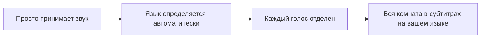
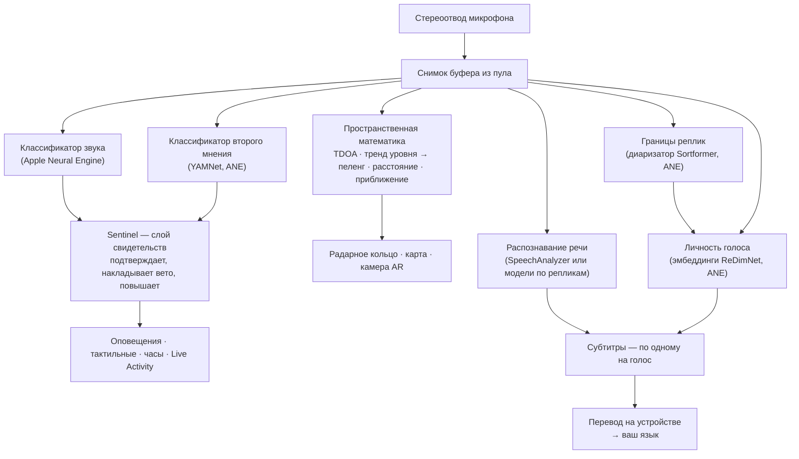
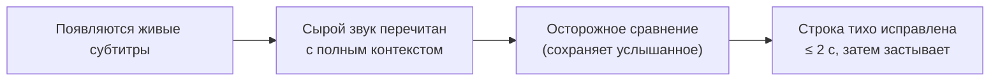
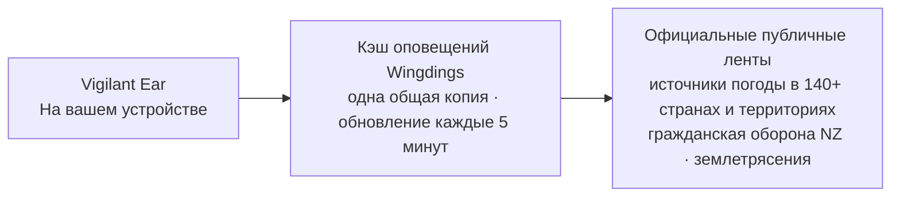

# Vigilant Ear 👂🛡️

*Действует с версии 1.1.12 · октябрь 2026 г.*

## Акустический радар для тех, кто не слышит.

Приложение, созданное специально для сообщества глухих, слабослышащих и CODA. Большинство приложений распознавания звука говорят вам, *что* это за звук. **Vigilant Ear говорит, где он, кто его издаёт и что при этом говорят** — и превращает iPhone в устройство, которое описывает звук вокруг вас в тот момент, когда он происходит.

Направление и расстояние до сирены. Стук у вас за спиной. Люди в разговоре — отдельные расшифрованные голоса, у каждого свои субтитры и своё место по направлению. Если кто-то говорит на языке, который вы не читаете, его слова могут приходить **переведёнными на ваш.** Оповещения доходят до **экрана блокировки, Dynamic Island и Apple Watch**, так что хватает одного взгляда.

Всё, что важно, работает на устройстве. Звук не записывается и не отправляется на сервер для распознавания. Ничто не зависит от того, слышит ли человеческое ухо хоть что-нибудь.

- 🧭 **Направление, а не только обнаружение.** *Что, где, кто* и *что было сказано* — а не просто «какой-то звук произошёл».
- 📣 **Имя названо.** Впишите своё имя, ребёнка или партнёра — «заказ для Marie готов» оповещает телефон и часы и показывает, в какую сторону.
- 🔒 **Приватность заложена в основу.** Классификация, субтитры и перевод выполняются на вашем iPhone. Субтитры живые и мимолётные; архивом расшифровки они не сохраняются.
- ⌚ **На запястье и на экране блокировки.** Компаньон направления для Apple Watch и Live Activity держат последнее оповещение и то, откуда оно пришло, на расстоянии одного взгляда.
- 🛰️ **Больше телефонов — один общий слух.** Наша сеть Constellation связывает iPhone с Ultra-Wideband и сводит то, что слышит каждый, в более чёткую картину направлений.
- 👁️ **Сделано для глухих / слабослышащих / CODA.** Различимые тактильные сигналы, высококонтрастная картинка, подсказки независимо от цвета, крупные зоны нажатия и «Уменьшение движения» повсюду.

---

## Для кого это

- **Глухие, слабослышащие и CODA**, которым нужна ситуационная осведомлённость о звуке, — Home Watch (стук, сигнализация, ребёнок, телефон) и Street Watch (сирена, приближение), которые можно оставить включёнными и которым можно доверять.
- Все, кому нужны **живые субтитры с направлением и разделением говорящих** или **перевод на устройстве** речи людей, сидящих рядом.
- Те, кто занимается доступностью и акустическими исследованиями и кому интересно определять положение звука на устройстве.

> Vigilant Ear — это **вспомогательное средство** доступности, а не сертифицированное устройство для защиты жизни.

---

## Что оно делает

### 🧭 Оно видит звук — направление и расстояние
С помощью двух микрофонов iPhone Vigilant Ear измеряет **угол звука и то, впереди он или позади вас**, держит это показание устойчивым примерно до градуса и ставит его живым маркером на радарное кольцо с верхом по курсу и на карту. Два микрофона на одной линии сами по себе не отличают левое от правого. Звук в 50° справа от вас и звук в 50° слева приходят с одной и той же крошечной разницей во времени. Приложение рисует показание и **более бледную вторую метку — призрак — с другой стороны**, а поворот запястья или второй телефон снимает неопределённость. Расстояние оценивается по громкости с помощью кривой, откалиброванной на улице, и показывается как та оценка, которой оно является, с вероятным диапазоном, в единицах страны, где вы находитесь, а не языка, на котором вы читаете приложение. На телефоне для США это читается как *≈ 50 ft*. Когда вы двигаетесь, маркеры сохраняют своё положение в реальном мире. В этом суть: пространственная осведомлённость о мире, который вы не слышите. (Цифры — ниже.)

### 🚨 Оно распознаёт важные звуки — и предупреждает вас
Классификатор на устройстве узнаёт сотни повседневных звуков и следит за критическими категориями — **сирены, сигнализации — включая отдельный класс автомобильной сигнализации, — дверные звонки и стук, плач ребёнка, человек рядом и опасная погода.** Когда одна из них срабатывает, вы получаете ясное оповещение на экране, необязательное **push-уведомление** и отдельный **тактильный сигнал** — даже если приложение в фоне или телефон спит. Критические категории по умолчанию готовы, так что включение уведомлений не означает «всё выключено». Выключите все категории оповещений — и в фоне движок полностью засыпает, чтобы беречь батарею. Слой **Sentinel** сверяет оповещения с независимыми свидетельствами — направлением, движением и публичными лентами, — так что срабатывает подтверждённое, а не одиночная догадка классификатора. Это работает в обе стороны: момент внутри песни, похожий на сирену, удерживается, но настоящая сирена, которая повторяется сквозь вашу музыку, прорывается и даёт оповещение.

Предупреждения об опасной погоде приходят из **официальных государственных источников более чем в 140 странах и территориях**, и новые добавляются часто — бесплатно для всех. Оповещения гражданской обороны тоже входят, со своим переключателем **Экстренные оповещения**. Ленты сужаются до тех, что охватывают место, где вы находитесь. Где это доступно, приложение также читает **предварительные бюллетени** национальных метеослужб — уведомления простым языком, которые выпускают за несколько дней до тайфуна или сильного дождя, а не только предупреждения, когда опасность уже наступила, — плюс бюллетени о внезапном ливне и об оползнях. Предварительные уведомления показываются тихо, без звука и вибрации, которые оставлены для настоящего предупреждения.

### 🌧️ Метеорадар на карте
Дождь и снег видны на карте с момента открытия приложения — с национальных радаров США, Канады, Японии, Италии и большей части Европы, а на большей части остального мира — по спутниковой оценке дождя. Коснитесь карты, и последний час проиграется три раза, так что видно, куда движется буря; шкала внизу читается от «Слабый» до «Плотный». Если на этот сеанс радар не нужен, нажмите кнопку погоды, чтобы его выключить. Радар приходит тем же путём, что и предупреждения, — через наш собственный сервер, поэтому ваш телефон никогда не обращается к государственным серверам. Светло-серые стрелки также показывают, куда дует ветер, в любой точке мира, по глобальному прогнозу NOAA на текущий час.

### 🛟 Кому звонить — спасательный круг
Спасательный круг рядом с компасом карты открывает короткий список для страны, в которой вы стоите:

- экстренный номер, с кнопками звонка и сообщения и пометкой о тексте в реальном времени там, где сообщение на экстренный номер может не сработать
- национальная метеослужба
- организация глухих, если у неё есть устойчивая страница
- поддержка Vigilant Ear

### ⌚ Apple Watch + Live Activity — взглянули и поняли
- **Компаньон Apple Watch** — направление оповещения указывается на запястье, так что одного взгляда достаточно, чтобы понять, куда смотреть. Обновлённый интерфейс часов со значком уха приложения, раскладкой HUD угрозы и двойным касанием, чтобы снять оповещение. Стрелка направления может показываться и тогда, когда приложение на часах не открыто.
- **Live Activity** — Vigilant Ear остаётся на **экране блокировки**, в **Dynamic Island** и в **Smart Stack** часов, так что последнее оповещение и его пеленг всегда на расстоянии одного взгляда.
- **Оповещения партнёра на запястье** — когда телефон связанного партнёра Constellation поднимает оповещение, оно может дойти и до ваших часов, вместе с направлением. За день компаньон тратит мало заряда часов.

### 💬 Speaker Mode — живые направленные субтитры *(бесплатно)*
Включите **Speaker Mode**, и Vigilant Ear расшифрует речь людей рядом с вами в **блоки субтитров, по одному на голос.** Диаризация говорящих на устройстве держит голоса раздельно — *кто* говорит *что* — с подсказкой направления на внутреннем кольце. Текущий говорящий подсвечен; более старый текст уходит, когда нужно место.

**Каждый говорящий на своём языке.** На iPhone с памятью не меньше 8 ГБ однократная загрузка модели субтитров (около 1 ГБ — по Wi-Fi или по сотовой сети после вопроса) позволяет приложению давать субтитры к каждой реплике на языке, на котором её действительно сказали, так что комната, которая переключается между английским, испанским, французским и арабским, становится понятной. В наших тестах ошибки в словах в разговоре на четырёх языках упали примерно с 80% до 14%. С версии 1.1.12 улучшенная речевая модель ошибается в шуме гораздо реже — в шумном баре на iPhone 17 доля неверных слов в немецких субтитрах упала с 45% до 20% — и сама заменяет прежнюю по Wi-Fi. Без загрузки — и для тех, кто читает на китайском, японском и корейском, где распознаватель Apple читает лучше, — субтитры, как и раньше, используют распознавание речи Apple на устройстве.

Две вещи, которых большинство приложений субтитров не делают.

**Честность насчёт уверенности.** Неброская отметка качества у каждой строки и пунктир под сомнительными словами говорят, когда строке можно верить, а когда стоит перепроверить.

**Самокоррекция.** Сразу после того, как предложение легло, приложение заново читает звук с полным контекстом и может вернуть пропущенное или неверно услышанное слово за пару секунд, а затем текст застывает.

**Имя названо** (Настройки, выключено, пока вы его не включите) следит в этих субтитрах за именами из вашего списка — вашим, ребёнка, партнёра. Когда кто-то говорит «заказ для Marie готов», вы получаете отдельный тактильный сигнал и оповещение на часах с направлением, а не ещё один пузырь субтитров. Сами слова по-прежнему появляются в Speaker Mode как речь; этот сигнал — о том, что обращались *к вам*.

**Крепкие слова можно маскировать** (Настройки → Субтитры). Иначе брань приходит обычным текстом, смягчать её нечему, и у читающего нет возможности сначала отвести взгляд; включите это — и такие слова заменяются символами, так что предложение по-прежнему читается, уже без этого слова. Что считать таким словом, решает собственный распознаватель речи вашего устройства — не наш список слов, — поэтому он следует языку, который расшифровывается. На учётной записи, заявленной как младше 18 лет, это всегда включено и показывает замок. Это относится к речи, которую расшифровывает *это* устройство; текст, переданный с сопряжённого телефона, был расшифрован там и приходит уже готовым текстом.

**Слово, на которое говорящий сделал упор, помечается жирным.** Сказанные вслух по-английски, "I didn't say THAT" и "I didn't say that" — это два разных предложения, и одинаковая расшифровка теряет разницу целиком. Приложение следит за тем единственным словом, на котором голос говорящего поднял тон, и ставит его жирным — не больше одного на строку и ничего вообще, когда оно не уверено, потому что пометить не то слово значило бы приписать человеку то, чего он не говорил. Выключено в китайском и японском, где высота тона сообщает, *какое это слово*, а не насколько сильно на него нажали.

Субтитры бесплатны; автоматический перевод — необязательный слой Power Pack+. Субтитры также можно **произносить вслух на устройство Bluetooth, включая слуховой аппарат** — бесплатно, в Настройках. **Тоны направления** (тоже бесплатно, Настройки → Субтитры) добавляют необязательную звуковую подсказку в то ухо, которое вы выберете, и она показывает, где говорящий, — полезно со слуховым аппаратом или при одностороннем слухе и доступно всем.

### 🌐 Автоперевод — ваш язык, вживую *(Power Pack+)*
Когда включён Speaker Mode и человек рядом говорит на другом языке, Vigilant Ear может определить его и показать субтитры **на вашем языке**, а исходный язык — на блоке этого человека. Цепочка — услышать → разделить говорящих → расшифровать → перевести → показать — работает **на устройстве**; единственный сетевой момент — однократная загрузка языкового пакета от Apple, и если вы ждёте именно этой загрузки, приложение об этом говорит, а не оставляет вас перед непереведённым текстом. Заранее знать или выбирать другой язык не нужно. Законченное предложение переводится, как только оно заканчивается, не дожидаясь, пока говорящий замолчит, и переводы приходят за долю времени.

Это ближе всего из доступного к **универсальному переводчику научной фантастики** — устройству, которое просто понимает. Vigilant Ear сам определяет язык, следит за каждым говорящим в комнате и даёт субтитры всем на вашем языке — без наушников, без настройки, на вашем устройстве.

### 🎵 Музыка и осведомлённость об эфире *(Power Pack+)*
**ShazamKit** узнаёт музыку, которая играет вокруг вас, и сам замечает смену песни, так что название остаётся актуальным.

### 🎛️ Acoustic Scope — видеть звук как инженер
Профессиональный живой вид звука вокруг вас: спектр, спектрограмма, полосы RTA в ⅓ октавы, хрома и гармонические партиалы — **бесплатно для всех**. **Partials читает музыку:** каждый тон назван своей нотой, рядом его гармонический ряд, более высокие звуки, например дымовые сигнализации, названы по их истинной высоте, и можно задать целевую ноту, которая рисуется линией, чтобы петь или настраиваться по ней. Держать Спектрограмму открытой почти ничего не стоит, сколько бы вы ни смотрели. Инструменты, которые записывают звуки для обучения ваших собственных пользовательских звуковых пакетов, входят в Power Pack+.

### 📦 Пользовательские звуковые пакеты — научите его своему миру *(Power Pack+)*
Vigilant Ear можно научить звукам, которые важны вам, — местным птицам, дверному звонку здания, ненормальному гулу генератора или типу самолёта на взлёте. Эти дополнительные пакеты ложатся поверх встроенного обнаружения, так что новые звуки никогда не вытесняют сирены и сигнализации. Пошаговое руководство встроено в приложение.

### 🛰️ Constellation — много iPhone, один общий слух *(Power Pack+)*
Если iPhone с Ultra-Wideband два или больше (большинство начиная с iPhone 11), сеть **Constellation** связывает их, чтобы они чувствовали положение друг друга и сводили то, что слышит каждый, в одну, более точную картину того, откуда идёт звук, — распределённый пассивный слушающий массив. Субтитры тоже сводятся: каждый телефон расшифровывает то, что слышит его собственный микрофон, а слова выравниваются между телефонами, так что ближайший к говорящему вносит то, что услышал он, — слова, которые поймал только один телефон, сохраняются, а не теряются.

Телефоны соединяются **напрямую друг с другом** — без роутера, без общей сети Wi-Fi и без интернета; Wi-Fi просто должен быть включён. Они используют ту же одноранговую связь, что и AirDrop, и присоединиться могут только телефоны с нужным оборудованием. Связь между телефонами всегда зашифрована; телефонам с Vigilant Ear 1.1.6 или старше нужно обновить приложение, чтобы участвовать в сети.

**Сообщения партнёру** — отправьте короткий текст на телефон партнёра в сети; он попадает в его ленту субтитров и может прийти переведённым на его язык, на устройстве. Переписка учитывает возраст: она построена на Declared Age Range от Apple, и сообщения между взрослым и несовершеннолетним остаются выключенными, пока оба человека намеренно не назовут друг друга. Оповещения и субтитры не ограничиваются никогда — только переписка человека с человеком.

### 🔗 Remote Link — связаться с тем, кого нет рядом *(Power Pack+, чтобы начать)*
То, что обычно делает телефонный звонок, — видео и текстом. Код приглашения отправляете вы; другой человек присоединяется изнутри Vigilant Ear, **не имея Power Pack+**. В отличие от Constellation, находиться рядом не требуется — вы двое можете быть где угодно.

**Звук не используется ни на каком этапе.** Только видео и текст, поэтому в этой связи ничто не зависит от слуха ни на одном конце — и через приложение можно объясняться с кем-то на жестовом языке. Само приложение жестовый язык не понимает: оно передаёт видео, а остальное делаете вы вдвоём. Соединение идёт напрямую между двумя телефонами там, где это позволяет сеть, и приложение ясно показывает, путь **Прямой** или **Через релей**, так что вы всегда знаете, проходит ли ваше видео через релей.

**Субтитры тоже передаются.** То, что расшифровывает каждый телефон, появляется на другом, в переводе на язык читающего, когда это нужно. Любой из вас может поставить связь на паузу — видео и субтитры — и возобновить её, а также завершить разговор с главного экрана.

### 📷 Камера AR — «видеть звук»
Откройте камеру AR из Веера действий и закрепите обнаруженные звуки на их настоящем пеленге в живом виде камеры. Маркеры собираются по говорящему или по категории звука и направлению, чтобы вид оставался читаемым, и блёкнут, пока звук остаётся тихим.

### 🗺️ Карты, дороги и прогноз пути
Пеленги звуков проецируются на реальные координаты GPS на карте. Звуки транспорта можно **привязать к ближайшим улицам**, а их пути — спрогнозировать, так что проезжающий грузовик читается как движение *вдоль дороги*, а не сквозь здания. (Попробуйте демо пожарной машины в Feature Playground.)

### 🪄 Feature Playground — доказать это без слуха
**Feature Playground** открыт для всех: примеры оповещений Home и Street (стук, сигнализация, ребёнок, сирена, погода), демо с несколькими телефонами и с разговором. На них ясный водяной знак, так что тренировка никогда не притворяется живым событием. Закрытие панели чисто убирает демо (никакой застрявшей подмены GPS, никаких оставшихся флагов).

### ♿ Доступность прежде всего
Сделано для глухих / слабослышащих / CODA и людей с нарушением цветовосприятия:

- подсказки, **не зависящие от цвета**
- зоны нажатия **≥44 pt**
- соблюдение **Уменьшения движения**
- **раскладки справа налево** для читающих на арабском
- мультимодальные оповещения (тактильные + визуальные + часы)
- экран проверки при запуске, который показывает статус разрешений ясным зелёным / серым / красным и жжёно-оранжевым для «запрещено», включая разрешение на уведомления, которое служит главным выключателем оповещений

---

## Бесплатно и Power Pack+

Ядро безопасности **бесплатно, навсегда**:

- **Home Watch и Street Watch** — локальные звуковые оповещения (сигнализации, сирены, стук и дверные звонки, ребёнок, человек рядом) с выводом на экран, тактильным сигналом и необязательной доставкой push.
- **Живые субтитры** — Speaker Mode, на устройстве, с направлением там, где позволяет оборудование, с честными отметками уверенности, самокоррекцией примерно за 2 секунды, необязательным озвучиванием на устройство Bluetooth (включая слуховой аппарат) и Тонами направления.
- **Имя названо** — необязательные имена, которые вы вводите (своё, детей, партнёра). Совпадение — это оповещение на часах и на телефоне с пеленгом, а не вторые субтитры.
- **Standing Watch** — собственное состояние комнаты, всегда включено и настраивать нечего: ровная бирюзовая лампа, пока комната держит свой рисунок, янтарная, когда что-то меняется — новый голос, внезапная тишина или что-то приближается. Когда приложение запускается, оно сообщает, как долго оно не слушало оповещения.
- **Оповещения об опасной погоде** — официальные предупреждения для вашего региона из государственных источников более чем в 140 странах и территориях, и новые добавляются часто.
- **Метеорадар** — дождь и снег на карте, с повтором последнего часа и с тем, куда дует ветер.
- **Спасательный круг** — кому звонить в стране, где вы находитесь.
- **Оповещения о землетрясениях (по всему миру)** — вибрация и на карте область, которая это ощутила, когда рядом сообщают о толчке. Подтверждение из официальной ленты землетрясений, а не раннее предупреждение: если вы почувствовали тряску, это говорит, что это было. Лента проверяется каждые пять минут, в том числе в фоне, а распознавание глубоких грохотов (инфразвука) на устройстве может взвести дополнительную проверку в тот момент, когда двигается земля.
- **Feature Playground** — учебные оповещения и предпросмотр функций с ясным водяным знаком PREVIEW.
- **Компаньон Apple Watch и Live Activity** — направление и последнее оповещение с одного взгляда.
- **Acoustic Scope** — профессиональная живая визуализация звука, бесплатно для всех. (Инструменты записи для обучения — это Power Pack+.)
- **Исследовательский массив** *(включён, пока вы его не выключите)* — пока он включён, передаются время, приблизительное место (около 1 км) и частота событий, похожих на землетрясение, — без звука, без идентификатора, — чтобы помочь наносить на карту землетрясения и другие низкочастотные события. Вопрос на карте задаётся один раз. Отчёты ждут, пока этот вопрос не окажется на экране.

**Power Pack+** — разовая разблокировка (**не подписка**) с **бесплатной пробой на 90 дней**. Он добавляет сверхспособности:

- **Автоперевод** — перевод на устройстве речи рядом на ваш язык.
- **Constellation** — общий слух нескольких iPhone через Ultra-Wideband, с сообщениями партнёру.
- **Music ID** — распознавание песен через ShazamKit.
- **Пользовательские звуковые пакеты** — дополнительные классификаторы, которые вы обучаете на своих звуках.
- **Remote Link** — приватные видео- и текстовые разговоры с тем, кого нет рядом, без звука на любом этапе. Чтобы начать, нужен Power Pack+; человек, которого вы приглашаете, присоединяется бесплатно.

Бесплатно или с Power Pack+, **ваш звук для распознавания остаётся на устройстве** — уровень меняет только то, какие функции открыты, и никогда не меняет то, куда сырой звук отправляется на анализ.

---

## Как это устроено (под капотом)

Vigilant Ear — это конвейер **сначала локальный, на устройстве**, собранный слоями: захватить один раз, а затем дать независимым специалистам прочитать один и тот же звук и проверить работу друг друга. Сырой звук снимается высокоприоритетным отводом, копируется в **список свободных буферов из пула** (без пробуксовки выделений на пути реального времени) и расходится дальше, не задерживая интерфейс:

Ни одной модели не доверяют в одиночку. Слой **Sentinel** стоит между обнаружением и оповещением: независимые движки кадр за кадром подтверждают друг друга или накладывают вето — и когда против вето копятся повторные свидетельства из реального мира (настоящая сирена воет сквозь вашу музыку), побеждают свидетельства, и оповещение срабатывает.

У субтитров есть свой второй шанс. Каждое завершённое предложение тихо перечитывается из короткого звукового кольца в памяти, с полным контекстом — правки ложатся примерно за две секунды, затем текст застывает насовсем:

- **Пространственная математика** — БПФ, разность времени прихода, взвешенная по когерентности (TDOA — отдавать предпочтение полосам частот, где оба микрофона согласны, а затем превращать крошечное запаздывание прихода в пеленг), и отслеживание приближения по тренду уровня на фоновых задачах. Пара микрофонов читается в фиксированной ориентации, так что направление работает одинаково, держите ли вы телефон прямо или боком.
- **Речь** — iOS 26 `SpeechAnalyzer` / `SpeechTranscriber` для расшифровки; фреймворк **Translation** от Apple для перевода на устройстве. С необязательной загрузкой субтитров каждую реплику нарезает детектор речевой активности, её язык выбирает модель устной речи, а расшифровывают открытые модели распознавания речи — одна для европейских языков, одна для остальных — и всё это на устройстве. Личность голоса опирается на свидетельства: голос подтверждается как реальный человек только по независимым окнам звука, а неуверенное совпадение показывается без имени, а не угадывает неверное.
- **Две модели для двух вопросов** — чтобы различать голоса, нужно *когда сменился говорящий* и *кто этот говорящий*, и это не одна и та же задача. Потоковый диаризатор **Sortformer** отмечает границы реплик; эмбеддинги **ReDimNet** решают, чей голос находится внутри каждой. Резать по границе важнее, чем это звучит: окно, которое накрывает двух людей, содержит обоих, и никакая модель эмбеддингов потом этого не отменит. Под обеими лежит нижний слой — пол речевой активности: если диаризатор в трудной комнате замолкает, а не угадывает, реплики всё равно нарезаются, так что приложение снижает качество, а не сливает двух говорящих в одного.
- **Правда о музыке** — детектор **сигнатуры песни** по хроме владеет решением «музыка и правда играет?», потому что обычные классификаторы, как известно, называют «музыкой» тихие комнаты и сирены. Shazam запускается только тогда, когда сигнатура согласна, что музыкальное там действительно есть.
- **Параллельность** — изоляция Swift 6 держит отвод микрофона, акустическую математику и цикл отрисовки интерфейса чисто разделёнными.
- **Эффективность** — понижение частоты дискретизации, классификация, которая подстраивается под нагрузку, и выход в сеть только при свидетельствах держат постоянное слушание достаточно лёгким, чтобы его оставлять включённым.

Оповещения о погоде и о землетрясениях идут путём, противоположным звуку, — ничего о вашем звуке никогда не уходит наружу, но *данные* оповещений приходят. **Каждая** официальная лента — и изображения радара и ветра — проходит через небольшой релейный кэш, который ведём мы, так что одной загрузки публичных данных хватает всем пользователям, и ваш телефон никогда не обращается к государственным серверам:

---

## Что может слышать ваш телефон — измерено

У вашего iPhone два микрофона примерно в шести дюймах (15 см) друг от друга, барометр и очень хорошие часы. Этого достаточно, чтобы сказать, с какой стороны пришёл звук, примерно насколько далеко, идёт ли он к вам и открылась ли только что дверь. Вот насколько точен каждый из этих ответов, как мы это проверяли и почему это важно, если вы сами звук не слышите. Таблица направлений измерена на iPhone 17 в сентябре 2026 года. Та же проверка на столе на iPhone 16 Pro Max не дала непрерывного угла — это изображение прищёлкивает звук к направлению вперёд или вбок, — поэтому строки в градусах относятся только к 17-й модели. Расстояние по своей природе остаётся оценкой — на экране мы так и пишем. Расстояния, снятые рулеткой в этом разделе, даны в футах — в единицах той рулетки.

**Направление — до пары градусов.** Звук доходит до верхнего микрофона раньше нижнего или позже, и по этому промежутку приложение вычисляет, насколько звук ушёл от оси телефона и впереди он или сзади. Два канала телефона — не простые микрофоны, а обработанное стереоизображение, и это изображение добавляет собственный постоянный рисунок всякий раз, когда в комнате шумно. Приложение выучивает этот рисунок по тишине после запуска. Примерно через минуту тихой комнаты оно убирает рисунок перед чтением направления; до тех пор показание идёт без этой поправки.

| Что мы измеряли | Результат |
|---|---|
| Медианная ошибка по 96 смоделированным комнатам, от тихого офиса до комнаты с жёсткими стенами при SNR 5 дБ | 1.0° |
| iPhone 17 на столе, шум комнаты включён, динамик на 30° от оси | прочитал 61.7° от боковой плоскости при ожидаемых 60°, колебание 1.6° |
| То же, динамик прямо сбоку от телефона | прочитал 4.5° при ожидаемых 0°, колебание 2.2° |
| То же, динамик на 60° от оси | медиана 35.7° при ожидаемых 30°; прогон разделился, со вторым скоплением на задержке прямо вперёд, скорее всего отражение от стенда |
| То же, динамик прямо впереди | каждое показание на максимальной задержке, как и должно быть |
| Показания, попавшие на собственный рисунок изображения, а не на звук | ни одного, ни на каком угле |

*Почему это важно:* если вы не слышите сирену, «позади вас, в сторону» говорит, куда смотреть. Показание, которое стоит на месте, заслуживает доверия только после проверки рулеткой, и это проверили дважды. Первая проверка сделала результат лучше, чем он был на самом деле.

**Расстояние — показано как оценка, которой оно и является.** Один микрофон не измеряет расстояние, только громкость, и громкий грузовик далеко может звучать как тихая машина рядом. Приложение оценивает расстояние по громкости с помощью кривой, подогнанной на настоящей улице, а затем говорит об этом так, как сказал бы осторожный человек. На телефоне для США это *около 50 ft, вероятно между 25 и 100.*

| Что мы измеряли | Результат |
|---|---|
| Реальные обнаружения машин, проигранные через калибровку | 1131 |
| Попадание внутрь 100-foot дороги, на которой они на самом деле были | 73% |
| Машины дальней полосы | оценка 78 и 87 ft там, где рулетка сказала 73 и 85 ft |

Дорогу (городской перекрёсток) измерили полоса за полосой; когда кривая ошибается, она ошибается в ближнюю сторону. Калибровка закреплена автоматическим тестом, так что она не может тихо уехать. Сигнализациям в вашем собственном пространстве, например дымовому извещателю, цифра расстояния не даётся вовсе — они уже в комнате с вами.

**Движение — идёт к вам.** Для машин и сирен «становится громче» обычно значит «становится ближе». Приложение следит, как быстро уровень звука растёт за несколько секунд: устойчивый подъём примерно на 1,5 дБ в секунду (ясное, ровное усиление громкости) означает приближение, такой же спад означает удаление, а звук, который перестал меняться, примерно через четыре секунды перестают называть и тем и другим. Один громкий момент — короткий сигнал клаксона, хлопок двери — вызвать это не может. Построено на физике и девяти автоматических тестах; записанный проезд по улице — следующее подтверждение в поле.

**Воздух в комнате — у двери есть сигнатура.** Барометр может заметить, как дверь открывается примерно в четырнадцати футах (4,3 м): давление проседает, пока дверь идёт, затем отскакивает, когда она закрывается. За четырнадцать часов тишины и пятнадцать событий с дверью каждая дверь дала эту форму из двух частей, и ничего другого в доме этого не сделало.

| Событие | Скорость давления | Форма |
|---|---|---|
| Входная дверь, открыта и закрыта, ×10 | 0.6–1.8 Pa/s | просадка, затем отскок, ~5 с между ними |
| Входная дверь, хлопнули, ×5 | 1.1–2.5 Pa/s | та же пара, выше |
| Циклы кондиционера за ночь, ×8 | 0.11–0.46 Pa/s | медленный набор за минуты, одинаково на обоих телефонах |
| Тихая комната | ~0.02 Pa/s | ничего |
| Активность человека, проход мимо | — | датчик движения замечает, и телефон это игнорирует |

Дверь, которая не герметизирует комнату, была невидима — сетчатая наружная дверь, в этом тесте, — ровно так, как и должно быть. Сегодня сдвиг давления может показываться на карте как глубокие грохоты; отдельное оповещение о двери в тихую ночь измерено и спроектировано и ещё не является повседневным режимом по умолчанию.

**Constellation — два телефона определяют сторону.** Каждый телефон в сети проводит линию к звуку от того места, где он стоит, и линии чисто пересекаются только с одной стороны. Когда так и происходит, призрак исчезает, и приложение снова может сказать «слева» или «справа». В симуляции два телефона **в 40 метрах друг от друга** определяют положение сирены в 50 метрах с точностью около 2 метров.

**Как здесь чему-либо верят.** Каждое число прошло, по порядку, через одни и те же трое ворот: смоделированная комната, где ответ известен заранее; небольшие автоматические тесты, которые воссоздают ровно тот случай, что обманул бы приложение, и запускаются при каждом изменении; затем настоящие телефоны на настоящем столе, с расстояниями, измеренными руками. Ничто не считается точным, пока не пройдёт третьи ворота. Для того, кто не слышит звук, слово приложения — единственное слово, и заработать его нужно так, как это делает лаборатория.

Подробнее для инженеров: [Физика](https://vigilantear.com/en/physics/) — TDOA, расстояние, движение, Constellation и барометрическое обнаружение, и каждая цифра помечена MEASURED / BENCHED / MODELLED.

---

## Конфиденциальность

- **На устройстве, всегда для основного конвейера.** Классификация, пространственная математика, расшифровка, диаризация и перевод работают на вашем iPhone. Сырой звук не записывается и не отправляется на сервер для распознавания.
- **Субтитры мимолётны.** Живые субтитры остаются в памяти на время сеанса; выгруженные журналы отладки не содержат текста субтитров.
- **Никаких SDK рекламы или поведенческой аналитики.** Сеть используется ограниченно и только для карт, публичных лент погоды, изображений радара и ветра, списка помощи, необязательной загрузки модели субтитров, необязательных отпечатков Shazam, дорожного контекста, отчётов Исследовательского массива, пока эта функция включена, и покупок в App Store — подробности в нашей политике конфиденциальности.

Подробности: [Конфиденциальность](/ru/privacy/) · [Условия](/ru/terms/) · [Поддержка](/ru/support/)

---

## Оборудование и платформы

- **iPhone (полный опыт).** Работает в портретной и альбомной ориентации — держите как вам удобно. Для определения направления нужны стереомикрофоны. Рекомендуется **iPhone 13 или новее**; субтитры на языке каждого говорящего требуют **8 ГБ памяти** (iPhone 15 Pro и новее).
- **Apple Watch.** Оповещения компаньона со стрелкой направления; работает с Live Activity / Smart Stack.
- **iPad (нативно).** Адаптивная вёрстка: на большом экране живые субтитры получают полупрозрачную панель рядом с картой, которая убирается, когда никто не говорит. Одноканальные микрофоны → субтитры без полного направления.
- **Constellation** нужен **Ultra-Wideband** — iPhone 11 или новее, кроме моделей SE и «e». Сеть Wi-Fi ему **не** нужна: при включённом Wi-Fi телефоны находят друг друга напрямую, так что Constellation работает без роутера и без интернета, пока телефоны рядом друг с другом.
- **Android (когда доступно).** Отдельная сборка с основным радаром, оповещениями, субтитрами и погодой; сеть Constellation прежде всего для iOS.

---

## Локализация

Полностью локализовано — интерфейс, оповещения и субтитры — на **английский, испанский, португальский (Бразилия), французский, немецкий, итальянский, турецкий, арабский, японский, упрощённый китайский, традиционный китайский, корейский, русский, хинди и румынский** (15 языков). Следует локали системы или ручному выбору в приложении. Румынские субтитры работают на устройстве; в Apple Translate нет румынского, поэтому Автоперевод показывает для этого языка оригинал.

---

## Статус и оговорка

Vigilant Ear — это **экспериментальное средство акустической доступности**, а не сертифицированная утилита для защиты жизни. Разрешение локализации звука меняется в зависимости от окружения, погоды, ветра и оборудования микрофонов. **Всегда сохраняйте привычную для вас осведомлённость об окружении** — не полагайтесь на него как на единственный источник сведений о безопасности.

Некоторые возможности (маркеры камеры AR, повышение права Critical Alerts, когда его даёт Apple, продвинутое создание звука из нескольких пакетов) продолжают развиваться; бесплатные Home / Street Watch и живые субтитры — это продукт, которому можно доверять с первого дня.

**Источники и лицензии:** [api.vigilantear.com/sources](https://api.vigilantear.com/sources)

---

**Контакт:** [vigilantear@wingdingssocial.com](mailto:vigilantear@wingdingssocial.com)

Сделано с ❤️ для сообщества глухих и слабослышащих и акустических исследований.

    
  <strong>© 2026 Wingdings, Inc.</strong> 
  Все права защищены. 
  Заявлено несколько патентов

