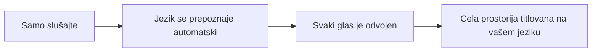
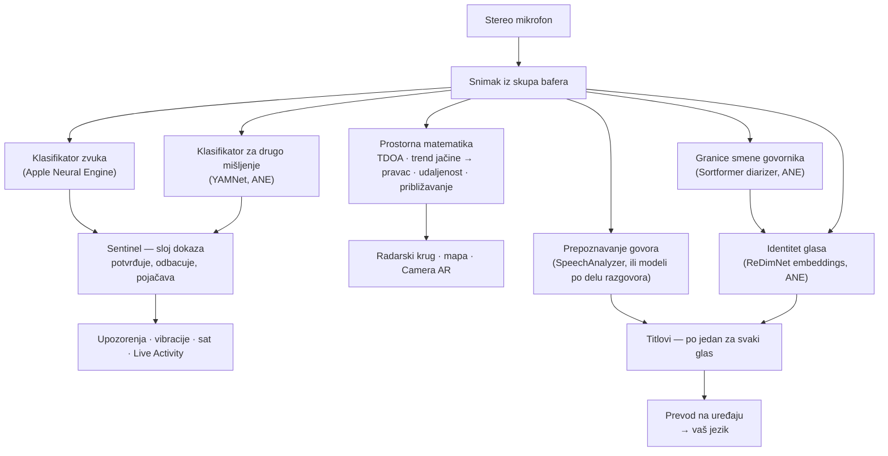
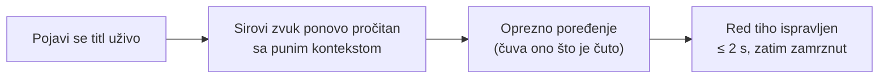
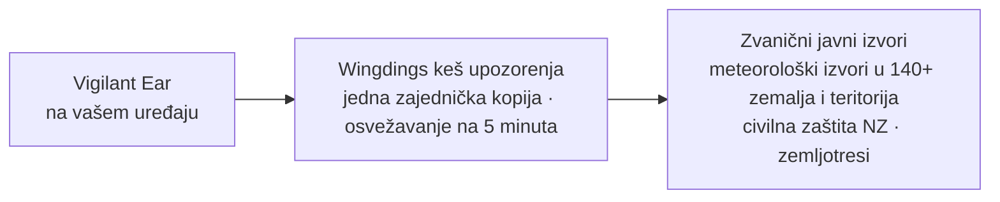

# Vigilant Ear 👂🛡️

*Važi od verzije 1.1.13 · oktobar 2026.*

## Akustični radar za ljude koji ne čuju.

Aplikacija napravljena posebno za zajednicu gluvih, nagluvih i CODA (čujuće dece gluvih roditelja). Većina aplikacija za prepoznavanje zvuka kaže vam *šta* je neki zvuk. **Vigilant Ear vam kaže gde je, ko ga proizvodi i šta govori** — i pretvara iPhone u uređaj koji opisuje zvuk oko vas dok se dešava.

Pravac i udaljenost sirene. Kucanje iza vas. Ljudi u razgovoru, prikazani kao zasebni glasovi sa titlovima — svaki titlovan i postavljen u svom pravcu. Ako neko govori jezik koji ne čitate, njegove reči mogu stići **prevedene na vaš jezik.** Upozorenja stižu na **zaključani ekran, Dynamic Island i Apple Watch**, pa je dovoljan jedan pogled.

Sve što je važno radi na samom uređaju. Zvuk se ne snima i ne šalje nigde radi prepoznavanja. Ništa ne zavisi od toga da li ljudsko uvo nešto čuje.

> Napomena o jeziku: interfejs aplikacije još nije na srpskom, pa na srpskom iPhone-u aplikacija prikazuje engleski. Zato su nazivi funkcija na ovoj stranici ostavljeni na engleskom, onako kako ih vidite u aplikaciji. Titlovi na srpskom još nisu provereni.

- 🧭 **Pravac, ne samo detekcija.** *Šta, gde, ko* i *šta je rečeno* — a ne samo „desio se neki zvuk”.
- 📣 **Name Called (prozvano ime).** Upišite svoje ime, ime deteta ili partnera — „porudžbina za Mariju je spremna” upozorava telefon i sat i pokazuje u kom pravcu.
- 🔒 **Privatnost od samog početka.** Prepoznavanje zvukova, titlovi i prevod rade na vašem iPhone-u. Titlovi su uživo i prolazni; ne čuvaju se kao arhiva transkripata.
- ⌚ **Na zglobu i na zaključanom ekranu.** Apple Watch pratilac i Live Activity drže poslednje upozorenje i njegov pravac na jedan pogled.
- 🛰️ **Više telefona, jedno zajedničko uvo.** Naša Constellation mreža povezuje iPhone-e sa Ultra-Wideband čipom i spaja ono što svaki od njih čuje u precizniju sliku pravca.
- 👁️ **Napravljeno za gluve, nagluve i CODA.** Prepoznatljive vibracije, visok kontrast, znaci koji ne zavise od boje, velike površine za dodir i poštovanje opcije Reduce Motion svuda.

---

## Za koga je

- **Gluvi, nagluvi i CODA korisnici** koji žele da znaju šta se zvučno dešava oko njih — Home Watch (kucanje, alarm, beba, telefon) i Street Watch (sirena, približavanje) koje možete ostaviti uključene i verovati im.
- Svi kojima trebaju **titlovi uživo sa pravcem i razdvajanjem govornika**, ili **prevod na uređaju** ljudi koji sede u blizini.
- Korisnici iz oblasti pristupačnosti i akustičnih istraživanja koje zanima lociranje zvuka na uređaju.

> Vigilant Ear je **pomoćno sredstvo** za pristupačnost, a ne sertifikovani sigurnosni uređaj.

---

## Šta radi

### 🧭 Vidi zvuk — pravac i udaljenost
Pomoću dva mikrofona iPhone-a, Vigilant Ear meri **ugao zvuka i to da li je ispred ili iza vas**, drži to merenje stabilnim do otprilike jednog stepena i prikazuje ga kao živu oznaku na radarskom krugu okrenutom u smeru kretanja i na mapi. Dva mikrofona na jednoj liniji sama ne mogu da razlikuju levo od desno. Zvuk 50° desno od vas i zvuk 50° levo stižu sa istom sićušnom vremenskom razlikom. Aplikacija crta merenje i **bledi „duh” na drugoj strani**, a pokret zgloba ili drugi telefon to razrešava. Udaljenost se procenjuje iz jačine zvuka prema krivoj kalibrisanoj na ulici i prikazuje se kao procena, sa verovatnim rasponom, u mernim jedinicama zemlje u kojoj se nalazite, a ne jezika na kom čitate aplikaciju. Na američkom telefonu to glasi *≈ 50 ft*. Kada se pomerite, oznake ostaju na svom stvarnom mestu. To je srž: prostorna svest o svetu koji ne čujete. (Brojke su niže.)

### 🚨 Prepoznaje važne zvukove — i upozorava vas
Klasifikator na uređaju prepoznaje stotine svakodnevnih zvukova i prati kritične kategorije — **sirene, alarme — uključujući posebnu klasu za auto-alarm — zvono na vratima i kucanje, plač bebe, osobu u blizini i nevreme.** Kada se neka od njih aktivira, dobijate jasno upozorenje na ekranu, po želji **push obaveštenje**, i prepoznatljivu **vibraciju** — čak i kada je aplikacija u pozadini ili telefon spava. Kritične kategorije su podrazumevano spremne, pa uključivanje obaveštenja ne znači „sve isključeno”. Ako isključite sve kategorije upozorenja, aplikacija u pozadini potpuno miruje da bi štedela bateriju. Sloj **Sentinel** proverava upozorenja prema nezavisnim dokazima — pravcu, kretanju i javnim izvorima — tako da ono što se oglasi ima potvrdu, a nije usamljena procena jednog klasifikatora. Radi u oba smera: trenutak u pesmi koji zvuči kao sirena biva zadržan, ali prava sirena koja se ponavlja kroz vašu muziku probija se i oglašava.

Upozorenja o nevremenu stižu iz **zvaničnih državnih izvora u više od 140 zemalja i teritorija**, a novi se često dodaju — besplatno za sve korisnike. Uključena su i upozorenja civilne zaštite, sa sopstvenim prekidačem **Emergency Alerts**. Izvori se sužavaju na one koji pokrivaju mesto gde se nalazite. Gde je dostupno, aplikacija čita i **prethodna saopštenja** nacionalnih meteoroloških službi — obaveštenja jednostavnim jezikom izdata danima pre tajfuna ili jake kiše, a ne samo upozorenja izdata kada opasnost već stigne — kao i saopštenja o iznenadnim pljuskovima i klizištima. Prethodna saopštenja prikazuju se tiho, bez zvuka i vibracije koji su rezervisani za pravo upozorenje.

### 🌧️ Meteorološki radar na mapi
Kiša i sneg vide se na mapi od trenutka kada otvorite aplikaciju — sa nacionalnih radara Sjedinjenih Država, Kanade, Japana, Italije i većeg dela Evrope, i sa satelitske procene padavina za veći deo ostatka sveta. Dodirnite mapu i poslednji sat se pušta tri puta, pa vidite u kom pravcu se oluja kreće; skala na dnu ide od Light do Dense. Ako ga ne želite tokom neke sesije, dodirnite dugme za vreme da ga isključite. Radar stiže na isti način kao upozorenja — preko našeg servera, tako da vaš telefon nikada ne kontaktira državne servere. Svetlosive strelice pokazuju i u kom pravcu duva vetar, bilo gde u svetu, prema NOAA globalnoj prognozi za tekući sat.

### 🛟 Koga zvati — pojas za spasavanje
Pojas za spasavanje pored kompasa na mapi otvara kratak spisak za zemlju u kojoj se nalazite:

- broj za hitne slučajeve, sa dugmićima za poziv i poruku, i napomenom o Real-Time Text tamo gde slanje poruke na broj za hitne slučajeve možda ne radi
- nacionalna meteorološka služba
- organizacija gluvih, tamo gde postoji stabilna stranica
- podrška za Vigilant Ear

Podelite Vigilant Ear iz panela za pomoć (pojas za spasavanje): kod koji osoba pored vas može da skenira da bi preuzela aplikaciju, link ka App Store-u i naš Instagram.

### ⌚ Apple Watch + Live Activity — pogledajte i znate
- **Apple Watch pratilac** — pravac upozorenja pokazuje se na vašem zglobu, pa vam jedan pogled kaže gde da gledate. Preuređen interfejs na satu sa ikonom uva, rasporedom upozorenja i dvostrukim dodirom za odbacivanje upozorenja. Upozorenja i dalje mogu da pokažu strelicu pravca kada aplikacija na satu nije otvorena.
- **Name Called na Apple Watch-u.** Kada neko izgovori vaše ime, sat vas tri puta kucne po zglobu i pokaže strelicu prema glasu. Kada telefon ne može da razlikuje levo od desno, lepeza pokazuje obe strane. Radi i dok je iPhone zaključan, ako je aplikacija Vigilant Ear otvorena na satu. Za Name Called mora biti uključen Speaker Mode.
- **Live Activity** — Vigilant Ear ostaje na **zaključanom ekranu**, u **Dynamic Island** i u **Smart Stack-u na satu**, pa su poslednje upozorenje i njegov pravac uvek na jedan pogled.
- **Upozorenja partnera na zglobu** — kada telefon povezanog Constellation partnera podigne upozorenje, ono može stići i na vaš sat, zajedno sa pravcem. Pratilac tokom dana troši malo baterije sata.

### 💬 Speaker Mode — titlovi uživo sa pravcem *(besplatno)*
Uključite **Speaker Mode** i Vigilant Ear pretvara govor ljudi u vašoj blizini u **blokove titlova, po jedan za svaki glas.** Razdvajanje govornika na uređaju drži glasove odvojenim — *ko* govori *šta* — uz oznaku pravca na unutrašnjem krugu. Govornik koji trenutno govori je istaknut; stariji tekst se pomera kada zatreba mesta.

**Svaki govornik na svom jeziku.** Na iPhone-ima sa najmanje 8 GB memorije, jednokratno preuzimanje modela za titlove (oko 1 GB — preko Wi-Fi mreže, ili preko mobilne mreže uz pitanje) omogućava aplikaciji da svaki deo razgovora titluje na jeziku koji je zaista izgovoren, pa je razumljiva i prostorija u kojoj se smenjuju engleski, španski, francuski i arapski. U našim testovima, greške u rečima u razgovoru na četiri jezika pale su sa oko 80% na 14%. Od verzije 1.1.12 poboljšani model govora pravi mnogo manje grešaka u buci — u bučnom baru na iPhone-u 17, nemački titlovi su pali sa 45% pogrešnih reči na 20% — i sam zamenjuje stari preko Wi-Fi mreže. Bez tog preuzimanja — i za čitaoce kineskog, japanskog i korejskog, gde Apple-ovo prepoznavanje bolje čita — titlovi koriste Apple-ovo prepoznavanje govora na uređaju, kao i do sada. Od verzije 1.1.13 aplikacija oslobađa te modele posle 30 sekundi u pozadini — na iPhone-u 17 njena memorija je pala sa oko 1,6 GB na 85 MB — pa je mnogo manje verovatno da će je iOS zatvoriti kada drugoj aplikaciji treba mesta; titlovi se vraćaju oko sekundu posle povratka u aplikaciju.

Dve stvari koje većina aplikacija za titlove ne radi.

**Iskrenost o pouzdanosti.** Diskretna oznaka kvaliteta za svaki red i tačkasto podvlačenje ispod nesigurnih reči govore vam kada možete verovati redu, a kada treba proveriti.

**Samoispravljanje.** Odmah pošto se rečenica pojavi, aplikacija ponovo čita zvuk sa punim kontekstom i može da vrati propuštenu ili pogrešno čutu reč za par sekundi, a zatim se tekst zamrzava.

**Name Called** (u Preferences, isključeno dok ga ne uključite) prati te titlove i traži imena koja ste upisali — vaše, detetovo, partnerovo. Kada neko kaže „porudžbina za Mariju je spremna”, dobijate prepoznatljivu vibraciju i upozorenje na satu sa pravcem, a ne još jedan oblačić sa titlom. Reči se i dalje pojavljuju u Speaker Mode kao govor; ovo je kucanje koje vam kaže da su govorili *vama*.

**Psovke se mogu sakriti** (Preferences → Captions). Inače psovke stižu kao običan tekst, bez ičega što ih ublažava, i čitalac nema priliku da prvo skrene pogled; uključite ovo i te reči se zamenjuju simbolima, pa se rečenica i dalje čita bez te reči. O tome šta se računa odlučuje prepoznavanje govora na vašem uređaju — ne naš spisak reči — pa prati jezik koji se transkribuje. Na nalogu prijavljenom kao mlađi od 18 godina uvek je uključeno i prikazuje katanac. Važi za govor koji transkribuje *ovaj* uređaj; tekst prosleđen sa uparenog telefona transkribovan je tamo i stiže kao gotov tekst.

**Reč na koju je govornik stavio naglasak označena je masnim slovima.** Izgovoreno na engleskom, „I didn't say THAT” i „I didn't say that” su dve različite rečenice, a isti transkript potpuno gubi tu razliku. Aplikacija traži jednu reč na kojoj je govornikov glas podigao visinu i stavlja je masnim slovima — najviše jednu po redu, i nijednu kada nije sigurna, jer bi označavanje pogrešne reči tvrdilo da je osoba rekla nešto što nije. Isključeno na kineskom i japanskom, gde visina tona kaže *koja je reč* u pitanju, a ne koliko je naglašena.

Titlovi su besplatni; automatski prevod je opcioni sloj Power Pack+. Titlovi se mogu i **čitati naglas na Bluetooth uređaj, uključujući slušni aparat** — besplatno, u Preferences. **Direction Tones** (takođe besplatno, u Preferences → Captions) dodaju opcioni zvučni signal u uvo koje izaberete, koji pokazuje gde je govornik — korisno uz slušni aparat ili sluh na jednoj strani, i dostupno svima.

### 🌐 Auto-Translate — vaš jezik, uživo *(Power Pack+)*
Kada je Speaker Mode uključen i osoba u blizini govori drugi jezik, Vigilant Ear može to da prepozna i prikaže njene titlove **na vašem jeziku**, sa izvornim jezikom naznačenim na njenom bloku. Ceo lanac — slušanje → razdvajanje govornika → transkripcija → prevod → prikaz — radi **na uređaju**; jedini trenutak kada se koristi mreža je jednokratno preuzimanje jezičkog paketa od Apple-a, a kada čekate baš na to preuzimanje, aplikacija vam to kaže umesto da vas ostavi da gledate neprevedeni tekst. Ne morate unapred da znate ili izaberete drugi jezik. Završena rečenica prevodi se čim se završi, bez čekanja da govornik prestane, a prevodi stižu za delić vremena.

Ovo je najbliže što postoji **univerzalnom prevodiocu iz naučne fantastike** — uređaju koji jednostavno razume. Vigilant Ear sam prepoznaje jezik, prati svakog govornika u prostoriji i sve ih titluje na vašem jeziku — bez slušalica, bez podešavanja, na vašem uređaju.

### 🎵 Muzika i emitovanje *(Power Pack+)*
**ShazamKit** prepoznaje muziku koja svira oko vas i automatski primećuje promenu pesme, pa naslov ostaje tačan.

### 🎛️ Acoustic Scope — vidite zvuk kao inženjer
Profesionalni prikaz zvuka oko vas uživo: spektar, spektrogram, RTA pojasevi od ⅓ oktave, hroma i harmonici — **besplatno za sve**. **Partials čita muziku:** svaki ton je imenovan po noti, sa svojim harmonijskim nizom pored, viši zvuci kao što su alarmi za dim imenovani su po svojoj pravoj visini, a možete postaviti ciljnu notu koja se crta kao linija prema kojoj pevate ili štimujete. Otvoren Spectrogram ne troši gotovo ništa, koliko god dugo gledali. Alati koji snimaju zvukove za treniranje sopstvenih paketa zvukova deo su Power Pack+.

### 📦 Custom Sound Packs — naučite je vašem svetu *(Power Pack+)*
Možete naučiti Vigilant Ear zvukovima koji su važni vama — lokalnim pticama, zvonu na vratima zgrade, neobičnom brujanju generatora ili poletanju određene vrste aviona. Ovi dodatni paketi slažu se preko ugrađenog prepoznavanja, pa novi zvukovi nikada ne potiskuju sirene i alarme. Vodič korak po korak ugrađen je u aplikaciju.

### 🛰️ Constellation — mnogo iPhone-a, jedno zajedničko uvo *(Power Pack+)*
Sa dva ili više iPhone-a sa Ultra-Wideband čipom (većina od iPhone-a 11), mreža **Constellation** ih uparuje tako da mogu da osete međusobni položaj i spoje ono što svaki čuje u jednu, precizniju sliku odakle zvuk dolazi — raspoređen, pasivan niz za slušanje. Spajaju se i titlovi: svaki telefon transkribuje ono što čuje njegov mikrofon, a reči se usklađuju između telefona, pa onaj najbliži govorniku doprinosi ono što je čuo — reči koje je uhvatio samo jedan telefon se čuvaju, a ne gube.

Telefoni se povezuju **direktno jedan sa drugim** — bez rutera, bez zajedničke Wi-Fi mreže i bez interneta; Wi-Fi samo mora biti uključen. Koriste istu vezu telefon-telefon koju koristi AirDrop, i mogu da se pridruže samo telefoni sa odgovarajućim hardverom. Veza između telefona je uvek šifrovana; telefoni sa verzijom Vigilant Ear 1.1.6 ili starijom moraju da ažuriraju aplikaciju da bi učestvovali u mreži.

**Poruke partneru** — pošaljite kratku poruku na telefon partnera u mreži; ona stiže u njegov niz titlova i može stići prevedena na njegov jezik, na uređaju. Poruke vode računa o uzrastu: zasnovane na Apple-ovom Declared Age Range, poruke između odrasle osobe i maloletnika ostaju isključene osim ako su obe osobe namerno imenovale jedna drugu. Upozorenja i titlovi nikada nisu ograničeni — samo poruke od osobe do osobe.

### 🔗 Remote Link — dođite do nekoga ko nije sa vama *(za pokretanje je potreban Power Pack+)*
Ono što bi inače uradio telefonski poziv, urađeno videom i tekstom. Pošaljete kod za poziv; druga osoba se pridružuje iz aplikacije Vigilant Ear **bez Power Pack+**. Za razliku od Constellation, ne morate biti blizu — vas dvoje možete biti bilo gde.

**Zvuk se ne koristi ni u jednom trenutku.** Samo video i tekst, pa ništa u vezi ne zavisi od sluha ni na jednoj strani — i to vam daje način da znakovnim jezikom razgovarate sa nekim kroz aplikaciju. Sama aplikacija ne razume znakovni jezik; ona prenosi video, a vas dvoje radite ostalo. Veza je direktna između dva telefona gde god mreža to dozvoljava, a aplikacija jasno pokazuje da li je **Direct** ili **Relayed**, pa uvek znate da li vaš video prolazi kroz posrednički server.

**Putuju i titlovi.** Ono što svaki telefon transkribuje pojavljuje se na drugom, prevedeno na jezik čitaoca kada je potrebno. Svako od vas može da pauzira vezu — video i titlove — i nastavi je, i da prekine vezu sa glavnog ekrana.

### 📷 Camera AR — „vidite zvuk”
Otvorite Camera AR iz Action Fan menija i postavite prepoznate zvukove u njihovom stvarnom pravcu u živoj slici kamere. Oznake se grupišu po govorniku ili po kategoriji zvuka i pravcu, pa prikaz ostaje čitljiv, i blede kada zvuk utihne.

### 🗺️ Mape, putevi i predviđanje putanje
Pravci zvukova prenose se na stvarne GPS koordinate na mapi. Zvuci vozila mogu se **pripojiti obližnjim ulicama** i njihove putanje predvideti, pa se kamion koji prolazi vidi kako se kreće *duž puta*, a ne kroz zgrade. (Probajte demo sa vatrogasnim kamionom u Feature Playground.)

### 🪄 Feature Playground — dokažite bez uva
**Feature Playground** je otvoren za sve: primeri upozorenja za kuću i ulicu (kucanje, alarm, beba, sirena, vreme), demo sa više telefona i demo razgovora. Imaju jasan vodeni žig, pa vežba nikada ne glumi pravi događaj. Zatvaranje panela uredno gasi demo (nema zaglavljene lažne GPS lokacije, nema zaostalih podešavanja).

### ♿ Pristupačnost na prvom mestu
Napravljeno za gluve, nagluve, CODA i daltoniste:

- znaci koji **ne zavise od boje**
- površine za dodir od **≥44 pt**
- poštovanje opcije **Reduce Motion**
- **raspored zdesna nalevo** za čitaoce arapskog
- upozorenja na više načina (vibracija + slika + sat)
- početni ekran za proveru koji pokazuje status dozvola jasnom zelenom / sivom / crvenom bojom, i tamnonarandžastom za „nije dozvoljeno”, uključujući dozvolu za obaveštenja koja služi kao glavni prekidač za upozorenja

---

## Besplatno i Power Pack+

Osnova bezbednosti je **besplatna, zauvek**:

- **Home Watch i Street Watch** — upozorenja na zvukove u okolini (alarmi, sirene, kucanje/zvono, beba, osoba u blizini) na ekranu, vibracijom i po želji push obaveštenjem.
- **Titlovi uživo** — Speaker Mode, na uređaju, sa pravcem gde hardver to dozvoljava, sa iskrenim oznakama pouzdanosti, samoispravljanjem za ~2 sekunde, opcionim čitanjem naglas na Bluetooth uređaj (uključujući slušni aparat) i Direction Tones.
- **Name Called** — opciona imena koja upišete (vaše, deca, partner). Pogodak je upozorenje na satu/telefonu sa pravcem, a ne drugi titl.
- **Standing Watch** — stanje same prostorije, uvek uključeno i bez podešavanja: mirno cijan svetlo dok prostorija zadržava svoj obrazac, žuto-narandžasto kada se nešto promeni — novi glas, iznenadna tišina ili nešto što se približava. Kada se aplikacija pokrene, kaže vam koliko dugo nije slušala upozorenja.
- **Upozorenja o nevremenu** — zvanična upozorenja za vaš region iz državnih izvora u više od 140 zemalja i teritorija, a novi se često dodaju.
- **Meteorološki radar** — kiša i sneg na mapi, sa ponavljanjem poslednjeg sata, i pravcem vetra.
- **Pojas za spasavanje** — koga zvati u zemlji u kojoj se nalazite.
- **Upozorenja o zemljotresima (u celom svetu)** — osetite vibraciju i vidite na mapi područje gde je zemljotres osećen kada je prijavljen u blizini. Potvrda iz zvaničnog izvora za zemljotrese — ne rano upozorenje: ako ste osetili podrhtavanje, ovo vam kaže šta je to bilo. Izvor se proverava svakih pet minuta, i u pozadini, a merenje dubokog tutnjanja (infrazvuka) na uređaju može da pokrene dodatnu proveru u trenutku kada se tlo pomeri.
- **Feature Playground** — vežbanje upozorenja i pregled funkcija sa jasnim vodenim žigom PREVIEW.
- **Apple Watch pratilac i Live Activity** — pravac i poslednje upozorenje na jedan pogled.
- **Acoustic Scope** — profesionalni prikaz zvuka uživo, besplatno za sve. (Alati za snimanje radi treniranja deo su Power Pack+.)
- **Research Array** *(uključeno dok ga ne isključite)* — dok je uključeno, deli se vreme, približna lokacija (oko 1 km) i učestalost događaja nalik zemljotresu — bez zvuka, bez identifikatora — radi mapiranja zemljotresa i drugih niskofrekventnih događaja. Pitanje na mapi postavlja se jednom. Izveštaji čekaju dok se to pitanje ne pojavi na ekranu.

**Power Pack+** je jednokratno otključavanje (**nije pretplata**) sa **besplatnom probom od 90 dana**. Dodaje supermoći:

- **Auto-Translate** — prevod govora u blizini na vaš jezik, na uređaju.
- **Constellation** — zajedničko slušanje više iPhone-a preko Ultra-Wideband, sa porukama partneru.
- **Music ID** — prepoznavanje pesama pomoću ShazamKit.
- **Custom Sound Packs** — dodatni klasifikatori koje trenirate za sopstvene zvukove.
- **Remote Link** — privatni video i tekstualni pozivi sa nekim ko nije sa vama, bez zvuka ni u jednom trenutku. Za pokretanje je potreban Power Pack+; osoba koju pozovete pridružuje se besplatno.

Besplatno ili Power Pack+, **vaš zvuk ostaje na uređaju radi prepoznavanja** — nivo menja samo koje su funkcije otključane, nikada to gde se sirovi zvuk šalje na analizu.

---

## Kako radi (ispod haube)

Vigilant Ear je sistem koji radi **lokalno, na uređaju**, izgrađen u slojevima: zvuk se uhvati jednom, a zatim ga nezavisni specijalisti čitaju i proveravaju rad jedni drugih. Sirovi zvuk se hvata sa mikrofona visokog prioriteta, kopira u **skup unapred pripremljenih bafera** (bez stalnog zauzimanja memorije na putanji u realnom vremenu) i raspoređuje dalje bez zastoja interfejsa:

Nijednom modelu se ne veruje samom. Sloj **Sentinel** stoji između detekcije i upozorenja: nezavisni sistemi potvrđuju ili odbacuju jedni druge, kadar po kadar — a kada se ponovljeni dokazi iz stvarnog sveta nagomilaju protiv odbacivanja (prava sirena koja zavija kroz vašu muziku), dokazi pobeđuju i upozorenje se oglašava.

I titlovi dobijaju drugu šansu. Svaka završena rečenica tiho se ponovo čita iz kratkog zvučnog zapisa u memoriji, sa punim kontekstom — ispravke stižu za oko dve sekunde, a zatim se tekst zauvek zamrzava:

- **Prostorna matematika** — FFT, vremenska razlika dolaska zvuka ponderisana koherencijom (TDOA — daje se prednost frekvencijskim pojasevima oko kojih se oba mikrofona slažu, a zatim se sićušno kašnjenje dolaska pretvara u pravac), i praćenje približavanja po trendu jačine, u pozadinskim zadacima. Par mikrofona se čita u fiksnoj orijentaciji, pa pravac radi isto bez obzira da li telefon držite uspravno ili položeno.
- **Govor** — iOS 26 `SpeechAnalyzer` / `SpeechTranscriber` za transkripciju; Apple-ov okvir **Translation** za prevod na uređaju. Uz opciono preuzimanje za titlove, svaki deo razgovora odseca detektor glasovne aktivnosti, njegov jezik bira model za govorni jezik, a transkribuju ga otvoreni modeli za prepoznavanje govora — jedan za evropske jezike, jedan za ostale — sve na uređaju. Identitet glasa zasniva se na dokazima: glas se potvrđuje kao stvarna osoba samo na osnovu nezavisnih odsečaka zvuka, a nesigurno poklapanje prikazuje se kao nepripisano umesto da se pogađa pogrešno ime.
- **Dva modela za dva pitanja** — razlikovanje glasova traži da se zna *kada se govornik promenio* i *ko je taj govornik*, a to nije isti problem. Strimovani diarizer **Sortformer** označava granice smene; **ReDimNet** embeddings odlučuju čiji glas je unutar svakog dela. Sečenje na granici je važnije nego što zvuči: odsečak koji prelazi preko dve osobe sadrži obe, i nijedan model to posle ne može da razdvoji. Ispod oba je donja granica glasovne aktivnosti — ako diarizer u teškoj prostoriji utihne umesto da pogađa, delovi se i dalje seku, pa aplikacija radi slabije umesto da spoji dva govornika u jednog.
- **Istina o muzici** — hroma **detektor potpisa pesme** odlučuje „da li muzika zaista svira?”, jer opšti klasifikatori čuveno nazivaju tihe prostorije i sirene „muzikom”. Shazam se pokreće tek kada se potpis složi da nešto muzičko zaista postoji.
- **Konkurentnost** — izolacija u Swift 6 drži mikrofon, akustičnu matematiku i iscrtavanje interfejsa čisto odvojenim.
- **Efikasnost** — smanjivanje uzorkovanja, klasifikacija prilagođena opterećenju i korišćenje mreže samo kada dokazi to traže čine stalno slušanje dovoljno laganim da ga ostavite uključenim.

Upozorenja o vremenu i zemljotresima idu suprotnim putem od zvuka — ništa o vašem zvuku nikada ne izlazi, ali *podaci* o upozorenjima ulaze. **Svaki** zvanični izvor — i slike radara i vetra — prolazi kroz mali keš koji mi održavamo, pa jedno preuzimanje javnih podataka služi sve korisnike, a vaš telefon nikada ne kontaktira državne servere:

---

## Šta vaš telefon može da čuje — izmereno

Vaš iPhone ima dva mikrofona udaljena oko 15 cm, barometar i veoma dobar sat. To je dovoljno da vam kaže iz kog pravca je zvuk došao, otprilike koliko daleko, da li dolazi prema vama i da li su se upravo otvorila vrata. Evo koliko je svako od toga tačno, kako smo proverili i zašto je to važno ako sami ne čujete zvuk. Tabela pravca izmerena je na iPhone-u 17 u septembru 2026. Ista provera na stolu sa iPhone-om 16 Pro Max nije dala neprekidan ugao — njegova slika prebacuje zvuk na „ispred” ili „sa strane” — pa su redovi sa stepenima samo za iPhone 17. Udaljenost je po prirodi procena — to i piše na ekranu. Udaljenosti merene metrom u ovom delu date su u stopama (1 ft ≈ 30 cm), jedinicama tog metra.

**Pravac — do par stepeni.** Zvuk stiže do gornjeg mikrofona pre donjeg, ili posle, i iz te razlike aplikacija izračunava koliko je zvuk udaljen od ose telefona i da li je ispred ili iza. Dva kanala telefona nisu obični mikrofoni već obrađena stereo slika, a ta slika dodaje sopstveni stalni obrazac kad god je u prostoriji bučno. Aplikacija uči taj obrazac iz tišine posle pokretanja. Posle otprilike minut tihe prostorije, ona uklanja obrazac pre čitanja pravca; do tada merenje radi bez te ispravke.

| Šta smo merili | Rezultat |
|---|---|
| Srednja greška u 96 simuliranih prostorija, od tihe kancelarije do prostorije sa tvrdim zidovima pri 5 dB SNR | 1,0° |
| iPhone 17 na stolu, uključena buka u prostoriji, zvučnik 30° od ose | 61,7° od bočne ravni prema očekivanih 60°, kolebanje 1,6° |
| Isto, zvučnik pravo sa strane telefona | 4,5° prema očekivanih 0°, kolebanje 2,2° |
| Isto, zvučnik 60° od ose | medijana 35,7° prema očekivanih 30°; merenje se podelilo, sa drugom grupom na kašnjenju za „pravo napred”, najverovatnije odraz od postolja |
| Isto, zvučnik pravo napred | svako merenje na najvećem kašnjenju, kako i treba |
| Merenja koja padaju na sopstveni obrazac slike umesto na zvuk | nijedno, ni pod jednim uglom |

*Zašto je važno:* ako ne čujete sirenu, „iza vas, malo sa strane” kaže vam gde da gledate. Merenju koje je stabilno vredi verovati tek kada je provereno metrom, a ovo je provereno dvaput. Prva provera učinila je da rezultat izgleda bolje nego što jeste.

**Udaljenost — prikazana kao procena.** Jedan mikrofon ne može da izmeri udaljenost, samo jačinu, a glasan kamion daleko može da zvuči kao tih automobil izbliza. Aplikacija procenjuje udaljenost iz jačine pomoću krive napravljene na pravoj ulici, a zatim je kaže onako kako bi to rekla pažljiva osoba. Na američkom telefonu to je *oko 50 ft, verovatno između 25 i 100.*

| Šta smo merili | Rezultat |
|---|---|
| Stvarna prepoznata vozila ponovo puštena kroz kalibraciju | 1.131 |
| Pala unutar 100 stopa (oko 30 m) puta na kom su zaista bila | 73% |
| Automobili u daljoj traci | procenjeno 78 i 87 ft, a metar je pokazao 73 i 85 ft |

Put (gradska raskrsnica) izmeren je traku po traku; kada kriva greši, greši na bližu stranu. Kalibracija je zaključana automatskim testom, pa ne može neprimetno da odluta. Alarmi u vašem prostoru, kao što je detektor dima, ne dobijaju nikakvu udaljenost — oni su već u prostoriji sa vama.

**Kretanje — dolazi prema vama.** Kod automobila i sirena, pojačavanje obično znači približavanje. Aplikacija prati koliko brzo jačina zvuka raste tokom nekoliko sekundi: stalan rast od oko 1,5 dB u sekundi (jasno, ravnomerno pojačavanje) znači približavanje, isto takvo opadanje znači udaljavanje, a zvuk koji prestane da se menja prestaje da se tako naziva posle oko četiri sekunde. Jedan glasan trenutak — kratak zvuk sirene automobila, tresak vrata — ne može to da pokrene. Zasnovano na fizici i devet automatskih testova; snimljen prolazak na ulici je sledeća provera na terenu.

**Vazduh u prostoriji — vrata imaju svoj potpis.** Barometar može da primeti otvaranje vrata udaljenih oko 4,3 m: pritisak padne dok se vrata otvaraju, pa se vrati kada se zatvore. Tokom četrnaest sati tišine i petnaest događaja sa vratima, svaka vrata su napravila taj oblik iz dva dela, a ništa drugo u kući nije.

| Događaj | Brzina promene pritiska | Oblik |
|---|---|---|
| Ulazna vrata, otvorena i zatvorena, ×10 | 0,6–1,8 Pa/s | pad, pa povratak, ~5 s razmaka |
| Ulazna vrata, zalupljena, ×5 | 1,1–2,5 Pa/s | isti par, viši |
| Klima-uređaj koji se uključuje i isključuje tokom noći, ×8 | 0,11–0,46 Pa/s | spor rast tokom više minuta, isti na oba telefona |
| Tiha prostorija | ~0,02 Pa/s | ništa |
| Ljudska aktivnost, prolazak pored | — | senzor pokreta to primeti i telefon zanemari |

Vrata koja ne zatvaraju prostoriju bila su nevidljiva — u ovom testu, vrata sa mrežom protiv komaraca — tačno kako i treba. Danas se promena pritiska može prikazati kao duboko tutnjanje na mapi; posebno upozorenje za vrata u tihoj noći izmereno je i osmišljeno, ali još nije svakodnevno podrazumevano.

**Constellation — dva telefona razrešavaju stranu.** Svaki telefon u mreži crta liniju prema zvuku sa mesta gde se nalazi, a linije se čisto seku samo na jednoj strani. Kada se to desi, „duh” nestaje i aplikacija ponovo može da kaže levo ili desno. U simulaciji, dva telefona **udaljena 40 metara** postavljaju sirenu udaljenu 50 metara sa tačnošću od oko 2 metra.

**Kako se ovde bilo čemu veruje.** Svaki broj prošao je kroz ista tri koraka, ovim redom: simulirana prostorija u kojoj je odgovor unapred poznat; mali automatski testovi koji ponavljaju tačno onaj slučaj koji bi prevario aplikaciju i pokreću se pri svakoj promeni; zatim pravi telefoni na pravom stolu sa udaljenostima izmerenim ručno. Ništa se ne računa kao tačno dok ne prođe treći korak. Za nekoga ko ne čuje zvuk, reč aplikacije je jedina reč — treba je zaslužiti onako kako je zaslužuje laboratorija.

Detaljnije beleške za inženjere: [Physics](https://vigilantear.com/en/physics/) (na engleskom) — TDOA, udaljenost, kretanje, Constellation i barometarska detekcija, sa svakom brojkom označenom kao MEASURED / BENCHED / MODELLED.

---

## Privatnost

- **Na uređaju, uvek, za osnovni sistem.** Klasifikacija, prostorna matematika, transkripcija, razdvajanje govornika i prevod rade na vašem iPhone-u. Sirovi zvuk se ne snima i ne šalje radi prepoznavanja.
- **Titlovi su prolazni.** Titlovi uživo ostaju u memoriji tokom sesije; izvezeni dnevnici za otklanjanje grešaka ne sadrže tekst titlova.
- **Bez SDK-ova za reklame ili analitiku ponašanja.** Ograničeno korišćenje mreže služi samo za mape, javne meteorološke izvore, slike radara i vetra, spisak za pomoć, opciono preuzimanje modela za titlove, opcione Shazam otiske, podatke o putevima, izveštaje za Research Array dok je ta funkcija uključena i kupovine u App Store-u — pogledajte detalje u našoj politici privatnosti.

Svi detalji (na engleskom): [PRIVACY.md](/sr/privacy/) · [TERMS.md](/sr/terms/) · [SUPPORT.md](/sr/support/)

---

## Hardver i platforme

- **iPhone (puno iskustvo).** Radi uspravno ili položeno — držite ga kako vam odgovara. Za određivanje pravca potrebni su stereo mikrofoni. Preporučuje se **iPhone 13 ili noviji**; za titlove na jeziku svakog govornika potrebno je **8 GB memorije** (iPhone 15 Pro i noviji).
- **Apple Watch.** Upozorenja pratioca sa strelicom pravca; radi sa Live Activity / Smart Stack.
- **iPad (izvorno).** Prilagodljiv raspored: na velikom ekranu, titlovi uživo dobijaju providan panel pored mape koji se skloni kada niko ne govori. Mikrofoni sa jednim kanalom → titlovi bez punog pravca.
- **Constellation** traži **Ultra-Wideband** — iPhone 11 ili noviji, osim SE i „e” modela. **Ne** traži Wi-Fi mrežu: kada je Wi-Fi uključen, telefoni pronalaze jedan drugog direktno, pa Constellation radi bez rutera i bez interneta dok god su telefoni blizu jedan drugog.
- **Android (kada bude dostupan).** Posebna verzija sa osnovnim radarom, upozorenjima, titlovima i vremenom; Constellation mreža je prvo za iOS.

---

## Jezici

Potpuno prevedeno — interfejs, upozorenja i titlovi — na **engleski, španski, portugalski (Brazil), francuski, nemački, italijanski, turski, arapski, japanski, pojednostavljeni kineski, tradicionalni kineski, korejski, ruski, hindi, rumunski i poljski** (16 jezika). Prati jezik sistema ili ručni izbor u aplikaciji. Rumunski titlovi rade na uređaju; Apple Translate nema rumunski, pa Auto-Translate za taj jezik prikazuje original.

Srpski još nije među njima: interfejs se na srpskom iPhone-u prikazuje na engleskom, titlovi na srpskom još nisu provereni, a Apple Translate nema srpski. Radimo na podršci za srpski.

---

## Status i odricanje odgovornosti

Vigilant Ear je **eksperimentalno pomoćno sredstvo za akustičnu pristupačnost**, a ne sertifikovani sigurnosni uređaj. Preciznost lociranja zavisi od okoline, vremena, vetra i hardvera mikrofona. **Uvek zadržite svoju uobičajenu pažnju prema okolini** — ne oslanjajte se na aplikaciju kao jedini izvor informacija o bezbednosti.

Neke mogućnosti (AR oznake kamere, Critical Alerts kada ih Apple odobri, napredno pravljenje više paketa zvukova) i dalje se razvijaju; besplatni Home / Street Watch i titlovi uživo su proizvod kome možete verovati od prvog dana.

**Izvori i licence:** [api.vigilantear.com/sources](https://api.vigilantear.com/sources)

---

**Kontakt:** [vigilantear@wingdingssocial.com](mailto:vigilantear@wingdingssocial.com)

Napravljeno sa ❤️ za zajednicu gluvih i nagluvih i za akustična istraživanja.

    
  <strong>© 2026 Wingdings, Inc.</strong> 
  Sva prava zadržana. 
  Više patenata u postupku

