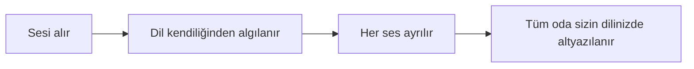
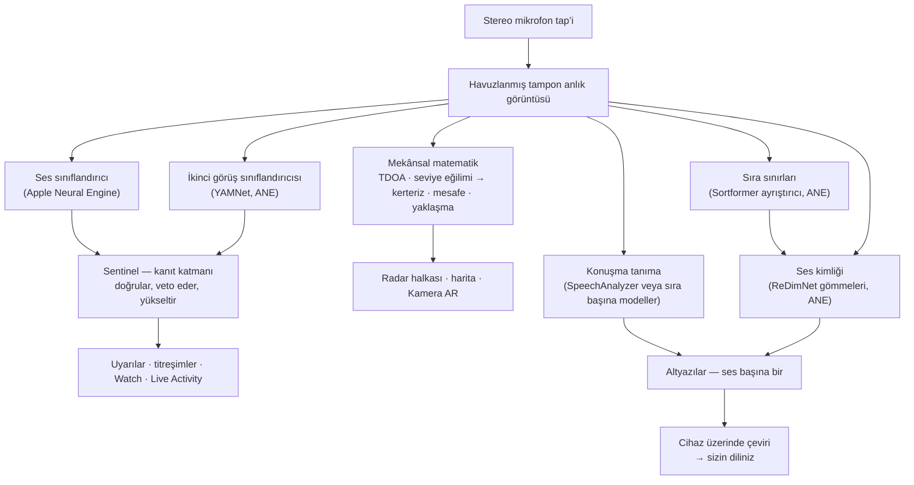
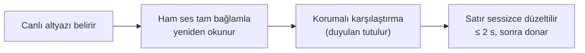
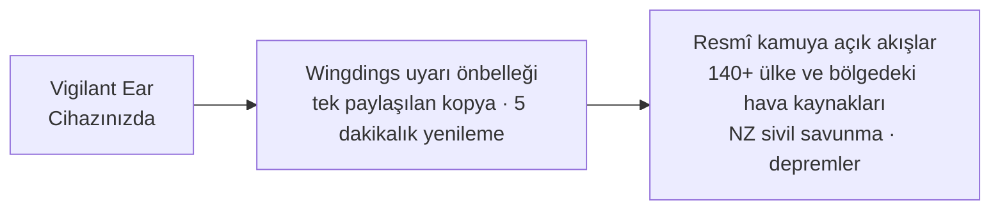

# Vigilant Ear 👂🛡️

*1.1.14 sürümü itibarıyla geçerlidir · Ekim 2026.*

## Duyamayanlar için bir akustik radar.

Sağır, az işiten ve CODA topluluğu için özel olarak yapılmış bir uygulama. Çoğu ses tanıma uygulaması size bir sesin *ne* olduğunu söyler. **Vigilant Ear sesin nerede olduğunu, kimin çıkardığını ve ne söylediklerini söyler** — bir iPhone’u, çevrenizdeki sesi olurken betimleyen bir cihaza dönüştürür.

Bir sirenin yönü ve mesafesi. Arkanızdaki bir tıklatma. Bir konuşmadaki insanlar, ayrı ayrı yazıya dökülmüş sesler olarak çizilir — her biri altyazılı ve yönüyle yerleştirilmiş. Biri sizin okumadığınız bir dil konuşuyorsa sözleri **sizin dilinize çevrilmiş** olarak gelebilir. Uyarılar **Kilit Ekranı, Dynamic Island ve Apple Watch**’unuza ulaşır; bir bakış yeter.

Önemli olan her şey cihazda çalışır. Ses, tanıma için kaydedilmez veya yüklenmez. Hiçbir şey bir insan kulağının bir şey duymasına bağlı değildir.

- 🧭 **Yalnızca algılama değil, yön.** *Ne, nerede, kim* ve *ne söylendi* — yalnızca “bir ses oldu” değil.
- 📣 **İsim Çağrıldı.** Adınızı, bir çocuğun veya bir eşin adını listeleyin — “Marie’nin siparişi hazır” telefonu ve saati uyarır ve hangi yönü gösterir.
- 🔒 **Tasarımı gereği mahrem.** Sınıflandırma, altyazılama ve çeviri iPhone’unuzda çalışır. Altyazılar canlıdır ve geçicidir; bir döküm arşivi olarak kaydedilmez.
- ⌚ **Bileğinizde ve Kilit Ekranı’nda.** Apple Watch yön yoldaşı + Live Activity, son uyarıyı ve hangi yönden geldiğini bir bakış uzağında tutar.
- 🛰️ **Daha fazla telefon, tek bir ortak işitme.** Constellation ağımız, Ultra-Wideband’li iPhone’ları birbirine bağlar ve her birinin duyduğunu daha keskin bir yön resminde birleştirir.
- 👁️ **Sağır / az işiten / CODA için yapıldı.** Ayırt edici titreşimler, yüksek kontrastlı görseller, renkten bağımsız ipuçları, büyük dokunma hedefleri ve baştan sona Hareketi Azalt.

---

## Kimler için

- Sesin durumsal farkındalığını isteyen **Sağır, az işiten ve CODA kullanıcıları** — açık bırakıp güvenebileceğiniz Home Watch (tıklatma, alarm, bebek, telefon) ve Street Watch (siren, yaklaşma).
- Yakında oturan kişiler için **yönlü ve konuşmacı ayrımı olan canlı altyazılara** ya da **cihaz üzerinde çeviriye** ihtiyaç duyan herkes.
- Cihaz üzerinde ses konumlandırmasıyla ilgilenen erişilebilirlik ve akustik araştırma kullanıcıları.

> Vigilant Ear bir erişilebilirlik **yardımcısıdır**, onaylı bir can güvenliği cihazı değildir.

---

## Ne yapar

### 🧭 Sesi görür — yön ve mesafe
iPhone’un iki mikrofonunu kullanarak Vigilant Ear, **bir sesin açısını ve önünüzde mi arkanızda mı olduğunu** ölçer, bu okumayı yaklaşık bir dereceye kadar sabit tutar ve onu, yönü yukarı bakan bir radar halkası ile harita üzerinde canlı bir işaret olarak yerleştirir. Aynı çizgi üzerindeki iki mikrofon, solu sağı kendi başına ayırt edemez. Sağınızda 50°’deki bir ses ile solunuzda 50°’deki bir ses aynı minik zaman aralığıyla gelir. Uygulama okumayı ve **öteki tarafta daha silik bir hayalet iz** çizer; bileği çevirmek ya da ikinci bir telefon bunu netleştirir. Mesafe, sokağa göre kalibre edilmiş bir eğri karşısında ses yüksekliğinden kestirilir ve olduğu kestirim olarak, olası bir aralıkla gösterilir; birim, uygulamayı okuduğunuz dil değil, bulunduğunuz ülkedir. Bir ABD telefonunda bu *≈ 50 ft* okunur. Siz hareket ettikçe işaretler gerçek dünyadaki yerlerini korur. Çekirdek budur: duyamadığınız bir dünyanın mekânsal farkındalığı. (Sayılar aşağıda.)

### 🚨 Önemli sesleri tanır — ve sizi uyarır
Cihaz üzerindeki bir sınıflandırıcı yüzlerce gündelik sesi tanır ve kritik kategorileri izler — **sirenler, alarmlar — buna ayrı bir araç alarmı sınıfı da dahildir — kapı zilleri/tıklatmalar, bebek ağlaması, yakındaki bir kişi ve şiddetli hava.** Biri tetiklendiğinde, uygulama arka plandayken veya telefon uykudayken bile net bir ekran uyarısı, isteğe bağlı **anlık bildirim** ve ayırt edici bir **titreşim** alırsınız. Kritik kategoriler hazır gelir; bildirimleri açmak “her şey kapalı” demek değildir. Tüm uyarı kategorilerini kapatırsanız motor, pil tasarrufu için arka plandayken tamamen uykuya yatar. Bir **Sentinel** katmanı uyarıları bağımsız kanıtlarla — yön, hareket ve kamuya açık akışlar — çapraz denetler; böylece tetiklenen şey doğrulanmıştır, tek başına bir sınıflandırıcı tahmini değildir. Bu iki yönde de işler: bir şarkının içindeki siren biçimli bir an tutulur, ama müziğinizin arasından yinelenen gerçek bir siren geçer ve uyarır.

Şiddetli hava uyarıları, **140’tan fazla ülke ve bölgedeki resmî devlet kaynaklarından** gelir; yenileri sık sık eklenir — tüm kullanıcılar için ücretsiz. Sivil savunma acil durum uyarıları da dahildir ve kendi **Acil Durum Uyarıları** anahtarları vardır. Akışlar, bulunduğunuz yeri kapsayanlarla sınırlanır. Mümkün olan yerlerde uygulama, ulusal meteoroloji kurumlarının **ön bültenlerini** de okur — tehlike vardıktan sonra yayımlanan uyarılardan ibaret değil, bir tayfun veya şiddetli yağmurdan günler önce çıkan sade dilli duyurular — ayrıca ani sağanak ve heyelan bültenleri. Ön duyurular sessizce gösterilir; gerçek bir uyarıya ayrılmış ses ve titreşim olmadan.

### 🌧️ Haritada hava radarı
Yağmur ve kar, uygulama açıldığı andan itibaren haritada görünür — Amerika Birleşik Devletleri, Kanada, Japonya, İtalya ve Avrupa’nın büyük bölümünün ulusal radarlarından ve dünyanın geri kalanının çoğunda bir uydu yağmur kestiriminden. Haritaya dokunun; son bir saat üç kez geri oynatılır, böylece bir fırtınanın hangi yöne gittiğini görürsünüz. Alttaki ölçek Hafif’ten Yoğun’a okunur. Bir oturum için istemezseniz kapatmak üzere hava düğmesine dokunun. Radar, uyarıların geldiği yoldan gelir — kendi sunucumuz üzerinden; böylece telefonunuz devlet sunucularıyla hiç iletişim kurmaz. Açık gri oklar da, NOAA’nın içinde bulunulan saate ait küresel tahmininden, dünyanın her yerinde rüzgârın hangi yöne estiğini gösterir.

### 🛟 Kimi aramalı — can simidi
Haritanın pusulasının yanındaki bir can simidi, içinde bulunduğunuz ülke için kısa bir liste açar:

- acil durum numarası; arama ve mesaj düğmeleriyle birlikte, bir acil durum numarasına mesajın işlemeyebileceği yerlerde Gerçek Zamanlı Metin üzerine bir not
- ulusal meteoroloji kurumu
- kararlı bir sayfası olan bir Sağır kuruluşu
- Vigilant Ear destek

Vigilant Ear'ı yardım panelinden (can simidi) paylaşın: yanınızdaki birinin uygulamayı edinmek için tarayabileceği bir kod, App Store bağlantısı ve Instagram hesabımız.

### ⌚ Apple Watch + Live Activity — bir bakışta bilin
- **Apple Watch yoldaşı** — bir uyarının yönü bileğinizde işaret eder; bir bakış nereye bakacağınızı söyler. Yeniden tasarlanmış Watch arayüzü: uygulamanın kulak simgesi, tehdit HUD yerleşimi ve bir uyarıyı kapatmak için çift dokunuş. Watch uygulaması açık değilken uyarılar yön okunu yine gösterebilir.
- **Apple Watch'ta İsim Çağrıldı.** Biri adınızı söylediğinde saatiniz bileğinize üç kez dokunur ve sese doğru bir ok gösterir. iPhone sağı soldan ayırt edemediğinde, bir yelpaze iki tarafı da gösterir. iPhone'unuz kilitliyken de, Vigilant Ear uygulaması saatte açık olduğu sürece çalışır. İsim Çağrıldı için Konuşmacı Modu'nun açık olması gerekir.
- **Ritmi Apple Watch'ta hissedin.** Müzik çalarken ve Vigilant Ear uygulaması saatinizde açıkken bas davul ve trampet halkalar halinde atar, her ölçünün 1. vuruşu işaretlenir ve her 1. vuruşta bileğinize hafifçe dokunulur. Müzik durana kadar dokunuşu kapatmak için saat ekranında herhangi bir yere çift dokunun. Uyarılar her zaman önce gelir. Müzik Tanıma şarkıyı bulduğunda adı saatinizde de görünür.
- **Live Activity** — Vigilant Ear **Kilit Ekranı**’nızda, **Dynamic Island**’da ve **Watch Smart Stack**’te durur; böylece son uyarı ve kerterizi her zaman bir bakış uzağınızdadır.
- **Bileğinizde eş uyarıları** — bağlı bir Constellation eşinin telefonu bir uyarı yükselttiğinde, yönüyle birlikte sizin Watch’unuza da ulaşabilir. Yoldaş, bir gün boyunca Watch pilinin çok azını kullanır.

### 💬 Konuşmacı Modu — canlı, yönlü altyazılar *(ücretsiz)*
**Konuşmacı Modu**’nu açın; Vigilant Ear yakınınızda konuşan kişileri **ses başına bir altyazı bloğu** olacak şekilde yazıya döker. Cihaz üzerindeki konuşmacı ayrıştırma sesleri ayrı tutar — *kimin* *ne* söylediğini — iç halkada bir yön ipucuyla. Canlı konuşmacı vurgulanır; yer gerektiğinde eski metin kayarak uzaklaşır.

**Her konuşmacı kendi dilinde.** En az 8 GB belleği olan iPhone’larda, bir kez yapılan altyazı modeli indirmesi (yaklaşık 1 GB — Wi-Fi üzerinden ya da size sorduktan sonra hücresel üzerinden) uygulamanın her sırayı gerçekten konuşulan dilde altyazılamasını sağlar; böylece İngilizce, İspanyolca, Fransızca ve Arapça arasında geçen bir oda anlaşılır olur. Testlerimizde dört dilli bir konuşmadaki sözcük hataları yaklaşık %80’den %14’e düştü. 1.1.12 sürümünden beri geliştirilmiş bir konuşma modeli gürültüde çok daha az hata yapar — iPhone 17’de gürültülü bir barda Almanca altyazılar, sözcüklerin %45’i yanlışken %20’ye indi — ve eskisinin yerini Wi-Fi üzerinden kendiliğinden alır. İndirme olmadan — ve Apple’ın tanıyıcısının daha iyi okuduğu Çince, Japonca ve Korece okuyucuları için — altyazılar eskisi gibi Apple’ın cihaz üzerindeki konuşma tanımasını kullanır.

Çoğu altyazı uygulamasının yapmayacağı iki şey.

**Güven konusunda dürüstlük.** Satır başına ince bir kalite işareti ve kuşkulu sözcüklerin altındaki noktalı çizgiler, bir satıra ne zaman güveneceğinizi ve ne zaman bir daha bakacağınızı söyler.

**Kendini düzeltme.** Bir cümle yerleşir yerleşmez uygulama sesi tam bağlamıyla yeniden okur ve kaçırılan ya da yanlış duyulan bir sözcüğü birkaç saniye içinde geri getirebilir; sonra metin donar.

**İsim Çağrıldı** (Ayarlar, siz açana kadar kapalı) listelediğiniz adlar için bu altyazıları izler — sizinki, bir çocuğunki, bir eşinki. Biri “Marie’nin siparişi hazır” dediğinde, başka bir altyazı balonu değil, yönlü ayırt edici bir titreşim ve Watch uyarısı alırsınız. Sözcükler Konuşmacı Modu’nda yine konuşma olarak görünür; bu, *size* konuştuklarını bildiren dokunuştur.

**Ağır dil maskelenebilir** (Ayarlar → Altyazılar). Aksi halde küfür, yumuşatacak hiçbir şey olmadan düz metin olarak gelir ve okuyanın önce bakışını çevirme şansı olmaz; bunu açın, o sözcükler simgelerle değiştirilir, böylece cümle sözcük olmadan da okunur. Ne sayılacağına sizin cihazınızın kendi konuşma tanıyıcısı karar verir — bizim bir sözcük listemiz değil — bu yüzden yazıya dökülen dili izler. 18 yaşından küçük olarak beyan edilmiş bir hesapta her zaman açıktır ve bir kilit gösterir. *Bu* cihazın yazıya döktüğü konuşmaya uygulanır; eşleştirilmiş bir telefondan aktarılan metin orada yazıya dökülmüştür ve bitmiş metin olarak gelir.

**Bir konuşmacının üzerine yüklendiği sözcük kalın işaretlenir.** İngilizce yüksek sesle söylendiğinde "I didn't say THAT" ile "I didn't say that" iki farklı cümledir ve özdeş bir döküm bu farkı tümüyle kaybeder. Uygulama, konuşmacının sesinin perdesini yükselttiği tek sözcüğü izler ve onu kalın yapar — satır başına en fazla bir tane, emin değilse hiç; çünkü yanlış sözcüğü işaretlemek, kişinin söylemediği bir şeyi söylediğini iddia ederdi. Çince ve Japoncada kapalıdır; orada perde, ne kadar bastırıldığını değil *hangi sözcük olduğunu* söyler.

Altyazılar ücretsizdir; otomatik çeviri isteğe bağlı Power Pack+ katmanıdır. Altyazılar ayrıca **bir işitme cihazı dahil bir Bluetooth cihazına sesli okunabilir** — ücretsiz, Ayarlar’da. **Yön Tonları** (o da ücretsiz, Ayarlar → Altyazılar) seçtiğiniz kulakta konuşmacının nerede olduğunu bildiren isteğe bağlı bir ses ipucu ekler — bir işitme cihazıyla veya tek taraflı işitmeyle yararlıdır ve herkese açıktır.

### 🌐 Otomatik çeviri — kendi diliniz, canlı *(Power Pack+)*
Konuşmacı Modu açıkken, yakındaki biri başka bir dil konuştuğunda Vigilant Ear bunu algılayabilir ve altyazılarını, bloklarında kaynak dil görünerek **sizin dilinizde** sunar. Zincir — duy → konuşmacıları ayır → yazıya dök → çevir → göster — **cihaz üzerinde** çalışır; tek ağ anı, Apple’dan bir kez yapılan dil paketi indirmesidir ve beklediğiniz şey o indirmeyse uygulama, sizi çevrilmemiş metne bakarken bırakmak yerine bunu söyler. Önce öteki dili bilmeniz veya seçmeniz gerekmez. Bitmiş bir cümle, konuşmacının durması beklenmeden biter bitmez çevrilir ve çeviriler sürenin çok küçük bir bölümünde gelir.

Bu, **bilimkurgunun evrensel çevirmenine** — yalnızca anlayan bir cihaza — bugün var olan en yakın şeydir. Vigilant Ear dili kendisi algılar, odadaki her konuşmacıyı izler ve hepsini sizin dilinizde altyazılar — kulak içi kulaklık yok, kurulum yok, cihazınızda.

### 🎵 Müzik ve yayın farkındalığı *(Power Pack+)*
**ShazamKit**, çevrenizde çalan müziği tanır ve şarkı değişikliklerini kendiliğinden algılar; böylece başlık güncel kalır.

### 🎛️ Akustik Kapsam — sesi bir mühendis gibi görün
Çevrenizdeki sesin profesyonel canlı görünümü: spektrum, spektrogram, ⅓ oktav RTA bantları, kroma ve harmonik kısmi tonlar — **herkes için ücretsiz**. **Partials müziği okur:** her ton notasıyla adlandırılır, yanında harmonik dizisi durur; duman alarmları gibi daha tiz sesler gerçek perdeleriyle adlandırılır ve şarkı söylemek ya da akort etmek için bir çizgi olarak çizilen bir hedef nota belirleyebilirsiniz. Spektrogramı açık bırakmak, ne kadar uzun izlerseniz izleyin, neredeyse hiçbir şeye mal olmaz. Kendi özel ses paketlerinizi eğitmek için ses yakalayan araçlar Power Pack+ kapsamındadır.

### 📦 Özel Ses Paketleri — ona kendi dünyanızı öğretin *(Power Pack+)*
Vigilant Ear’a sizin için önemli sesleri öğretebilirsiniz — yerel kuşlar, bir binanın kapı zili, bir jeneratörün olağandışı uğultusu veya kalkış yapan bir uçak türü. Bu eklenti paketler yerleşik algılamanın üzerine eklenir; böylece yeni sesler sirenlerin ve alarmların yerini asla kapmaz. Adım adım bir kılavuz uygulamanın içindedir.

### 🛰️ Constellation — birçok iPhone, tek bir ortak işitme *(Power Pack+)*
İki veya daha fazla Ultra-Wideband’li iPhone ile (iPhone 11’den beri çoğu), **Constellation** ağı onları eşleştirir; birbirlerinin konumunu algılayabilir ve her birinin duyduğunu, sesin nereden geldiğine dair tek ve daha kesin bir resimde birleştirebilirler — dağıtık, edilgen bir dinleme dizisi. Altyazılar da birleşir: her telefon kendi mikrofonunun duyduğunu yazıya döker ve sözcükler telefonlar arasında hizalanır; böylece bir konuşmacıya en yakın olan, duyduğunu katar — yalnızca bir telefonun yakaladığı sözcükler kaybolmak yerine tutulur.

Telefonlar **doğrudan birbirine** bağlanır — yönlendirici yok, paylaşılan Wi-Fi ağı yok ve internet yok; Wi-Fi’nin yalnızca açık olması yeter. AirDrop’un kullandığı eşler arası bağlantının aynısını kullanırlar ve yalnızca doğru donanıma sahip telefonlar katılabilir. Telefonlar arasındaki bağlantı her zaman şifrelidir; Vigilant Ear 1.1.6 veya daha eskisini çalıştıran telefonların ağa katılmak için uygulamayı güncellemesi gerekir.

**Eş iletileri** — bir ağ eşinin telefonuna kısa bir metin gönderin; onların altyazı akışına düşer ve cihaz üzerinde kendi dillerine çevrilmiş olarak gelebilir. İletileşme yaşa duyarlıdır: Apple’ın Beyan Edilen Yaş Aralığı üzerine kuruludur; bir yetişkin ile reşit olmayan arasındaki mesajlaşma, her iki kişi de birbirini bilerek adlandırmadıkça kapalı kalır. Uyarılar ve altyazılar hiçbir zaman kısıtlanmaz — kısıtlanan yalnızca kişiden kişiye mesajlaşmadır.

### 🔗 Remote Link — yanınızda olmayan birine ulaşın *(başlamak için Power Pack+)*
Bir telefon görüşmesinin normalde yaptığı iş, bunun yerine görüntü ve metinle yapılır. Bir davet kodu gönderirsiniz; karşı taraf Vigilant Ear’ın içinden, **Power Pack+ sahibi olmadan** katılır. Constellation’dan farklı olarak yakınlık şartı yoktur — ikiniz herhangi bir yerde olabilirsiniz.

**Hiçbir noktada ses kullanılmaz.** Yalnızca görüntü ve metin; böylece bağlantıyla ilgili hiçbir şey iki uçta da işitmeye bağlı değildir — ve uygulama üzerinden biriyle işaret diliyle görüşmenin bir yolunu verir. Uygulamanın kendisi işaret dilini anlamaz; görüntüyü taşır, gerisini ikiniz yaparsınız. Bağlantı, ağın izin verdiği her yerde iki telefon arasında doğrudandır ve uygulama bunun **Doğrudan** mı **Aktarılmış** mı olduğunu açıkça gösterir; böylece görüntünüzün bir aktarıcıdan geçip geçmediğini her zaman bilirsiniz.

**Altyazılar da gider.** Her telefonun yazıya döktüğü, gerektiğinde okuyanın diline çevrilerek diğerinde görünür. İkinizden biri bağlantıyı — görüntüyü ve altyazıları — duraklatıp sürdürebilir ve ana ekrandan kapatabilir.

### 📷 Kamera AR — “sesi görün”
Eylem Yelpazesi’nden Kamera AR’ı açın ve algılanan sesleri canlı kamera görünümünde gerçek kerterizlerine sabitleyin. İşaretler konuşmacıya ya da ses kategorisine ve yöne göre kümelenir; böylece görünüm okunur kalır ve bir ses sessiz kaldıkça solar.

### 🗺️ Haritalar, yollar ve yol tahmini
Ses kerterizleri haritada gerçek GPS koordinatlarına izdüşürülür. Araç sesleri **yakındaki sokaklara oturtulabilir** ve yolları tahmin edilir; böylece geçen bir kamyon, binaların içinden değil *yol boyunca* ilerliyor olarak okunur. (Özellik Deneme Alanı’ndaki itfaiye aracı demosunu deneyin.)

### 🪄 Özellik Deneme Alanı — duymadan kanıtlayın
**Özellik Deneme Alanı** herkese açıktır: Home ve Street örnek uyarıları (tıklatma, alarm, bebek, siren, hava), çok telefonlu ve konuşma demoları. Bunların belirgin bir filigranı vardır; böylece alıştırma hiçbir zaman canlı bir olaymış gibi görünmez. Paneli kapatmak demoları temizce söker (takılı kalmış bir GPS sahteciliği yok, artakalan bayrak yok).

### ♿ Önce erişilebilirlik
Sağır / az işiten / CODA ve renk körü kullanıcılar için yapıldı:

- **renkten bağımsız** ipuçları
- **≥44 pt** dokunma hedefleri
- **Hareketi Azalt**’a uyum
- Arapça okuyanlar için **sağdan sola yerleşimler**
- çok kipli uyarılar (titreşim + görsel + Watch)
- izin durumunu net yeşil / gri / kırmızı, “izin verilmedi” içinse yanık turuncu gösteren bir açılış doğrulama ekranı; buna, ana uyarı anahtarı işlevi gören bildirim izni de dahildir

---

## Ücretsiz ve Power Pack+

Güvenlik çekirdeği **sonsuza dek ücretsizdir**:

- **Home Watch ve Street Watch** — yerel ses uyarıları (alarmlar, sirenler, tıklatmalar/kapı zilleri, bebek, yakındaki kişi); ekranda, titreşimle ve isteğe bağlı anlık bildirimle.
- **Canlı altyazılar** — Konuşmacı Modu, cihaz üzerinde, donanımın izin verdiği yerde yönlü; dürüst güven işaretleri, yaklaşık 2 saniyelik kendini düzeltme, bir Bluetooth cihazına (işitme cihazı dahil) isteğe bağlı sesli çıktı ve Yön Tonları.
- **İsim Çağrıldı** — yazdığınız isteğe bağlı adlar (sizinki, çocuklar, eş). Bir eşleşme, ikinci bir altyazı değil, kerterizli bir Watch/telefon uyarısıdır.
- **Sürekli Nöbet** — odanın kendi durumu, yapılandırılacak bir şey olmadan her zaman açık: oda örüntüsünü korurken sabit bir camgöbeği lamba, bir şey değişince amber — yeni bir ses, ani sessizlik veya yaklaşan bir şey. Uygulama başlarken, uyarıları ne kadar süre dinlemediğini size söyler.
- **Şiddetli hava uyarıları** — bölgeniz için, 140’tan fazla ülke ve bölgedeki devlet kaynaklarından resmî uyarılar; yenileri sık sık eklenir.
- **Hava radarı** — haritada yağmur ve kar, son bir saatin yeniden oynatımı ve rüzgârın hangi yöne estiği.
- **Can simidi** — bulunduğunuz ülkede kimi arayacağınız.
- **Deprem uyarıları (dünya çapında)** — yakında bir deprem bildirildiğinde bir titreşim hissedersiniz ve onu hisseden bölgeyi haritanızda görürsünüz. Resmî deprem akışından bir doğrulama — erken uyarı değil: sarsıntı hissettiyseniz, bunun ne olduğunu söyler. Akış her beş dakikada bir, arka planda da denetlenir ve cihaz üzerindeki derin gürültü (sesaltı) algılaması, yer hareket ettiği anda ek bir denetimi hazırlayabilir.
- **Özellik Deneme Alanı** — belirgin bir PREVIEW filigranıyla alıştırma uyarıları ve özellik önizlemeleri.
- **Apple Watch yoldaşı ve Live Activity** — bakışta görülen yön ve son uyarı.
- **Akustik Kapsam** — profesyonel düzeyde canlı ses görselleştirmesi, herkes için ücretsiz. (Eğitim için yakalama araçları Power Pack+’tır.)
- **Araştırma Dizisi** *(siz kapatana kadar açık)* — açıkken, deprem benzeri olayların zamanı, kabaca bir konumu (yaklaşık 1 km) ve frekansı paylaşılır — ses yok, tanımlayıcı yok — depremleri ve diğer düşük frekanslı olayları haritalamaya yardımcı olmak için. Haritadaki bir soru bir kez sorulur. Raporlar, o soru ekranda görünene kadar bekler.

**Power Pack+** tek seferlik bir kilit açmadır (**abonelik değildir**) ve **90 günlük ücretsiz deneme** sunar. Süper güçleri ekler:

- **Otomatik çeviri** — yakındaki konuşmanın cihaz üzerinde sizin dilinize çevrilmesi.
- **Constellation** — Ultra-Wideband üzerinden çoklu iPhone ile paylaşılan işitme, eş iletileriyle.
- **Müzik Tanıma** — ShazamKit şarkı tanıma.
- **Özel Ses Paketleri** — kendi sesleriniz için eğittiğiniz eklenti sınıflandırıcılar.
- **Remote Link** — yanınızda olmayan biriyle, hiçbir noktada ses olmadan özel görüntü ve metin görüşmeleri. Birini başlatmak Power Pack+ gerektirir; davet ettiğiniz kişi ücretsiz katılır.

Ücretsiz veya Power Pack+, **tanıma için sesiniz cihazda kalır** — katman yalnızca hangi özelliklerin açıldığını değiştirir, ham sesin çözümleme için nereye gönderildiğini asla.

---

## Nasıl çalışır (kaputun altında)

Vigilant Ear katmanlar halinde kurulmuş, **önce yerel, cihaz üzerinde** bir işlem hattıdır: bir kez yakala, sonra bağımsız uzmanlar aynı sesi okusun ve birbirlerinin işini denetlesin. Ham ses yüksek öncelikli bir tap’te yakalanır, bir **havuzlanmış tampon serbest listesine** kopyalanır (gerçek zamanlı yolda bellek ayırma çırpınması yok) ve arayüzü duraksatmadan dağıtılır:

Hiçbir modele tek başına güvenilmez. **Sentinel** katmanı algılama ile uyarma arasında durur: bağımsız motorlar kare kare birbirini doğrular veya veto eder — ve yinelenen gerçek dünya kanıtı bir vetoya karşı biriktiğinde (müziğinizin arasından öten gerçek bir siren), kanıt kazanır ve uyarı tetiklenir.

Altyazılar kendi ikinci şanslarını alır. Kesinleşen her cümle, kısa bir bellek içi ses halkasından tam bağlamla sessizce yeniden okunur — düzeltmeler yaklaşık iki saniye içinde yerleşir, sonra metin kalıcı olarak donar:

- **Mekânsal matematik** — FFT’ler, tutarlılık ağırlıklı varış zaman farkı (TDOA — her iki mikrofonun uyuştuğu frekans bantları kayırılır, sonra minik varış gecikmesi bir kerterize çevrilir) ve arka plan görevlerinde seviye eğilimiyle yaklaşma izleme. Mikrofon çifti sabit bir yönde okunur; böylece telefonu dik ya da yan tutmanız yönün aynı çalışmasını sağlar.
- **Konuşma** — yazıya dökme için iOS 26 `SpeechAnalyzer` / `SpeechTranscriber`; cihaz üzerinde çeviri için Apple’ın **Translation** çerçevesi. İsteğe bağlı altyazı indirmesiyle her sıra bir ses etkinliği algılayıcısıyla kesilir, dili bir konuşma dili modeliyle seçilir ve açık konuşma tanıma modelleriyle yazıya dökülür — biri Avrupa dilleri için, biri geri kalanı için — hepsi cihazda. Ses kimliği kanıta dayalıdır: bir ses yalnızca bağımsız ses pencerelerinden gerçek bir kişi olarak doğrulanır ve belirsiz bir eşleşme, yanlış adı tahmin etmek yerine atıfsız gösterilir.
- **İki soru için iki model** — sesleri ayırmak, *konuşmacının ne zaman değiştiğini* ve *o konuşmacının kim olduğunu* gerektirir ve bunlar aynı problem değildir. Bir **Sortformer** akış ayrıştırıcısı sıra sınırlarını işaretler; **ReDimNet** gömmeleri her birinin içinde kimin sesinin durduğuna karar verir. Sınırdan kesmek, kulağa geldiğinden daha önemlidir: iki kişiye binen bir pencere ikisini de içerir ve hiçbir gömme modeli bunu sonradan geri alamaz. İkisinin altında bir ses etkinliği tabanı vardır — ayrıştırıcı zor bir odada tahmin etmek yerine susarsa sıralar yine kesilir; böylece uygulama iki konuşmacıyı tek birinde harmanlamak yerine niteliğini düşürür.
- **Müziğin doğruluğu** — bir kroma **şarkı imzası algılayıcısı**, “gerçekten müzik mi çalıyor?” kararına sahiptir; çünkü genel sınıflandırıcılar sessiz odaları ve sirenleri meşhur biçimde “müzik” diye adlandırır. Shazam, imza gerçekten müzikal bir şeyin orada olduğuna katıldıktan sonra çalışır.
- **Eşzamanlılık** — Swift 6 yalıtımı mikrofon tap’ini, akustik matematiği ve arayüz çizim döngüsünü temiz biçimde ayrı tutar.
- **Verim** — örnek seyreltme, yüke uyarlanan sınıflandırma ve kanıta bağlı ağ kullanımı, sürekli dinlemeyi açık bırakılacak kadar hafif tutar.

Hava ve deprem uyarıları sesten ters yolu izler — sesinizle ilgili hiçbir şey dışarı çıkmaz, ama uyarı *verisi* içeri gelir. **Her** resmî akış — radar ve rüzgâr görüntüleri de — işlettiğimiz küçük bir aktarım önbelleğinden geçer; böylece kamuya açık verinin bir kez alınması her kullanıcıya yeter ve telefonunuz devlet sunucularıyla hiç iletişim kurmaz:

---

## Telefonunuzun duyabildikleri — ölçülmüş

iPhone’unuzun yaklaşık altı inç (15 cm) aralıklı iki mikrofonu, bir barometresi ve çok iyi bir saati vardır. Bu, bir sesin hangi yönden geldiğini, kabaca ne kadar uzakta olduğunu, size doğru gelip gelmediğini ve bir kapının az önce açılıp açılmadığını söylemeye yeter. İşte bunların her birinin ne kadar doğru olduğu, nasıl denetlediğimiz ve sesi kendiniz duyamıyorsanız neden önemli olduğu. Yön tablosu Eylül 2026’da bir iPhone 17’de ölçüldü. Aynı masa denetimi bir iPhone 16 Pro Max’te sürekli bir açı vermedi — o görüntü bir sesi öne ya da yana doğru yapıştırır — bu yüzden derece satırları yalnızca 17’ye aittir. Mesafe doğası gereği bir kestirim olarak kalır — bunu ekranda da söyleriz. Bu bölümde şerit metreyle ölçülen mesafeler feet cinsindendir; bu, o şeridin birimidir.

**Yön — bir iki dereceye kadar.** Bir ses üst mikrofona alttakinden önce ya da sonra ulaşır ve uygulama bu aralıktan sesin telefonun ekseninden ne kadar saptığını ve önde mi arkada mı olduğunu çıkarır. Telefonun iki kanalı düz mikrofonlar değil, işlenmiş bir stereo görüntüdür ve bu görüntü, oda gürültülüyken kendine ait sabit bir örüntü ekler. Uygulama bu örüntüyü açılıştan sonraki sessizlikten öğrenir. Sessiz bir odanın yaklaşık bir dakikasından sonra, yönü okumadan önce örüntüyü çıkarır; o ana kadar okuma bu düzeltme olmadan sürer.

| Ölçtüğümüz şey | Sonuç |
|---|---|
| 96 simüle odada ortanca hata, sessiz ofisten 5 dB SNR’de sert duvarlı odaya | 1.0° |
| Masada iPhone 17, oda gürültüsü açık, hoparlör eksenden 30° açıkta | yan düzlemden 61.7° okudu, beklenen 60°; salınım 1.6° |
| Aynı, hoparlör telefonun tam yanından | 4.5° okudu, beklenen 0°; salınım 2.2° |
| Aynı, hoparlör eksenden 60° açıkta | ortanca 35.7°, beklenen 30°; ölçüm ikiye ayrıldı, ikinci küme dümdüz ilerinin gecikmesinde, büyük olasılıkla düzeneğin yansıması |
| Aynı, hoparlör dümdüz ileride | her okuma, olması gerektiği gibi en büyük gecikmede |
| Ses yerine görüntünün kendi örüntüsüne oturan okumalar | hiçbiri, hiçbir açıda |

*Neden önemli:* bir sireni duyamıyorsanız “arkanızda, bir yana kayık” nereye bakacağınızı söyler. Yerinde duran bir okumaya ancak bir şerit metreyle denetlendikten sonra güvenilir ve bu okuma iki kez denetlendi. İlk denetim, sonucu olduğundan daha iyi gösterdi.

**Mesafe — olduğu kestirim olarak gösterilir.** Bir mikrofon mesafe ölçemez, yalnızca ses yüksekliğini; uzaktaki gürültülü bir kamyon, yakındaki sessiz bir araba gibi gelebilir. Uygulama mesafeyi, gerçek bir sokakta uydurulmuş bir eğriyle ses yüksekliğinden kestirir, sonra bunu dikkatli birinin söyleyeceği gibi söyler. Bir ABD telefonunda bu *yaklaşık 50 ft, büyük olasılıkla 25 ile 100 arasında* olur.

| Ölçtüğümüz şey | Sonuç |
|---|---|
| Kalibrasyondan yeniden oynatılan gerçek araba algılamaları | 1,131 |
| Gerçekte üzerinde oldukları 100-foot yola düşenler | 73% |
| Uzak şerit arabaları | kestirim 78 ve 87 ft, şeridin dediği 73 ve 85 ft |

Yol (bir kent kavşağı) şerit şerit ölçüldü; eğri yanıldığında yakın tarafa yanılır. Kalibrasyon otomatik bir testle kilitlenir, böylece sessizce kayamaz. Duman dedektörü gibi kendi mekânınızdaki alarmlara hiç mesafe rakamı verilmez — zaten sizinle aynı odadadırlar.

**Hareket — size doğru gelmek.** Arabalar ve sirenler için sesin yükselmesi genellikle yaklaşmak demektir. Uygulama, bir sesin seviyesinin birkaç saniye içinde ne hızla yükseldiğini izler: saniyede yaklaşık 1.5 dB’lik sürekli bir tırmanış (ses yüksekliğinde açık, kararlı bir artış) yaklaşmak demektir, buna uyan bir düşüş uzaklaşmak demektir ve değişmeyi bırakan bir ses yaklaşık dört saniye sonra ikisinden biri olarak anılmayı bırakır. Tek bir gürültülü an — bir korna dokunuşu, bir kapı çarpması — bunu tetikleyemez. Fizik ve dokuz otomatik test üzerine kuruludur; kaydedilmiş bir sokak geçişi bir sonraki saha doğrulamasıdır.

**Odadaki hava — bir kapının imzası vardır.** Barometre, yaklaşık on dört feet (4.3 m) ötedeki bir kapının açıldığını fark edebilir: kapı savrulurken basınç düşer, kapanırken geri seker. On dört saatlik sessizlik ve on beş kapı olayında her kapı bu iki parçalı biçimi verdi ve evdeki başka hiçbir şey vermedi.

| Olay | Basınç hızı | Biçim |
|---|---|---|
| Ön kapı, açılıp kapandı, ×10 | 0.6–1.8 Pa/s | düşüş, sonra geri sekme, ~5 s arayla |
| Ön kapı, çarpıldı, ×5 | 1.1–2.5 Pa/s | aynı çift, daha yüksek |
| Gece boyunca klima döngüsü, ×8 | 0.11–0.46 Pa/s | dakikalar boyunca yavaş rampa, iki telefonda özdeş |
| Sessiz bir oda | ~0.02 Pa/s | hiçbir şey |
| İnsan etkinliği, yanından yürüme | — | hareket algılayıcı fark eder ve telefon bunu yok sayar |

Odayı sızdırmaz kılmayan bir kapı görünmezdi — bu testte bir sineklik kapı — tam olması gerektiği gibi. Bugün bir basınç değişimi haritada derin gürültüler olarak görünebilir; sessiz geceye özel bir kapı uyarısı ölçülmüş ve tasarlanmıştır ve henüz gündelik varsayılan değildir.

**Constellation — iki telefon tarafı netleştirir.** Ağdaki her telefon, durduğu yerden sese doğru bir çizgi çizer ve çizgiler yalnızca bir tarafta temiz kesişir. Kesiştiklerinde hayalet kaybolur ve uygulama solu ya da sağı **yeniden** söyleyebilir. Simülasyonda, **40 metre aralıklı** iki telefon, 50 metre ötedeki bir sireni yaklaşık 2 metreye kadar yerleştirir.

**Buradaki bir şeye nasıl inanılır.** Her sayı aynı üç kapıdan sırayla geçti: yanıtı önceden bilinen simüle bir oda; uygulamayı yanıltacak tam durumu yeniden kuran ve her değişiklikte çalışan küçük otomatik testler; sonra mesafeleri elle ölçülmüş gerçek bir masada gerçek telefonlar. Üçüncüyü atlatmadan hiçbir şey doğru sayılmaz. Sesi duyamayan biri için uygulamanın sözü tek sözdür — bir laboratuvarın kazandığı gibi kazanılmalıdır.

Mühendisler için daha derin notlar: [Fizik](https://vigilantear.com/en/physics/) — TDOA, mesafe, hareket, Constellation ve barometrik algılama; her şekil MEASURED / BENCHED / MODELLED olarak etiketlenir.

---

## Gizlilik

- **Cihaz üzerinde, çekirdek işlem hattı için her zaman.** Sınıflandırma, mekânsal matematik, yazıya dökme, ayrıştırma ve çeviri iPhone’unuzda çalışır. Ham ses, tanıma için kaydedilmez veya yüklenmez.
- **Altyazılar geçicidir.** Canlı altyazılar oturum boyunca bellekte kalır; dışa aktarılan hata ayıklama günlükleri altyazı metnini içermez.
- **Reklam veya davranışsal analitik SDK’sı yok.** Sınırlı ağ kullanımı yalnızca haritalar, kamuya açık hava akışları, radar ve rüzgâr görüntüleri, yardım listesi, isteğe bağlı altyazı modeli indirmesi, isteğe bağlı Shazam parmak izleri, yol bağlamı, bu özellik açıkken Araştırma Dizisi raporları ve App Store satın alımları içindir — ayrıntılar gizlilik politikamızdadır.

Tüm ayrıntılar: [Gizlilik](/tr/privacy/) · [Koşullar](/tr/terms/) · [Destek](/tr/support/)

---

## Donanım ve platformlar

- **iPhone (tam deneyim).** Dikey ya da yatay çalışır — nasıl isterseniz öyle tutun. Yön bulma için stereo mikrofonlar gerekir. Önerilen **iPhone 13 veya daha yenisi**; her konuşmacının dilindeki altyazılar **8 GB bellek** ister (iPhone 15 Pro ve sonrası).
- **Apple Watch.** Yön oklu yoldaş uyarıları; Live Activity / Smart Stack ile çalışır.
- **iPad (yerel).** Uyarlanan yerleşim: büyük ekranda canlı altyazılar, haritanın yanında, kimse konuşmadığında katlanan yarı saydam bir panel alır. Tek kanallı mikrofonlar → tam yön olmadan altyazılar.
- **Constellation** için **Ultra-Wideband** gerekir — SE ve “e” modelleri hariç iPhone 11 veya sonrası. Bir Wi-Fi ağına ihtiyacı **yoktur**: Wi-Fi açıkken telefonlar birbirini doğrudan bulur; böylece telefonlar birbirine yakın olduğu sürece Constellation yönlendirici ve internet olmadan çalışır.
- **Android (kullanılabilir olduğunda).** Çekirdek radar, uyarılar, altyazılar ve hava durumuyla ayrı bir yapı; Constellation ağı iOS önceliklidir.

---

## Yerelleştirme

Tam yerelleştirilmiştir — arayüz, uyarılar ve altyazılar — **İngilizce, İspanyolca, Portekizce (Brezilya), Fransızca, Almanca, İtalyanca, Türkçe, Arapça, Japonca, Basitleştirilmiş Çince, Geleneksel Çince, Korece, Rusça, Hintçe, Rumence ve Lehçe** olarak (16 dil). Sistem yerel ayarını ya da uygulamadaki elle bir seçimi izler. Rumence altyazılar cihazda çalışır; Apple Translate’te Rumence yoktur, bu yüzden Otomatik çeviri o dil için özgün metni gösterir.

---

## Durum ve sorumluluk reddi

Vigilant Ear **deneysel bir akustik erişilebilirlik yardımcısıdır**, onaylı bir can güvenliği hizmeti değildir. Konumlandırma çözünürlüğü çevreye, havaya, rüzgâra ve mikrofon donanımına göre değişir. **Her zamanki çevresel farkındalığınızı her zaman koruyun** — güvenlik bilgisinin tek kaynağı olarak ona güvenmeyin.

Bazı yetenekler (kamera AR işaretleri, Apple verdiğinde Kritik Uyarılar yetki yükseltmesi, gelişmiş çok paketli ses yazımı) gelişmeye devam eder; ücretsiz Home / Street nöbeti ve canlı altyazılar, ilk günden güvenebileceğiniz üründür.

**Kaynaklar ve Lisanslar:** [api.vigilantear.com/sources](https://api.vigilantear.com/sources)

---

**İletişim:** [vigilantear@wingdingssocial.com](mailto:vigilantear@wingdingssocial.com)

Sağır ve az işiten topluluğu ile akustik araştırma için ❤️ ile yapıldı.

    
  <strong>© 2026 Wingdings, Inc.</strong> 
  Tüm hakları saklıdır. 
  Birden fazla patent başvurusu sürmektedir

