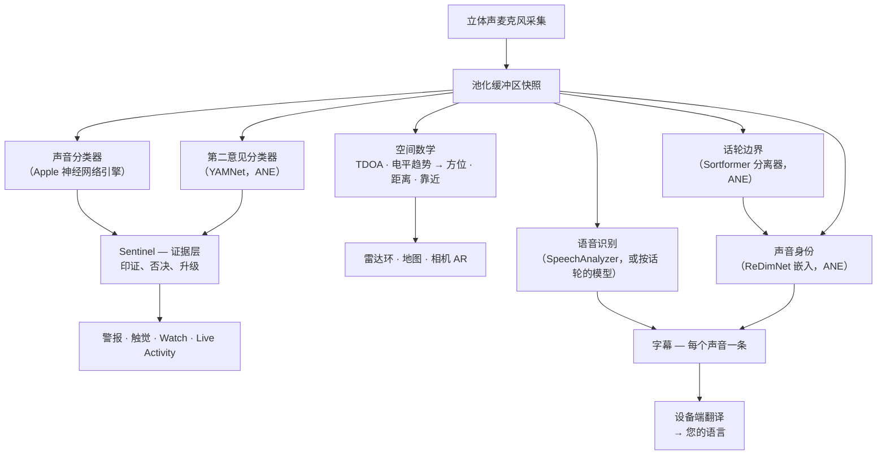
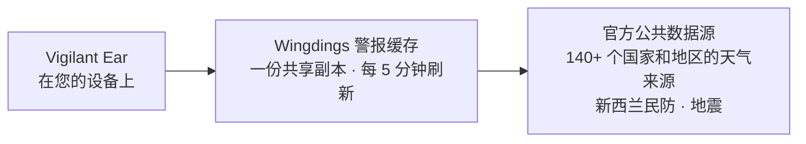

# Vigilant Ear 👂🛡️

📲 [在 App Store 下载](https://apps.apple.com/app/id6761978703)

*自版本 1.1.14 起生效 · 2026 年 10 月。*

## 给听不见的人用的声学雷达。

一款专门为聋人、重听人士以及 CODA 社群打造的应用。大多数声音识别应用只告诉您一个声音*是什么*。**Vigilant Ear 告诉您它在哪里、是谁发出的，以及对方在说什么**——把一部 iPhone 变成一台设备，在周围的声音发生的同时把它描述出来。

警笛的方向和距离。身后的敲门。谈话里的人，被画成各自独立的转写声音——每一道都有字幕，并标出方向。如果有人说的是您读不懂的语言，他们的话可以**译成您的语言**送到您面前。警报会到达您的**锁定屏幕、Dynamic Island 和 Apple Watch**，看一眼就够。

要紧的一切都在设备上完成。音频不会为了识别而被录下或上传。没有任何环节要靠一只人耳去听见什么。

- 🧭 **要的是方向，而不只是探测。** *是什么、在哪里、是谁，*以及*说了什么*——不只是「发生了一个声音」。
- 📣 **叫到名字。** 列出您的名字、孩子或伴侣——柜台一喊「Marie，餐好了」，手机会警报，手表也会警报，并指出方向。
- 🔒 **从设计上就私密。** 分类、字幕和翻译都在您的 iPhone 上运行。字幕是实时的、转瞬即逝的；不会被存成一份文字稿档案。
- ⌚ **在手腕上，也在锁定屏幕上。** Apple Watch 方向伴侣加上 Live Activity，让最近一次警报、以及它从哪边来，看一眼就知道。
- 🛰️ **更多手机，一份共享的听觉。** 我们的 Constellation 网状网络把支持 Ultra-Wideband 的 iPhone 连在一起，把每部听到的融合成一幅更清晰的方向图景。
- 👁️ **为聋人 / 重听 / CODA 而做。** 彼此不同的触觉、高对比的画面、不依赖颜色的提示、够大的点按目标，并且全程遵循减少动态效果。

---

## 它是给谁的

- **想掌握周围声音的聋人、重听人士和 CODA 用户**——Home Watch（敲门、警报、婴儿、电话）和 Street Watch（警笛、有东西靠近）可以开着，并且信得过。
- 任何需要**带方向、能分开说话人的实时字幕**，或需要把坐在附近的人**在设备上翻译**过来的人。
- 对设备端声音定位感兴趣的无障碍用户和声学研究用户。

> Vigilant Ear 是一项无障碍**辅助**，不是经认证的生命安全设备。

---

## 它做什么

### 🧭 它看见声音——方向与距离

用 iPhone 的两只麦克风，Vigilant Ear 测量**声音的角度，以及它在您前方还是后方**，把这个读数稳定在大约一度，并把它作为实时标记放在航向向上的雷达环和地图上。排在同一条直线上的两只麦克风，靠它们自己分不清左右。您右侧 50° 的声音和左侧 50° 的声音，到达时带着同样微小的时间差。应用会画出这个读数，并加上**另一侧较淡的雷达鬼影**；转一下手腕，或加上第二部手机，就能把它定下来。距离按响度来估计，对照的是一条在街道上校准过的曲线，显示时就按估计本来的样子来显示，并给出一个可能的范围；单位跟着您所在的国家走，而不是跟着您阅读这款应用时所用的语言。在一部美国的手机上，它显示为 *≈ 50 ft*。您一移动，标记就守在真实世界里的位置上。这就是核心：对一个您听不见的世界的空间觉察。（数字见下文。）

### 🚨 它识别重要的声音——并警告您

设备端的分类器能辨认数百种日常声音，并盯着那些关键类别——**警笛、警报——其中包括专门的汽车警报类别——门铃/敲门、婴儿啼哭、附近有人，以及恶劣天气。** 其中一类触发时，您会得到清晰的屏幕警报、可选的**推送通知**，以及独特的**触觉**——即使应用在后台，或手机处于睡眠状态。关键类别默认就是就绪的，因此打开通知并不意味着「全都是关的」。把所有警报类别都关掉，引擎在后台会完全休眠，以节省电量。**Sentinel** 层会用独立的证据交叉核对警报——方向、运动，以及公开数据源——所以真正响起的是被印证过的，而不是分类器独自的一次猜测。它两个方向都成立：歌里一段形似警笛的片段会被按住，但真正的警笛一遍遍穿过您的音乐时，会突破并发出警报。

恶劣天气预警来自**140 多个国家和地区的官方政府来源**，并且仍在经常增加——对所有用户免费。民防方面的紧急警报也包含在内，并有自己的**紧急警报**开关。数据源会收窄到覆盖您所在之处的那些。在有这些资料的地方，应用还会读取各国气象机构的**提前公报**——台风或强降雨到来之前几天发出的白话通知，而不只是危险已经到来之后才发布的预警——以及短时强降水和滑坡公报。提前通知会安静地显示，不使用留给真正预警的声音和振动。

### 🌧️ 地图上的天气雷达

雨和雪从应用一打开就显示在地图上——来自美国、加拿大、日本、意大利以及欧洲大部分地区的国家雷达；世界其余大部分地方，则用来自卫星的降雨估计。触摸地图，过去的一小时会回放三次，这样您能看出风暴正往哪边走；底部的标尺从「淡」读到「浓」。如果这一次您不想看，点一下天气按钮即可关掉。雷达到达的方式和预警一样——经过我们自己的服务器，因此您的手机从不会联系政府服务器。浅灰色的箭头还会显示风往哪边吹，世界任何地方都可以，依据是 NOAA 对当前这一小时的全球预报。

### 🛟 该打给谁——救生圈

地图罗盘旁边的救生圈，会打开一份您当前所在国家的简短清单：

- 紧急号码，带有通话和短信按钮，并注明实时文本：给紧急号码发短信可能行不通
- 国家气象机构
- 一家聋人组织，如果它有一个稳定的页面
- Vigilant Ear 支持

在帮助面板（救生圈）中分享 Vigilant Ear：身边的人扫码即可获取应用，另有 App Store 链接和我们的 Instagram。

### ⌚ Apple Watch + Live Activity——看一眼就知道

- **Apple Watch 伴侣**——警报的方向会指在您的手腕上，看一眼就知道该往哪看。重新设计的 Watch 界面带有应用的耳朵图标、威胁 HUD 布局，以及轻点两下以消除一条警报。即使 Watch 上的应用没有打开，警报仍可以显示方向箭头。
- **Apple Watch 上的“叫到名字”。** 有人叫你的名字时，手表会轻点三下，并用箭头指向声音的方向。手机分不清左右时，会用扇形同时显示两侧。iPhone 锁定时也能使用，只要手表上的 Vigilant Ear 应用处于打开状态。“叫到名字”需要开启 Speaker Mode。
- **在 Apple Watch 上感受节拍。** 播放音乐且手表上打开 Vigilant Ear 应用时，底鼓和军鼓会以光环形式跳动，每小节的第 1 拍会被标出，每个第 1 拍都会轻点你的手腕。双击手表屏幕的任意位置可关闭轻点，直到音乐停止。警报始终优先。Music ID 识别出歌曲后，歌名也会显示在手表上。
- **Live Activity**——Vigilant Ear 留在您的**锁定屏幕**上、**Dynamic Island** 里，以及 **Watch Smart Stack** 中，因此最近一次警报和它的方位始终看一眼就在。
- **手腕上的伙伴警报**——已连接的 Constellation 伙伴的手机发出警报时，也可以到达您的 Watch，并带上方向。这个伴侣在一天里几乎不耗 Watch 的电量。

### 💬 Speaker Mode——实时、带方向的字幕 *（免费）*

打开 **Speaker Mode**，Vigilant Ear 会把您附近说话的人转写成**字幕块，每个声音一块。** 设备端的说话人分离让各道声音保持区分——*谁*在说*什么*——内环上带有方向线索。正在说的人会被高亮；较旧的文字会在需要空位时滚走。

**每位说话人用自己的语言。** 在内存至少有 8 GB 的 iPhone 上，只要一次性下载字幕模型（大约 1 GB——走 Wi-Fi，或在询问过您之后走蜂窝网络），应用就能按实际说出的语言给每一话轮加字幕，因此房间在英语、西班牙语、法语和阿拉伯语之间切换时，内容仍然看得懂。在我们的测试里，一场四种语言的对话，出错的词从大约 80% 降到了 14%。自版本 1.1.12 起，改进后的语音模型在噪声里的错误少得多——在 iPhone 17 上、一间嘈杂的酒吧里，德语字幕从 45% 的词是错的降到了 20%——并且会通过 Wi-Fi 自行换掉旧模型。没有这次下载时——以及对中文、日文和韩文的读者而言，Apple 的识别器读得更好——字幕仍像从前一样，使用 Apple 的设备端语音识别。

这是多数字幕应用不会做的两件事。

**对把握程度诚实。** 每一行上细微的质量标记，以及可疑词语下面的虚线下划线，告诉您这一行何时信得过、何时该再核对一遍。

**自我纠正。** 一句话刚落地，应用就会带着完整的上下文把音频再读一遍，并可以在一两秒内把漏掉或听错的词补回来，然后文字冻结。

**叫到名字**（在设置里，在您打开之前是关的）会在这些字幕里留意您列出的名字——您自己的、孩子的、伴侣的。有人说出「Marie，餐好了」时，您得到的是独特的触觉和带方向的 Watch 警报，而不是又一个字幕气泡。这些话仍会作为言语出现在 Speaker Mode 里；这一下是在告诉您，他们是在*对您*说话。

**强烈用语可以被遮盖**（设置 → 字幕）。否则脏话会以纯文本到来，没有任何东西把它放软，阅读的人也来不及先把目光移开；打开之后，这些词会被符号替换，句子仍然读得通，只是没有那个词。算不算由您这台设备自己的语音识别器决定——不是我们的一份词表——因此它跟随正在转写的语言。在声明为未满 18 岁的账户上，它始终开着，并显示一把锁。它作用于*这台*设备所转写的言语；从一部已配对的手机传过来的文字，是在那边转写的，到这里时已经是完成的文本。

**说话人着重的那个词会标成粗体。** 用英语大声说出来时，英文句子 "I didn't say THAT" 和 "I didn't say that" 是两句不同的话，而一份一模一样的文字稿会把这个差别完全丢掉。应用会留意说话人把音高抬起来的那一个词，并把它设为粗体——每行至多一个；拿不准时就什么都不标，因为标错了词，就等于断言这个人说了自己并没有说的话。在中文和日文里此项关闭，因为那里的音高告诉您的是*到底是哪个词*，而不是这个词被着力推了多重。

字幕是免费的；自动翻译是可选的 Power Pack+ 一层。字幕也可以**朗读到 Bluetooth 设备，包括助听器**——免费，在设置里。**方向提示音**（同样免费，位于设置 → 字幕）会在您选定的那只耳朵里加上可选的声音提示，指出说话人在哪里——对助听器或单侧听力有用，并且任何人都能用。

### 🌐 自动翻译——您的语言，实时 *(Power Pack+)*

打开 Speaker Mode 之后，附近有人说另一种语言时，Vigilant Ear 可以检测到它，并把他们的字幕**用您的语言**呈现出来，来源语言显示在他们的字幕块上。整条链——听见 → 分开说话人 → 转写 → 翻译 → 显示——都**在设备上**运行；唯一要用到网络的时刻，是从 Apple 一次性下载语言包。当您正在等的就是这次下载时，应用会直接说明，而不是让您对着还没翻译的文字干看。您不必事先知道或点选另一种语言。一句话说完就马上翻译，不必等说话的人停下来，译文也会在很短的时间里到达。

这是目前最接近**科幻作品里那种通用翻译器**的东西——一种直接就能听懂的设备。Vigilant Ear 自己检测语言，跟上房间里的每一位说话人，并把他们全部用您的语言加上字幕——不用耳机，不用事先设定，就在您的设备上。

### 🎵 音乐与广播觉察 *(Power Pack+)*

**ShazamKit** 识别您周围正在播放的音乐，并自动发现换歌，让歌名一直是当前这一首。

### 🎛️ Acoustic Scope——像工程师那样看见声音

周围声音的专业实时视图：频谱、频谱图、⅓ 倍频程 RTA 频段、色度，以及谐波分音——**所有人免费**。**Partials 读音乐：** 每一个音都用它的音名标出，旁边是它的谐波列；更高的声音，例如烟雾警报，按其真实音高命名；您还可以设定一个目标音，画成一条线，用来对着唱或校音。无论看多久，把频谱图开着几乎不费什么。用来采集声音、以便训练您自己的自定义声音包的那些工具，属于 Power Pack+。

### 📦 自定义声音包——教它认识您的世界 *(Power Pack+)*

您可以教 Vigilant Ear 那些对您要紧的声音——本地的鸟、一栋楼的门铃声、发电机不正常的嗡嗡声，或某一种正在起飞的飞机。这些附加包叠在内置检测之上，因此新的声音从不会把警笛和警报挤掉。应用里内置了逐步指南。

### 🛰️ Constellation——多部 iPhone，一份共享的听觉 *(Power Pack+)*

有两部或更多支持 Ultra-Wideband 的 iPhone（自 iPhone 11 起的大多数机型），**Constellation** 网状网络会把它们配对，使它们能感知彼此的位置，并把每部听到的融合成一幅更精确的单一图景，说明声音从哪里来——一个分布式的、被动的聆听阵列。字幕也会融合：每部手机转写自己的麦克风听到的内容，词语在手机之间对齐，于是离说话人最近的那一部贡献它所听到的——只有一部手机捕捉到的词会被留下，而不是丢掉。

手机**彼此直接相连**——不需要路由器，不需要同一个 Wi-Fi 网络，也不需要互联网；只要把 Wi-Fi 打开即可。它们用的是 AirDrop 所用的同一条点对点链路，只有硬件符合的手机才能加入。手机之间的链路始终是加密的；运行 Vigilant Ear 1.1.6 或更早版本的手机，需要先更新应用才能加入这个网状网络。

**伙伴消息**——给网状网络里一位伙伴的手机发一条短文字；它会落进对方的字幕流，并且可以在设备上译成对方的语言后再到达。发消息会看年龄：它建立在 Apple 的「声明的年龄范围」之上，成人与未成年人之间的文字往来保持关闭，除非双方都刻意指名了对方。警报和字幕从不因此被拦住——被拦住的只有人对人的发消息。

### 🔗 Remote Link——联系不在身边的人 *（发起时需要 Power Pack+）*

平常一通电话会做的事，这里改用视频和文字来做。您发出一个邀请码；对方从 Vigilant Ear 里面加入，**不必自己拥有 Power Pack+**。和 Constellation 不同，这里不要求人在附近——双方可以在任何地方。

**任何环节都不使用音频。** 只有视频和文字，因此这条连接的任何方面都不依赖任何一端听得见——它也让您能通过应用和别人打手语。应用本身并不懂手语；它负责把视频送过去，其余由双方自己完成。只要网络允许，连接就是两部手机之间的直接连接，应用会明白地告诉您当前是 **Direct** 还是 **Relayed**，因此您始终知道自己的视频有没有经过中继。

**字幕也会一起过去。** 每部手机转写出的内容会出现在另一部上，需要时译成阅读者的语言。任何一方都可以暂停这条连接——视频和字幕一起——然后再恢复，也可以从主屏幕挂断。

### 📷 相机 AR——「看见声音」

从操作扇打开相机 AR，把检测到的声音按它们的真实方位钉在实时相机画面上。标记会按说话人聚合，或按声音类别和方向聚合，让画面仍然好读，并在一个声音持续安静时渐渐淡去。

### 🗺️ 地图、道路与路径预测

声音的方位会投影到地图上的真实 GPS 坐标。车辆的声音可以**吸附到附近的街道**，并预测它们的路径，于是一辆经过的卡车会被读成*沿着道路*在走，而不是穿过楼房。（可以在 Feature Playground 里试试消防车演示。）

### 🪄 Feature Playground——不用耳朵也能证明

**Feature Playground** 对所有人公开：Home 与 Street 的示例警报（敲门、警报、婴儿、警笛、天气），以及多手机和对话的演示。它们带有清楚的水印，因此练习绝不会冒充正在发生的事。关上面板会把演示干净地拆掉（不会留下卡住的 GPS 伪装，也不会留下残余标志）。

### ♿ 无障碍优先

为聋人 / 重听 / CODA 以及色盲用户而做：

- **不依赖颜色**的提示
- **≥44 pt** 的点按目标
- 遵循**减少动态效果**
- 给阿拉伯语读者的**从右到左布局**
- 多种方式的警报（触觉 + 视觉 + Watch）
- 一块启动核验屏幕，用清楚的绿 / 灰 / 红显示权限状态；「不允许」用焦橙色，其中包括充当总警报开关的那一项通知授权

---

## 免费与 Power Pack+

安全核心**永久免费**：

- **Home Watch 与 Street Watch**——本地声音警报（警报、警笛、敲门/门铃、婴儿、附近有人），可通过屏幕、触觉以及可选的推送送达。
- **实时字幕**——Speaker Mode，在设备上，硬件允许时带方向，带诚实的把握标记、约 2 秒的自我纠正、可选地把言语朗读到 Bluetooth 设备（包括助听器），以及方向提示音。
- **叫到名字**——您键入的可选名字（您的、孩子的、伴侣的）。一次匹配是一条带方位的 Watch/手机警报，而不是第二条字幕。
- **Standing Watch**——房间自己的状态，一直开着，没有什么需要配置：房间维持它原有的格局时，是一盏稳定的青色灯；有变化时变成琥珀色——一个新的声音、忽然的安静，或有什么正在靠近。应用启动时，会告诉您它有多久没有在听警报。
- **恶劣天气警报**——针对您所在地区的官方预警，来自 140 多个国家和地区的政府来源，并且仍在经常增加。
- **天气雷达**——地图上的雨和雪，可回放过去的一小时，以及风往哪边吹。
- **救生圈**——在您所在的国家该打给谁。
- **地震警报（全世界）**——附近报告了地震时，感到一次振动，并在地图上看到感受到它的区域。这是来自官方地震数据源的确认，不是预警：如果您感到了晃动，它告诉您那是什么。这份数据源每五分钟检查一次，在后台也一样；设备端对低沉轰鸣（次声）的感知，可以在地面一动的瞬间启动一次额外检查。
- **Feature Playground**——带清楚 PREVIEW 水印的练习警报和功能预览。
- **Apple Watch 伴侣与 Live Activity**——一眼就能读到的方向和最近一次警报。
- **Acoustic Scope**——专业级的实时声音可视化，所有人免费。（为训练而采集声音的工具属于 Power Pack+。）
- **研究阵列** *（在您关掉之前一直开着）*——开着的时候，会分享时间、大致位置（大约 1 公里），以及类似地震的事件出现的频率——没有音频，没有标识符——用来帮助绘制地震和其他低频事件。地图上会问一次。在那个问题出现在屏幕上之前，报告会一直等着。

**Power Pack+** 是一次性解锁（**不是订阅**），带有 **90 天免费试用**。它加上这些超能力：

- **自动翻译**——把附近的言语在设备上译成您的语言。
- **Constellation**——经由 Ultra-Wideband 的多部 iPhone 共享听力，带伙伴消息。
- **Music ID**——ShazamKit 歌曲识别。
- **自定义声音包**——您为自己的声音训练的附加分类器。
- **Remote Link**——与不在身边的人进行私人的视频和文字通话，任何环节都没有音频。发起一次需要 Power Pack+；您邀请的人免费加入。

无论免费还是 Power Pack+，**为了识别，您的音频都留在设备上**——档位只改变哪些功能被解锁，从不改变原始音频被送去哪里做分析。

---

## 它如何工作（底层）

Vigilant Ear 是一条**本地优先、在设备上**的流水线，一层一层搭起来：只采集一次，然后让彼此独立的专门模块去读同一段声音，并互相核对。原始音频在一条高优先级的采集上被捕获，复制进一份**池化缓冲区空闲链表**（实时路径上不会因反复分配而颠簸），然后扇出，而不拖住界面：

没有任何一个模型被单独信任。**Sentinel** 层坐在检测和警报之间：独立的引擎逐帧互相印证或否决——而当反复出现的现实证据积得压过一次否决（真正的警笛穿过您的音乐在叫），证据胜出，警报就会响起。

字幕有它们自己的第二次机会。每一句已经定稿的话，都会被安静地从内存里一小段环形音频中、带着完整上下文再读一遍——纠正大约在两秒内落下，然后文字就此冻结：

- **空间数学**——FFT、按相干性加权的到达时间差（TDOA——优先取两只麦克风彼此一致的那些频段，再把微小的到达时差变成方位），以及在后台任务里按电平趋势跟踪是否正在靠近。麦克风这一对按固定朝向来读，因此无论您把手机竖着拿还是横着拿，方向都一样工作。
- **语音**——转写用 iOS 26 的 `SpeechAnalyzer` / `SpeechTranscriber`；设备端翻译用 Apple 的 **Translation** 框架。有了可选的字幕下载之后，每一话轮由语音活动检测器切开，语言由一个口语语言模型来选，再由开放的语音识别模型来转写——一个负责欧洲语言，一个负责其余语言——全部在设备上。声音身份讲证据：一道声音只有凭彼此独立的声音窗口，才会被确认为一个真实的人；把握不住的匹配会显示为尚未归属，而不是猜一个错误的名字。
- **两个模型，两个问题**——要把声音分开，得知道*说话人是什么时候换的*，以及*这个说话人是谁*，而这并不是同一个问题。**Sortformer** 流式分离器标出话轮的边界；**ReDimNet** 嵌入决定每一段里面是谁的声音。沿着边界切开，比听上去更要紧：一个窗口如果横跨两个人，里面就同时有他们两个，之后没有任何嵌入模型能把这件事撤销。两者底下还有一层语音活动的底线——如果分离器在难对付的房间里宁可安静也不去猜，话轮依然会被切开，于是应用是降级，而不是把两个说话人拌成一个。
- **音乐是否属实**——一个色度**歌曲签名检测器**负责「是不是真的在放音乐？」这个判断，因为通用分类器出了名地会把安静的房间和警笛叫成「音乐」。只有签名同意那里确实有音乐在，Shazam 才会运行。
- **并发**——Swift 6 的隔离把麦克风采集、声学数学和界面渲染循环清楚分开。
- **效率**——降采样、随负载调整的分类，以及要有证据才去用的网络，让一直听着也足够轻，可以放心开着。

天气和地震警报走的是和音频相反的路——关于您声音的任何东西都不会送出去，但警报的*数据*会送进来。**每一条**官方数据源——以及雷达和风的图像——都流经我们运营的一小块中继缓存，因此公共数据取一次就能服务每一位用户，而您的手机从不会联系政府服务器：

---

## 您的手机能听见什么——实测

您的 iPhone 有两只相距大约六英寸（15 cm）的麦克风、一只气压计，以及一只非常好的时钟。这就足以告诉您声音从哪边来、大致有多远、是不是正在朝您过来，以及一扇门是不是刚刚打开。下面是其中每一项有多准、我们如何核对，以及如果您自己听不见那个声音，为什么这要紧。方向表是 2026 年 9 月在一部 iPhone 17 上测的。在一部 iPhone 16 Pro Max 上做的同一次桌面核对，并没有得出连续的角度——那幅图像会把声音吸向正前方或正侧面——因此按度数排列的那些行只属于 17。距离就其本性仍然是估计——我们在屏幕上也是这样说的。这一节里用卷尺量出的距离以英尺为单位，也就是那卷卷尺自己的单位。

**方向——精确到大约一两度。** 声音会先到达上面那只麦克风，或者后到达；应用凭这段时差算出声音偏离手机轴线多远，以及它在前还是在后。手机的两个声道并不是普通的麦克风，而是一幅处理过的立体声图像；只要房间嘈杂，这幅图像就会加上它自己固定的一套模式。应用从启动之后的那段安静里学习这套模式。安静的房间过了大约一分钟，它会在读取方向之前把这套模式去掉；在此之前，读数不带这次校正。

| 我们测了什么 | 结果 |
|---|---|
| 96 间模拟房间的中位误差，从安静的办公室到 5 dB SNR 的硬墙房间 | 1.0° |
| iPhone 17 放在桌上，房间噪声开着，扬声器偏离轴线 30° | 读得距侧面平面 61.7°，期望为 60°，晃动 1.6° |
| 同上，扬声器正对手机的侧面 | 读数为 4.5°，期望为 0°，晃动 2.2° |
| 同上，扬声器偏离轴线 60° | 中位数 35.7°，期望为 30°；这次运行出现了分裂，在正前方延迟处还有第二簇，最可能是测试架的反射 |
| 同上，扬声器在正前方 | 每一次读数都在最大延迟上，正如应当如此 |
| 读数落在图像自己的模式上，而不是落在声音上 | 任何角度都没有 |

*为什么这要紧：* 如果您听不见警笛，「在您身后，偏到一侧」会告诉您该往哪看。一个稳住不动的读数，只有拿卷尺核对过才值得信，而这一次核对了两遍。第一次核对让结果看起来比实际更好。

**距离——按估计本来的样子来显示。** 一只麦克风量不出距离，只能量响度；远处一辆很响的卡车，可以听起来像近处一辆安静的汽车。应用用一条在真实街道上拟合的曲线，从响度估计距离，然后像一个谨慎的人那样把它说出来。在一部美国的手机上，那就是 *大约 50 ft，很可能在 25 到 100 之间。*

| 我们测了什么 | 结果 |
|---|---|
| 经该校准重放的真实汽车检测 | 1,131 |
| 落在它们实际所在的那条 100-foot 道路之内 | 73% |
| 远车道的汽车 | 估计为 78 与 87 ft，卷尺所标为 73 与 85 ft |

这条路（一个城市路口）是一条车道一条车道量的；曲线要是出错，就错在偏近的一侧。校准被一项自动化测试锁住，因此它不能悄悄漂掉。您自己空间里的警报，比如烟雾探测器，完全不给距离数字——它们已经和您在同一个房间里。

**运动——正在朝您过来。** 对汽车和警笛来说，变响通常就是在变近。应用看着一个声音的电平在几秒钟里上升得有多快：大约每秒 1.5 dB 的持续爬升（响度清楚而稳定地增加）表示正在靠近，与之相当的下降表示正在离开；一个不再变化的声音，大约四秒之后就不再被称作这两者中的任何一个。单独一声响——按一下喇叭、摔一下门——触发不了它。它建立在物理和九项自动化测试之上；一段录下的街道经过，是下一步的实地确认。

**房间里的空气——一扇门有它的签名。** 气压计能注意到大约十四英尺（4.3 m）外有一扇门打开：门扇摆开时气压下沉，关上时又弹回来。在十四个小时的安静和十五次门事件里，每一扇门都做出了这个两段的形状，而这栋房子里的其他东西都没有。

| 事件 | 气压变化率 | 形状 |
|---|---|---|
| 前门，打开再关上，×10 | 0.6–1.8 Pa/s | 先下沉，再回弹，相隔约 5 秒 |
| 前门，摔上，×5 | 1.1–2.5 Pa/s | 同样的一对，幅度更高 |
| 空调通宵循环，×8 | 0.11–0.46 Pa/s | 历时数分钟的缓慢爬升，两部手机上一样 |
| 一间安静的房间 | ~0.02 Pa/s | 什么也没有 |
| 人的活动，从旁边走过 | — | 运动传感器注意到了，手机则不去理它 |

一扇封不住房间的门是看不见的——这次测试里是一扇纱门——这正是它应有的样子。目前，气压的变化可以在地图上显示为低沉轰鸣；一项专门的、安静夜晚的门警报已经测过，也已经设计好，但还不是日常的默认。

**Constellation——两部手机把左右定下来。** 网状网络里的每部手机，都从自己所在的位置朝声音画一条线，而这些线只会在其中一侧干净地交上。一旦交上，鬼影就消失，应用便可以再次说出是左还是右。在仿真中，相距 **40 米** 的两部手机，可以把 50 米外的警笛定位到大约 2 米以内。

**这里的任何数字要怎样才被相信。** 每一个数字都按同样的三道关、按顺序走过：一间事先知道答案的模拟房间；小型的自动化测试，把恰好会骗过应用的那种情形重做出来，并且每一次更改都会跑；然后是真手机放在真桌子上，距离用手量。没有挺过第三道的，都不算准确。对一个听不见那个声音的人来说，应用说的就是唯一的说法——这句话应当像实验室那样挣出来。

给工程师的更细笔记：[物理](https://vigilantear.com/en/physics/)——TDOA、距离、运动、Constellation，以及气压检测，每一个数字都标着 MEASURED / BENCHED / MODELLED。

---

## 隐私

- **核心流水线始终在设备上。** 分类、空间数学、转写、说话人分离和翻译都在您的 iPhone 上运行。原始音频不会为了识别而被录下或上传。
- **字幕是转瞬即逝的。** 实时字幕在这一次会话里留在内存中；导出的调试日志不包含字幕文本。
- **没有广告或行为分析 SDK。** 有限的联网只用于地图、公开的天气数据源、雷达和风的图像、帮助清单、可选的字幕模型下载、可选的 Shazam 指纹、道路上下文、该功能开着时的研究阵列报告，以及 App Store 购买——详情见我们的隐私政策。

完整详情：[隐私](/zh-Hans/privacy/) · [条款](/zh-Hans/terms/) · [支持](/zh-Hans/support/)

---

## 硬件与平台

- **iPhone（完整体验）。** 竖着或横着都能用——您喜欢怎么拿就怎么拿。寻向需要立体声麦克风。建议 **iPhone 13 或更新的机型**；按每位说话人自己的语言加字幕，需要 **8 GB 内存**（iPhone 15 Pro 及之后）。
- **Apple Watch。** 带方向箭头的伴侣警报；与 Live Activity / Smart Stack 一起工作。
- **iPad（原生）。** 自适应布局：在大屏幕上，实时字幕放在地图旁边的一块透明面板里，没有人说话时会收起来。单声道麦克风 → 有字幕，但没有完整的方向。
- **Constellation** 需要 **Ultra-Wideband**——iPhone 11 或之后，不包括 SE 和 “e” 机型。它**不**需要 Wi-Fi 网络：只要 Wi-Fi 开着，手机就会彼此直接发现，因此只要手机彼此靠近，没有路由器、没有互联网，Constellation 也能工作。
- **Android（在可用时）。** 独立的构建，带有核心雷达、警报、字幕和天气；Constellation 网状网络以 iOS 为先。

---

## 本地化

完全本地化——界面、警报和字幕——涵盖**英语、西班牙语、葡萄牙语（巴西）、法语、德语、意大利语、土耳其语、阿拉伯语、日语、简体中文、繁体中文、韩语、俄语、印地语、罗马尼亚语和波兰语**（16 种语言）。跟随系统的区域设置，也可以在应用里手动选择。罗马尼亚语字幕在设备上可用；Apple Translate 没有罗马尼亚语，因此对该语言，自动翻译显示的是原文。

---

## 状态与声明

Vigilant Ear 是一项**实验性的声学无障碍辅助**，不是经认证的生命安全工具。定位的分辨率会随周围环境、天气、风以及麦克风硬件而变化。**请始终保持您平时的环境觉察**——不要把它当作您唯一的安全信息来源。

有些能力还在继续演进（相机 AR 标记、Apple 授予之后的 Critical Alerts 授权升级、更进一步的多声音包制作）；免费的 Home / Street Watch 和实时字幕，是您从第一天起就可以信赖的产品。

**来源与许可：** [api.vigilantear.com/sources](https://api.vigilantear.com/sources)

---

**联系：** [vigilantear@wingdingssocial.com](mailto:vigilantear@wingdingssocial.com)

用 ❤️ 为聋人与重听社群以及声学研究而做。

    
  <strong>© 2026 Wingdings, Inc.</strong> 
  保留所有权利。 
  多项专利正在申请中

