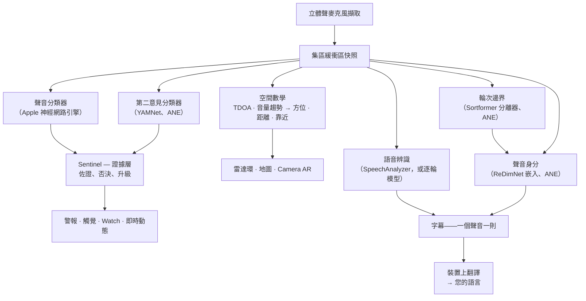
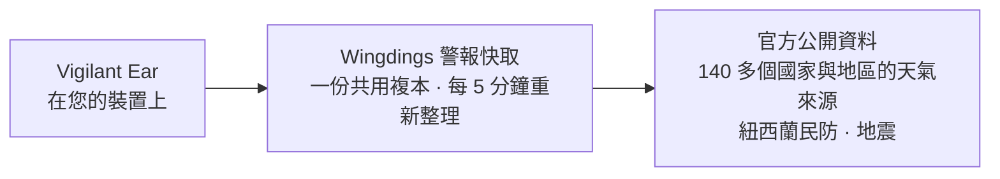

# Vigilant Ear 👂🛡️

*自版本 1.1.13 起生效 · 2026 年 10 月。*

## 給聽不見的人用的聲學雷達。

專為聾人、重聽與 CODA 社群打造的應用程式。多數聲音辨識應用程式告訴您的是聲音*是什麼*。**Vigilant Ear 告訴您它在哪裡、是誰發出的，以及他們在說什麼**——把 iPhone 變成一台裝置，在聲音發生的當下描述您周遭的聲音。

警笛的方向與距離。身後的一記敲門。對話裡的人，畫成各自轉寫的聲音——每一則都有字幕，也標出方向。若有人說的語言是您讀不懂的，那些話可以**翻譯成您的語言**再送到。警報會到您的**鎖定畫面、動態島與 Apple Watch**，看一眼就夠。

要緊的一切都在裝置上執行。音訊不會為了辨識而被錄下或上傳。沒有任何功能依賴人耳真的聽見什麼。

- 🧭 **不只是偵測，還有方向。** *是什麼、在哪裡、是誰，*以及*說了什麼*——不只是「有聲音發生了」。
- 📣 **叫到名字。** 把您的名字、孩子或伴侶列進去——「Marie 的餐點好了」會提醒手機與手錶，並指出方向。
- 🔒 **隱私是設計的一部分。** 分類、字幕與翻譯都在您的 iPhone 上執行。字幕是即時且短暫的；不會存成一份逐字稿檔案。
- ⌚ **在手腕上，也在鎖定畫面。** Apple Watch 的方向伴隨功能加上即時動態，讓上一則警報、以及它從哪個方向來，看一眼就知道。
- 🛰️ **多支手機，共享聽覺。** Constellation 網狀網路把具備 Ultra-Wideband 的 iPhone 連在一起，把各自聽到的融合成更清楚的方向圖像。
- 👁️ **為聾人／重聽／CODA 而做。** 分明的觸覺、高對比的視覺、不依賴顏色的提示、大的點按目標，並且全程遵循減少動態效果。

---

## 給誰用

- **聾人、重聽與 CODA 使用者**，想掌握周遭聲音的狀況——Home Watch（敲門、警報、嬰兒、電話）與 Street Watch（警笛、靠近）可以一直開著，也信得過。
- 任何需要**帶方向與說話者分離的即時字幕**，或需要把坐在附近的人**在裝置上翻譯**的人。
- 關心無障礙，以及對裝置上聲音定位有興趣的聲學研究使用者。

> Vigilant Ear 是無障礙**輔助**，不是經認證的生命安全裝置。

---

## 它做什麼

### 🧭 它看見聲音——方向與距離
Vigilant Ear 用 iPhone 的兩支麥克風，量出**聲音的角度，以及它在您前方還是後方**，把讀數穩在大約一度，並在航向朝上的雷達環與地圖上放成即時標記。同一直線上的兩支麥克風，自己分不出左右。您右側 50° 的聲音，和左側 50° 的聲音，抵達時的微小時間差是一樣的。應用程式會畫出讀數，再加上**另一側較淡的雷達鬼影**；轉一下手腕，或加上第二支手機，就能定下來。距離依響度、對照一條在街道上校正過的曲線來估計，並如實顯示成估計值，附上可能的範圍；單位跟著您所在的國家，而不是跟著您閱讀這個應用程式的語言。在美國的手機上，它會顯示 *≈ 50 ft*。您一移動，標記仍守在真實世界的位置。這就是核心：對一個您聽不見的世界，仍有空間上的感知。（數字見下方。）

### 🚨 它辨認重要的聲音——並警告您
裝置上的分類器能辨認數百種日常聲音，並盯著關鍵類別——**警笛、警報——含一個獨立的汽車警報類別——門鈴／敲門、嬰兒哭聲、附近有人，以及惡劣天氣。** 其中一項觸發時，您會看到清楚的螢幕警報、可選的**推播通知**，以及分明的**觸覺**——即使應用程式在背景執行，或手機在睡眠中，也一樣。關鍵類別預設就是就緒的，所以開啟通知並不表示「全部關掉」。把所有警報類別都關掉，引擎在背景時會完全休眠，以節省電池。**Sentinel** 層會拿獨立證據交叉核對警報——方向、移動，以及公開資料——所以發出的是經過佐證的，不是分類器單獨的猜測。它兩個方向都這樣：歌曲裡一段像警笛的片刻會先按住不發，但真正的警笛反覆穿過您的音樂時，會突破並發出警報。

惡劣天氣警告來自**超過 140 個國家與地區的政府官方來源**，而且常常再增加——所有使用者免費。民防的緊急警報也在其中，有自己的 **緊急警報** 開關。資料會收窄到涵蓋您所在之處的那些。在有提供的地方，應用程式也會讀各國氣象機構的**預先通報**——颱風或豪雨到來的前幾天發出的白話通知，而不只是危險已經來到才發的警告——以及瞬間豪雨與山崩通報。預先通知會安靜地顯示，不用保留給真正警告的聲音與震動。

### 🌧️ 地圖上的天氣雷達
雨和雪從應用程式一打開就顯示在地圖上——來自美國、加拿大、日本、義大利與歐洲大部分地區的國家雷達，以及涵蓋世界其餘大部分地方的衛星降雨估計。點一下地圖，過去一小時會重播三次，您就能看出暴風雨往哪裡移動；底部的刻度從淡到濃。若這一次您不想看，點一下天氣按鈕就能關掉。雷達和警告走同一條路——經過我們自己的伺服器，所以您的手機從不會聯絡政府伺服器。淺灰色箭頭也顯示風往哪裡吹，世界任何地方都有，取自 NOAA 對當前這一小時的全球預報。

### 🛟 該聯絡誰——救生圈
地圖羅盤旁的救生圈，會打開一份短清單，對應您正站著的這個國家：

- 緊急號碼，附通話與簡訊按鈕；在以簡訊聯絡緊急號碼可能行不通的地方，附上即時文字的說明
- 國家氣象機構
- 有穩定網頁的聾人組織
- Vigilant Ear 支援

從說明面板（救生圈）分享 Vigilant Ear：身邊的人掃描代碼就能取得 App，還有 App Store 連結和我們的 Instagram。

### ⌚ Apple Watch + 即時動態——看一眼就知道
- **Apple Watch 伴隨功能**——警報的方向標在您的手腕上，看一眼就知道往哪裡看。重新設計的 Watch 介面有應用程式的耳朵圖示、威脅 HUD 版面，輕點兩下即可關閉警報。即使 Watch 上的應用程式沒有開著，警報仍可顯示方向箭頭。
- **Apple Watch 上的「叫到名字」。** 有人叫你的名字時，手錶會輕點三下，並用箭頭指向聲音的方向。手機分不出左右時，會用扇形同時顯示兩側。iPhone 鎖定時也能使用，只要手錶上的 Vigilant Ear App 是開著的。「叫到名字」需要開啟 Speaker Mode。
- **即時動態**——Vigilant Ear 留在您的**鎖定畫面**、**動態島**與 **Apple Watch 的智慧型堆疊**，所以上一則警報和它的方位，永遠只差一眼。
- **手腕上的夥伴警報**——已連結的 Constellation 夥伴手機發出警報時，也能送到您的 Watch，方向一併帶來。伴隨功能一整天只用掉很少的 Watch 電池。

### 💬 Speaker Mode——即時、帶方向的字幕 *(免費)*
開啟 **Speaker Mode**，Vigilant Ear 會把您附近說話的人轉寫成**字幕區塊，一個聲音一塊。** 裝置上的說話者分離讓聲音保持分明——*誰*在說*什麼*——內環上有方向提示。正在說的人會被標亮；較舊的文字在需要空間時往上捲走。

**每位說話者用自己的語言。** 在記憶體至少 8 GB 的 iPhone 上，一次性下載字幕模型（約 1 GB——走 Wi-Fi，或在問過之後走行動網路）讓應用程式用實際說出的語言為每一輪上字幕，於是一間在英語、西班牙語、法語與阿拉伯語之間切換的房間也能懂。在我們的測試裡，四種語言對話的錯詞從約 80% 降到 14%。自版本 1.1.12 起，改進過的語音模型在噪音中少錯很多——在 iPhone 17 上、一間吵的酒吧裡，德文字幕裡錯的詞從 45% 降到 20%——並會在 Wi-Fi 上自己換掉舊的模型。沒有這次下載時——以及對中文、日文與韓文的讀者，因為 Apple 的辨識器讀得更好——字幕仍和以前一樣，使用 Apple 在裝置上的語音辨識。

多數字幕應用程式不會做的兩件事。

**對把握誠實。** 每一列有細微的品質標記，可疑的詞底下有虛線，告訴您什麼時候可以信這一行、什麼時候該再核對一次。

**自我校正。** 句子一落下，應用程式就帶著完整的上下文把音訊重讀一次，並能在幾秒內把漏掉或聽錯的詞補回來，然後文字凍結。

**叫到名字**（設定，在您開啟之前是關的）會在那些字幕裡盯著您列出的名字——您自己的、孩子的、伴侶的。有人說出「Marie 的餐點好了」時，您會得到分明的觸覺，以及帶方向的 Watch 警報，而不是又一顆字幕泡泡。那些詞仍會以說話的形式出現在 Speaker Mode 裡；這一記是在告訴您，他們是在*跟您*說話。

**粗話可以遮起來**（設定 → 字幕）。否則髒話會以明文到來，沒有任何東西把語氣放軟，讀的人也來不及先把視線移開；打開之後，那些詞會換成符號，句子仍然讀得通，只是沒有那個詞。算不算，由您裝置自己的語音辨識器決定——不是我們的一份詞表——所以它跟著正在轉寫的語言走。在聲明未滿 18 歲的帳號上，它一律開著，並顯示一把鎖。它適用於*這台*裝置所轉寫的語音；從配對的手機轉送過來的文字，是在那裡轉寫的，送到時已是完成的文字。

**說話者把力氣放在哪一個詞上，會以粗體標出。** 用英語說出來時，"I didn't say THAT" 與 "I didn't say that" 是兩個不同的句子，而一份一模一樣的逐字稿會把這個差別整個丟掉。應用程式盯著說話者把音高抬起來的那一個詞，並把它設成粗體——一行最多一個；不確定的時候就完全不標，因為標錯詞，等於主張那個人說了自己沒說過的話。在中文和日文裡關掉，因為那裡的音高告訴您的是*哪一個詞*，而不是那個詞被推得多用力。

字幕是免費的；自動翻譯是可選的 Power Pack+ 這一層。字幕也可以**朗讀到 Bluetooth 裝置，包括助聽器**——免費，在設定裡。**方向提示音**（同樣免費，在設定 → 字幕）在您選定的那一耳加上可選的聲音提示，指出說話者在哪裡——對助聽器或單側聽力有用，而且任何人都能用。

### 🌐 自動翻譯——您的語言，即時 *(Power Pack+)*
開啟 Speaker Mode 之後，附近的人若說另一種語言，Vigilant Ear 可以偵測出來，並把他們的字幕呈現**成您的語言**，來源語言標在他們的區塊上。這條鏈——聽見 → 分開說話者 → 轉寫 → 翻譯 → 顯示——**在裝置上**執行；唯一要用到網路的時刻，是從 Apple 一次性下載語言包。若您正在等的就是那次下載，應用程式會明說，而不是讓您對著還沒翻譯的文字乾看。您不必事先知道或選好另一種語言。一個說完的句子在結束的當下就翻譯，不必等說話者停下來，翻譯也在很短的時間內送到。

這是目前最接近**科幻裡的通用翻譯器**的東西——一種聽了就懂的裝置。Vigilant Ear 自己偵測語言，跟著房間裡的每一位說話者，並全部用您的語言加上字幕——不用耳機、不用設定，就在您的裝置上。

### 🎵 音樂與廣播感知 *(Power Pack+)*
**ShazamKit** 辨認您周遭正在播放的音樂，並自動偵測換歌，讓歌名保持在當下。

### 🎛️ Acoustic Scope——像工程師那樣看見聲音
以專業的方式即時觀看您周遭的聲音：頻譜、聲譜圖、⅓ 八度 RTA 頻帶、色度，以及諧波分音——**人人免費**。**Partials 讀音樂：** 每個音都以音名標出，旁邊是它的諧波列；較高的聲音，例如煙霧警報器，以真實音高命名；您也可以設一個目標音，畫成一條線，用來對著唱或調音。聲譜圖一直開著幾乎不耗什麼，無論您看多久。用來擷取聲音、訓練您自己的自訂聲音包的工具，屬於 Power Pack+。

### 📦 自訂聲音包——教它您的世界 *(Power Pack+)*
您可以教 Vigilant Ear 那些對您要緊的聲音——當地的鳥、建築物的門鈴聲、發電機異常的嗡鳴，或某一種飛機起飛。這些附加包疊在內建偵測之上，所以新的聲音絕不會把警笛和警報擠掉。應用程式裡內建了逐步指南。

### 🛰️ Constellation——多支 iPhone，共享聽覺 *(Power Pack+)*
有兩支或更多具備 Ultra-Wideband 的 iPhone（自 iPhone 11 起的大多數機型），**Constellation** 網狀網路會把它們配對，讓它們感知彼此的位置，並把各自聽到的融合成一幅更精確的單一圖像，指出聲音從哪裡來——一套分散式、被動的聆聽陣列。字幕也會融合：每支手機轉寫自己的麥克風聽到的，詞句在各手機之間對齊，讓最靠近說話者的那一支交出它所聽到的——只有一支手機抓到的詞會留下，而不是失掉。

手機**彼此直接相連**——不需要路由器、不需要共用的 Wi-Fi 網路，也不需要網際網路；Wi-Fi 只要開著即可。它們用的是 AirDrop 所用的同一種點對點連線，只有硬體相符的手機才能加入。手機之間的連線始終加密；執行 Vigilant Ear 1.1.6 或更舊版本的手機，需要先更新應用程式，才能加入這個網狀網路。

**夥伴訊息**——傳一則短訊到網狀夥伴的手機；它會落進對方的字幕流，也可以在裝置上翻譯成對方的語言再送到。傳訊會看年齡：以 Apple 的 Declared Age Range 為基礎，成年人和未成年人之間的傳訊保持關閉，除非雙方都刻意指名了彼此。警報和字幕從不設門檻——只有人和人之間的傳訊會。

### 🔗 Remote Link——聯絡不在您身邊的人 *(開始時需要 Power Pack+)*
平常一通電話會做的事，改用視訊和文字來做。您送出一組邀請碼；對方從 Vigilant Ear 裡面加入，**不必擁有 Power Pack+**。和 Constellation 不同，沒有必須靠近的要求——您們兩人可以在任何地方。

**任何時候都不用音訊。** 只有視訊和文字，所以這條連線的任何部分都不依賴任何一端聽得見——也讓您能透過應用程式和某人打手語。應用程式本身不懂手語；它負責把視訊送過去，其餘由您們兩人來。只要網路允許，連線就在兩支手機之間直接建立，應用程式也會明白顯示是 **Direct** 還是 **Relayed**，所以您始終知道自己的視訊有沒有經過中繼。

**字幕也一起走。** 每支手機轉寫的內容會出現在另一支上，需要時翻譯成閱讀者的語言。您們任何一方都可以暫停這條連線——視訊和字幕——再恢復，並從主畫面掛斷。

### 📷 Camera AR——「看見聲音」
從操作扇打開 Camera AR，把偵測到的聲音釘在即時相機畫面裡的真實方位上。標記依說話者聚集，或依聲音類別與方向聚集，畫面才讀得清楚；一個聲音一直安靜時，標記會淡去。

### 🗺️ 地圖、道路與路徑預測
聲音的方位會投影到地圖上真實的 GPS 座標。車輛的聲音可以**吸附到附近的街道**，路徑也能預測，所以經過的卡車讀起來是*沿著道路*在動，而不是穿過建築物。（可在 Feature Playground 試試消防車示範。）

### 🪄 Feature Playground——不用耳朵也能證明
**Feature Playground** 對每個人公開：Home 與 Street 的範例警報（敲門、警報、嬰兒、警笛、天氣），以及多支手機與對話的示範。這些都有清楚的浮水印，所以練習絕不會假裝自己是即時事件。關掉面板會把示範乾淨地拆掉（沒有卡住的 GPS 偽裝，也沒有留下的旗標）。

### ♿ 無障礙優先
為聾人／重聽／CODA 以及色盲使用者而做：

- **不依賴顏色**的提示
- **≥44 pt** 的點按目標
- 遵循 **減少動態效果**
- 給阿拉伯文讀者的**由右至左版面**
- 多模態警報（觸覺 + 視覺 + Watch）
- 啟動時的驗證畫面，以清楚的綠／灰／紅顯示權限狀態，「不允許」用焦橙色，其中包括充當警報總開關的通知授權

---

## 免費與 Power Pack+

安全核心**免費，而且永遠免費**：

- **Home Watch 與 Street Watch**——本地的聲音警報（警報、警笛、敲門／門鈴、嬰兒、附近有人），以螢幕、觸覺，以及可選的推播送達。
- **即時字幕**——Speaker Mode，在裝置上，硬體允許時帶方向，有誠實的把握標記、約 2 秒的自我校正、可選的朗讀輸出到 Bluetooth 裝置（包括助聽器），以及方向提示音。
- **叫到名字**——您輸入的可選名字（您的、孩子、伴侶）。相符時是帶方位的 Watch／手機警報，不是第二則字幕。
- **Standing Watch**——房間自己的狀態，永遠開著，沒有什麼要設定：房間維持它的樣態時，是一盞穩定的青色燈；有變化時轉為琥珀色——新的說話聲、突然安靜，或有東西正在靠近。應用程式啟動時，會告訴您有多久沒有在聽警報。
- **惡劣天氣警報**——針對您所在地區的官方警告，來自超過 140 個國家與地區的政府來源，而且常常再增加。
- **天氣雷達**——地圖上的雨和雪，可重播過去一小時，以及風往哪裡吹。
- **救生圈**——在您所在的國家該聯絡誰。
- **地震警報（全球）**——附近回報地震時，您會感到一陣震動，並在地圖上看見感受到搖晃的區域。這是官方地震資料的確認——不是預警：若您感覺到搖晃，它告訴您那是什麼。資料每五分鐘檢查一次，在背景也一樣；裝置上的低沉轟鳴（次聲波）感測，可以在地面一動的當下預備一次額外檢查。
- **Feature Playground**——練習警報與功能預覽，帶有清楚的 PREVIEW 浮水印。
- **Apple Watch 伴隨功能與即時動態**——一眼就能看到的方向與上一則警報。
- **Acoustic Scope**——專業級的即時聲音視覺化，人人免費。（為訓練而擷取的工具屬於 Power Pack+。）
- **研究陣列** *(在您關掉之前一直開著)*——開著的時候，會分享時間、粗略位置（約 1 公里），以及類地震事件的頻率——沒有音訊、沒有識別碼——用來幫忙繪製地震與其他低頻事件。地圖上的一個問題只問一次。報告會等到那個問題已經出現在螢幕上才送出。

**Power Pack+** 是一次性解鎖（**不是訂閱**），並附 **90 天免費試用**。它加上這些超能力：

- **自動翻譯**——把附近的語音在裝置上翻譯成您的語言。
- **Constellation**——多支 iPhone 透過 Ultra-Wideband 共享聽覺，並有夥伴訊息。
- **Music ID**——ShazamKit 的歌曲辨識。
- **自訂聲音包**——您為自己的聲音訓練的附加分類器。
- **Remote Link**——和沒有在您身邊的人進行私人的視訊與文字通話，任何時候都沒有音訊。發起一方需要 Power Pack+；您邀請的人免費加入。

不論免費或 Power Pack+，**供辨識用的音訊都留在您的裝置上**——等級只改變哪些功能被解鎖，從不改變原始音訊被送到哪裡去做分析。

---

## 它怎麼運作（裡頭）

Vigilant Ear 是一條**以本地為先、在裝置上**分層建立的管線：擷取一次，再讓各自獨立的專責部分讀同一段聲音，並互相檢查。原始音訊在高優先權的擷取點取得，複製進**集區緩衝區的空閒清單**（即時路徑上不會因反覆配置記憶體而抖動），再分送出去，不讓介面停住：

沒有任何單一模型被單獨信任。**Sentinel** 層位於偵測與發出警報之間：獨立的引擎逐幀互相佐證或否決——而當反覆出現的真實證據堆起來、反對一次否決（真正的警笛穿過您的音樂長鳴），證據勝出，警報就發出。

字幕有自己的第二次機會。每一句已定稿的句子，都會帶著完整上下文，從記憶體裡短短一段環形音訊安靜地重讀——校正大約在兩秒內落下，然後文字就永久凍結：

- **空間數學**——FFT、以相干性加權的抵達時間差（TDOA——優先採用兩支麥克風都同意的頻帶，再把微小的抵達延遲轉成方位），以及在背景工作裡依音量趨勢追蹤是否靠近。麥克風對以固定朝向讀取，所以不論您把手機直著拿或橫著拿，方向都一樣。
- **語音**——轉寫使用 iOS 26 的 `SpeechAnalyzer`／`SpeechTranscriber`；裝置上的翻譯使用 Apple 的 **Translation** 框架。有了可選的字幕下載之後，每一輪由語音活動偵測器切開，語言由口語語言模型揀出，再由開放的語音辨識模型轉寫——一個負責歐洲語言，一個負責其餘語言——全部在裝置上。聲音身分以證據為本：一個聲音只有從彼此獨立的聲音視窗被確認，才算是真人；不確定的相符顯示為未歸屬，而不是猜一個錯的名字。
- **兩個問題，兩個模型**——把聲音分開，要知道*說話者是何時換的*，以及*那位說話者是誰*，這兩件事不是同一個問題。**Sortformer** 串流分離器標出輪次邊界；**ReDimNet** 嵌入決定每一段裡是誰的聲音。沿著邊界切開，比聽起來更要緊：一個橫跨兩個人的視窗同時含有兩人，之後沒有任何嵌入模型能把它拆開。兩者底下都有一層語音活動的底線——若分離器在難處理的房間裡寧願安靜、也不猜測，輪次仍會被切開，所以應用程式是降級，而不是把兩位說話者混成一個。
- **音樂的實情**——色度**歌曲特徵偵測器**負責「真的有音樂在播嗎？」這個判斷，因為一般分類器出了名地會把安靜的房間和警笛叫成「音樂」。只有特徵同意那裡真的有音樂性的東西，Shazam 才會執行。
- **並行**——Swift 6 的隔離把麥克風擷取、聲學數學，以及介面繪製迴圈乾淨地分開。
- **效率**——降取樣、依負載調整的分類，以及由證據把關的網路使用，讓一直聽著也輕得可以開著不關。

天氣與地震警報走的路和音訊相反——關於您聲音的任何東西都不會出去，但警報*資料*會進來。**每一份**官方來源——以及雷達與風的圖像——都流經我們營運的一個小中繼快取，所以公開資料抓一次就能服務每一位使用者，而您的手機從不會聯絡政府伺服器：

---

## 您的手機聽得到什麼——實測

您的 iPhone 有兩支相距約六英寸（15 cm）的麥克風、一個氣壓計，以及一個非常準的時鐘。這就足以告訴您聲音從哪個方向來、大約多遠、是否正朝您過來，以及門是不是剛打開。以下是每一項有多準、我們如何查核，以及若您自己聽不見那個聲音，為什麼這要緊。方向表是 2026 年 9 月在一支 iPhone 17 上量的。同一項桌面檢查，在 iPhone 16 Pro Max 上並沒有得出連續的角度——那幅影像會把聲音吸向前方或吸向側邊——所以以度計的那些列只屬於 17。距離依其本性仍是估計——我們在螢幕上如此說明。本節以捲尺量得的距離以英尺計，也就是那條捲尺的單位。

**方向——到幾度之內。** 聲音會先到達上方的麥克風、再到底下那一支，或是反過來；應用程式從那個差距算出聲音偏離手機軸線多遠，以及它在前方還是後方。手機的兩個聲道不是單純的麥克風，而是處理過的立體聲影像；房間一吵，那幅影像就會加上它自己固定的圖樣。應用程式從啟動之後的安靜裡學會這個圖樣。安靜的房間大約過了一分鐘，它會在讀方向之前把圖樣去掉；在那之前，讀數不做這項校正。

| 我們量了什麼 | 結果 |
|---|---|
| 96 間模擬房間的誤差中位數，從安靜的辦公室到 5 dB SNR 的硬牆房間 | 1.0° |
| iPhone 17 放在桌上，房間噪音開著，喇叭偏離軸線 30° | 從側面平面讀到 61.7°，預期為 60°，晃動 1.6° |
| 同上，喇叭正對手機的側面 | 讀到 4.5°，預期為 0°，晃動 2.2° |
| 同上，喇叭偏離軸線 60° | 中位數 35.7°，預期為 30°；這次量測分成兩群，第二群落在正前方的延遲，最可能是測試架的反射 |
| 同上，喇叭在正前方 | 每一次讀數都在最大延遲，正如應有的樣子 |
| 讀數落在影像自己的圖樣上，而不是落在聲音上 | 沒有，任何角度都沒有 |

*為什麼要緊：* 若您聽不見警笛，「在您後方，偏到一側」會告訴您往哪裡看。一個穩得住的讀數，要對過捲尺才值得信任，而這一個對過兩次。第一次核對，讓結果看起來比實際上更好。

**距離——如實顯示為估計。** 一支麥克風量不到距離，只能量響度；遠處很響的卡車，可以聽起來像近處安靜的汽車。應用程式用一條在真實街道上擬合的曲線，從響度估計距離，然後像謹慎的人那樣說出來。在美國的手機上，那是 *about 50 ft, likely between 25 and 100.*

| 我們量了什麼 | 結果 |
|---|---|
| 真實車輛偵測經校正重播 | 1,131 |
| 落在它們實際所在的那條 100-foot 道路以內 | 73% |
| 遠車道的車 | 估計為 78 與 87 ft，捲尺所寫為 73 與 85 ft |

那條路（一個城市路口）是一條車道、一條車道量的；曲線若有偏差，會偏在近的一側。校正被一項自動化測試鎖住，所以不會悄悄漂移。您自己空間裡的警報，例如煙霧偵測器，完全不給距離數字——它們已經和您在同一個房間。

**移動——朝您而來。** 對汽車和警笛而言，變響通常表示變近。應用程式看一個聲音的音量在幾秒內上升多快：持續爬升約每秒 1.5 dB（清楚而穩定地變響）表示正在靠近，對等的下降表示正在離開；一個不再變化的聲音，大約四秒之後就不再被稱作其中任何一種。單獨一個很響的片刻——按一下喇叭、摔上一扇門——不能觸發它。它建立在物理與九項自動化測試之上；一段錄下的街道經過，是下一項實地確認。

**房間裡的空氣——門有它的特徵。** 氣壓計可以注意到約十四英尺（4.3 m）外有門打開：門一轉開，氣壓下陷，關上時又回彈。在十四小時的安靜與十五次門事件裡，每一扇門都做出那個兩段的形狀，屋子裡沒有別的東西這樣。

| 事件 | 氣壓變化率 | 形狀 |
|---|---|---|
| 前門，打開再關上，×10 | 0.6–1.8 Pa/s | 先下陷，再回彈，相隔約 5 秒 |
| 前門，摔上，×5 | 1.1–2.5 Pa/s | 同一對，更高 |
| 空調整夜循環，×8 | 0.11–0.46 Pa/s | 以分鐘計的緩慢爬升，兩支手機相同 |
| 安靜的房間 | ~0.02 Pa/s | 什麼都沒有 |
| 人的活動，走過 | — | 運動感測器注意到，手機則忽略它 |

封不住房間的門是看不見的——這次測試用的是紗門——正如它所應當。今天，氣壓的變化可以在地圖上顯示為低沉轟鳴；專用的安靜夜晚門警報已經量過、也設計好了，但還不是日常的預設。

**Constellation——兩支手機定出左右。** 網狀網路上的每支手機，從自己所在之處朝聲音畫一條線，而這些線只會在其中一側乾淨地相交。相交的時候，鬼影消失，應用程式可以再次說出左或右。在模擬裡，相距 **40 公尺** 的兩支手機，把 50 公尺外的警笛定在大約 2 公尺以內。

**這裡的任何數字要怎樣才被相信。** 每一個數字都按順序走過同樣的三道關：一間事先知道答案的模擬房間；小型的自動化測試，重現正好會騙過應用程式的那個情況，而且每一次變更都跑；然後是真的手機放在真的桌上，距離用手量。沒有通過第三道，就不算準確。對聽不見那個聲音的人來說，應用程式說的就是唯一的一句話——這句話該像實驗室那樣掙來。

給工程師的更深入筆記：[物理](https://vigilantear.com/en/physics/)——TDOA、距離、移動、Constellation，以及氣壓偵測，每一項數字都標著 MEASURED / BENCHED / MODELLED。

---

## 隱私

- **核心管線始終在裝置上。** 分類、空間數學、轉寫、說話者分離與翻譯，都在您的 iPhone 上執行。原始音訊不會為了辨識而被錄下或上傳。
- **字幕是短暫的。** 即時字幕在該次使用期間留在記憶體裡；匯出的除錯紀錄不包含字幕文字。
- **沒有廣告或行為分析 SDK。** 有限的網路使用只用於地圖、公開的天氣資料、雷達與風的圖像、求助清單、可選的字幕模型下載、可選的 Shazam 指紋、道路情境、該功能開著時的研究陣列報告，以及 App Store 購買——詳情見我們的隱私權政策。

完整說明：[隱私權](/zh-Hant/privacy/) · [條款](/zh-Hant/terms/) · [支援](/zh-Hant/support/)

---

## 硬體與平台

- **iPhone（完整體驗）。** 直向或橫向都可以——您喜歡怎麼拿就怎麼拿。找方向需要立體聲麥克風。建議 **iPhone 13 或更新的機型**；要以每位說話者的語言上字幕，需要 **8 GB 記憶體**（iPhone 15 Pro 與之後）。
- **Apple Watch。** 帶方向箭頭的伴隨警報；可與即時動態／智慧型堆疊一起使用。
- **iPad（原生）。** 會自己適應的版面：在大螢幕上，即時字幕在地圖旁邊有一塊透明面板，沒有人說話時就收起來。單聲道麥克風 → 有字幕，但沒有完整的方向。
- **Constellation** 需要 **Ultra-Wideband**——iPhone 11 或之後，不含 SE 與「e」機型。它**不**需要 Wi-Fi 網路：只要 Wi-Fi 開著，手機就會直接發現彼此，所以只要手機互相靠近，Constellation 不需要路由器、也不需要網際網路就能運作。
- **Android（可用時）。** 獨立的版本，具備核心雷達、警報、字幕與天氣；Constellation 網狀網路以 iOS 為先。

---

## 在地化

完整在地化——介面、警報與字幕——涵蓋**英語、西班牙語、葡萄牙語（巴西）、法語、德語、義大利語、土耳其語、阿拉伯語、日語、簡體中文、繁體中文、韓語、俄語、印地語、羅馬尼亞語與波蘭語**（16 種語言）。跟隨系統的語系，或在應用程式裡手動選擇。羅馬尼亞語的字幕在裝置上可以運作；Apple Translate 沒有羅馬尼亞語，所以自動翻譯對這個語言顯示原文。

---

## 狀態與免責聲明

Vigilant Ear 是一項**實驗性的聲學無障礙輔助**，不是經認證的生命安全公用設施。定位的解析度會隨周遭環境、天氣、風，以及麥克風硬體而變。**請始終保持您平時對環境的警覺**——不要把它當成您唯一的安全資訊來源。

有些能力（相機 AR 標記、Apple 授予時的重要提示權限升級、進階的多聲音包編寫）會繼續演進；免費的 Home／Street 監看與即時字幕，是您從第一天起就可以信賴的產品。

**來源與授權：** [api.vigilantear.com/sources](https://api.vigilantear.com/sources)

---

**聯絡：** [vigilantear@wingdingssocial.com](mailto:vigilantear@wingdingssocial.com)

用 ❤️ 為聾人／重聽社群與聲學研究而做。

    
  <strong>© 2026 Wingdings, Inc.</strong> 
  保留所有權利。 
  多項專利申請中

